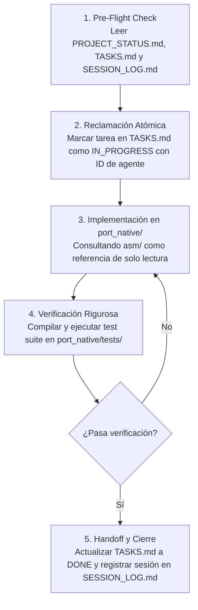

# Mighty Bomb Jack Native Port - Agent Operational Constitution

Este archivo define las reglas globales, permisos de directorios, roles de agentes y el protocolo del **Sistema de Memoria Persistente**. Todos los orquestadores, subagentes y herramientas automáticas que operen en este workspace deben cumplir estrictamente estas directrices.

---

## 1. Gobernanza de Directorios y Permisos

```
+---------------------------------------------------------------------------------------------------+
|                                       WORKSPACE ROOT (mjk/)                                       |
|                                                                                                   |
|  [READ-ONLY REFERENCE]                                   [READ-WRITE WORKSPACE & TARGET]          |
|  +--------------------+                                  +--------------------+                   |
|  |       asm/         | <-- Golden Ground Truth          |   port_native/     | <-- Port C/C++    |
|  |  (Atributo +R OS   |     (Disassembly 6502)           |  (Compilador MSVC, |     Tests, Assets |
|  |   + Regla AGENTS)  |     Inmutable                    |   CMake, Tests)    |                   |
|  +--------------------+                                  +--------------------+                   |
|                                                                                                   |
|  [PERSISTENT RESEARCH & KNOWLEDGE BASE]                                                           |
|  * research/          -> Base de conocimiento e investigaciones de ingeniería inversa (R/W)       |
|    - INDEX.md         -> Índice maestro de investigaciones y catálogo técnico                     |
|    - TEMPLATE.md      -> Plantilla estandarizada para informes de investigación                   |
|    - RES-*.md         -> Informes técnicos con datos extraídos de asm/ y análisis del port        |
|                                                                                                   |
|  [AUTOMATION & ANALYSIS TOOLS]                                                                    |
|  * tools/             -> Scripts reutilizables de análisis estático, extracción y auditoría (R/W) |
|                                                                                                   |
|  [PERSISTENT MEMORY LEDGER - SINGLE SOURCE OF TRUTH]                                              |
|  * AGENTS.md          -> Reglas del workspace, permisos, roles y protocolo operativo              |
|  * TASKS.md           -> Matriz formal de tareas (TODO / IN_PROGRESS / VERIFICATION / DONE)       |
|  * PROJECT_STATUS.md  -> Estado actual del port, hito activo, métricas de paridad y salud         |
|  * DECISIONS.md       -> Registro de Decisiones de Arquitectura (ADR) técnicas e invariantes     |
|  * SESSION_LOG.md     -> Handoff y bitácora continua entre sesiones y agentes                     |
|                                                                                                   |
|  [MEDIA ASSETS]                                                                                   |
|  * Mighty-Bomb-Jack-original.mp4                                                                  |
|  * Mighty-Bomb-Jack-Port.mp4                                                                      |
+---------------------------------------------------------------------------------------------------+
```

### Reglas de Acceso:
1. **`asm/` -> SOLO LECTURA (READ-ONLY)**:
   - Contiene el desmontaje original del cartucho NES de 1987 (*Tecmo*).
   - Es la **Fuente de Verdad Absoluta** (Golden Ground Truth).
   - **PROHIBICIÓN ESTRICTA**: Ningún agente ni proceso debe intentar crear, modificar, renombrar ni eliminar archivos dentro de `asm/`. Toda operación sobre `asm/` debe ser de lectura/inspección.
2. **`port_native/` -> LECTURA Y ESCRITURA (READ-WRITE)**:
   - Contiene la implementación nativa en C/C++, headers, scripts de construcción (`CMakeLists.txt`, `build.bat`), assets y suites de pruebas en `port_native/tests/`.
   - Área de trabajo principal de los agentes desarrolladores.
3. **`research/` -> LECTURA Y ESCRITURA (READ-WRITE)**:
   - Base de conocimiento técnico permanente. Contiene el índice maestro `research/INDEX.md`, plantilla `research/TEMPLATE.md` e informes técnicos `research/RES-*.md`.
   - Todo hallazgo de ingeniería inversa, tablas de constantes de `asm/`, layouts y análisis comparativos debe registrarse aquí.
4. **`tools/` -> LECTURA Y ESCRITURA (READ-WRITE)**:
   - Contiene scripts y herramientas reutilizables de análisis estático, extracción de símbolos, grafos de llamadas y automatización de auditoría sobre `asm/` y `port_native/`.
5. **Raíz (`./`) -> LECTURA Y ESCRITURA (READ-WRITE)**:
   - Reservada exclusivamente para los archivos del **Sistema de Memoria Persistente** (`AGENTS.md`, `TASKS.md`, `PROJECT_STATUS.md`, `DECISIONS.md`, `SESSION_LOG.md`) y los videos de referencia `.mp4`.
   - **PROHIBICIÓN**: No contaminar la raíz con archivos `.obj`, ejecutables temporales ni scripts de un solo uso (todo script o herramienta debe residir en `tools/`).

---

## 2. Principio de Independencia de Contexto

> **REGLA DE ORO**: No depender bajo ninguna circunstancia del directorio `.agents` ni de memorias volátiles de sesión para registrar el estado de las tareas o el diseño del proyecto.

- Toda tarea, decisión, bloqueo, progreso o handoff debe quedar inmediatamente formalizado en los archivos de memoria persistente en la raíz.
- Si un flujo de trabajo se cancela, se pausa o se resetea el contexto del modelo, cualquier nuevo orquestador o subagente podrá retomar el trabajo en menos de 30 segundos leyendo los archivos persistentes.

---

## 3. Protocolo Operativo Obligatorio (Ciclo de Vida)

Todo agente (sea el orquestador principal o un subagente especializado) debe seguir obligatoriamente este protocolo de 5 fases:



### Fase 1: Pre-Flight Check (Inspección Previa)
Antes de ejecutar cualquier comando o editar código, determinar la modalidad de arranque:
- **Modalidad A (Nueva Sesión / Nuevo Hito / Nueva Tarea Mayor)**:
  1. Leer `PROJECT_STATUS.md` para conocer el hito actual y componentes prioritarios.
  2. Leer `TASKS.md` para identificar tareas activas (`IN_PROGRESS`), bloqueadas (`BLOCKED`) o pendientes (`TODO`).
  3. Leer la última entrada de `SESSION_LOG.md` para contexto general.
  4. Si la tarea involucra mecánicas originales o ingeniería inversa, consultar `research/INDEX.md`.
- **Modalidad B (Reanudación de Micro-Lote o Tarea Interrumpida / Pausada)**:
  - **Aplica estrictamente el Protocolo Quirúrgico de Reanudación (Sección 6.3)**: No leer archivos generales ni explorar directorios. Leer únicamente el bloque `CHECKPOINT ACTIVO` de la tarea en `TASKS.md` o la última entrada de `SESSION_LOG.md`, abrir las líneas exactas señaladas mediante `read_file` acotado, y ejecutar inmediatamente el siguiente micro-paso.

### Fase 2: Reclamación Atómica de Tarea
- Ningún agente puede empezar a escribir código sin reclamar una tarea en `TASKS.md`.
- Se cambia el estado de `[TODO]` o `[PAUSED]` a `[IN_PROGRESS]` indicando el rol/nombre del agente y la fecha.
- Esto evita colisiones y duplicidad de trabajo cuando operan múltiples subagentes.

### Fase 3: Implementación e Investigación Controlada
- Todo cambio de código debe realizarse dentro de `port_native/`.
- Toda investigación, extracción de tablas, decodificación de datos o análisis de paridad debe documentarse en `research/RES-###-<slug>.md` siguiendo `research/TEMPLATE.md`.
- La lógica debe calcar exactamente los algoritmos y constantes hallados en `asm/src/` (física de salto, tablas de senos/cosenos, BCD score, temporizadores en frames a 60 Hz).

### Fase 4: Verificación Rigurosa (Definition of Done)
Una tarea **NO** está terminada simplemente porque el código haya sido escrito:
- Debe compilar sin warnings/errores críticos.
- Debe contar con un test unitario o de integración ejecutable (en `port_native/tests/`).
- Debe registrarse el resultado del comando de prueba en el reporte.

### Fase 5: Handoff y Persistencia Inmediata
Al completar una tarea, un lote pequeño, o **antes de agotar el turno/pausar/ser interrumpido**:
1. Actualizar `TASKS.md`:
   - Si la tarea se completó: Marcar como `[DONE]` e incluir fecha y test verificado.
   - Si la tarea fue parcial/interrumpida: Mantener como `[IN_PROGRESS]` o `[PAUSED]` y registrar el bloque **Checkpoint Activo** con el último subpaso completado y la siguiente micro-acción inmediata.
2. Actualizar `research/INDEX.md`: Registrar cualquier nueva investigación técnica generada en la sesión.
3. Actualizar `PROJECT_STATUS.md`: Si se avanzó en un hito o se corrigió un componente.
4. Registrar entrada en `SESSION_LOG.md`:
   - Agente responsable.
   - Resumen del micro-lote ejecutado.
   - Archivos modificados en `port_native/` y `research/`.
   - Pruebas superadas o pendientes.
   - **Punto de reanudación exacto** (archivo, función, línea, siguiente comando).

---

## 4. Roles y Dinámicas de Colaboración

- **Orquestador**:
  - Descompone requerimientos globales del usuario en tareas y micro-lotes atómicos en `TASKS.md`.
  - Prioriza y coordina a los subagentes, pasando prompts ultra-acotados con micro-contratos (Sección 6.4).
  - Vela por la coherencia global y la actualización de `PROJECT_STATUS.md` y `SESSION_LOG.md`.
- **Implementador / Worker (C Engine)**:
  - Invocado con `invoke_subagent(TypeName="self", Role="C Engine Worker")`.
  - Hereda herramientas de edición y ejecución para operar en `port_native/`.
  - Lee especificaciones y desmontaje en `asm/` (solo lectura).
  - Asegura paridad binaria y matemática con la versión NES.
  - Al concluir su micro-lote, devuelve el resumen con formato de Checkpoint.
- **Auditor / Tester (Verification Specialist)**:
  - Invocado con `invoke_subagent(TypeName="self", Role="Verification Specialist")`.
  - Crea pruebas headless y suites de verificación en `port_native/tests/`.
  - Compara métricas contra los videos de referencia (`Mighty-Bomb-Jack-original.mp4` vs `Mighty-Bomb-Jack-Port.mp4`).
  - Aprueba el paso de tareas a `[DONE]` o reporta discrepancias.
- **Investigador (Reverse Engineering Researcher)**:
  - Invocado con `invoke_subagent(TypeName="research", Role="Reverse Engineering Researcher")`.
  - Dispone de herramientas de solo lectura para inspeccionar `asm/` y generar informes técnicos en `research/`.

---

## 5. Reglas Técnicas del Port Nativo (`port_native`)

1. **Paridad 1:1 con 6502**:
   - Variables críticas de juego (subpíxeles, timers, contadores BCD, tabla de física de salto) deben replicar fielmente los valores del código de `asm/src/`.
2. **Determinismo a 60 Hz**:
   - La lógica de actualización del juego corre a 60 ticks por segundo fijos (`dt = 1/60s`), desacoplada de la tasa de refresco del monitor si fuera necesario.
3. **Manejo de Memoria Limpio**:
   - C estándar portable (C99/C11). Evitar memory leaks o punteros colgantes en el ciclo de vida del juego.

---

## 6. Protocolo de Micro-Lotes y Reanudación de Bajo Coste de Tokens

Para garantizar que cualquier interrupción (por límite de contexto, pausa de usuario o error de red) no provoque un re-gasto masivo de tokens al reanudar, se establecen las siguientes reglas obligatorias:

### 6.1 Regla del Micro-Lote (Micro-Batching Rule)
- **Prohibición de Tareas Monolíticas**: Ninguna tarea en `TASKS.md` puede abarcar múltiples subsistemas a la vez.
- **Criterio de Atómicidad de Micro-Paso**:
  1. Alcance acotado: Máximo 1 función o subsistema específico.
  2. Archivos limitados: Modificar o crear un máximo de 1-2 archivos por micro-paso.
  3. Verificación inmediata: Cada micro-paso debe concluir con una comprobación rápida (compilación o test unitario específico).
  4. Duración corta: Diseñado para completarse en un único turno de ejecución.

### 6.2 Checkpoints Persistentes en `TASKS.md`
Toda tarea activa (`[IN_PROGRESS]`) o pausada debe incluir una sección visible de **Subpasos (Micro-lotes)** con checkboxes y un bloque de **Checkpoint Activo**:

```markdown
#### Subpasos (Micro-Lotes)
- [x] 1. Definir estructuras en `player.h`
- [x] 2. Implementar tabla de aceleración en `player.c`
- [ ] 3. Escribir test unitario en `tests/test_player.c`
- [ ] 4. Ejecutar suite y verificar paridad 60 Hz

> **CHECKPOINT ACTIVO (Última actualización: YYYY-MM-DD HH:MM)**
> - **Último subpaso completado**: Subpaso 2.
> - **Archivos modificados**: `port_native/src/player.c:45-80`.
> - **Estado de compilación**: Compila OK.
> - **Siguiente micro-acción inmediata**: Abrir `port_native/tests/test_player.c` y añadir función `test_player_acceleration()`.
```

### 6.3 Protocolo Quirúrgico de Reanudación (Resume Protocol)
Cuando un agente u orquestador se despierta o toma el control tras una interrupción:
- **PROHIBIDO**: Hacer exploraciones generales de directorios, listados recursivos o lecturas completas de archivos no relacionados.
- **SECUENCIA OBLIGATORIA (Máx ~500 tokens de contexto inicial)**:
  1. Leer **únicamente** la última entrada de `SESSION_LOG.md` (o el bloque `CHECKPOINT ACTIVO` de la tarea en `TASKS.md`).
  2. Leer **únicamente** las líneas exactas señaladas en el checkpoint mediante `read_file` acotado (indicando `StartLine` y `EndLine`).
  3. Ejecutar inmediatamente la acción descrita en "Siguiente micro-acción inmediata".

### 6.4 Contratos de Micro-Lote para Subagentes (Worker Micro-Contracts)
Cuando el orquestador delegue trabajo en un subagente:
1. **Prompt Ultra-Acotado**: Pasar únicamente el contexto imprescindible (objetivo único, rutas exactas de los 1-2 archivos a tocar, y comando de verificación).
2. **Entrega con Checkpoint**: El subagente debe retornar obligatoriamente un resumen con el formato de Checkpoint (subpaso concluido, archivos y líneas tocadas, test corrido, y siguiente paso propuesto).
3. **Persistencia Inmediata por el Orquestador**: Antes de responder al usuario o invocar al siguiente subagente, el orquestador vuelca este checkpoint en `TASKS.md` y `SESSION_LOG.md`.
