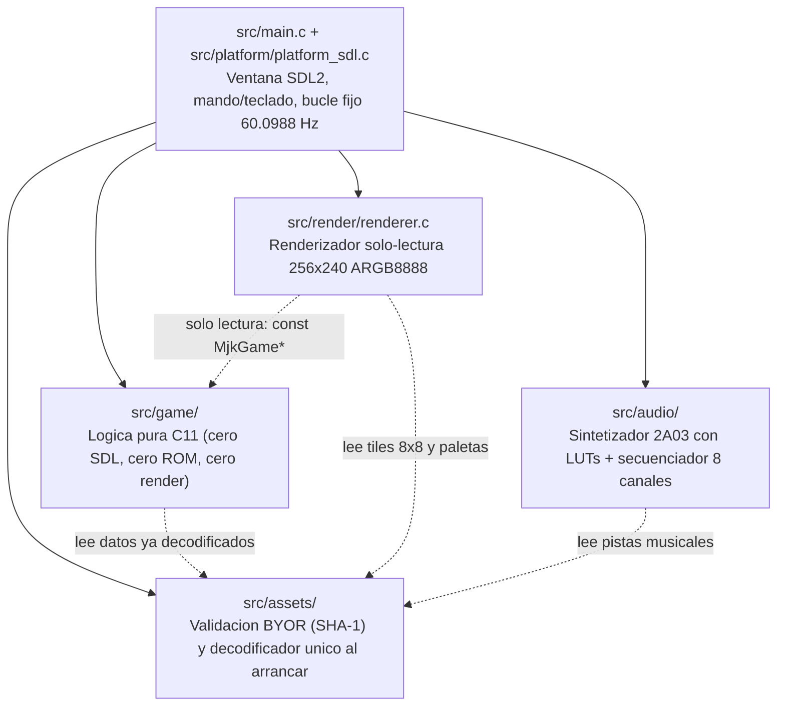

# Arquitectura Técnica — Mighty Bomb Jack (C11 Moderno)

Esta guía explica la estructura del motor de **Mighty Bomb Jack (`REV_US`, 1987)** escrito en **C11 estándar**. El diseño prioriza la **legibilidad, el rendimiento y la separación limpia de responsabilidades**, sin arrastrar convenciones del ensamblador 6502 ni código de depuración en el ejecutable final.

---

## 1. Visión General por Capas

### Reglas Fundamentales del Diseño
1. **Patrón Traductor en la Frontera (`src/assets/`)**: Solo `src/assets/` conoce el formato binario de `mbj-us.nes` y `assets/assets.dat`. Al iniciar, decodifica una sola vez gráficos, tablas de física (`float`), puntuaciones (`uint32_t`), textos y las 256 salas.
2. **Lógica Pura (`src/game/`)**: Cero llamadas a SDL2, cero direcciones de ROM, cero BCD empaquetado, cero punto fijo Q8.8 manual y cero escrituras a PPU/OAM.
3. **Renderizador Solo-Lectura (`src/render/`)**: `MjkRenderer_DrawFrame(const MjkGame*, const MjkAssets*, uint32_t*)` nunca modifica el estado del juego.
4. **Cero Alocaciones en Partida**: No existe ningún `malloc`/`free` dentro del bucle de juego.

---

## 2. Ciclo de un Frame (`60.0988 Hz`)

En `src/main.c`:
1. **Lectura de entrada (`MjkInputLatch`)**: `MjkPlatform_PollRawButtons()` lee teclado y mando y acumula los flancos de subida/bajada en `MjkInputLatch`. Así, un frame rápido sin pasos de simulación no pierde pulsaciones (`A`, `Start`, `B`) y un frame de *catch-up* con 2 pasos no las dispara dos veces.
2. **Simulación (`MjkGame_StepFrame`)**: Avanza 1 tick de `SCREEN_TITLE` o `MjkGameState` (`GS_INIT`..`GS_ENDING`) y encola eventos de audio en `game.sound_queue`.
3. **Audio NTSC (`MjkAudio_NextFrameSampleCount` + `MjkAudio_StepFrame`)**: Alterna entre **733 y 734 muestras** por frame (`44100 / 60.0988139 ≈ 733.7915`) para mantenerse sincronizado a 44.1 kHz sin deriva ni cortes en SDL2.
4. **Render (`MjkRenderer_DrawFrame`)**: Dibuja el framebuffer `256×240` ARGB8888 usando tiles pre-decodificados en caché L1 y paletas planas pre-resueltas.

---

## 3. Mapa de Archivos

| Carpeta | Archivos | Qué hace |
| :--- | :--- | :--- |
| `include/mjk/` | `types.h`, `input.h`, `rom_loader.h`, `assets.h`, `scoring.h`, `world.h`, `player.h`, `objects.h`, `doors.h`, `enemies.h`, `game.h`, `renderer.h`, `audio.h`, `platform.h` | Contratos públicos y estructuras de datos limpias. |
| `src/assets/` | `sha1.c`, `rom_loader.c`, `asset_bank.c` | Validación SHA-1/CRC-32, extractor BYOR v2 y decodificación única de la ROM. |
| `src/game/` | `input.c`, `scoring.c`, `world.c`, `player.c`, `objects.c`, `doors.c`, `enemies.c`, `screens.c`, `game.c` | Mecánicas completas del juego en C11 estándar. |
| `src/render/` | `renderer.c` | Rasterizador `256×240` optimizado (solo lectura). |
| `src/audio/` | `synth_2a03.c`, `audio_engine.c` | Sintetizador 2A03 con tablas LUT y motor musical de 8 canales. |
| `src/platform/` | `platform_sdl.c` + `src/main.c` | Ventana SDL2, audio, teclado/gamepad y bucle principal. |
| `tests/c/` | 11 suites `CTest` + `golden_reference.h` | Verificación unitaria exhaustiva de cada módulo. |

---

## 4. Documentación Relacionada

- [Sistemas de Juego](GAME_SYSTEMS.md) — Física, mundo, objetos, 33 puertas, 6 enemigos y finales.
- [Assets, Renderizado y Audio 2A03](ASSETS_AND_AUDIO.md) — Clean-Room BYOR, optimizaciones de render y síntesis 2A03.
- [Guía de Compilación y Testing](TESTING_GUIDE.md) — CMake, CTest, `SKIP_RETURN_CODE 77` y sanitizers.
- [Referencias ASM originales](research/INDEX.md) — Inventarios y especificaciones 6502.
- [Estado y Decisiones del Proyecto](project/PROJECT_STATUS.md) — Estado del workspace, ADRs e historial de tareas.
