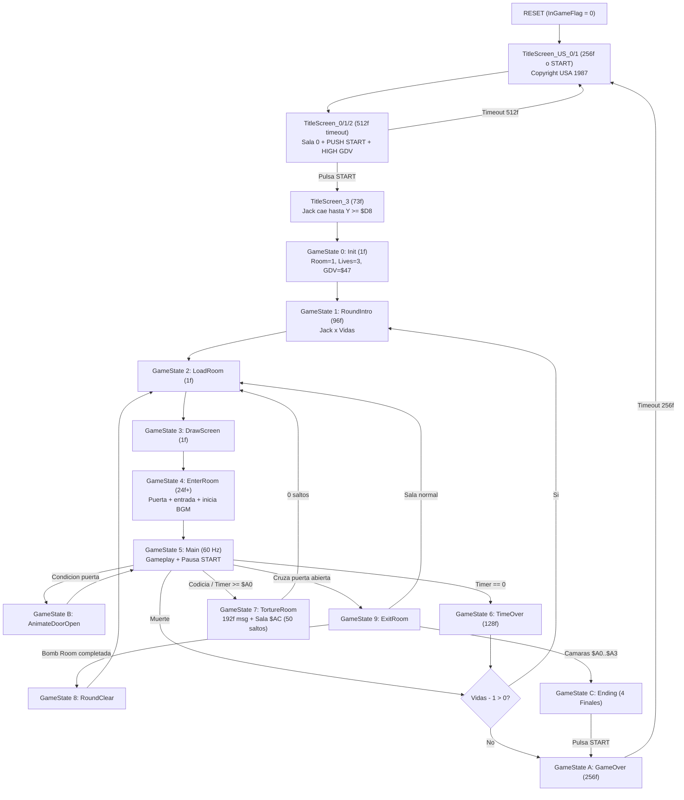

# Flujo Completo del Juego y Máquina de Estados (`REV_US`)

Especificación del ciclo completo de *Mighty Bomb Jack* (NES USA 1987), desde el encendido (`RESET`) hasta los 4 finales y el retorno al Título.

**Fuentes**: `asm/src/prg.asm` (`290-1163`, `2436-2490`, `7294-7924`), `asm/src/data.asm`.

---

## 1. Estructura de la Campaña (17 Rondas, 256 Salas)

- **16 rondas regulares + 1 ronda final**: cada ronda regular recorre un **Pasaje / Laberinto** (salas con scroll o pantalla única, cofres, bloques secretos y puertas condicionales) hasta llegar a una **Royal Palace Room (Bomb Room)** de pantalla fija.
- **Pasajes**: Jack acumula *Mighty Coins* (`M`) y puede activar *Mighty Power* (`1`, `2`, `3`) pulsando `B`.
- **Royal Palace Rooms (Bomb Rooms)**: contienen 23 bombas con cadena de mechas encendidas y multiplicador de puntuación (`×2..×5`). Al entrar, *Mighty Power* se desactiva. Recoger todas las bombas abre la salida hacia `RoundClear`.
- **Cámaras finales (`$A0..$A3`)**: tras la ronda 16, `EndingDoorChecks` (`prg.asm:7376-7425`) evalúa las Bolas de Cristal y las *Secret Coins* para seleccionar uno de los **4 finales**.

---

## 2. Diagrama de Pantallas y Estados

El despachador principal (`prg.asm:290-317`) selecciona entre `TitleScreenHandler` (`InGameFlag == 0`) y `GameHandler` (`InGameFlag == 1`).

---

## 3. Detalle y Temporización Canónica (60.0988 Hz NTSC)

| Estado / Pantalla | Duración | Comportamiento y Transición (`asm/src/prg.asm`) |
| :--- | :---: | :--- |
| **`TitleScreen_US_0/1`** | `256f` (~4.27 s) o `START` | Muestra textos de copyright USA (`Strings $1C..$1F`) y dígitos OAM `1987`. Silencio total (`prg.asm:7496-7530`). |
| **`TitleScreen_0/1/2`** | `512f` (~8.53 s) o `START` | Carga Sala 0, `PUSH START BUTTON`, `HIGH GDV` y coloca a Jack en `(40, 120)`. Timeout vuelve a Copyright; `START` inicia caída (`prg.asm:7533-7640`). |
| **`TitleScreen_3`** | `73f` (~1.22 s) | Jack cae con gravedad `$00A0` hasta `Y >= $D8`. Limpia pantalla y activa `InGameFlag = 1`, `GameState = 0` (`prg.asm:7644-7660`). |
| **`GameState_0_Init`** | `1f` | Encola `Sound_Silence`, `CurrentRoomID = 1`, `EntryDoorType = $0F`, `PlayerLives = 3`, `PlayerGDV = $47` BCD, `PlayerScore = 0` (`prg.asm:323-362`). |
| **`GameState_1_RoundIntro`** | `96f` (`$60`, 1.60 s) | Muestra Jack `x <PlayerLives>` en pantalla azul; silencio total (`prg.asm:7663-7700`). |
| **`GameState_2_LoadRoom`** | `1f` | Decodifica cabecera de sala, paleta, música y flags (`prg.asm:3130-3163`). |
| **`GameState_3_DrawScreen`** | `1f` | Renderiza metatiles y atributos en Nametable, activa `DrawScoreAndCoinsFlag` (`prg.asm:379-441`). |
| **`GameState_4_EnterRoom`** | `24f+` (`$18`) | Abre puerta de entrada, Jack camina 24 frames hacia el interior, cierra puerta y encola `MusicOptionsTable[RoomMusic]` (`prg.asm:445-623`). |
| **`GameState_5_Main`** | Activo | Ejecuta pausa (`START`), física, colisiones, scroll, objetos, enemigos, `StageTimer` (`$60` BCD, 1 tick cada 256f) y HUD (`prg.asm:647-668`). |
| **`GameState_6_TimeOver`** | `128f` (`$80`) | Muestra `TIME OVER`, reproduce `Sound_Death` y llama a `LoseALifeMaybeGameOver` (`prg.asm:672-694, 1135-1151`). |
| **`GameState_7_GoToTortureRoom`** | `192f` (`$C0`) + 50 saltos | Muestra `YOU ARE GREEDY / GO TO THE TORTURE ROOM`, confisca *Mighty Coins*, traslada a sala `$AC` con `GreedyJumpsRemaining = $50` BCD (US). Al llegar a 0 restaura checkpoint (`prg.asm:698-772`). |
| **`GameState_8_RoundClear`** | Subestados `0..3` | Muestra `ROUND X CLEAR`, descuenta `TIME BONUS` y si `FireBombsCollected >= 20` concede `FIRE BOMBS SPECIAL BONUS` (`10k/20k/30k/50k`) (`prg.asm:776-1004`). |
| **`GameState_9_ExitRoom`** | Transición | Cierra puerta, resuelve destino vía `AdjacentRoomsTable` y calcula `EntryDoorType = exit ^ 4`. En `$A0..$A3` invoca `EndingDoorChecks` (`prg.asm:7294-7425`). |
| **`GameState_A_GameOver`** | `256f` | Muestra `GAME OVER` y `YOUR GDV`. Suma bonos a `PlayerGDV`, actualiza `HighGDV` y vuelve a `InGameFlag = 0` (`prg.asm:1038-1091`). |
| **`GameState_B_AnimateDoorOpen`** | Animación | Abre visualmente una puerta recién desbloqueada durante `GameState_5_Main`. |
| **`GameState_C_Ending`** | Subestados `0..4` | Ejecuta el final correspondiente, suma `+3` GDV y espera `START` para pasar a `GameOver` (`prg.asm:7706-7810`). |

---

## 4. Selección de los 4 Finales (`EndingDoorChecks`)

Evaluada en `prg.asm:7376-7425` usando `PlayerCrystalBallsCollected` (`$0391`, bit 0 = Reina, bit 1 = Princesa) y `PlayerSecretCoins` (`$03E5`):

| Final | Sala | Condición |
| :---: | :---: | :--- |
| **Final 0** | `$A0` | Sin ambas Bolas de Cristal en la primera cámara. |
| **Final 1** | `$A1` | `PlayerCrystalBallsCollected != 3` (falta Reina o Princesa). |
| **Final 2** | `$A2` | Ambas Bolas de Cristal (`== 3`), pero `PlayerSecretCoins < 5`. |
| **Final 3 (Best)** | `$A3` | Ambas Bolas de Cristal (`== 3`) y `PlayerSecretCoins >= 5`. |

---

## 5. Semántica de Entrada (Joypad 1)

- **Lectura hardware (`$4016`)**: realizada una vez por frame en la NMI (`Joypad1_Immediate` en `$0308`, copia del frame anterior en `Joypad1_ImmediateCopy` `$00E6`).
- **Máscara de botones**: `A=$80`, `B=$40`, `Select=$20`, `Start=$10`, `Up=$08`, `Down=$04`, `Left=$02`, `Right=$01`.
- **Flancos críticos**: `Start` (inicio/pausa), `B` (activar *Mighty Power*) y `A` (salto y *flutter* aéreo) requieren detección de flanco de subida; `D-Pad` se evalúa por nivel mantenido.
