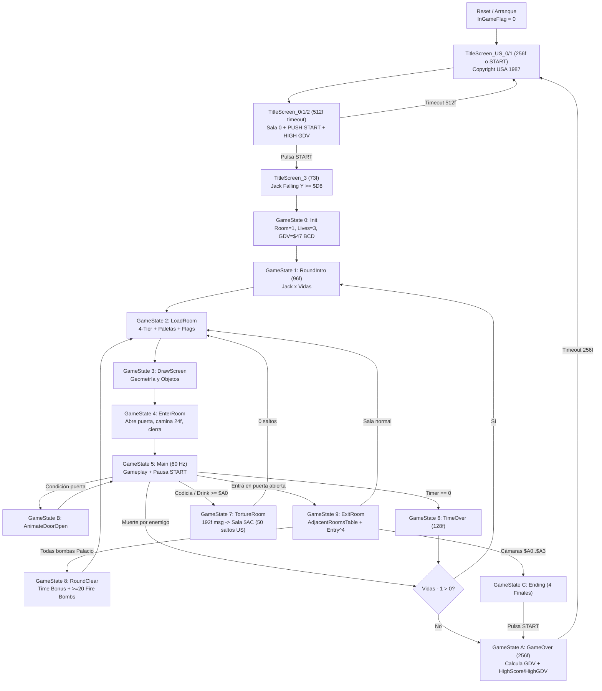

# Flujo Completo del Juego: Mighty Bomb Jack (NES USA `REV_US`)

> **Propósito**: Mapa maestro de extremo a extremo (*Copyright Screen -> Title -> 17 Rondas / 257 Salas -> Torture Room / Round Clear -> 4 Finales -> Game Over -> Title*). Consultar antes de diseñar o modificar pantallas, estados o transiciones para mantener la visión global del juego completo.

**Fuentes Verificadas**: `Mighty Bomb Jack - Manual (Searchable).pdf` y `asm/src/prg.asm` (`290-1163`, `2436-2490`, `7294-7810`).

---

## 1. Estructura Global de Campaña (17 Rondas, 257 Salas)

1. **16 Rondas Regulares + 1 Ronda Final**:
   - Cada ronda regular consta de un **Pasaje / Laberinto** (salas con scroll horizontal o fijas, cofres rojos/naranjas, bloques secretos, puertas condicionales y salas ocultas) que desemboca en una **Royal Palace Room (Bomb Room)** de pantalla fija.
   - En los **Pasajes**, Jack puede acumular **Mighty Coins** (`M`) y activar **Mighty Power 1/2/3** con `B`.
   - En las **Royal Palace Rooms**, hay 23–24 bombas con cadena de mechas encendidas en orden; **Mighty Power se desactiva** al entrar (`prg.asm:3130+` / Manual pág. 7, 12). Al recoger todas las bombas se abre la salida hacia `RoundClear`.
   - Superadas las 16 rondas regulares, la ruta final conduce a las cámaras `$A0..$A3` donde `EndingDoorChecks` (`prg.asm:7376-7425`) evalúa cuál de los **4 finales** se desbloquea.

---

## 2. Diagrama Completo de Pantallas y Estados

---

## 3. Detalle Canónico de Transiciones Críticas (`asm/src/prg.asm`)

| Estado / Pantalla | Duración / Trigger | Comportamiento Clave y Transición (`REV_US`) |
| :--- | :--- | :--- |
| **`TitleScreen_US_0/1`** | 256f o `START` | Textos `MIGHTY BOMB JACK TM`, `TM AND (C) TECMO,LTD.`, `LICENSED BY NINTENDO OF AMERICA INC.`, `1987` (`prg.asm:7496-7530`). |
| **`TitleScreen_0/1/2`** | 512f o `START` | Sala 0, `PUSH START BUTTON`, `HIGH GDV`, Jack en `(40,120)`. Timeout regresa a Copyright; `START` pasa a `TitleScreen_3` (`prg.asm:7533-7640`). |
| **`TitleScreen_3`** | ~73f (`Y >= $D8`) | Caída parabólica de Jack -> limpia pantalla, `TitleScreenState=0`, `GameState=0`, `InGameFlag=1` (`prg.asm:7644-7659`). |
| **`GameState_0_Init`** | 1 frame | `CurrentRoomID=1`, `EntryDoorType=$0F`, `PlayerLives=3`, `PlayerGDV=$47` BCD, `PlayerScore=0` -> `GameState=1` (`prg.asm:323-360`). |
| **`GameState_1_RoundIntro`** | 96f (`$60`) | Dibuja Jack `x <PlayerLives>` en pantalla azul -> `GameState=2` (`prg.asm:7663-7700`). |
| **`GameState_2/3/4`** | Carga + 24f entrada | Carga sala (`LoadRoom`), dibuja (`DrawScreen`), abre puerta de entrada, Jack entra 24f, cierra puerta, inicia BGM -> `GameState=5` (`prg.asm:379-626, 3130-3251`). |
| **`GameState_5_Main`** | Activo 60 Hz | Pausa (`START`), físicas, colisiones, scroll, objetos, enemigos, `StageTimer` (`$00A4`, `$60` BCD), HUD OAM (`Score` Y=16; `T`/`M` Y=24) (`prg.asm:647-668`). |
| **`GameState_6_TimeOver`** | 128f (`$80`) | Muestra `TIME OVER` + `Sound_Death` -> `LoseALifeMaybeGameOver`: si `Lives>0` restaura checkpoint y va a `GameState=1`; si `0` va a `GameState=$A` (`prg.asm:672-694, 1135-1151`). |
| **`GameState_7_GoToTortureRoom`** | 192f + 50 saltos | `YOU ARE GREEDY / GO TO THE TORTURE ROOM` (`$C0` frames), confisca Mighty Coins, entra a sala `$AC` con `GreedyJumpsRemaining=$50` BCD (US). Al llegar a 0 restaura checkpoint -> `GameState=2` (`prg.asm:698-772`). |
| **`GameState_8_RoundClear`** | Subestados `0..3` | `ROUND X CLEAR`, `TIME BONUS`, y si `FireBombsCollected >= 20` concede `FIRE BOMBS SPECIAL BONUS` (`$10/$20/$30/$50` mil) -> siguiente ronda -> `GameState=2` (`prg.asm:776-1004`). |
| **`GameState_9_ExitRoom`** | Salida de puerta | Cierra puerta, resuelve destino en `AdjacentRoomsTable` y `EntryDoorType = exit ^ 4`. Si destino en `$A0..$A3` ejecuta `EndingDoorChecks` (`prg.asm:7294-7425`). |
| **`GameState_A_GameOver`** | 256f | Muestra `GAME OVER` y `YOUR GDV`. Suma a `PlayerGDV`: `LastBombRoomCleared/2` (0–7), `ExtraLivesFound/2` y `Score/200000` (0–5). Actualiza `HighGDV` -> vuelve a `InGameFlag=0` (`prg.asm:1038-1091`). |
| **`GameState_C_Ending`** | Subestados `0..4` | Evalúa los 4 finales según `PlayerCrystalBallsCollected` (`$0391`) y `PlayerSecretCoins` (`$03E5`): **Final 0** (sin bolas en `$A0`), **Final 1** (sin ambas bolas `!=3` en `$A1`), **Final 2** (`<5` Secret Coins en `$A2`), **Final 3 Best** (`>=5` Secret Coins en `$A3`). Suma `+3` GDV; `START` pasa a `GameState=$A` (`prg.asm:7376-7425, 7706-7810`). |

---

## 4. Mecánicas Clave de Juego (Manual + ASM)

- **Controles**: `D-Pad` (mover, `Arriba+A` salto alto, `Abajo+A` salto bajo o caída rápida en aire), `A` (salto, freno en aire, pulsación repetida = *flutter*), `B` (consumir stock de Mighty Coins para activar Nivel 1/2/3), `START` (iniciar/pausa).
- **Mighty Power (solo en Pasajes)**:
  - `1` (Azul): abre cofres naranjas.
  - `2` (Naranja): abre cofres rojos y naranjas al tocarlos por los lados (saltar encima también abre).
  - `3` (Verde): transmuta enemigos temporalmente (5s / 320f) y permite revelar **Secret Coins** (50.000 pts); se degrada conforme se usa `A` (20/10/5 saltos).
- **Ítems**: Treasure Bags (`100`/`300`/`1000`), Gold Coin (`500`, hacia `1UP`), Bombas (`100`/`200`, cadena de mechas -> `Power Ball`), Mighty Drink (`+1000`, `+10` timer; `>= $A0` dispara Torture Room), Sphinx (`10000`, revela/abre puerta), Mighty Coin (`1000`, stock `M`), Extra Coin (`1UP`), Power Ball (`320f` monedas), Bonus Coin (`x2..x5` cada 5.000 pts en Bomb Room), Secret Coin (`50000`, 5 para Final 3), Crystal Balls (Reina + Princesa).

---

## 5. Checklist de Juego Completo (*Definition of Done*)

1. Arranque BYOR automático desde `mbj-us.nes` (o aviso claro si falta) sin datos con copyright en C.
2. Ciclo completo `Copyright US` $\leftrightarrow$ `Title Screen` $\to$ `Jack Falling` $\to$ `Round Intro`.
3. Jugabilidad completa en Sala 1 y pasajes: salto 64 pasos, *flutter*, 9-probe, scroll horizontal y costuras limpias.
4. Bombas, cadena de mechas con chispa, cofres rojos/naranjas, bloques secretos e ítems funcionales.
5. Mighty Power 1/2/3 con degradación por usos de `A` y desactivación al entrar en Royal Palace.
6. Evaluación correcta de las 33 condiciones de puertas y transición topológica bidireccional entre las 257 salas.
7. Los 6 arquetipos de enemigos, spawns, mutación `(APressCounter % 6) + 2` y Power Coin de 320 frames.
8. `StageTimer` (`$60`), pausa (`START`), `Time Over`, pérdida de vidas con retorno a checkpoint y `Game Over`.
9. Sala de Tortura (`$AC`) con mensaje, confiscación, 50 saltos US y retorno limpio al checkpoint.
10. Royal Palace (Bomb Room) con multiplicador `x2..x5` y pantalla `RoundClear` (`Time Bonus` + `Fire Bombs Bonus`).
11. Desbloqueo y cinemática de los 4 finales según Crystal Balls + 5 Secret Coins, cálculo de `PlayerGDV` y retorno limpio al Título.
12. Audio chiptune APU 2A03 completo (BGM + SFX) sin glitches en Windows y Linux.
