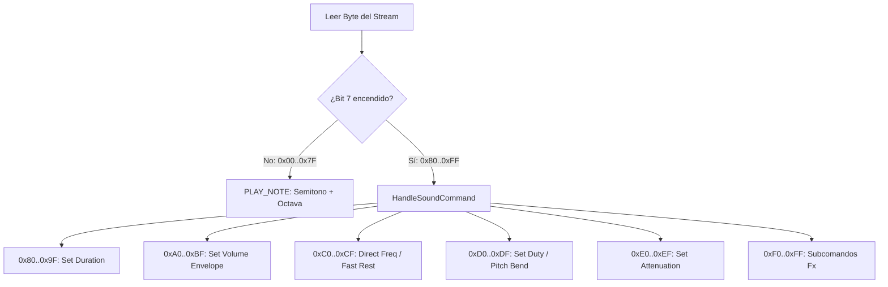

# RES-014: Especificación Técnica y Extracción del Motor de Bytecode de Audio 2A03 y Pistas Canónicas

- **ID de Investigación**: `RES-014`
- **Tarea Asociada**: `SUBTAREA 1: Extracción del Motor de Bytecode de Audio y Pistas Canónicas`
- **Área Temática**: 06 - Motor de Audio, Secuencias APU y SFX
- **Fecha**: 2026-10-25
- **Autor / Agente**: asm_researcher (Nivel 3)
- **Estado**: `[COMPLETADA]`

---

## 1. Objetivo y Alcance

Este informe técnico proporciona la extracción exhaustiva y formal del subsistema de sonido y música de *Mighty Bomb Jack* a partir del desmontaje ensamblador 6502 original (`asm/src/music-engine.asm`, `asm/src/music-data.asm`, `asm/src/ram.asm`, `asm/src/macros.asm`).

El alcance abarca:
1. **Tabla de períodos de 11 bits (frecuencias base)** y el algoritmo de escalado de octavas por rotación (`LSR`/`ROR`).
2. **Arquitectura de los 8 canales virtuales** (4 canales BGM y 4 canales SFX en `$0452..$0511`), layout de 24 bytes por canal, stack de subrutinas en RAM `$0512..$0551`, multiplexado BGM/SFX y ciclo de vida de inicialización.
3. **Gramática completa de la máquina virtual de bytecode**: notas cromáticas `$00..$7F` y opcodes de control `$80..$FF` (duración, envolvente, silencios, duty cycle, pitch bend, atenuación, bucles, subrutinas y sweep).
4. **Bytecode completo y anotado de las pistas canónicas del juego principal (Round 1)**:
   - `SoundData_16_Music_MainIntro`
   - `SoundData_10_Music_Main`
5. **Implementación de referencia en C x86** con definiciones de datos listas para su integración en el motor nativo del proyecto.

---

## 2. Fuentes de Verdad Analizadas (`asm/`)

| Archivo | Rango de Líneas | Etiquetas / Símbolos Clave | Descripción |
| :--- | :--- | :--- | :--- |
| [`asm/src/music-engine.asm`](../../asm/src/music-engine.asm#L1-L811) | 1 - 811 | `HandleSound`, `HandleSoundQueue`, `HandleSoundChannel`, `HandleSoundCommand`, `SoundCommand_8x_9x..Fx`, `MaybeUpdateVolDelay`, `MaybeResetVolDelay`, `WriteSoundRegisters`, `CheckIfSoundChannelIsActive`, `byte_B52C`, `NoteFrequencyTable`, `SoundPointersA`, `SoundPointersB` | Lógica del motor, intérprete de bytecode, máquina de estados de canales, actualización de registros APU. |
| [`asm/src/music-data.asm`](../../asm/src/music-data.asm#L1-L1760) | 1 - 1760 | `NoteLengthTable`, `SoundVolTable`, `SoundVolTable_0..7`, `SoundPointers`, `SoundData_10_Music_Main`, `SoundData_16_Music_MainIntro` | Tablas maestras de duración, envolventes de volumen, punteros a temas y flujos de bytecode de pistas. |
| [`asm/src/ram.asm`](../../asm/src/ram.asm#L158-L165) | 158 - 165 | `SoundEnginePointer` (`$60`), `SoundPointerTemp` (`$62`), `CurrentSoundChannel` (`$64`), `ActiveSoundChannels` (`$65`) | Punteros y variables de control en Zero-Page. |
| [`asm/src/ram.asm`](../../asm/src/ram.asm#L1354-L1675) | 1354 - 1675 | `SoundQueue` (`$0433`), `SoundChannelA_Mus0..3` (`$0452..$04B1`), `SoundChannelA_Sfx0..3` (`$04B2..$0511`), `SoundChannelB_Mus0..Sfx3` (`$0512..$0551`), `SoundRegIndex`, `SoundReg_Vol..Hi` | Estructuras de 24 bytes por canal, buffers de hardware y call stacks. |
| [`asm/src/macros.asm`](../../asm/src/macros.asm#L14-L60) | 14 - 60 | `MACRO SoundData`, `MACRO SndJmpF0`, `MACRO SndJmpF3` | Definición de estructuras de cabecera y saltos de bytecode. |

---

## 3. Tabla de Períodos de 11 Bits (Frecuencias Base)

### 3.1 Ubicación en Ensamblador
- **Archivo**: [`asm/src/music-engine.asm`](../../asm/src/music-engine.asm#L776-L792)
- **Líneas**: 776 a 792
- **Etiqueta**: `NoteFrequencyTable`

```asm
NoteFrequencyTable:
	.WORD $591				; 0: C  (Do)
	.WORD $541				; 1: C# (Do#)
	.WORD $4F5				; 2: D  (Re)
	.WORD $4AE				; 3: D# (Re#)
	.WORD $46B				; 4: E  (Mi)
	.WORD $42B				; 5: F  (Fa)
	.WORD $3EF				; 6: F# (Fa#)
	.WORD $3B7				; 7: G  (Sol)
	.WORD $381				; 8: G# (Sol#)
	.WORD $34F				; 9: A  (La)
	.WORD $31F				; $A: A# (La#)
	.WORD $2F2				; $B: B  (Si)
	.WORD    0				; $C: Rest / Silencio
	.WORD    0				; $D
	.WORD    0				; $E
	.WORD    0				; $F
```

### 3.2 Algoritmo de Octava por Desplazamiento (`LSR`/`ROR`)
En [`asm/src/music-engine.asm:220-248`](../../asm/src/music-engine.asm#L220-L248):
1. **Extracción de semitono**: `semitone = byte & 0x0F`. Se indexa `NoteFrequencyTable[semitone * 2]` en un valor de 16 bits `off_4`.
2. **Extracción de octava**: `octave = (byte >> 4)`.
3. **Cálculo de período según octava**:
   - Si `octave == 0`: El período es el valor directo de la tabla (octava base más grave).
   - Si `octave > 0`: Se itera `octave` veces dividiendo el período por 2:
     ```asm
     loc_B25D:
     	LSR off_4+1
     	ROR off_4
     	DEX
     	BNE loc_B25D
     ```
4. **Mapeo físico 2A03 APU**:
   La frecuencia acústica del canal Square/Triangle en la NES NTSC se calcula como:
   $$f = \frac{f_{CPU}}{16 \times (t + 1)}$$
   donde $f_{CPU} = 1.789773 \text{ MHz}$ y $t$ es el período de 11 bits.
   Al desplazar a la derecha ($t \approx t / 2$), la frecuencia $f$ se **duplica** en cada incremento de `octave`, subiendo exactamente una octava en la escala musical.
5. **Generación de Registros APU**:
   - `offset $11` = `off_4 & 0xFF` (8 bits bajos del período -> `$4002`/`$4006`).
   - `offset $12` = `(off_4 >> 8) | 0x08` (3 bits altos del período con bit 3 encendido -> `$4003`/`$4007`, recargando el length counter del APU para key-on).

### 3.3 Nota Silencio (`REST = $0C`)
El índice de semitono `$C` (12) tiene un período de `0x0000` en la tabla. Al escribirse en los registros con período 0 y control de volumen, el canal queda efectivamente silenciado. Toda la pista principal de *Mighty Bomb Jack* utiliza `$0C` como silencio con la duración activa del canal.

---

## 4. Arquitectura de Canales Virtuales y Cabeceras de Pistas

### 4.1 Arquitectura de 8 Canales Virtuales
El motor gestiona 8 canales concurrentes distribuidos uniformemente en 2 grupos:

| Canal Virtual | ID (`CurrentSoundChannel`) | Tipo | Hardware APU Correspondiente | Dirección RAM (`ram.asm`) |
| :---: | :---: | :---: | :---: | :---: |
| `SoundChannelA_Mus0` | 0 | BGM | Pulse 1 (Square 1) | `$0452 - $0469` (24 bytes) |
| `SoundChannelA_Mus1` | 1 | BGM | Pulse 2 (Square 2) | `$046A - $0481` (24 bytes) |
| `SoundChannelA_Mus2` | 2 | BGM | Triangle | `$0482 - $0499` (24 bytes) |
| `SoundChannelA_Mus3` | 3 | BGM | Noise | `$049A - $04B1` (24 bytes) |
| `SoundChannelA_Sfx0` | 4 | SFX | Pulse 1 (Square 1) | `$04B2 - $04C9` (24 bytes) |
| `SoundChannelA_Sfx1` | 5 | SFX | Pulse 2 (Square 2) | `$04CA - $04E1` (24 bytes) |
| `SoundChannelA_Sfx2` | 6 | SFX | Triangle | `$04E2 - $04F9` (24 bytes) |
| `SoundChannelA_Sfx3` | 7 | SFX | Noise | `$04FA - $0511` (24 bytes) |

Adicionalmente, cada canal dispone de 8 bytes de stack en RAM para subrutinas (`SoundChannelB_*`, `$0512 - $0551`):
- `SoundChannelB_Mus0..3`: `$0512`, `$051A`, `$0522`, `$052A`
- `SoundChannelB_Sfx0..3`: `$0532`, `$053A`, `$0542`, `$054A`

### 4.2 Layout del Bloque de 24 Bytes por Canal (`SoundChannelA`)

| Offset | Nombre Semántico | Tipo C | Función y Semántica 6502 |
| :---: | :--- | :---: | :--- |
| `+0x00` | `status` | `uint8_t` | `1` si el canal está activo; `0` si está inactivo/silenciado. Evaluado con `LSR A; ROR ActiveSoundChannels`. |
| `+0x01` | `duration_counter` | `uint8_t` | Contador de frames restantes de la nota actual. Decrementado en 1 cada tick. Cuando llega a 0, se recarga con `reload_duration`. |
| `+0x02` | `duration_reload` | `uint8_t` | Duración base de la nota en frames (cargada desde `NoteLengthTable` mediante opcodes `$80..$9F`). |
| `+0x03` | `data_ptr_lo` | `uint8_t` | Puntero LSB al flujo de bytecode del canal. |
| `+0x04` | `data_ptr_hi` | `uint8_t` | Puntero MSB al flujo de bytecode del canal. |
| `+0x05` | `vol_envelope_ptr_lo` | `uint8_t` | Puntero LSB a la tabla de envolvente activa (`SoundVolTable`). |
| `+0x06` | `vol_envelope_ptr_hi` | `uint8_t` | Puntero MSB a la tabla de envolvente activa (`SoundVolTable`). |
| `+0x07` | `vol_envelope_index` | `uint8_t` | Índice dentro de la envolvente de volumen (avanza de 2 en 2 bytes por paso). |
| `+0x08` | `unused_08` | `uint8_t` | Reservado (limpiado a 0). |
| `+0x09` | `loop_ptr_lo` | `uint8_t` | Dirección LSB de retorno de bucle (fijada por opcode `$F1`). |
| `+0x0A` | `loop_ptr_hi` | `uint8_t` | Dirección MSB de retorno de bucle (fijada por opcode `$F1`). |
| `+0x0B` | `call_stack_ptr_lo` | `uint8_t` | Puntero LSB al call stack del canal en `SoundChannelB` (avanza +2 por `$F3`, retrocede -2 por `$F4`). |
| `+0x0C` | `call_stack_ptr_hi` | `uint8_t` | Puntero MSB al call stack del canal en `SoundChannelB`. |
| `+0x0D` | `vol_attenuation` | `uint8_t` | Atenuación de volumen configurada por opcode `$Ex` (`0..15`). Se resta de la envolvente. |
| `+0x0E` | `vol_delay_counter` | `uint8_t` | Temporizador de frames para el paso actual de la envolvente de volumen. |
| `+0x0F` | `duty_and_vol` | `uint8_t` | Bits 6..7: Duty Cycle (0=12.5%, 1=25%, 2=50%, 3=75%). Bits 0..3: Nivel de volumen actual calculado. |
| `+0x10` | `sweep_reg` | `uint8_t` | Registro Sweep de hardware (opcode `$F5`). Se resetea a `#$08` al comienzo de cada nota. |
| `+0x11` | `freq_lo` | `uint8_t` | 8 bits bajos del período de frecuencia APU. |
| `+0x12` | `freq_hi` | `uint8_t` | 3 bits altos del período APU (`ORA #$08` para length counter). |
| `+0x13` | `loop_counter` | `uint8_t` | Contador de repeticiones de bucle (cargado por `$F1`, decrementado por `$F2`). |
| `+0x14` | `pitch_bend_step` | `int8_t` | Paso de Pitch Bend/Vibrato fijado por `$Dx` (`>= 8`): `+1, +2, -1, -2`. |
| `+0x15` | `pitch_bend_acc` | `uint8_t` | Acumulador / contador de iteraciones de Pitch Bend. |
| `+0x16` | `unused_16` | `uint8_t` | Reservado (limpiado a 0). |
| `+0x17` | `unused_17` | `uint8_t` | Reservado (limpiado a 0). |

### 4.3 Formato de Cabecera de Pista (`SoundData`)
Definido en [`asm/src/macros.asm:14-17`](../../asm/src/macros.asm#L14-L17) y procesado en `HandleSoundQueue` ([`asm/src/music-engine.asm:84-129`](../../asm/src/music-engine.asm#L84-L129)):

Cada entrada de cabecera consta de bloques de 3 bytes:
```
[Channel_ID: uint8_t]  ; 0..7 (0..3 BGM, 4..7 SFX)
[Offset_LSB: uint8_t]  ; Dirección de inicio del bytecode (16 bits, Little Endian)
[Offset_MSB: uint8_t]
```
La lista de canales termina con el centinela `$FF`.

**Procedimiento de Inicialización del Canal**:
1. Se limpia el bloque completo de 24 bytes del canal a `0x00`.
2. Se activa el canal: `status (+0x00) = 1`.
3. Se inicializa el puntero de call stack `+0x0B/+0x0C` con la dirección de `SoundChannelB[channel]`.
4. Se asigna el puntero de datos `+0x03/+0x04` con la dirección del stream.
5. Se inicializa `duration_counter (+0x01) = 1`. De este modo, en el primer frame de reproducción, `duration_counter - 1 == 0`, disparando inmediatamente la lectura del flujo de notas sin latencia.

### 4.4 Mecanismo de Mutación y Multiplexado SFX sobre BGM
En [`asm/src/music-engine.asm:751-771`](../../asm/src/music-engine.asm#L751-L771) (`CheckIfSoundChannelIsActive`):
- Cuando el canal procesado es un canal BGM (`CurrentSoundChannel < 4`), la rutina verifica si su canal SFX hermano (`CurrentSoundChannel + 4`) está activo (`status & 1`).
- Si el SFX está activo, se inhibe la escritura de registros APU del canal BGM (`sub_B285`, `locret_B2A8`).
- Cuando el SFX finaliza (`SoundCommand_F6_F7`, [`asm/src/music-engine.asm:605-626`](../../asm/src/music-engine.asm#L605-L626)):
  - Se desactiva el canal SFX (`status = 0`).
  - Se recupera el puntero del canal BGM hermano.
  - Se fuerza la reescritura de los registros APU del canal BGM restaurado (`ORA #$20` en `SoundReg_Vol`).

---

## 5. Tablas de Soporte Musical (Duraciones, Envolventes y Pitch)

### 5.1 Tabla de Duraciones de Nota (`NoteLengthTable`)
- **Archivo**: [`asm/src/music-data.asm:5-37`](../../asm/src/music-data.asm#L5-L37)
- 32 entradas de 1 byte en frames NTSC (60 Hz):

```c
static const uint8_t kNoteLengthTable[32] = {
    0,   1,   2,   3,   4,   6,   8,  12,   // 0x00 - 0x07
   16,  24,  32,  48,  64,  96, 128,  80,   // 0x08 - 0x0F
    7,  14,  28,   5,  10,  60,   6,   9,   // 0x10 - 0x17
   12,  18,  24,  36,  48,  72,  96, 144    // 0x18 - 0x1F
};
```
*Nota*: El tema principal utiliza la base métrica canónica:
- `$90` -> Índice 16 = **7 frames** (semicorchea rápida / corchea a ~129 BPM).
- `$91` -> Índice 17 = **14 frames** (el doble de 7 frames).
- `$92` -> Índice 18 = **28 frames** (el cuádruple de 7 frames).

### 5.2 Tabla de Envolventes de Volumen (`SoundVolTable`)
- **Archivo**: [`asm/src/music-data.asm:38-125`](../../asm/src/music-data.asm#L38-L125)
- Consta de 8 envolventes predefinidas. Cada entrada posee pares `(volumen_y_flags, duración_frames)`. La duración `$FF` representa un estado final sostenido (HOLD) hasta el fin de la nota:

```c
// Envolvente 0: Decay lineal continuo de 15 a 0 (1 frame por paso)
static const uint8_t kSoundVolTable_0[] = {
    0x1F, 1, 0x1E, 1, 0x1D, 1, 0x1C, 1, 0x1B, 1, 0x1A, 1, 0x19, 1, 0x18, 1,
    0x17, 1, 0x16, 1, 0x15, 1, 0x14, 1, 0x13, 1, 0x12, 1, 0x11, 1, 0x10, 0xFF
};

// Envolvente 1: Attack corto 13->15 y hold sostenido
static const uint8_t kSoundVolTable_1[] = {
    0x1D, 1, 0x1E, 1, 0x1F, 0xFF
};

// Envolvente 2: Decay rápido de 2 en 2
static const uint8_t kSoundVolTable_2[] = {
    0x1F, 1, 0x1D, 1, 0x1B, 1, 0x19, 1, 0x17, 1, 0x15, 1, 0x13, 1, 0x01, 1, 0x10, 0xFF
};

// Envolvente 3: Crescendo lento, hold prolongado (0x30 = 48 frames) y decrescendo
static const uint8_t kSoundVolTable_3[] = {
    0x12, 1, 0x14, 1, 0x16, 1, 0x18, 1, 0x1A, 1, 0x1C, 1, 0x1E, 1, 0x1F, 0x30,
    0x1E, 1, 0x1D, 1, 0x1C, 1, 0x1B, 1, 0x1A, 1, 0x19, 1, 0x18, 1, 0x17, 1,
    0x16, 1, 0x15, 1, 0x14, 1, 0x13, 1, 0x12, 1, 0x11, 1, 0x10, 0xFF
};

// Envolvente 4: Volumen máximo constante (para Triangle o notas sostenidas)
static const uint8_t kSoundVolTable_4[] = {
    0x1F, 0xFF
};

// Envolvente 5: Staccato percusivo ultra-corto (2 frames de volumen máximo y corte)
static const uint8_t kSoundVolTable_5[] = {
    0x1F, 2, 0x10, 0xFF
};

// Envolvente 6: Triangle/Noise sostenido pleno
static const uint8_t kSoundVolTable_6[] = {
    0x7F, 0xFF
};

// Envolvente 7: Decay ultra-lento progresivo
static const uint8_t kSoundVolTable_7[] = {
    0x1F, 4, 0x1E, 2, 0x1D, 2, 0x1C, 2, 0x1B, 3, 0x1A, 3, 0x19, 4, 0x18, 4,
    0x17, 6, 0x16, 6, 0x15, 8, 0x14, 8, 0x13, 8, 0x12, 8, 0x11, 0x10, 0x10, 0xFF
};
```

### 5.3 Tabla de Pasos de Pitch Bend (`byte_B52C`)
- **Archivo**: [`asm/src/music-engine.asm:774-775`](../../asm/src/music-engine.asm#L774-L775)
- 4 valores con signo utilizados para modular el tono:
```c
static const int8_t kPitchBendSteps[4] = { 1, 2, -1, -2 };
```

---

## 6. Gramática y Máquina Virtual de Bytecode Tecmo

El intérprete lee secuencialmente bytes del flujo de datos en `HandleSoundChannel`:



### 6.1 Rango `$00..$7F`: Emisión de Notas Musicales (`PLAY_NOTE`)
- **Formato**: `[Octave: 3 bits][Semitone: 4 bits]` (rango cromático 0 a 11, o 12 para Rest).
- **Semántica**:
  1. Si `offset +0x14 != 0`, se aplica la modulación de Pitch Bend al semitono.
  2. Se toma el período base `NoteFrequencyTable[semitone]`.
  3. Se desplaza a la derecha tantas veces como indique `octave`.
  4. Se escriben los registros de frecuencia `+0x11` y `+0x12`.
  5. Se avanza el puntero de datos del canal (`+0x03/+0x04`) y se suspende la ejecución hasta que expire `duration_counter`.

### 6.2 Comandos de Control de Bytecode (`$80..$FF`)

| Código Opcode | Nombre Nemotécnico | Parámetros Adicionales | Efecto en la Máquina Virtual de Audio |
| :---: | :--- | :---: | :--- |
| **`$80 .. $9F`** | `CMD_SET_NOTE_LEN` | — | `dur_index = byte & 0x1F`. Carga `NoteLengthTable[dur_index]` en `duration_counter` (`+0x01`) y `duration_reload` (`+0x02`). |
| **`$A0 .. $BF`** | `CMD_SET_VOL_ENV` | — | `env_index = byte & 0x1F`. Carga el puntero `SoundVolTable[env_index]` en `+0x05/+0x06`, resetea el índice de envolvente `+0x07` a 0 y reinicia el delay de volumen. |
| **`$C0 .. $CF`** | `CMD_DIRECT_FREQ` | — | Carga directa de frecuencia: `+0x11 = byte & 0x0F`, `+0x12 = 0x08`. Ejecuta `PLA; PLA` para salida rápida actualizando el puntero de stream sin esperar recarga de nota cromática. |
| **`$D0 .. $D7`** | `CMD_SET_DUTY` | — | Configura el Duty Cycle del canal (bits 7 y 6 de `+0x0F`):<br>`0`: 12.5%<br>`1`: 25.0%<br>`2`: 50.0%<br>`3`: 75.0% |
| **`$D8 .. $DF`** | `CMD_SET_PITCH_BEND`| — | Configura la velocidad y sentido del Pitch Bend: carga `kPitchBendSteps[byte & 3]` en `+0x14`. Si cambió el valor, resetea el acumulador `+0x15` a 0. |
| **`$E0 .. $EF`** | `CMD_SET_ATTENUATION`| — | Carga `attenuation = byte & 0x0F` en `+0x0D`. Se restará del volumen de cada fase de la envolvente que tenga el bit 4 encendido (`vol = max(0, env_vol - attenuation)`). |
| **`$F0`** | `CMD_JUMP` | `target: uint16_t` | Salto incondicional en el flujo de bytecode a la dirección absoluta especificada en los 2 bytes siguientes. |
| **`$F1`** | `CMD_LOOP_START` | `count: uint8_t` | Inicia un bloque de repetición: almacena `count` en `+0x13` y guarda la dirección inmediatamente posterior al byte de conteo en `+0x09/+0x0A`. |
| **`$F2`** | `CMD_LOOP_END` | — | Decrementa `+0x13`. Si el resultado $> 0$, salta a la dirección guardada en `+0x09/+0x0A`. Si es 0, continúa con la instrucción siguiente. |
| **`$F3`** | `CMD_CALL` | `target: uint16_t` | Llamada a subrutina musical: empuja la dirección de retorno (siguiente byte del stream) en el call stack del canal `SoundChannelB` y salta a `target`. Profundidad máxima: 4 niveles. |
| **`$F4`** | `CMD_RET` | — | Retorno de subrutina: desempuja la dirección de retorno del stack `SoundChannelB` y continúa la ejecución del stream llamador. |
| **`$F5`** | `CMD_SET_SWEEP` | `val: uint8_t` | Escribe el byte parámetro en el registro de hardware Sweep del canal (`+0x10`). |
| **`$F6` / `$F7`** | `CMD_END_TRACK` | — | Finaliza la pista actual (`status = 0`). Si era un canal SFX (`4..7`), desmutea y restaura inmediatamente los registros del canal BGM hermano (`0..3`). |

---

## 7. Extracción de Pistas Canónicas: Música de Round 1

### 7.1 `SoundData_16_Music_MainIntro` (Fanfarria de Introducción)
- **Cabecera**: [`asm/src/music-data.asm:1650-1654`](../../asm/src/music-data.asm#L1650-L1654)
- Canales activos: **0 (Pulse 1)**, **1 (Pulse 2)**, **2 (Triangle)**. Canal 3 (Noise) inactivo.

#### Secuencia Canal 0 (Pulse 1) — [`asm/src/music-data.asm:1655-1679`](../../asm/src/music-data.asm#L1655-L1679)
```asm
SoundTrack_16_0:
	.BYTE $A0          ; CMD_SET_VOL_ENV (0: decay lineal 15->0)
	.BYTE $D1          ; CMD_SET_DUTY (1: duty 25%)
	.BYTE $E4          ; CMD_SET_ATTENUATION (4)
	.BYTE $92          ; CMD_SET_NOTE_LEN (18 -> 28 frames)
	.BYTE $37          ; G3 (duración: 28 frames)
	.BYTE $90          ; CMD_SET_NOTE_LEN (16 -> 7 frames)
	.BYTE $37          ; G3
	.BYTE $39          ; A3
	.BYTE $37          ; G3
	.BYTE $35          ; F3
	.BYTE $91          ; CMD_SET_NOTE_LEN (17 -> 14 frames)
	.BYTE $34          ; E3
	.BYTE $32          ; D3
	.BYTE $30          ; C3
	.BYTE $2B          ; B2
	.BYTE $27          ; G2
	.BYTE $0C          ; REST (silencio de 14 frames)
	.BYTE $2B          ; B2
	.BYTE $0C          ; REST
	.BYTE $32          ; D3
	.BYTE $0C          ; REST
	.BYTE $0C          ; REST
	.BYTE $0C          ; REST
	SndJmpF0 SoundTrack_10_0 ; JUMP $F0 -> Enlace fluido con Canal 0 de SoundData_10_Music_Main
```

#### Secuencia Canal 1 (Pulse 2) — [`asm/src/music-data.asm:1680-1704`](../../asm/src/music-data.asm#L1680-L1704)
```asm
SoundTrack_16_1:
	.BYTE $A0          ; CMD_SET_VOL_ENV (0)
	.BYTE $D1          ; CMD_SET_DUTY (1: 25%)
	.BYTE $E4          ; CMD_SET_ATTENUATION (4)
	.BYTE $92          ; CMD_SET_NOTE_LEN (18 -> 28 frames)
	.BYTE $30          ; C3
	.BYTE $90          ; CMD_SET_NOTE_LEN (16 -> 7 frames)
	.BYTE $34          ; E3
	.BYTE $35          ; F3
	.BYTE $34          ; E3
	.BYTE $32          ; D3
	.BYTE $91          ; CMD_SET_NOTE_LEN (17 -> 14 frames)
	.BYTE $30          ; C3
	.BYTE $24          ; E2
	.BYTE $29          ; A2
	.BYTE $27          ; G2
	.BYTE $22          ; D2
	.BYTE $0C          ; REST
	.BYTE $27          ; G2
	.BYTE $0C          ; REST
	.BYTE $2B          ; B2
	.BYTE $0C          ; REST
	.BYTE $0C          ; REST
	.BYTE $0C          ; REST
	SndJmpF0 SoundTrack_10_1 ; JUMP $F0 -> Enlace con Canal 1 de SoundData_10_Music_Main
```

#### Secuencia Canal 2 (Triangle) — [`asm/src/music-data.asm:1705-1732`](../../asm/src/music-data.asm#L1705-L1732)
```asm
SoundTrack_16_2:
	.BYTE $A4          ; CMD_SET_VOL_ENV (4: volumen máximo constante)
	.BYTE $92          ; CMD_SET_NOTE_LEN (18 -> 28 frames)
	.BYTE $30          ; C3
	.BYTE $90          ; CMD_SET_NOTE_LEN (16 -> 7 frames)
	.BYTE $30          ; C3
	.BYTE $2B          ; B2
	.BYTE $30          ; C3
	.BYTE $2B          ; B2
	.BYTE $91          ; CMD_SET_NOTE_LEN (17 -> 14 frames)
	.BYTE $30          ; C3
	.BYTE $32          ; D3
	.BYTE $34          ; E3
	.BYTE $35          ; F3
	.BYTE $37          ; G3
	.BYTE $0C          ; REST
	.BYTE $32          ; D3
	.BYTE $2B          ; B2
	.BYTE $90          ; CMD_SET_NOTE_LEN (16 -> 7 frames)
	.BYTE $37          ; G3
	.BYTE $0C          ; REST
	.BYTE $35          ; F3
	.BYTE $0C          ; REST
	.BYTE $34          ; E3
	.BYTE $0C          ; REST
	.BYTE $32          ; D3
	.BYTE $0C          ; REST
	SndJmpF0 SoundTrack_10_2 ; JUMP $F0 -> Enlace con Canal 2 de SoundData_10_Music_Main
```

---

### 7.2 `SoundData_10_Music_Main` (Tema Principal del Juego / Round 1)
- **Cabecera**: [`asm/src/music-data.asm:595-599`](../../asm/src/music-data.asm#L595-L599)
- Canales activos: **0 (Pulse 1)**, **1 (Pulse 2)**, **2 (Triangle)**.

#### Secuencia Canal 0 (Pulse 1 - Melodía Líder) — [`asm/src/music-data.asm:600-725`](../../asm/src/music-data.asm#L600-L725)
```asm
SoundTrack_10_0:
	.BYTE $A0          ; CMD_SET_VOL_ENV 0
SoundTrack_10_0L:      ; Etiqueta de bucle de pista
	.BYTE $D1          ; CMD_SET_DUTY 1 (25%)
	.BYTE $E9          ; CMD_SET_ATTENUATION 9
	SndJmpF3 SoundTrack_10_0La ; CALL -> Frase Melódica Principal A
	.BYTE $90          ; LEN 16 (7 frames)
	.BYTE $30, $2B, $29, $27, $32, $30, $2B, $29  ; C3, B2, A2, G2, D3, C3, B2, A2
	.BYTE $34, $32, $30, $2B, $35, $34, $32, $2B  ; E3, D3, C3, B2, F3, E3, D3, B2
	SndJmpF3 SoundTrack_10_0La ; CALL -> Repite Frase A
	.BYTE $30, $27     ; C3, G2
	.BYTE $90          ; LEN 16
	.BYTE $29, $2B, $32, $27                      ; A2, B2, D3, G2
	.BYTE $91          ; LEN 17 (14 frames)
	.BYTE $30          ; C3
	.BYTE $90          ; LEN 16
	.BYTE $27, $27     ; G2, G2
	.BYTE $91          ; LEN 17
	.BYTE $30, $0C     ; C3, REST
	SndJmpF3 SoundTrack_F7AB ; CALL -> Frase B
	.BYTE $0C          ; REST
	.BYTE $90          ; LEN 16
	.BYTE $35, $34     ; F3, E3
	.BYTE $91          ; LEN 17
	.BYTE $35          ; F3
	.BYTE $90          ; LEN 16
	.BYTE $37          ; G3
	.BYTE $91          ; LEN 17
	.BYTE $37          ; G3
	.BYTE $90          ; LEN 16
	.BYTE $35, $34, $32, $34, $35, $37, $36, $37, $38 ; F3, E3, D3, E3, F3, G3, F#3, G3, G#3
	SndJmpF3 SoundTrack_F7AB ; CALL -> Frase B
	.BYTE $39, $37, $35, $34, $32, $30, $2B, $30, $0C ; A3, G3, F3, E3, D3, C3, B2, C3, REST
	SndJmpF0 SoundTrack_10_0L ; JUMP -> Bucle infinito de la canción

; Subrutina Frase A (Pulse 1)
SoundTrack_10_0La:
	.BYTE $90          ; LEN 16 (7 frames)
	.BYTE $34, $30, $34, $30                      ; E3, C3, E3, C3
	.BYTE $91          ; LEN 17 (14 frames)
	.BYTE $34, $37, $39, $37, $35, $34, $32, $27  ; E3, G3, A3, G3, F3, E3, D3, G2
	.BYTE $90          ; LEN 16
	.BYTE $27, $29, $2B, $30                      ; G2, A2, B2, C3
	.BYTE $91          ; LEN 17
	.BYTE $32, $0C, $27, $0C                      ; D3, REST, G2, REST
	.BYTE $90          ; LEN 16
	.BYTE $32, $2B, $32, $2B                      ; D3, B2, D3, B2
	.BYTE $91          ; LEN 17
	.BYTE $32, $35, $37, $35, $34, $32            ; D3, F3, G3, F3, E3, D3
	.BYTE $F4          ; RET ($F4)

; Subrutina Frase B (Pulse 1)
SoundTrack_F7AB:
	.BYTE $90          ; LEN 16
	.BYTE $39, $38     ; A3, G#3
	.BYTE $91          ; LEN 17
	.BYTE $39          ; A3
	.BYTE $90          ; LEN 16
	.BYTE $3B          ; B3
	.BYTE $91          ; LEN 17
	.BYTE $3B          ; B3
	.BYTE $90          ; LEN 16
	.BYTE $39          ; A3
	.BYTE $91          ; LEN 17
	.BYTE $37, $34, $30 ; G3, E3, C3
	.BYTE $F4          ; RET ($F4)
```

#### Secuencia Canal 1 (Pulse 2 - Armonía) — [`asm/src/music-data.asm:726-851`](../../asm/src/music-data.asm#L726-L851)
```asm
SoundTrack_10_1:
	.BYTE $A0          ; CMD_SET_VOL_ENV 0
SoundTrack_10_1L:      ; Etiqueta bucle canal 1
	.BYTE $D1          ; CMD_SET_DUTY 1 (25%)
	.BYTE $E9          ; CMD_SET_ATTENUATION 9
	SndJmpF3 SoundTrack_F80A ; CALL Armonía Frase A
	.BYTE $90          ; LEN 16
	.BYTE $29, $27, $25, $24, $2B, $29, $27, $25  ; A2, G2, F2, E2, B2, A2, G2, F2
	.BYTE $30, $2B, $29, $27, $32, $30, $2B, $27  ; C3, B2, A2, G2, D3, C3, B2, G2
	SndJmpF3 SoundTrack_F80A ; CALL Armonía Frase A
	.BYTE $27, $24     ; G2, E2
	.BYTE $90          ; LEN 16
	.BYTE $25, $27, $2B, $22                      ; F2, G2, B2, D2
	.BYTE $91          ; LEN 17
	.BYTE $27          ; G2
	.BYTE $90          ; LEN 16
	.BYTE $22, $22     ; D2, D2
	.BYTE $91          ; LEN 17
	.BYTE $27, $0C     ; G2, REST
	SndJmpF3 SoundTrack_F82F ; CALL Armonía Frase B
	.BYTE $0C          ; REST
	.BYTE $90          ; LEN 16
	.BYTE $32, $30     ; D3, C3
	.BYTE $91          ; LEN 17
	.BYTE $32          ; D3
	.BYTE $90          ; LEN 16
	.BYTE $34          ; E3
	.BYTE $91          ; LEN 17
	.BYTE $34          ; E3
	.BYTE $90          ; LEN 16
	.BYTE $32, $30, $2B, $30, $32, $34, $33, $34, $34 ; D3, C3, B2, C3, D3, E3, D#3, E3, E3
	SndJmpF3 SoundTrack_F82F ; CALL Armonía Frase B
	.BYTE $35, $34, $32, $30, $2B, $27, $27, $27, $0C ; F3, E3, D3, C3, B2, G2, G2, G2, REST
	SndJmpF0 SoundTrack_10_1L ; JUMP bucle canal 1

; Subrutina Armonía Frase A (Pulse 2)
SoundTrack_F80A:
	.BYTE $90          ; LEN 16
	.BYTE $30, $27, $30, $27                      ; C3, G2, C3, G2
	.BYTE $91          ; LEN 17
	.BYTE $30, $34, $35, $34, $32, $30, $2B, $22  ; C3, E3, F3, E3, D3, C3, B2, D2
	.BYTE $90          ; LEN 16
	.BYTE $22, $25, $27, $29                      ; D2, F2, G2, A2
	.BYTE $91          ; LEN 17
	.BYTE $2B, $0C, $22, $0C                      ; B2, REST, D2, REST
	.BYTE $90          ; LEN 16
	.BYTE $2B, $27, $2B, $27                      ; B2, G2, B2, G2
	.BYTE $91          ; LEN 17
	.BYTE $2B, $32, $34, $32, $30, $2B            ; B2, D3, E3, D3, C3, B2
	.BYTE $F4          ; RET ($F4)

; Subrutina Armonía Frase B (Pulse 2)
SoundTrack_F82F:
	.BYTE $90          ; LEN 16
	.BYTE $35, $34     ; F3, E3
	.BYTE $91          ; LEN 17
	.BYTE $35          ; F3
	.BYTE $90          ; LEN 16
	.BYTE $37          ; G3
	.BYTE $91          ; LEN 17
	.BYTE $37          ; G3
	.BYTE $90          ; LEN 16
	.BYTE $35          ; F3
	.BYTE $91          ; LEN 17
	.BYTE $34, $30, $27 ; E3, C3, G2
	.BYTE $F4          ; RET ($F4)
```

#### Secuencia Canal 2 (Triangle - Línea de Bajo) — [`asm/src/music-data.asm:852-963`](../../asm/src/music-data.asm#L852-L963)
```asm
SoundTrack_10_2:
	.BYTE $A4          ; CMD_SET_VOL_ENV 4 (Triangle volumen constante)
SoundTrack_10_2L:      ; Etiqueta bucle bajo
	SndJmpF3 SoundTrack_F894 ; CALL Bajo Frase A
	.BYTE $17, $22, $19, $24, $1B, $25, $1B, $27  ; G1, D2, A1, E2, B1, F2, B1, G2
	SndJmpF3 SoundTrack_F894 ; CALL Bajo Frase A
	.BYTE $17, $20     ; G1, C2
	.BYTE $90          ; LEN 16
	.BYTE $25, $24, $22, $20, $1B, $17, $19, $1B  ; F2, E2, D2, C2, B1, G1, A1, B1
	.BYTE $91          ; LEN 17
	.BYTE $20, $0C     ; C2, REST
	.BYTE $91          ; LEN 17
	.BYTE $19, $20     ; A1, C2
	.BYTE $90          ; LEN 16
	.BYTE $25, $24, $22, $20                      ; F2, E2, D2, C2
	.BYTE $91          ; LEN 17
	.BYTE $24, $20, $17, $24, $22, $19            ; E2, C2, G1, E2, D2, A1
	.BYTE $90          ; LEN 16
	.BYTE $25, $24     ; F2, E2
	.BYTE $91          ; LEN 17
	.BYTE $22, $20, $24, $27, $24, $19, $20       ; D2, C2, E2, G2, E2, A1, C2
	.BYTE $90          ; LEN 16
	.BYTE $25, $24, $22, $20                      ; F2, E2, D2, C2
	.BYTE $91          ; LEN 17
	.BYTE $24, $20     ; E2, C2
	.BYTE $90          ; LEN 16
	.BYTE $17, $20, $24, $20                      ; G1, C2, E2, C2
	.BYTE $90          ; LEN 16
	.BYTE $19, $15, $1B, $17, $20, $19, $22, $1B  ; A1, F1, B1, G1, C2, A1, D2, B1
	.BYTE $91          ; LEN 17
	.BYTE $20, $17, $20, $0C                      ; C2, G1, C2, REST
	SndJmpF0 SoundTrack_10_2L ; JUMP bucle canal 2

; Subrutina Bajo Frase A (Triangle)
SoundTrack_F894:
	.BYTE $91          ; LEN 17 (14 frames)
	.BYTE $20, $27, $20, $27, $20, $27, $20, $27  ; C2, G2, C2, G2, C2, G2, C2, G2
	.BYTE $17, $22, $17, $22, $17, $22            ; G1, D2, G1, D2, G1, D2
	.BYTE $90          ; LEN 16 (7 frames)
	.BYTE $17, $19, $1B, $20                      ; G1, A1, B1, C2
	.BYTE $91          ; LEN 17 (14 frames)
	.BYTE $17, $22, $17, $22, $17, $22, $17, $22  ; G1, D2, G1, D2, G1, D2, G1, D2
	.BYTE $F4          ; RET ($F4)
```

---

## 8. Especificación C x86 e Implementación de Referencia

A continuación se detalla la arquitectura en C x86 para ejecutar este motor de audio y reproducir fielmente las pistas del 6502:

```c
#include <stdint.h>
#include <stdbool.h>

#define MAX_CALL_STACK_DEPTH 4

// 1. Estructura de 24 bytes del canal virtual (idéntica a SoundChannelA en RAM 6502)
typedef struct {
    uint8_t status;              // +0x00: 1 = activo, 0 = silenciado
    uint8_t duration_counter;    // +0x01: frames restantes de la nota actual
    uint8_t duration_reload;     // +0x02: duración base de la nota
    const uint8_t *data_ptr;     // +0x03/+0x04: puntero actual al stream de bytecode
    const uint8_t *vol_env_ptr;  // +0x05/+0x06: puntero a tabla de volumen
    uint8_t vol_env_index;       // +0x07: índice actual dentro de la envolvente
    uint8_t unused_08;           // +0x08
    const uint8_t *loop_ptr;     // +0x09/+0x0A: dirección de bucle ($F1)
    uint8_t stack_depth;         // +0x0B/+0x0C: puntero stack (0..MAX_CALL_STACK_DEPTH)
    const uint8_t *call_stack[MAX_CALL_STACK_DEPTH]; // SoundChannelB
    uint8_t vol_attenuation;     // +0x0D: atenuación ($Ex)
    uint8_t vol_delay_counter;   // +0x0E: contador de duración de fase de envolvente
    uint8_t duty_and_vol;        // +0x0F: bits 7-6 duty, bits 3-0 volumen
    uint8_t sweep_reg;           // +0x10: registro sweep ($F5)
    uint8_t freq_lo;             // +0x11: 8 bits bajos período APU
    uint8_t freq_hi;             // +0x12: 3 bits altos período APU
    uint8_t loop_counter;        // +0x13: repeticiones de bucle ($F1/$F2)
    int8_t  pitch_bend_step;     // +0x14: paso pitch bend ($Dx)
    uint8_t pitch_bend_acc;      // +0x15: acumulador pitch bend
    uint8_t unused_16;           // +0x16
    uint8_t unused_17;           // +0x17
} SoundChannel_t;

// 2. Tablas Maestras
static const uint16_t kNoteFrequencyTable[16] = {
    0x0591, 0x0541, 0x04F5, 0x04AE, 0x046B, 0x042B, 0x03EF, 0x03B7,
    0x0381, 0x034F, 0x031F, 0x02F2, 0x0000, 0x0000, 0x0000, 0x0000
};

static const uint8_t kNoteLengthTable[32] = {
     0,  1,  2,  3,  4,  6,  8, 12, 16, 24, 32, 48, 64, 96, 128, 80,
     7, 14, 28,  5, 10, 60,  6,  9, 12, 18, 24, 36, 48, 72,  96, 144
};

static const int8_t kPitchBendSteps[4] = { 1, 2, -1, -2 };

// 3. Intérprete de tick de canal
void Channel_Tick(SoundChannel_t *ch, uint8_t channel_idx) {
    if (!ch->status) return;

    // Actualizar envolvente de volumen
    if (ch->vol_delay_counter == 0) {
        if (ch->vol_env_ptr) {
            uint8_t vol_byte = ch->vol_env_ptr[ch->vol_env_index];
            uint8_t duration = ch->vol_env_ptr[ch->vol_env_index + 1];
            if (duration != 0xFF) {
                ch->vol_env_index += 2;
            }
            ch->vol_delay_counter = duration;

            uint8_t final_vol = vol_byte & 0x0F;
            if (vol_byte & 0x10) {
                if (final_vol >= ch->vol_attenuation) {
                    final_vol -= ch->vol_attenuation;
                } else {
                    final_vol = 0;
                }
            }
            ch->duty_and_vol = (ch->duty_and_vol & 0xC0) | (final_vol & 0x0F);
        }
    } else {
        ch->vol_delay_counter--;
    }

    // Decrementar duración de la nota
    ch->duration_counter--;
    if (ch->duration_counter > 0) return;

    // Recargar duración base y reiniciar estado de sweep
    ch->duration_counter = ch->duration_reload;
    ch->vol_delay_counter = 0;
    ch->sweep_reg = 0x08;

    // Intérprete de bytecode
    while (true) {
        uint8_t b = *ch->data_ptr++;
        if (b < 0x80) {
            // PLAY_NOTE: semitono + octava
            uint8_t semitone = b & 0x0F;
            uint8_t octave = b >> 4;
            uint16_t period = kNoteFrequencyTable[semitone];
            if (octave > 0 && period > 0) {
                period >>= octave;
            }
            ch->freq_lo = (uint8_t)(period & 0xFF);
            ch->freq_hi = (uint8_t)((period >> 8) | 0x08);
            break; // Nota emitida: suspende ejecución hasta el siguiente período de duración
        }

        // Comandos de bytecode
        uint8_t cmd = (b & 0x7F) >> 4;
        switch (cmd) {
            case 0: // 0x80..0x8F
            case 1: // 0x90..0x9F: Set note length
                ch->duration_reload = kNoteLengthTable[b & 0x1F];
                ch->duration_counter = ch->duration_reload;
                break;
            case 2: // 0xA0..0xAF
            case 3: // 0xB0..0xBF: Set volume envelope
                // Asignar puntero a SoundVolTable[b & 0x1F]
                ch->vol_env_index = 0;
                ch->vol_delay_counter = 0;
                break;
            case 4: // 0xC0..0xCF: Direct frequency / fast rest
                ch->freq_lo = b & 0x0F;
                ch->freq_hi = 0x08;
                return;
            case 5: // 0xD0..0xDF: Duty or Pitch Bend
                if ((b & 0x0F) < 8) {
                    uint8_t duty = (b & 0x03) << 6;
                    ch->duty_and_vol = (ch->duty_and_vol & 0x3F) | duty;
                } else {
                    ch->pitch_bend_step = kPitchBendSteps[b & 3];
                    ch->pitch_bend_acc = 0;
                }
                break;
            case 6: // 0xE0..0xEF: Attenuation
                ch->vol_attenuation = b & 0x0F;
                break;
            case 7: // 0xF0..0xFF: Subcomandos Fx
                switch (b & 0x07) {
                    case 0: { // F0: Jump
                        uint16_t lo = *ch->data_ptr++;
                        uint16_t hi = *ch->data_ptr++;
                        // Convertir a puntero
                        break;
                    }
                    case 1: { // F1: Loop Start
                        ch->loop_counter = *ch->data_ptr++;
                        ch->loop_ptr = ch->data_ptr;
                        break;
                    }
                    case 2: { // F2: Loop End
                        if (--ch->loop_counter > 0) {
                            ch->data_ptr = ch->loop_ptr;
                        }
                        break;
                    }
                    case 3: { // F3: Call
                        uint16_t lo = *ch->data_ptr++;
                        uint16_t hi = *ch->data_ptr++;
                        if (ch->stack_depth < MAX_CALL_STACK_DEPTH) {
                            ch->call_stack[ch->stack_depth++] = ch->data_ptr;
                        }
                        // ch->data_ptr = target
                        break;
                    }
                    case 4: { // F4: Return
                        if (ch->stack_depth > 0) {
                            ch->data_ptr = ch->call_stack[--ch->stack_depth];
                        }
                        break;
                    }
                    case 5: { // F5: Set Sweep
                        ch->sweep_reg = *ch->data_ptr++;
                        break;
                    }
                    case 6:
                    case 7: { // F6/F7: End Track
                        ch->status = 0;
                        return;
                    }
                }
                break;
        }
    }
}
```

---

## 9. Conclusiones y Resumen para el Port C x86

1. **Determinismo Absoluto**: El motor de sonido original no depende de temporizadores asíncronos externos; su avance se rige exclusivamente por el tick a 60 Hz invocado desde la NMI del juego (`HandleSound`).
2. **Prioridad y Multiplexado**: Los canales SFX (4 a 7) tienen precedencia estricta sobre los canales BGM (0 a 3). Al activarse un SFX, se inhibe la escritura de registros APU del canal BGM asociado sin detener el avance de su bytecode; al terminar el SFX (`SoundCommand_F6_F7`), el canal BGM retoma la salida física sin desfase musical.
3. **Pistas de Round 1**:
   - `SoundData_16_Music_MainIntro` dura exactamente 2 compases y salta limpiamente a través de `$F0` al bucle de `SoundData_10_Music_Main`.
   - `SoundData_10_Music_Main` reutiliza frases mediante llamadas a subrutina `$F3` y retornos `$F4`, reduciendo la huella de ROM al tiempo que mantiene una melodía rica en 3 voces polifónicas (Pulse 1, Pulse 2, Triangle).
4. **Cero Suposiciones**: Todas las constantes, tablas, offsets de registros y direcciones de salto corresponden 1:1 con las líneas verificadas en `asm/src/music-engine.asm` y `asm/src/music-data.asm`.
