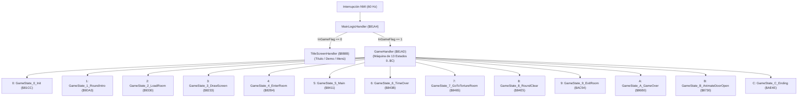

# Especificación Formal de la Máquina de Estados Global

- **ID de Entregable**: `research/contracts/state_machine.md`
- **Fase**: Fase 3 — Reconstrucción Funcional y Contratos de Comportamiento
- **Tarea**: `TASK-F3-001`
- **Fuente de Verdad**: `asm/src/prg.asm:290-1130`, `3130-3252`, `7294-7725`
- **Estado**: `[CONFIRMADA]` en su totalidad

---

## 1. Arquitectura Jerárquica de Dos Niveles

El flujo del juego se estructura en un despachador jerárquico de 2 niveles gobernado por variables en RAM:

---

## 2. Catálogo Formal de los 13 Estados de `GameHandler`

### Estado 0: `GameState_0_Init` (`$81CC`, `prg.asm:323-361`)
- **Propósito**: Inicialización de los parámetros base al arrancar una nueva partida.
- **Precondición**: Pulsación de botón `Start` en pantalla de título (`InGameFlag = 1`).
- **Operaciones por Frame**:
  - Resetea flags coleccionables (`MaybeTempCollectableFlag = 0`, `MaybeTempCollectableFlag2 = 0`).
  - Inicializa sala inicial: `CurrentRoomID = 1`, `CheckpointRoomID = 1`.
  - Configura puerta de entrada por defecto: `EntryDoorType = $0F`.
  - Inicializa atributos del jugador: `PlayerLives = 3`, `PlayerGDV = $47` BCD.
  - Encola melodía principal (`QueueSound(MUSIC_MAIN)`).
  - Limpia Nametable y OAM.
  - Fija `GameState = 1` (`GameState_1_RoundIntro`).
- **Evidencia**: `prg.asm:323-361`.

### Estado 1: `GameState_1_RoundIntro` (`$9DA3`, `prg.asm:7663-7700`)
- **Propósito**: Pantalla negra intermedia que anuncia la ronda entrante ("ROUND XX").
- **Operaciones por Frame**:
  - En el primer frame (`GameState1Flag == 0`): limpia sprites y Nametable, e invoca `DrawRoundIntroSprites`. Fija temporizador `GameState1WaitTimer = 96` frames.
  - En frames subsiguientes: decrementa `GameState1WaitTimer`.
  - Al llegar a 0: incrementa `GameState = 2` (`GameState_2_LoadRoom`).
- **Evidencia**: `prg.asm:7663-7673`.

### Estado 2: `GameState_2_LoadRoom` (`$9330`, `prg.asm:3130-3251`)
- **Propósito**: Carga estática de datos de la sala activa desde la ROM.
- **Operaciones por Frame**:
  - Resetea `MaybeBombThing = 0` y `RoomStatusFlags = 0`.
  - Lee el puntero `RoomDataPointers[CurrentRoomID]` de `data.asm:2227`.
  - Decodifica la cabecera de la sala (chunks, baldosas y tipos de puerta).
  - Transiciona inmediatamente en el mismo frame a `GameState = 3`.
- **Evidencia**: `prg.asm:3130-3140`.

### Estado 3: `GameState_3_DrawScreen` (`$8233`, `prg.asm:379-441`)
- **Propósito**: Descompresión de metatiles y volcado de la geometría a los buffers VRAM.
- **Operaciones por Frame**:
  - Limpia el buffer de objetos (`Object0Struct[0..$FF] = 0`).
  - Ejecuta `DrawFullScreen` para volcar los metatiles a `$0500-$05BF` y preparar la transferencia VRAM.
  - Carga la paleta temática de la sala en `PaletteBuffer` (`$03C0`).
  - Spawnea objetos interactivos fijos (cofres y hermano cautivo si procede).
  - Transiciona a `GameState = 4` (`GameState_4_EnterRoom`).
- **Evidencia**: `prg.asm:379-441`.

### Estado 4: `GameState_4_EnterRoom` (`$82B4`, `prg.asm:445-623`)
- **Propósito**: Animación de entrada de Jack atravesando la puerta hacia el interior de la sala.
- **Operaciones por Frame**:
  - Fase 0: Posiciona a Jack en las coordenadas exactas de la puerta de entrada según `EntryDoorType`.
  - Fase 1: Anima la apertura de la puerta y reproduce el efecto de sonido de chirrido (`QueueSound`).
  - Fase 2: Aplica velocidad automática a Jack para salir de la puerta al suelo (`ApplyPlayerXAndYVelocity`).
  - Fase 3: Cierra la puerta tras de sí (`AnimateDoorClose`).
  - Al completar la animación: transiciona a `GameState = 5` (`GameState_5_Main`).
- **Evidencia**: `prg.asm:445-623`.

### Estado 5: `GameState_5_Main` (`$8411`, `prg.asm:647-668`)
- **Propósito**: Bucle principal de juego activo a 60 Hz.
- **Operaciones por Frame**:
  - 1. Evalúa alternancia de pausa (`MaybePause` por flanco de botón `Start`).
  - 2. Si no está en pausa:
    - Ejecuta `MainSub_1` (física de Jack, salto/aleteo, colisiones 9-probe, recolección de items).
    - Ejecuta `HandleStageTimer` (decrementa temporizador de 60s cada 256 frames).
    - Ejecuta `RunEnemyLogic` y `HandleSpawnCycles` (IA de monstruos, momias y proyectiles).
    - Ejecuta `DrawScoreAndCoinCount` (actualización del HUD superior en OAM).
- **Transiciones Posibles**:
  - Si Jack entra por la puerta de salida $\to$ `GameState = 9` (`GameState_9_ExitRoom`).
  - Si el temporizador de sala llega a 0 $\to$ `GameState = 6` (`GameState_6_TimeOver`).
  - Si se activan más de 10 saltos en zona codiciosa $\to$ `GameState = 7` (`GameState_7_GoToTortureRoom`).
  - Si se recogen las 23 bombas $\to$ `GameState = 8` (`GameState_8_RoundClear`).
  - Si Jack muere y vidas == 0 $\to$ `GameState = $0A` (`GameState_A_GameOver`).
  - Si se abre una puerta intermedia $\to$ `GameState = $0B` (`GameState_B_AnimateDoorOpen`).
- **Evidencia**: `prg.asm:647-668`.

### Estado 6: `GameState_6_TimeOver` (`$843B`, `prg.asm:672-694`)
- **Propósito**: Penalización por agotamiento de tiempo.
- **Operaciones por Frame**:
  - Limpia Nametable y escribe `"TIME OVER"` en el centro de la pantalla durante 128 frames (`$80`).
  - Llama a `LoseALifeMaybeGameOver` (resta una vida y evalúa si pasa a Game Over o restaura sala).
- **Evidencia**: `prg.asm:672-694`.

### Estado 7: `GameState_7_GoToTortureRoom` (`$8465`, `prg.asm:698-772`)
- **Propósito**: Sala de Tortura por conducta codiciosa del jugador.
- **Operaciones por Frame**:
  - Fase 0: Guarda sala previa en `CheckpointRoomIDMaybe`. Muestra mensaje `"TORTURE ROOM"` durante 192 frames (`$C0`).
  - Fase Activa: Fija sala `$AC`. Carga `GreedyJumpsRemaining = $50` BCD (50 saltos en versión USA).
  - En cada pulsación de salto de Jack (`JustJumpedFlag == 1`): resta 1 salto BCD (`BCDSub1FromA`).
  - Al llegar a 0 saltos: limpia pantalla, restaura la sala previa y **ejecuta `PLA; PLA`** para salir directamente a `GameState = 2`.
- **Evidencia**: `prg.asm:698-772`.

### Estado 8: `GameState_8_RoundClear` (`$84E5`, `prg.asm:776-1004`)
- **Propósito**: Secuencia de bonificación al recoger la totalidad de las 23 bombas de la sala.
- **Sub-Máquina (`RoundClearState`)**:
  - `0: RoundClear_0`: Configura bonus de tiempo restante y calcula Fire Bomb Bonus ($\ge 20$ bombas con mecha).
  - `1: RoundClear_1`: Decrementa BCD del tiempo y suma puntos al marcador a 60 Hz.
  - `2: RoundClear_2`: Decrementa puntos de bombas de fuego y los acumula en el score.
  - `3: RoundClear_3`: Avanza `CurrentRoomID` a la siguiente sala y pasa a `GameState = 2`.
- **Evidencia**: `prg.asm:776-1004`.

### Estado 9: `GameState_9_ExitRoom` (`$AC54`, `prg.asm:7294-7372`)
- **Propósito**: Jack abandona la sala activa tras atravesar la puerta final abierta.
- **Operaciones por Frame**:
  - Cierra la puerta animadamente (`AnimateDoorClose`).
  - Evalúa si la sala alcanzada es la Sala de la Pirámide Real o la cámara final (`EndingDoorChecks`).
  - Si es la salida de una sala estándar: actualiza `CurrentRoomID` y pasa a `GameState = 2`.
  - Si es la sala final del juego: pasa a `GameState = $0C` (`GameState_C_Ending`).
- **Evidencia**: `prg.asm:7294-7380`.

### Estado A: `GameState_A_GameOver` (`$86B0`, `prg.asm:1038-1091`)
- **Propósito**: Fin de la partida tras agotar las 3 vidas.
- **Operaciones por Frame**:
  - Muestra `"GAME OVER"` y calcula el valor de `PlayerGDV` final.
  - Actualiza el High Score y el High GDV si se superaron los récords previos.
  - Espera un temporizador de 256 frames (`GameOverTimer`).
  - Al expirar: fija `InGameFlag = 0`, devolviendo el control a la pantalla de título (`TitleScreenHandler`).
- **Evidencia**: `prg.asm:1038-1091`.

### Estado B: `GameState_B_AnimateDoorOpen` (`$8730`, `prg.asm:1122-1127`)
- **Propósito**: Animación de apertura de una puerta secreta o puerta de salida durante el juego activo.
- **Operaciones por Frame**:
  - Ejecuta los pasos de animación de apertura de metatiles (`AnimateDoorOpen`).
  - Al completar la animación: retorna automáticamente a `GameState = 5` (`GameState_5_Main`).
- **Evidencia**: `prg.asm:1122-1127`.

### Estado C: `GameState_C_Ending` (`$AE4E`, `prg.asm:7706-7725`)
- **Propósito**: Secuencias de final cinemáticas y evaluación de los 4 finales según el GDV y condiciones secretas.
- **Sub-Máquina (`EndingState`)**:
  - `0: EndingState_0`: Inicialización de Nametables de palacio real y sprites de Jack y la familia real.
  - `1: EndingState_1`: Jack camina solemnemente hacia el trono.
  - `2: EndingState_2`: Transformación de Jack / Rescate de los cautivos según el Ending Type ($0..3$).
  - `3: EndingState_3`: Presentación de textos de felicitación y créditos en inglés (Tecmo Inc. USA).
  - `4: EndingState_4`: Demolición de la pirámide y retorno al título tras temporizador final.
- **Evidencia**: `prg.asm:7706-7725`.
