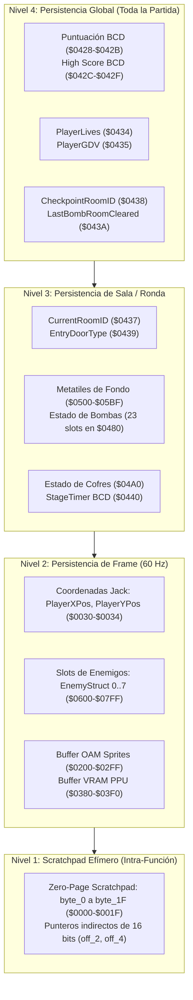

# Modelo de Flujo de Datos, Ciclo de Vida y Zero-Page Scratchpad

- **ID de Entregable**: `research/control_flow/data_flow.md`
- **Fase**: Fase 2 — Flujo de Control, Datos y Modelo de Hardware
- **Tarea**: `TASK-F2-002`
- **Fuente de Verdad**: `asm/src/ram.asm`, `variable_usage.csv` y `memory_map.md`
- **Estado**: `[CONFIRMADA]`

---

## 1. Jerarquía del Ciclo de Vida de los Datos

Las 337 variables de RAM de *Mighty Bomb Jack* se dividen en 4 niveles de persistencia según su tiempo de retención en memoria:

---

## 2. El Invariante de No-Concurrencia (Single-Threaded Cooperative Execution)

Un hallazgo crítico derivado del análisis estático de `prg.asm:91-123` y `variable_usage.csv` es que:
1. **La simulación es estrictamente monohilo y no reentrante**: Al inicio de la NMI, la CPU deshabilita explícitamente interrupciones NMI adicionales modificando el registro de control (`PPUCtrlMirror & $7F` en `prg.asm:93`).
2. **Cero Condiciones de Carrera**: Las variables de scratchpad `$0000-$001F` (`byte_0` a `byte_1F`) **nunca sufren colisiones de hilos ni interrupciones asíncronas**.
3. **Paso de Parámetros por Scratchpad**: Las funciones se transfieren punteros y resultados intermedios usando pares de bytes en Zero-Page:
   - `(byte_0, byte_1)`: Puntero base de lectura de tablas ROM o VRAM.
   - `(off_2, off_2+1)`: Puntero indirecto a metatiles de sala o buffers de audio.
   - `(off_4, off_4+1)`: Puntero de dibujo en OAM o cómputo de envolventes de volumen.

---

## 3. Matriz de Flujo de Datos entre Estados (`GameState`)

El paso de información entre los 13 estados de `GameHandler` se gobierna mediante variables canónicas en RAM:

| Transición de Estado | Parámetros de Entrada | Variables de Salida / Efectos | Rutinas Responsables |
| :--- | :--- | :--- | :--- |
| **`Init (0)` $\to$ `RoundIntro (1)`** | Ninguno (Nueva partida) | `CurrentRoomID = 1` `PlayerLives = 3` `PlayerGDV = $47` BCD `StageTimer = $60` BCD | `GameState_0_Init` (`prg.asm:323`) |
| **`RoundIntro (1)` $\to$ `LoadRoom (2)`** | `CurrentRoomID` `EntryDoorType` | Limpia buffers de OAM y resetea temporizadores de spawn. | `GameState_1_RoundIntro` (`prg.asm:365`) |
| **`LoadRoom (2)` $\to$ `DrawScreen (3)`** | `CurrentRoomID` | Carga puntero `RoomDataPointers[CurrentRoomID]` en `(byte_0, byte_1)`. | `GameState_2_LoadRoom` (`prg.asm:379`) |
| **`DrawScreen (3)` $\to$ `EnterRoom (4)`** | Bytecode de sala | Descomprime metatiles en `$0500-$05BF`. Configura paletas de sala en `PaletteBuffer` (`$03C0`). | `GameState_3_DrawScreen` (`prg.asm:445`) |
| **`EnterRoom (4)` $\to$ `Main (5)`** | `EntryDoorType` | Posiciona a Jack en la puerta de entrada. Ejecuta animación de apertura de puerta (`byte_340`). | `GameState_4_EnterRoom` (`prg.asm:627`) |
| **`Main (5)` $\to$ `TortureRoom (7)`** | `GreedyJumpsRemaining` | Guarda sala previa en `CheckpointRoomIDMaybe`. Fija `CurrentRoomID = $AC` y `GreedyJumps = $50` BCD. | `GameState_7_GoToTortureRoom` (`prg.asm:698`) |
| **`Main (5)` $\to$ `RoundClear (8)`** | Bombas recogidas $\ge 23$ | `RoundClearState = 0`. Pasa al cómputo de Time Bonus y Fire Bomb Bonus. | `GameState_8_RoundClear` (`prg.asm:776`) |
| **`Main (5)` $\to$ `GameOver (A)`** | `PlayerLives == 0` | Congela simulación, calcula GDV final y muestra pantalla de Game Over. | `GameState_A_GameOver` (`prg.asm:1038`) |

---

## 4. Pipeline de Buffers de Video VRAM

Dado que la PPU de la NES solo puede recibir escrituras durante el periodo de VBlank (o con el renderizado desactivado), el juego nunca escribe directamente en la VRAM durante `GameState_5_Main`. En su lugar, utiliza un sistema de **doble buffer en RAM**:

1. **Cola de Actualización Lineal (`PPUUpdateBuffer` en `$0380-$03F0`)**:
   - `byte_3EF`: Dirección PPU alta (ej. `$20` para Nametable 0).
   - `byte_3F0`: Dirección PPU baja (ej. `$40`).
   - `byte_3EE`: Incremento de dirección PPU (`0` = +1 horizontal, `4` = +32 vertical).
   - `byte_3F1`: Contador de bytes pendientes de volcar (si es `0`, la cola está vacía).
   - `$0380..$03EF`: Carga útil de bytes que se escribirán secuencialmente en `$2007`.
2. **Buffer de Atributos (`$0563` y `$05A3`)**:
   - Cuando se modifica un bloque de la sala (ej. al abrir un cofre o recoger una bomba), se actualizan 64 bytes de tabla de atributos en RAM.
   - Durante la siguiente NMI, `HandlePPUUpdates` vuelca el bloque completo a `$23C0` o `$2BC0` en una ráfaga ininterrumpida.
3. **Buffer de Paletas (`PaletteBuffer` en `$03C0-$03DF`)**:
   - 32 bytes correspondientes a las 4 paletas de fondo y 4 de sprites (`$3F00-$3F1F`).
   - Se activan mediante el flag `UpdatePaletteFlag` (`$0345`).

---

## 5. Implicación de Arquitectura para el Port Nativo

En la especificación funcional y en cualquier implementación futura:
- No es necesario emular la limitación física de VBlank ni los buffers de transferencia si se utiliza un buffer de píxeles virtual en memoria (ej. `uint32_t screen[256 * 240]`).
- **SIN EMBARGO, el momento exacto en que los datos se hacen visibles al jugador debe ser idéntico al frame**: Cualquier cambio provocado por la lógica de juego en el frame $N$ solo se presenta en pantalla en el frame $N+1$, preservando la latencia y la fluidez visual original del cartucho.
