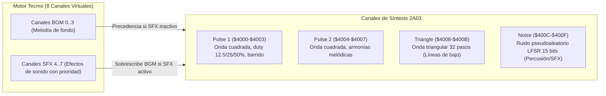

# Modelo de Abstracción de Hardware NES: PPU, APU y Joypads

- **ID de Entregable**: `research/control_flow/hardware_model.md`
- **Fase**: Fase 2 — Flujo de Control, Datos y Modelo de Hardware
- **Tarea**: `TASK-F2-003`
- **Fuente de Verdad**: `asm/src/registers.asm`, `asm/src/prg.asm` y `asm/src/music-engine.asm`
- **Estado**: `[CONFIRMADA]`

---

## 1. Modelo de la PPU 2C02 (Renderizado y Gráficos)

La Picture Processing Unit de la NES se comunica con la CPU mediante 8 registros mapeados en memoria (`$2000-$2007`):

| Registro | Dirección | Nombre en `asm/` | Operaciones en el Juego | Efecto Funcional |
| :---: | :---: | :--- | :---: | :--- |
| **`$2000`** | `PPUCTRL` | `PPUCtrlMirror` (`$0027`) | Escritura en NMI | Controla el incremento de VRAM (+1 horizontal o +32 vertical), selección de Nametable base (`$2000`) y habilitación de interrupción VBlank (bit 7). |
| **`$2001`** | `PPUMASK` | `PPUMaskMirror` (`$0028`) | Escritura en NMI | Habilita visualización de Sprites y Fondo (bits 3 y 4 con valor `#$18`). |
| **`$2002`** | `PPUSTATUS`| Lectura directa | En `RESET` | Limpia el flag de VBlank y resetea el flip-flop de `$2005/$2006`. |
| **`$2003`** | `OAMADDR` | `PPU_SPRRAM_ADDR` | Escritura en NMI | Fija la dirección base de OAM a `$00` antes del DMA. |
| **`$2005`** | `PPUSCROLL`| `byte_3C2`, `byte_3C4` | Escritura en NMI | Establece el desplazamiento de scroll X/Y tras las actualizaciones de VRAM. |
| **`$2006`** | `PPUADDR` | `PPU_ADDRESS` | En VBlank | Escribe la dirección de destino VRAM (byte alto luego byte bajo). |
| **`$2007`** | `PPUDATA` | `PPU_IO` | En VBlank | Transfiere baldosas o paletas a la memoria de video. |
| **`$4014`** | `OAMDMA` | `PPU_SPRRAM_DMA` | En NMI | Transfiere los 256 bytes de `$0200-$02FF` a la memoria interna OAM de la PPU en 513 ciclos de CPU. |

### Decodificación de Baldosas 2bpp (CHR-ROM)
Los patrones gráficos de la NES se almacenan en formato plano de 2 bits por píxel (2bpp):
- Cada baldosa de 8x8 píxeles ocupa **16 bytes**:
  - Bytes 0 a 7: Plano de bits 0 (Bit bajo del color).
  - Bytes 8 a 15: Plano de bits 1 (Bit alto del color).
- Para el píxel en posición $(x, y)$:
  $$\text{ColorIndex} = ((\text{byte}[y + 8] \gg (7 - x)) \ \& \ 1) \ll 1 \ | \ ((\text{byte}[y] \gg (7 - x)) \ \& \ 1)$$
- El valor resultante ($0..3$) selecciona una de las 4 entradas de la paleta asignada.

---

## 2. Modelo del Motor de Audio 2A03 (APU y Bytecode Musical)

El sintetizador de audio de la NES (integrado en el chip 2A03) dispone de 4 canales analógicos y un generador DMC:



### Protocolo de Precedencia BGM vs SFX (`music-engine.asm`)
1. **Canales Virtuales**: El motor mantiene internamente 8 canales virtuales:
   - Canales 0..3: Música de fondo (Pulse 1, Pulse 2, Triangle, Noise).
   - Canales 4..7: Efectos de sonido (Pulse 1 SFX, Pulse 2 SFX, Triangle SFX, Noise SFX).
2. **Prioridad SFX**: Cuando se encola un efecto de sonido en `SoundQueue` (ej. sonido de salto, recogida de moneda o explosión de bomba), el motor asigna el canal físico correspondiente al canal SFX, **silenciando o sustituyendo la voz de la melodía** hasta que la secuencia de SFX finaliza con un comando `$FF`, tras lo cual la melodía BGM recupera el control del canal sin desfases de compás.

---

## 3. Modelo de Controladores e Input Latching ($4016 / $4017)

La lectura de mandos en `UpdateJoypads` (`prg.asm:1271-1283`) opera mediante registros de desplazamiento seriales:

1. **Secuencia de Strobe**:
   - Escribir `#$01` en `$4016` (bloquea el estado actual de los 8 botones en el latch).
   - Escribir `#$00` en `$4016` (inicia la lectura serial).
2. **Lectura de 8 Bits Seriales (`ReadJoypad` en `prg.asm:1287`)**:
   - En cada lectura de `$4016` (P1) y `$4017` (P2), se lee 1 bit del estado del botón en el siguiente orden estricto:
     $$\text{A} \to \text{B} \to \text{Select} \to \text{Start} \to \text{Arriba} \to \text{Abajo} \to \text{Izquierda} \to \text{Derecha}$$
3. **Fusión de Mandos P1 y P2**:
   - En la línea `prg.asm:1280`, el juego ejecuta:
     ```asm
     LDAc Joypad1_Immediate
     ORAc Joypad2_Immediate
     STAc Joypad1_Immediate
     ```
   - **Invariante Funcional**: El jugador 1 puede controlar a Jack indistintamente desde el mando 1 o desde el mando 2 (o pulsar botones simultáneamente en ambos), ya que ambos estados se combinan con un operador lógico `OR`.
