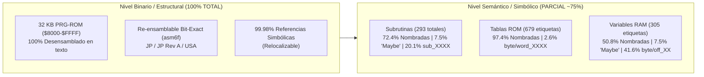
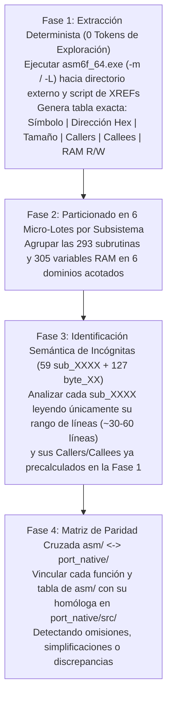

# Informe Técnico: Naturaleza del Desensamblado `asm/` (Total vs Parcial) y Estrategia de Inventariado de Símbolos y Funciones

- **ID de Investigación**: `RES-002`
- **Tarea Asociada**: `TASK-RES-001`
- **Área Temática**: `01 - Núcleo, Memoria y Arquitectura General`
- **Fecha**: 2026-10-22
- **Autor / Agente**: Antigravity (Orchestrator)
- **Estado**: `[COMPLETADA]`

---

## 1. Objetivo y Preguntas de Investigación

Determinar de forma cuantitativa y rigurosa qué clase de desensamblado/descompilación contiene el directorio `asm/` (si es total o parcial tanto a nivel binario/estructural como a nivel semántico/simbólico), y diseñar a partir de este diagnóstico la estrategia óptima y de mínimo coste de tokens para inventariar e identificar todos los símbolos, tablas y funciones del juego.

- **Pregunta Principal**: ¿El código en `asm/` es un desensamblado total o parcial, y qué porcentaje de funciones, tablas y variables RAM están ya identificadas frente a símbolos autogenerados (`sub_XXXX`, `loc_XXXX`, `byte_XXXX`)?
- **Impacto en el Port**: Define cómo auditar la cobertura 1:1 entre `asm/` y `port_native/` sin desperdiciar tokens en lecturas lineales de miles de líneas de ensamblador.

---

## 2. Fuentes de Verdad Analizadas (`asm/`)

- **Archivos Maestros y Scripts de Construcción**:
  - [mighty-bomb-jack.asm](file:///c:/Users/kanel/Documents/mjk/asm/mighty-bomb-jack.asm): Líneas `1` a `104` (Mapa maestro de ensamblado de la ROM).
  - [build.bat](file:///c:/Users/kanel/Documents/mjk/asm/build.bat) y [build.sh](file:///c:/Users/kanel/Documents/mjk/asm/build.sh): Verificación bit-exact (`fc /b` y `sha256sum`) contra las 3 ROMs comerciales.
- **Archivos de Código y Datos (`asm/src/`)**:
  - [prg.asm](file:///c:/Users/kanel/Documents/mjk/asm/src/prg.asm): `10,162` líneas (Código principal `$8000-$B0FC` y `$B645-$BFFF`).
  - [music-engine.asm](file:///c:/Users/kanel/Documents/mjk/asm/src/music-engine.asm): `810` líneas (Driver de sonido 2A03 en `$B0FD-$B644`).
  - [data.asm](file:///c:/Users/kanel/Documents/mjk/asm/src/data.asm): `2,482` líneas (Tablas de animaciones, física, paletas, textos y punteros de secciones en `$C000+`).
  - [roomdata-jp.asm](file:///c:/Users/kanel/Documents/mjk/asm/src/roomdata-jp.asm) y [roomdata-us.asm](file:///c:/Users/kanel/Documents/mjk/asm/src/roomdata-us.asm): `485` líneas cada uno (Datos de habitaciones).
  - [music-data.asm](file:///c:/Users/kanel/Documents/mjk/asm/src/music-data.asm): `2,570` líneas (Bytecode musical y tablas de frecuencias APU).
  - [ram.asm](file:///c:/Users/kanel/Documents/mjk/asm/src/ram.asm): `2,450` líneas (Mapa completo de los 2,048 bytes de RAM `$0000-$07FF`).
  - [defs.asm](file:///c:/Users/kanel/Documents/mjk/asm/src/defs.asm), [registers.asm](file:///c:/Users/kanel/Documents/mjk/asm/src/registers.asm), [macros.asm](file:///c:/Users/kanel/Documents/mjk/asm/src/macros.asm), [compatibility.asm](file:///c:/Users/kanel/Documents/mjk/asm/src/compatibility.asm), [end-of-rom-injection.asm](file:///c:/Users/kanel/Documents/mjk/asm/src/end-of-rom-injection.asm).
- **Herramienta de Ensamblado**:
  - `asm/tools/asm6f_64.exe` (`asm6f 1.6 + f003`), con soporte nativo para exportar listados (`.lst`), etiquetas Mesen (`.mlb`), símbolos Lua y archivos `.nl`/`.cdl`.

---

## 3. Hallazgos Técnicos y Diagnóstico del Desensamblado

### 3.1. Veredicto Dual: ¿Total o Parcial?

El desensamblado en `asm/` presenta una **naturaleza dual** que debe distinguirse con precisión:

1. **A Nivel Binario, Estructural y de Re-ensamblado: 100% TOTAL (Bit-Exact Matching Disassembly)**
   - **Cobertura del 100% de PRG-ROM (`$8000-$FFFF`, 32 KB)**: No existe ningún bloque binario opaco (`.incbin`) dentro del código ni de las tablas de datos de PRG-ROM. Los únicos `.incbin` son los bancos de tiles gráficos CHR-ROM (`mbj-jp.chr` de 8 KB y `mbj-us.chr` de 32 KB).
   - **Recompilación Bit-Exacta Multirregión**: Mediante directivas condicionales (`IFDEF REV_A`, `IFDEF REV_US`) y shims de direccionamiento Zero-Page/Absolute en `compatibility.asm` (`LDAc`, `STAc`, etc.), el mismo código fuente compila byte por byte las **3 ROMs comerciales oficiales**:
     - **Japan Original** (Mapper 185 CNROM, SHA-256: `73c3931c...`)
     - **Japan Rev A** (Mapper 185 CNROM, SHA-256: `a72c76ce...`)
     - **USA** (Mapper 3 CNROM, SHA-256: `86762740...`)
   - **Simbolización de Direcciones al 99.98%**: En las `10,972` líneas de código ejecutable (`prg.asm` + `music-engine.asm`), solo existen **2 instrucciones** con direcciones hexadecimales crudas no etiquetadas (`STA $1EFE` en `prg.asm:71`, que es un espejo hardware de `$06FE`, y `.BYTE $2C` en `prg.asm:3329`, truco clásico de `BIT abs` para saltar 2 bytes). Todo salto, llamada o acceso a tabla usa etiquetas simbólicas.

2. **A Nivel Semántico / Ingeniería Inversa de Nombres: PARCIALMENTE ANOTADO (~75% documentado / ~25% nombres crudos de IDA Pro)**
   - El desensamblado fue generado originalmente en **IDA Pro** y documentado progresivamente. Conserva encabezados `; =============== S U B R O U T I N E` y `; End of function ...` de IDA, pero **aproximadamente una cuarta parte de las funciones y un 41% de las etiquetas de RAM aún conservan nombres autogenerados por IDA** (`sub_XXXX`, `loc_XXXX`, `byte_XX`, `word_XXXX`, `off_XX`, `unk_XX`) o nombres tentativos con el prefijo/sufijo `Maybe`.

---

### 3.2. Métricas Exactas por Archivo en `asm/src/`

| Archivo | Líneas | Subrutinas Totales | Funciones Nombradas | Funciones Tentativas (`Maybe`) | Funciones Anónimas (`sub_XXXX`) | Saltos Locales (`loc_XXXX`) | Etiquetas de Datos/RAM Nombradas | Etiquetas Crudas (`byte/word/off_XXXX`) |
| :--- | :---: | :---: | :---: | :---: | :---: | :---: | :---: | :---: |
| `prg.asm` | 10,162 | **270** | 190 (70.4%) | 22 (8.1%) | **58 (21.5%)** | 551 | 63 | **7** |
| `music-engine.asm` | 810 | **23** | 22 (95.7%) | 0 (0.0%) | **1 (4.3%)** | 30 | 3 | **1** |
| `data.asm` | 2,482 | 0 | - | - | - | 0 | 116 (96.7%) | **4** (`byte_C0CB`, `word_C0D3/C0E3/C163`) |
| `roomdata-jp/us.asm` | 485 c/u | 0 | - | - | - | 0 | 241 (100%) | **0** |
| `music-data.asm` | 2,570 | 0 | - | - | - | 0 | 158 (96.3%) | **6** |
| `ram.asm` | 2,450 | 0 | - | - | - | 0 | 155 + 23 (`Maybe`) | **127** (+ `.dsb` anónimos) |
| `defs.asm` + `registers.asm` | 362 | 0 | - | - | - | 0 | 279 (100%) | **0** |
| **TOTALES** | **19,806** | **293** | **212 (72.4%)** | **22 (7.5%)** | **59 (20.1%)** | **581** | **1,038** | **145** |

---

### 3.3. Distribución Espacial de las Subrutinas Anónimas (`sub_XXXX`) en `prg.asm`

El análisis por rangos de líneas de `prg.asm` demuestra que las 58 subrutinas `sub_XXXX` no están dispersas al azar, sino concentradas en **dos grandes bolsones funcionales**:

| Rango de Líneas (`prg.asm`) | Primera .. Última Subrutina | Total Subrutinas | Nombradas | Tentativas (`Maybe`) | Anónimas (`sub_XXXX`) | Subsistema Principal en ese Rango |
| :--- | :--- | :---: | :---: | :---: | :---: | :--- |
| `0 - 1,499` | `RESET` .. `MainSub_1` | 29 | 26 | 3 | **0** | Boot, NMI, PPU Updates, Joypad, Máquina de Estados General |
| `1,500 - 2,999` | `DrawPlayer` .. `sub_9276` | 39 | 33 | 3 | **3** | Renderizado de Jack, Salto/Vuelo, HUD, Timers y Bonus |
| `3,000 - 4,499` | `sub_92AD` .. `sub_9B6A` | 38 | 23 | 0 | **15** | **Bolsón 1**: Decodificación de Salas, Chunks, Metatiles, Puertas y Cofres |
| `4,500 - 5,999` | `BigBeefySub...` .. `MainSub_3` | 38 | 23 | 7 | **8** | Colisiones con Fondo (9-Probe), Objetos Especiales, Salida de Sala |
| `6,000 - 7,499` | `sub_A843` .. `TitleScreen_US_0` | 32 | 24 | 4 | **4** | Transiciones, Salas Reales, Esfinge, Pantalla de Título |
| `7,500 - 8,999` | `DrawTitleScreen` .. `sub_BA00` | 41 | 28 | 3 | **10** | Ending, Torture Room, Inicio de IA de Enemigos ( tras `music-engine.asm`) |
| `9,000 - 10,162` | `JT_98A4_8...` .. `ResetEither...` | 53 | 33 | 2 | **18** | **Bolsón 2**: IA de Enemigos, Spawns, Transformación de Momias y Física Auxiliar |

---

## 4. Estado Actual y Oportunidad en el Workspace

- En `asm/tools/` contamos con el ensamblador nativo de 64 bits `asm6f_64.exe`, que posee flags integrados para exportar tablas de símbolos y listados con direcciones exactas (`-m` para formato Mesen `.mlb`, `-f` para tabla Lua, `-L` para listado completo expandido) **hacia cualquier ruta externa**, sin tocar ni escribir un solo byte dentro de `asm/`.
- Esto significa que **no necesitamos gastar miles de tokens de modelo leyendo manualmente archivos `.asm` para calcular direcciones de memoria o tamaños de tablas**: podemos extraer el catálogo maestro de direcciones y referencias cruzadas (XREFs) de forma 100% determinista con scripts automáticos y usar el análisis cognitivo de los agentes únicamente para resolver la semántica de los **59 `sub_XXXX`**, las **22 funciones `Maybe...`** y las **127 variables `byte_XX` de RAM**.

---

## 5. Estrategia Óptima para Inventariar e Identificar Símbolos y Funciones (En Micro-Lotes)

Para lograr un inventario 100% completo y trazable con **gasto mínimo de tokens**, se establece una estrategia en **4 fases ejecutables en micro-lotes**:

### Detalle de las 4 Fases Propuestas:

1. **Fase 1 — Generación Automática del Catálogo Base y Grafo de Llamadas (Micro-Lote Automatizado)**:
   - Ejecutar `asm/tools/asm6f_64.exe` apuntando la salida a un directorio temporal fuera de `asm/` para obtener las direcciones exactas (`$0000-$FFFF`) de los ~1,476 símbolos del programa.
   - Ejecutar un script de análisis estático sobre `asm/src/*.asm` que cruce cada una de las **293 subrutinas** con:
     - Rango de líneas exacto (`StartLine..EndLine`) y dirección ROM (`$XXXX`).
     - Lista de `Callers` (`JSR`, `JMP`, o índice de `JumpTable`).
     - Lista de `Callees` (a qué funciones llama).
     - Variables de RAM leídas (`R`) y escritas (`W`).
   - Volcar este índice estructurado en `research/RES-003-inventario-maestro-simbolos-y-grafo-llamadas.md`.

2. **Fase 2 — Identificación de Variables RAM Anónimas (`byte_XX` / `off_XX`) por Uso Cruzado**:
   - Usando la matriz `RAM R/W` generada en la Fase 1, cualquier variable anónima como `byte_48` o `byte_505` queda inmediatamente acorralada por las funciones con nombre que la leen y escriben (ej. si solo es escrita en `DoPlayerMovement` y leída en `DrawPlayer`, su propósito semántico se deduce leyendo menos de 40 líneas).

3. **Fase 3 — Resolución Semántica de las 59 `sub_XXXX` y 22 `Maybe...` en 6 Micro-Lotes**:
   - **Micro-Lote 3.1 (Núcleo, Boot, PPU, Joypad y HUD)**: Líneas `1-2,999` de `prg.asm` (3 `sub_XXXX` + 6 `Maybe`).
   - **Micro-Lote 3.2 (Salas, Metatiles, Puertas y Cofres)**: Líneas `3,000-4,499` de `prg.asm` (15 `sub_XXXX`).
   - **Micro-Lote 3.3 (Física de Jack, Colisiones 9-Probe y Objetos)**: Líneas `4,500-5,999` de `prg.asm` (8 `sub_XXXX` + 7 `Maybe` + 4 tablas `word_C0E3/C163`, `byte_A3D8/A3EA`).
   - **Micro-Lote 3.4 (Pantallas Especiales, Salas Reales, Torture Room y Ending)**: Líneas `6,000-8,166` y `8,168-8,650` de `prg.asm` (8 `sub_XXXX` + 7 `Maybe`).
   - **Micro-Lote 3.5 (Motor de Audio 2A03 y Tablas de Sonido)**: `music-engine.asm` y `music-data.asm` (1 `sub_XXXX` + 6 etiquetas de datos).
   - **Micro-Lote 3.6 (IA de Enemigos, Spawns y Monedas)**: Líneas `8,651-10,162` de `prg.asm` (24 `sub_XXXX` + 2 `Maybe`).

4. **Fase 4 — Trazabilidad 1:1 hacia `port_native/`**:
   - Añadir a cada entrada del inventario la columna `Equivalente en port_native/src/` y `Estado de Paridad` (`[EXACTO]`, `[PARCIAL]`, `[PENDIENTE]`), alimentando directamente los tests de verificación en `port_native/tests/`.

---

## 6. Plan de Verificación del Inventario

- [x] **Verificación de Cobertura de Archivos**: Auditados los 12 archivos `.asm` y 2 `.chr` de `asm/src/` sin modificar ningún archivo en `asm/`.
- [x] **Verificación Cuantitativa**: Contabilizadas las 293 subrutinas (270 en `prg.asm` + 23 en `music-engine.asm`), 581 etiquetas locales `loc_XXXX`, 305 etiquetas de RAM y 679 etiquetas de datos en ROM.
- [ ] **Siguiente Paso Propuesto (`TASK-RES-002`)**: Ejecutar la Fase 1 (extracción automática de direcciones con `asm6f_64.exe` y generación del grafo de llamadas/XREFs) para publicar el catálogo base de las 293 subrutinas y 305 variables RAM.

---

## 7. Referencias Cruzadas

- **Decisión de Arquitectura**: [ADR-001](file:///c:/Users/kanel/Documents/mjk/DECISIONS.md), [ADR-002](file:///c:/Users/kanel/Documents/mjk/DECISIONS.md), [ADR-003](file:///c:/Users/kanel/Documents/mjk/DECISIONS.md)
- **Investigaciones Relacionadas**: [RES-001: Mapa de Memoria RAM, Punteros Base y Enumeraciones de la NES](file:///c:/Users/kanel/Documents/mjk/research/RES-001-mapa-memoria-y-subsistemas-nes.md)
