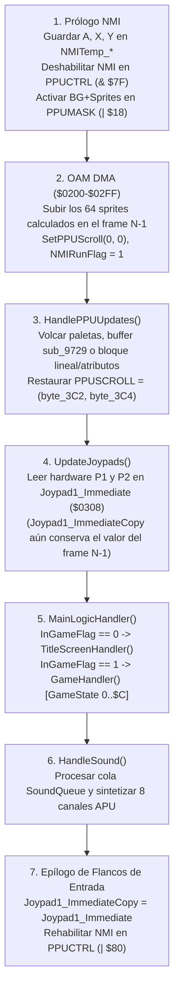

# Informe Técnico: Especificación Funcional C x86 — Subsistema 01: Boot, Pipeline NMI, PPU Buffer, Joypad y Máquina de Estados (`$8000-$8A9B`)

- **ID de Investigación**: `RES-004`
- **Tarea Asociada**: `TASK-RES-003`
- **Área Temática**: `01 - Núcleo, Memoria y Arquitectura General`
- **Fecha**: 2026-10-22
- **Autor / Agente**: Antigravity (Orchestrator)
- **Estado**: `[COMPLETADA]`

---

## 1. Objetivo y Preguntas de Investigación

Especificar al 100% de fidelidad funcional y matemática las primeras **24 rutinas del núcleo de ejecución** en [prg.asm](file:///c:/Users/kanel/Documents/mjk/asm/src/prg.asm#L1-L1636) (`$8000-$8A9B`, más `JumpTable` y `QueueSound` en `$8D76-$8D93`) para permitir una recreación exacta en **C x86** a 60 Hz sin discrepancias de latencia de entrada, orden de actualización ni flujo de pila.

- **Preguntas Resueltas**:
  1. ¿Cuál es la secuencia exacta de operaciones por frame dentro de `NMI` y por qué `Joypad1_ImmediateCopy` se actualiza al final del frame?
  2. ¿Cómo funcionan los 3 modos de transferencia PPU dentro de `HandlePPUUpdates` (`CopyPaletteToPPU`, `sub_9729` y bloques lineales/atributos)?
  3. ¿Cómo operan todos los estados de `GameHandler` (`GameState` `0..$C`), `RoundClear_0..3`, el cálculo de `GDV`, el divisor de 256 frames del `StageTimer` y el controlador maestro de Jack `MainSub_1`?
  4. ¿Cuál es el significado real de las 3 subrutinas tentativas de este bloque (`LoseALifeMaybeGameOver`, `MaybeGoBackToOldRoom`, `MaybePause`)?

---

## 2. Fuentes de Verdad Analizadas (`asm/`)

- **[prg.asm](file:///c:/Users/kanel/Documents/mjk/asm/src/prg.asm)**:
  - Líneas `1 - 1636` (`$8000 - $8A9B`): `RESET`, `NMI`, `HandlePPUUpdates`, `CopyPaletteToPPU`, `CopyPaletteToPPU2`, `MainLogicHandler`, `GameHandler`, `GameState_0_Init`, `InitPlayerStruct`, `GameState_3_DrawScreen`, `GameState_4_EnterRoom`, `SetPlayerVelocityFromX`, `GameState_5_Main`, `GameState_6_TimeOver`, `GameState_7_GoToTortureRoom`, `GameState_8_RoundClear` (`RoundClear_0..3`), `DrawTimeBonus`, `DrawFireBombBonus`, `GameState_A_GameOver`, `AddAToGDV`, `BCDCheckFirstDigit`, `GameState_B_AnimateDoorOpen`, `LoseALifeMaybeGameOver`, `MaybeGoBackToOldRoom`, `MaybePause`, `HandleStageTimer`, `InitXSprites`, `UpdateJoypads`, `ReadJoypad`, `MainSub_1`.
  - Líneas `2180 - 2203` (`$8D76 - $8D93`): `JumpTable`, `QueueSound`.

---

## 3. Hallazgos Técnicos y Extracción de Datos

### 3.1. Inventario de Subrutinas y Contrato ABI 6502 (`$8000-$8A9B`)

| Etiqueta `asm/` | Nombre Semántico C x86 | Dir. ROM | Líneas `prg.asm` | Entradas (`A,X,Y,C,ZP`) | Salidas (`A,X,Y,Flags`) | Stack Mutation | Callers | Callees |
| :--- | :--- | :---: | :---: | :--- | :--- | :---: | :--- | :--- |
| `RESET` | `sys_reset` | `$8000` | `8-81` | Ninguna (Boot) | Bucle infinito `JMP LoopForever` | `TXS ($FF)` | Vector `$FFFC` | `ClearNametable`, `ClearAllSprites`, `RestoreDefaultPalettes`, `SetPPUCtrl` |
| `NMI` / `IRQ` | `sys_nmi_frame_tick` | `$8081` | `90-123` | Interrupción VBlank (60 Hz) | Preserva `A, X, Y` vía `NMITemp_*` | `RTI` | Vector `$FFFA` | `SetPPUCtrl`, `SetPPUMask`, `SetPPUScroll`, `HandlePPUUpdates`, `UpdateJoypads`, `MainLogicHandler`, `HandleSound` |
| `HandlePPUUpdates` | `ppu_flush_vram_updates` | `$80C6` | `127-237` | Flags `PPUUpdateFlag1/2`, `UpdatePaletteFlag` | Limpia `byte_3F1=0`, fija scroll `byte_3C2/3C4` | `RTS` | `NMI`, `DrawFullScreen` | `CopyPaletteToPPU`, `sub_9729`, `LoadPointerTo050`, `SetPPUCtrl` |
| `CopyPaletteToPPU` | `ppu_upload_palettes` | `$8178` | `241-249` | `PaletteBuffer[0..$1F]` | `UpdatePaletteFlag=0`, salta a `loc_815B` | `JMP loc_815B` | `HandlePPUUpdates` | `CopyPaletteToPPU2` (x2) |
| `CopyPaletteToPPU2` | `ppu_upload_palette_half` | `$8187` | `259-281` | `X=offset (0/$10)`, `Y=$10` | `X = X + $10`, `Y = 0` | `RTS` | `CopyPaletteToPPU` | - |
| `MainLogicHandler` | `game_main_logic_dispatch` | `$81AF` | `290-296` | `InGameFlag` (`0..1`) | Despacha vía `JumpTable` | `RTS` | `NMI` | `JumpTable` $\to$ `TitleScreenHandler` (0), `GameHandler` (1) |
| `GameHandler` | `game_state_dispatch` | `$81B9` | `300-317` | `GameState` (`0..$C`) | Despacha vía `JumpTable` | `RTS` | `MainLogicHandler` | `JumpTable` $\to$ `GameState_0..C` |
| `GameState_0_Init` | `gs0_init_new_game` | `$81D9` | `323-361` | - | `CurrentRoomID=1`, `EntryDoorType=$0F`, `PlayerLives=3`, `PlayerGDV=$47`, `GameState=1` | `RTS` | `GameHandler` | `QueueSound`, `ClearNametable` |
| `InitPlayerStruct` | `player_clear_struct` | `$8234` | `365-375` | - | `PlayerStruct[0..$1E] = 0`, `A=0, X=$1F` | `RTS` | `GameState_1_RoundIntro`, `GameState_2_LoadRoom` | - |
| `GameState_3_DrawScreen` | `gs3_prepare_and_draw_room` | `$8240` | `379-441` | `CurrentRoomID` | Inicializa sala, limpia `Object0Struct[0..$FF]`, `GameState=4` | `RTS` | `GameHandler` | `ClearAllSprites`, `MaybeLoadRoomFlags`, `LoadRoomStuff`, `DrawFullScreen`, `RestoreDefaultPalettesLimited`, `SpawnBrotherRoomObjects` |
| `GameState_4_EnterRoom` | `gs4_enter_room_sequence` | `$82C2` | `445-623` | `EntryDoorType`, `byte_340` | Secuencia de 3 fases (`byte_340` bits 0,1,2), al terminar pasa a `GameState=5` | `RTS` | `GameHandler` | `SetPlayerVelocityFromX`, `DrawPlayer`, `LoadRoomPalette`, `AnimateDoorOpen`, `ApplyPlayerXAndYVelocity`, `AnimateDoorClose`, `MainSub_3`, `QueueSound` |
| `SetPlayerVelocityFromX` | `player_set_cardinal_vel` | `$8407` | `627-636` | `X = dir_offset (0,2,4,6)` | `PlayerYVelHi = VectorTable[X]`, `PlayerXVelHi = VectorTable[X+1]`, `Lo = 0` | `RTS` | `GameState_4_EnterRoom`, `GameState_9_ExitRoom` | - |
| `GameState_5_Main` | `gs5_active_gameplay_tick` | `$8420` | `647-668` | - | Ejecuta frame de juego activo si no está en pausa (`MaybePauseFlag & $20 == 0`) | `RTS` | `GameHandler` | `MaybePause`, `MainSub_1`, `GameState_7_GoToTortureRoom`, `HandleStageTimer`, `MainSub_3`, `HandleSpawnsAndMore`, `DrawScoreAndCoinCount` |
| `GameState_6_TimeOver` | `gs6_time_over_sequence` | `$844A` | `672-694` | `TimerStatusMaybe` | Muestra `"TIME OVER"` por 128 frames (`$80`), resta vida | `RTS` | `GameHandler` | `ClearNametable`, `WriteStringToPPU`, `QueueSound`, `LoseALifeMaybeGameOver`, `RestoreDefaultPalettesLimited` |
| `GameState_7_GoToTortureRoom` | `gs7_torture_room_handler` | `$8474` | `698-772` | `TortureRoomSceneFlag`, `JustJumpedFlag` | Fase 0: mensaje `$C0` frames $\to$ Sala `$AC` (`GreedyJumps=$49` JP / `$50` US). Fase activa: resta 1 salto BCD por `JustJumpedFlag`; al llegar a 0 restaura sala y **hace `PLA; PLA`** | **`PLA;PLA` (al llegar a 0 saltos)** | `GameHandler`, `GameState_5_Main` | `ClearAllSprites`, `ClearNametable`, `WriteStringToPPU`, `QueueSound`, `MaybeGoBackToOldRoom`, `DrawTimerOrTortureJumps` |
| `GameState_8_RoundClear` | `gs8_round_clear_sequence` | `$84F6` | `776-1004` | `GS8_Status`, `RoundClearState` | Despacha `RoundClear_0..3` (Time Bonus + Fire Bomb Bonus $\ge 20$ bombas) y avanza `LastBombRoomCleared` (`$90..$9F`) | `RTS` | `GameHandler` | `JumpTable` $\to$ `RoundClear_0..3` |
| `DrawTimeBonus` | `hud_draw_time_bonus` | `$86B6` | `1008-1018` | `StageTimerCopy` | Escribe dígitos BCD en OAM slot 5 (`X=$AC, Y=$7C`) | `RTS` | `RoundClear_0`, `RoundClear_1` | `WriteBCDDigitsSprites` |
| `DrawFireBombBonus` | `hud_draw_fire_bomb_bonus` | `$86C8` | `1022-1032` | `FireBombBonusPoints` | Escribe dígitos BCD en OAM slot 12 (`X=$B4, Y=$C4`) | `RTS` | `RoundClear_0`, `RoundClear_2` | `WriteBCDDigitsSprites` |
| `GameState_A_GameOver` | `gsA_game_over_and_gdv` | `$86DB` | `1038-1091` | `GameOverInitFlag` | Calcula `PlayerGDV` final, actualiza `HighGDV`, espera `GameOverTimer` (256 frames) y vuelve a Title (`InGameFlag=0`) | `RTS` | `GameHandler` | `ClearAllSprites`, `ClearNametable`, `WriteStringToPPU`, `QueueSound`, `AddAToGDV`, `CopyNext5BytesToTempSprite`, `WriteBCDDigitsSprites`, `RestoreDefaultPalettes` |
| `AddAToGDV` | `gdv_add_bcd` | `$8733` | `1095-1102` | `A = valor a sumar` | Suma `A` en BCD a `PlayerGDV` | `RTS` | `GameState_A_GameOver` | `BCDCheckFirstDigit` |
| `BCDCheckFirstDigit` | `bcd_adjust_low_nibble` | `$8740` | `1106-1118` | `A` | Si `(A & $0F) >= $0A`, suma `6` (`ADC #5` con `C=1`) | `RTS` | `AddAToGDV` | - |
| `GameState_B_AnimateDoorOpen` | `gsB_animate_door_open` | `$874E` | `1122-1127` | - | Ejecuta `AnimateDoorOpen` y vuelve a `GameState=5` | `RTS` | `GameHandler` | `AnimateDoorOpen` |
| `LoseALifeMaybeGameOver` | `player_lose_life_or_gameover` | `$8757` | `1135-1151` | `PlayerLives` | Decrementa `PlayerLives`. Si `==0` $\to$ `GameState=$0A`. Si `>0` $\to$ restaura checkpoint, resetea Mighty y pone `GameState=1`, `TimerStatusMaybe=0` | `RTS` | `GameState_6_TimeOver`, `MainSub_1` | `MaybeGoBackToOldRoom` |
| `MaybeGoBackToOldRoom` | `room_restore_checkpoint` | `$8777` | `1155-1163` | `CheckpointRoomIDMaybe`, `EntryDoorTypeBackup` | `CurrentRoomID = CheckpointRoomIDMaybe`, `EntryDoorType = EntryDoorTypeBackup`, `GameState = 2` | `RTS` | `GameState_7_GoToTortureRoom`, `LoseALifeMaybeGameOver` | - |
| `MaybePause` | `game_check_pause_toggle` | `$8789` | `1167-1187` | `Joypad1_Immediate`, `Joypad1_ImmediateCopy` | Si flanco de subida en `JP_Start`, invierte bit 5 (`$20`) de `MaybePauseFlag` y encola `Sound_Pause`/`Sound_Unpause` | `RTS` | `GameState_5_Main` | `QueueSound` |
| `HandleStageTimer` | `stage_timer_tick` | `$87A8` | `1191-1232` | `TimerStatusMaybe`, `StageTimer`, `TimerFrames` | Si bit 6 (`$40`) activo, retorna (congelado). Inicializa a `$60` BCD; cada 256 frames (`DEC TimerFrames == 0`) resta 1 BCD. Si llega a 0 $\to$ `GameState=6` | `RTS` | `GameState_5_Main` | `BCDSub1FromA`, `DrawTimerOrTortureJumps` |
| `InitXSprites` | `oam_init_x_blank_sprites` | `$87EC` | `1238-1264` | `X = count`, `CurrentSpriteIndex`, `TempSpriteX/Y` | Rellena `X` entradas OAM consecutivas con `tile=0, attr=0`, avanzando `TempSpriteX += 8` e `INC CurrentSpriteIndex` | `RTS` | `RoundClear_0`, `GameState_1_RoundIntro`, `DrawTitleScreen` | - |
| `UpdateJoypads` | `input_poll_joypads` | `$8818` | `1271-1283` | Hardware `$4016/$4017` | Hace strobe `$4016` (`1` luego `0`), lee P1 y P2 (incluyendo micrófono Famicom bit 2) y hace `Joypad1_Immediate \|= Joypad2_Immediate` | `RTS` | `NMI` | `ReadJoypad` (x2) |
| `ReadJoypad` | `input_shift_register_read` | `$8833` | `1287-1300` | `X = pad_idx (0 o 1)` | Lee 8 bits de `JOY1+X`, combina bit 0 y bit 1 (`LSR; ORA byte_0; LSR; ROL`) en `Joypad1_Immediate,X` | `RTS` | `UpdateJoypads` | - |
| `MainSub_1` | `player_frame_update` | `$8845` | `1304-1636` | `PlayerStruct`, `Joypad1_Immediate` | Gestiona muerte de Jack, `EnemyCoinTimer` (16-bit), pulsaciones `A`/`B` (Mighty Level, salto/aleteo), movimiento Y/X, límites de scroll y animación de sprites. Si muere y agota timer, **hace `PLA; PLA; RTS`** | **`PLA;PLA` (al terminar animación de muerte)** | `GameState_5_Main` | `QueueSound`, `LoseALifeMaybeGameOver`, `RestoreDefaultPalettesLimited`, `UpdateMightyPalette`, `AddScore`, `UseMightyCoin`, `LoadObjectPointerA`, `DoSomethingWithObjYVel`, `ApplyPlayerYVelocity`, `ApplyPlayerXVelocity`, `DrawPlayer` |
| `JumpTable` | `cpu_jump_table_dispatch` | `$8D76` | `2180-2194` | `A = índice (0..N)`, Stack top = dirección base tabla - 1 | Extrae dirección de retorno `(PLA, PLA)`, suma `2*A + 1` y hace `JMP (JumpTableTarget)` | Consume su propio frame de retorno | 15 sitios | Destinos de las 15 `JumpTables` |

---

### 3.2. Pipeline Exacto de `NMI` y Orden Intra-Frame (60 Hz)

Todo el motor se ejecuta dentro de la interrupción `NMI` (`prg.asm:91-123`). Para que la recreación en C x86 tenga **latencia de entrada y colisión idéntica al frame**, el bucle principal `nmi_tick()` debe respetar estrictamente este orden de 7 pasos:



> **Invariante Crítico para C x86**:
> La copia `Joypad1_ImmediateCopy = Joypad1_Immediate` (`prg.asm:113-114`) ocurre **DESPUÉS** de `MainLogicHandler` y `HandleSound`.
> Cualquier detector de flanco de subida en el juego tiene la forma:
> ```c
> bool pressed_edge = (Joypad1_Immediate & MASK) && !(Joypad1_ImmediateCopy & MASK);
> ```
> Si en C se actualiza `Joypad1_ImmediateCopy` dentro de `UpdateJoypads()` antes de `MainLogicHandler()`, **ningún botón por flanco (`Start`, `A`, `B`) funcionará jamás**.

---

### 3.3. Especificación de `HandlePPUUpdates` (`$80C6`) y Prioridad JP vs US

`HandlePPUUpdates` (`prg.asm:127-237`) transfiere datos desde la RAM hacia la VRAM durante el periodo de VBlank y tiene una sutil diferencia entre las revisiones JP y US:

1. **Prioridad de Ramas**:
   - **En versión JP (`!REV_US`)**:
     1. Si `PPUUpdateFlag1 != 0` **y** `UpdatePaletteFlag != 0` $\to$ llama a `CopyPaletteToPPU` (que limpia `UpdatePaletteFlag = 0`, sube 32 bytes de `PaletteBuffer` a `$3F00-$3F1F` y salta a `loc_815B` para fijar el scroll y salir).
     2. Si no, evalúa `PPUUpdateFlag2 != 0` $\to$ llama a `sub_9729` y salta a `loc_815B`.
     3. Si `PPUUpdateFlag2 == 0` $\to$ ejecuta la transferencia por puntero `off_81AB[PPUUpdateFlag1]`:
        - Si `PPUUpdateFlag1 == 0`: Transfiere `byte_3F1` bytes desde `PPUUpdateBuffer` (`$0380`) hacia la dirección PPU `(byte_3EF << 8) | byte_3F0`, con incremento de PPUCTRL gobernado por `byte_3EE` (`0` = +1 horizontal, `4` = +32 vertical). Luego pone `byte_3F1 = 0`.
        - Si `PPUUpdateFlag1 != 0`: Forzadamente configura una transferencia de **64 bytes (`$40`) de tabla de atributos** (`byte_3EE = 0`, `byte_3F0 = $C0`, `byte_3F1 = $40`):
          - Si `(byte_3EF & $08) == 0`: escribe en Nametable 0 (`byte_3EF = $23`, dirección PPU `$23C0`) leyendo desde `BasePointer_AttributeTableBuffer` (`$0563`).
          - Si `(byte_3EF & $08) != 0`: escribe en Nametable 2 (`byte_3EF = $2B`, dirección PPU `$2BC0`) leyendo desde `BasePointer_AttributeTableBuffer + 1` (`$05A3`).
   - **Al finalizar (`loc_815B`)**:
     - Limpia bits 0 y 2 de `PPUCtrlMirror` (`AND #$FA`, seleccionando Nametable base `$2000` e incremento +1) y escribe `PPUSCROLL = (byte_3C2, byte_3C4)`.

---

### 3.4. Especificación Completa de `MainSub_1` (`$8845` — Controlador Frame a Frame de Jack)

`MainSub_1` (`prg.asm:1304-1636`) es el corazón del bucle activo (`GameState_5_Main`). Su flujo exacto paso a paso es:

1. **Reset de Velocidad Y por Frame**:
   - `PlayerYVelLo = 0; PlayerYVelHi = 0;` (la velocidad Y se recalcula íntegramente en cada frame).
2. **Secuencia de Muerte de Jack (`PlayerStruct & $80 != 0`)**:
   - **Fase 1 (Inicio de muerte, bit 6 `$40` aún en 0)**:
     - Activa bit 6 (`PlayerStruct |= $40`), `MaybeDeathTimer = 6`, `PlayerSprite = $28`.
     - Encola `Sound_Silence` y `Sound_Death`.
   - **Fase 2 (Giro/animación en el aire mientras cae hasta tocar suelo, bit 5 `$20` aún en 0)**:
     - Comprueba si tocó suelo (`CollisionFlag & $04 != 0`):
       - Si **NO** tocó suelo: decrementa `MaybeDeathTimer`; cada 6 frames alterna `PlayerSprite ^= 1` (entre `$28` y `$29`), y salta a `loc_8970` para seguir aplicando gravedad/caída (`DoSomethingWithObjYVel` con `X=0` input nulo).
       - Si **SÍ** tocó suelo (`CollisionFlag & $04 != 0`): activa bit 5 (`PlayerStruct |= $20`), fija `MaybeDeathTimer = $40` (64 frames) y salta a `loc_89EF` (inmóvil en X).
   - **Fase 3 (Tumbado en el suelo, bit 5 `$20` activo)**:
     - Fija `PlayerSprite = $2A` y decrementa `MaybeDeathTimer`.
     - Cuando `MaybeDeathTimer == 0`:
       - Llama a `LoseALifeMaybeGameOver()` y `RestoreDefaultPalettesLimited($10)`.
       - **Ejecuta `PLA; PLA; RTS`** (`prg.asm:1336-1338`), abortando el resto de `GameState_5_Main` (no ejecuta `TortureRoom`, `HandleStageTimer`, `MainSub_3`, `HandleSpawnsAndMore` ni `DrawScoreAndCoinCount` en ese frame).
3. **Temporizador de Enemigos Convertidos en Monedas (`_EnemyCoinTimerCheck`, `$88BF`)**:
   - Si el contador de 16 bits `(EnemyCoinTimer+1 << 8) | EnemyCoinTimer` es distinto de 0:
     - Decrementa el par de 16 bits en 1 por frame.
     - Cuando llega exactamente a `0x0000`:
       - Limpia `MaybeTempCollectableFlag = 0` y `MaybeTempCollectableFlag2 = 0`.
       - Restaura las 2 últimas paletas de sprites (`RestoreDefaultPalettesLimited($18)`).
       - Reanuda la música de la sala (`MusicOptionsTable[RoomMusic == 0 ? 1 : RoomMusic]`).
       - Escribe `UnknownFlag_0FE = $20`.
4. **Detección de Salto / Aleteo y Degradación de Mighty Level (`_MightyLevelAPressCheck`, `$88F1`)**:
   - En salas normales (`(RoomStatusFlags & RF_BombRoom) == 0`), solo el botón **A** (`JP_A = $80`) activa el salto/aleteo.
   - En **Salas Reales / Bomb Rooms** (`(RoomStatusFlags & RF_BombRoom) != 0`), **tanto A como B** (`JP_A | JP_B = $C0`) activan el salto/aleteo (porque no se pueden usar Mighty Coins en las salas finales).
   - Si hay **flanco de subida** en los botones permitidos:
     - Incrementa `APressCounter` (usado para la mutación de Momias `(APressCounter % 6) + 2`).
     - Si `PlayerMightyLevel > 0`:
       - Decrementa `PlayerMightyLevelPressesLeft`.
       - Compara contra el umbral inferior `MightyLevelAPressesTable[PlayerMightyLevel - 1]` (`20`, `30`, `35` en `data.asm`). Si es menor (`BCC`), degrada `PlayerMightyLevel--` y llama a `UpdateMightyPalette()`.
     - **Diferenciación Salto desde Suelo vs Aleteo en Aire**:
       - Comprueba bit 1 de `PlayerStruct` (`$02` = en el aire):
         - Si estaba en **suelo** (`(PlayerStruct & $02) == 0`):
           - Activa `PlayerStruct |= $02`, `JustJumpedFlag = Sound_Jump` (`1`), encola `Sound_Jump`, y si `TortureRoomSceneFlag == 0` suma **10 puntos** (`AddScore(Score_10)`). Deja `Carry = 0` (`CLC`).
         - Si ya estaba en **aire** (`(PlayerStruct & $02) != 0`):
           - Deja `Carry = 1` (`SEC`) sin dar los 10 puntos ni sonar `Sound_Jump`.
       - A continuación (`_DontAddPoints`, `prg.asm:1439-1446`):
         - `byte_3E6 = 0` (índice de paso en la tabla de salto).
         - Rota `Carry` dos veces hacia `A` (`LDA #0; ROR A; ROR A; STA byte_3E7`):
           - Si fue **salto desde suelo (`C=0`)**: `byte_3E7 = $00`.
           - Si fue **aleteo en aire (`C=1`)**: `byte_3E7 = $40` (activa planeo/flutter).
         - Activa bit 3 de `PlayerStruct` (`PlayerStruct |= $08`).
5. **Activación de Mighty Coin con Botón B (`loc_895A`, `$895A`)**:
   - Si hay flanco de subida en `JP_B` (`$40`) y **no** es una sala de bombas (`(RoomStatusFlags & RF_BombRoom) == 0`), llama a `UseMightyCoin()`.
6. **Actualización Vertical en el Aire (`loc_8970`, `$8970`)**:
   - Si `(PlayerStruct & $02) != 0`:
     - Llama a `LoadObjectPointerA(0)` (apunta a `PlayerStruct`) y a `DoSomethingWithObjYVel(X = (PlayerStruct & $80) ? 0 : Joypad1_Immediate)`.
     - Si Jack está vivo (`(PlayerStruct & $80) == 0`): elige `PlayerSprite = 1` (salto normal) o `2` si `(byte_3E7 & $40) != 0` (aleteo).
     - Si la sala es `RF_SingleScreen`, `RF_ScrollStop` o está en `RF_AtScrollEdge`, aplica `ApplyPlayerYVelocity()` directamente a `PlayerYPosHi/Lo`; y si `PlayerYPosHi` cruza el centro vertical (`$79`) hacia el interior de una sala con scroll vertical, limpia `RF_AtScrollEdge` (`AND #$F7`).
     - **Clamping de Suelo Inferior (`$E0`)**: Si `PlayerYPosHi >= $E0`, aterriza forzosamente (`PlayerStruct &= $F9`, `PlayerSprite = 0`, `PlayerYPosHi = $E0`).
7. **Actualización Horizontal (`loc_89EF`, `$89EF`)**:
   - Resetea `PlayerXVelLo = 0; PlayerXVelHi = 0;`.
   - Si Jack está vivo y pulsa `JP_Right` (`$01`) o `JP_Left` (`$02`):
     - Derecha (`JP_Right`): `X = $01` (`+1`), `Y = 1` (máscara de bloqueo derecho en `CollisionFlag`).
     - Izquierda (`JP_Left`): `X = $FE` (`-2`), `Y = 2` (máscara de bloqueo izquierdo en `CollisionFlag`).
     - Si `(CollisionFlag & Y) == 0`:
       - Fija velocidad `8.8`:
         - **Derecha**: `PlayerXVelHi = $01`, `PlayerXVelLo = $80` $\implies$ **`+1.50 px/frame` (`+0x0180`)**.
         - **Izquierda**: `PlayerXVelHi = $FE`, `PlayerXVelLo = $80` $\implies$ en complemento a 2 de 16 bits `$FE80` = **`-1.50 px/frame` (`-0x0180`)**.
       - Fija espejo horizontal OAM en `byte_3DD`: `0x00` (mirando a la izquierda) o `0x08` (bit 3 antes del desplazamiento final en `DrawPlayer`, mirando a la derecha).
       - Aplica `ApplyPlayerXVelocity()` si no está haciendo scroll de cámara o si está en `RF_AtScrollEdge`; si cruza `PlayerXPosHi == $80` hacia el centro en sala horizontal, limpia `RF_AtScrollEdge`.
     - Calcula el frame de animación de caminar/flotar en `PlayerSprite` (`4..7`, alternando el bit 0 cada 8 frames mediante `INC byte_3DF; LSR x3`).
   - Termina haciendo `JMP DrawPlayer` (o cayendo en `DrawPlayer` en la línea `1640`).

---

### 3.5. Variables RAM Desveladas / Confirmadas en este Subsistema

| Dirección RAM | Etiqueta Actual en `ram.asm` | Nombre Semántico Confirmado | Tipo C | Rol Exacto |
| :---: | :--- | :--- | :---: | :--- |
| `$0040` | `MaybePauseFlag` | `pause_and_stage_flags` | `uint8_t` | Bit 5 (`$20`): Juego en pausa. Bit 6 (`$40`): Sala activa iniciada. |
| `$00A8` | `TimerStatusMaybe` | `stage_timer_status` | `uint8_t` | Bit 0 (`$01`): Timer inicializado a `$60`. Bit 6 (`$40`): Timer congelado. Bit 7 (`$80`): Secuencia Time Over / Round Clear iniciada. |
| `$00F7` | `byte_F7` | `bomb_collect_order_counter` | `uint8_t` | Contador de bombas recogidas en la sala actual (reseteado a 0 en `GameState_3_DrawScreen`). |
| `$033C` | `byte_33C` | `room_transition_skip_door_flag` | `uint8_t` | Bit 6 (`$40`): Si está activo en `GameState_4_EnterRoom`, omite `AnimateDoorOpen` y `AnimateDoorClose` (usado en pasajes/caídas sin puerta). |
| `$033E` | `byte_33E` | `torture_return_room_backup` | `uint8_t` | Respaldo del ID de sala previo a entrar en la Torture Room (`$AC`). |
| `$0340` | `byte_340` | `room_enter_exit_phase_flags` | `uint8_t` | Bitmask de subfases (`$01`, `$02`, `$04`) durante `GameState_4_EnterRoom` y `GameState_9_ExitRoom`. |
| `$0341` | `byte_341` | `room_door_walk_timer` | `uint8_t` | Temporizador de 24 frames (`$18`) en los que Jack camina saliendo/entrando por la puerta. |
| `$0343` | `byte_343` | `room_initial_scroll_timer` | `uint8_t` | Temporizador de `$48` (72) o `$60` (96) frames de scroll inicial al entrar en salas grandes por el extremo opuesto. |
| `$0357` | `MaybeTempCollectableFlag` | `power_coin_active_flag_1` | `uint8_t` | Flag de moneda de transformación activa (limpiado al expirar `EnemyCoinTimer` o cambiar de sala). |
| `$0358` | `MaybeTempCollectableFlag2` | `power_coin_active_flag_2` | `uint8_t` | Segundo flag de estado de Power Coin activa. |
| `$0364` | `byte_364` | `royal_room_and_bonus_flags` | `uint8_t` | Bit 1 (`$02`) se limpia al entrar en una sala de bombas (`$90-$9F`). |
| `$03B9` | `CheckpointRoomIDMaybe` | `checkpoint_room_id` | `uint8_t` | Última sala checkpoint válida a la que vuelve Jack tras perder una vida o salir de la Torture Room. |
| `$03C2` | `byte_3C2` | `ppu_scroll_x` | `uint8_t` | Coordenada X de scroll enviada a `PPUSCROLL`. |
| `$03C4` | `byte_3C4` | `ppu_scroll_y` | `uint8_t` | Coordenada Y de scroll enviada a `PPUSCROLL`. |
| `$03DD` | `byte_3DD` | `player_facing_attr` | `uint8_t` | Atributo de orientación de Jack (`$00` = izquierda, `$08` = derecha, `$21` = detrás de fondo al cruzar puerta). |
| `$03DF` | `byte_3DF` | `player_walk_anim_counter` | `uint8_t` | Contador de frames de caminata; su bit 3 (`(byte_3DF >> 3) & 1`) alterna los dos frames de correr de Jack. |
| `$03E6` | `byte_3E6` | `player_jump_table_step` | `uint8_t` | Índice actual (`0..63`) en la tabla parabólica de salto `word_C0E3`. |
| `$03E7` | `byte_3E7` | `player_jump_flutter_state` | `uint8_t` | Bit 6 (`$40`): `0` = salto normal desde el suelo, `1` = aleteo/planeo en el aire (*flutter*). |
| `$03E8` | `MaybeDeathTimer` | `player_death_anim_timer` | `uint8_t` | Temporizador de animación de muerte (`6` frames por giro en el aire, `$40` = 64 frames tumbado en el suelo). |
| `$03EE` | `byte_3EE` | `ppu_update_ctrl_inc_bit` | `uint8_t` | Bit 2 de `PPUCTRL` para la transferencia en `PPUUpdateBuffer` (`$00` = incremento +1, `$04` = incremento +32). |
| `$03EF` | `byte_3EF` | `ppu_update_addr_hi` | `uint8_t` | Byte alto de dirección VRAM destino en `HandlePPUUpdates`. |
| `$03F0` | `byte_3F0` | `ppu_update_addr_lo` | `uint8_t` | Byte bajo de dirección VRAM destino en `HandlePPUUpdates`. |
| `$03F1` | `byte_3F1` | `ppu_update_length` | `uint8_t` | Cantidad de bytes a copiar desde `PPUUpdateBuffer` a `PPUDATA` (se pone a 0 tras copiar). |

---

## 4. Especificación de Implementación en C x86

### 4.1. Manejo del Aborto de Pila (`PLA; PLA; RTS`) en `GameState_5_Main`
Tanto `MainSub_1` (cuando expira la animación de muerte en `prg.asm:1336-1338`) como `GameState_7_GoToTortureRoom` (cuando se completan los saltos de castigo en `prg.asm:766-767` invocado desde `GameState_5_Main`) ejecutan `PLA; PLA; RTS` para **abortar inmediatamente la ejecución de `GameState_5_Main`**.

En C x86, ambas funciones deben devolver un `bool` (`true` = abortar frame del llamador) o señalizar una bandera `abort_caller_frame`:

```c
void GameState_5_Main(GameContext *ctx) {
    MaybePause(ctx);
    if (ctx->ram.MaybePauseFlag & 0x20) {
        return;
    }
    if (MainSub_1(ctx)) {
        return; // Emula PLA; PLA; RTS al terminar muerte en prg.asm:1336
    }
    if (ctx->ram.TortureRoomSceneFlag != 0) {
        if (GameState_7_GoToTortureRoom(ctx)) {
            return; // Emula PLA; PLA; RTS al salir de Torture Room en prg.asm:766
        }
        ctx->ram.TimerStatusMaybe |= 0x40;
    }
    HandleStageTimer(ctx);
    MainSub_3(ctx);
    HandleSpawnsAndMore(ctx);
    DrawScoreAndCoinCount(ctx);
}
```

### 4.2. Cálculo Exacto de `PlayerGDV` en `GameState_A_GameOver` (`$86DB`)
Al inicializar `GameState_0_Init`, `PlayerGDV` arranca siempre en **`$47` BCD (`47` puntos base)**:
1. **Bonus por Salas Reales superadas**: `((LastBombRoomCleared & 0x0F) >> 1)` sumado en BCD (`0..7` puntos).
2. **Bonus por Vidas Extra encontradas**: `(ExtraLivesFound >> 1)` sumado en BCD.
3. **Bonus por Puntuación (`PlayerScore[2..3]`)**:
   - Si `PlayerScore[3] != 0` ($\ge 1,000,000$ puntos), carga `A = 0xA0`; si no, carga `A = PlayerScore[2]` (centenas/decenas de millar en BCD).
   - Desplaza `A >> 5` (dividiendo entre `0x20`, es decir, 1 punto por cada 200,000 puntos, máximo `5`) y lo suma en BCD a `PlayerGDV`.
4. Si `PlayerGDV >= HighGDV`, actualiza `HighGDV = PlayerGDV`.

---

## 5. Plan de Verificación para C x86

- [x] **Verificación de Cobertura**: Documentadas las 24 subrutinas del bloque `$8000-$8A9B` + `JumpTable` y desveladas las 3 subrutinas tentativas y 23 variables RAM asociadas.
- [ ] **Tests de Paridad Asociados en `port_native/tests/`**:
  - Verificar que `Joypad1_ImmediateCopy` se actualiza al final de `NMI`.
  - Verificar que la velocidad horizontal de Jack es exactamente `+0x0180` (derecha) y `-0x0180` (`0xFE80`, izquierda).
  - Verificar que `MainSub_1` y `GameState_7_GoToTortureRoom` abortan el resto de `GameState_5_Main` al hacer `PLA; PLA`.

---

## 6. Referencias Cruzadas

- **Índice Maestro**: [`RES-003`: Inventario Maestro de Símbolos, Tablas de Salto y Grafo de Llamadas](file:///c:/Users/kanel/Documents/mjk/research/RES-003-inventario-maestro-simbolos-y-grafo-llamadas.md)
- **Mapa de Constantes**: [`RES-001`: Mapa de Memoria RAM, Punteros Base y Enumeraciones de la NES](file:///c:/Users/kanel/Documents/mjk/research/RES-001-mapa-memoria-y-subsistemas-nes.md)
