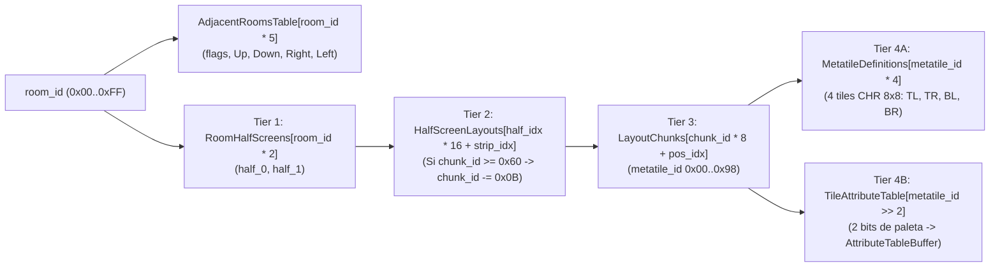

# RES-007: Especificación Funcional C x86 — Subsistema 04: Decodificador de Salas (4-Tier), Bytecode de Objetos (`RoomData`), Bombas, Cofres y Puertas

- **ID de Investigación**: `RES-007`
- **Tarea Vinculada**: `TASK-RES-006` (Subpasos `0.6.1` y `0.6.2`)
- **Área Temática**: 03 - Escenarios, Metatiles y Decodificación de Salas
- **Estado**: `[COMPLETADA]`
- **Fecha**: 2026-10-22
- **Agente Autor**: Antigravity (Orchestrator)

---

## 1. Objetivo y Alcance

Documentar la especificación completa y ejecutable para C x86 del **Subsistema 04** de [`asm/src/prg.asm`](file:///c:/Users/kanel/Documents/mjk/asm/src/prg.asm), [`asm/src/data.asm`](file:///c:/Users/kanel/Documents/mjk/asm/src/data.asm) y [`asm/src/roomdata-jp.asm`](file:///c:/Users/kanel/Documents/mjk/asm/src/roomdata-jp.asm) / [`roomdata-us.asm`](file:///c:/Users/kanel/Documents/mjk/asm/src/roomdata-us.asm):
1. **Decodificador Geométrico de Salas de 4 Niveles (4-Tier)**: `AdjacentRoomsTable` $\rightarrow$ `RoomHalfScreens` $\rightarrow$ `HalfScreenLayouts` (con ajuste de solapamiento `>= $60` $\rightarrow$ `-$0B`) $\rightarrow$ `LayoutChunks` $\rightarrow$ `MetatileDefinitions` + `TileAttributeTable`.
2. ** Intérprete del Bytecode de Objetos de Sala (`ReadRoomData` `$9410` y `sub_9592` `$9592`)**: Estructura de secciones multi-sala (`SectionRoomsTable`) y estado persistente en `RoomDataRAM` (`$05EB-$068A`).
3. **Sistema de Bombas y Orden de Mecha Encendida (`JTPickup_Bomb` `$9E5B`)**: Bombas en pasillos/laberinto vs. las 23 bombas en Salas del Palacio Real (`RF_BombRoom`), encadenamiento de mechas (`bit 6 = $40`), bono de `10,000 pts` (`MaybeBombThing` `$00F8`) y condición de aparición de `Power Coin` / `Bonus Coin` / `Extra Coin`.
4. **Sistema de Puertas, Condiciones de Apertura y Transiciones (`MaybeHandleDoorOpening` `$A951`, `CheckAndMaybeOpenDoor` `$A98D`, `AnimateDoor` `$ABD2`, `GameState_9_ExitRoom` `$AC4F`)**: Diferencias regionales JP vs. US en las 33 condiciones de puerta y warps secretos (`Round 5 -> 11`, `Round 11 -> 6`, `Room $FB`).

---

## 2. Fuentes del Desmontaje Analizadas (`asm/`)

| Archivo en `asm/` | Rango de Líneas | Dirección ROM | Símbolos / Subrutinas Cubiertas |
| :--- | :--- | :--- | :--- |
| [`asm/src/prg.asm`](file:///c:/Users/kanel/Documents/mjk/asm/src/prg.asm#L2551-L3856) | `2551 - 3856` | `$8FB1 - $97B7` | `sub_8FB1`, `MaybeLoadRoomFlags`, `LoadRoomStuff`, `HandleDrawHalfRow`, `LoadLayoutChunk`, `DrawFullScreen`, `sub_9276`, `sub_92AD`, `sub_92E2`, `IfNotTitleScreenRoomDoThings`, `GameState_2_LoadRoom`, `ReadRoomData`, `HandleRoomDataObject`, `JT_94AD_*`, `LoadRoomData`, `sub_9592`, `sub_9696`, `sub_96B7`, `CopyAttributeTableToPPU`, `sub_96F5`, `sub_9716`, `sub_9729`, `DoorPositionTileTable`, `UnknownDoorTable97B0` |
| [`asm/src/prg.asm`](file:///c:/Users/kanel/Documents/mjk/asm/src/prg.asm#L4860-L5388) | `4860 - 5388` | `$9DC3 - $A0D7` | `MaybePickupItem`, `JTPickup_Bag100..Beelzebub`, `GoToTheTortureRoom`, `JTPickup_Bomb`, `JTPickup_Chest`, `JTPickup_Chest2`, `JTPickup_Door`, `OpenBombRoomDoor`, `MaybeDrawFireBombSprite` |
| [`asm/src/prg.asm`](file:///c:/Users/kanel/Documents/mjk/asm/src/prg.asm#L6696-L7372) | `6696 - 7372` | `$A951 - $ACDC` | `MaybeHandleDoorOpening`, `CheckAndMaybeOpenDoor`, `DoorCond_*`, `MaybeDontOpenDoors`, `HandleOpenDoorMaybe`, `HandleSphinxEvent`, `HandleTileAttributes`, `AnimateDoor`, `GameState_9_ExitRoom` |
| [`asm/src/data.asm`](file:///c:/Users/kanel/Documents/mjk/asm/src/data.asm#L598-L2482) | `598 - 2482` | `$C4BC - $FF9F` | `TileAttributeTable`, `SectionRoomsTable`, `MultipliedScoreTable`, `ScoreAddTable`, `ItemToTileTable`, `RoomHalfScreens`, `HalfScreenLayouts`, `LayoutChunks`, `MetatileDefinitions`, `AdjacentRoomsTable`, `RoomDataPointers` |
| [`asm/src/roomdata-jp.asm`](file:///c:/Users/kanel/Documents/mjk/asm/src/roomdata-jp.asm#L1-L485) | `1 - 485` | `$DC9A - $FA9F` | `RoomData_01` a `RoomData_FF` (y variante [`roomdata-us.asm`](file:///c:/Users/kanel/Documents/mjk/asm/src/roomdata-us.asm)) |

---

## 3. Especificación de Subrutinas, Contrato ABI 6502 y Resolución de `sub_XXXX`

| Etiqueta 6502 | Nombre C Propuesto | Dir. ROM | Línea (`prg.asm`) | Inputs (`A, X, Y, ZP`) | Outputs (`A, X, Y, Flags`) | Stack Mutation | Callers | Callees |
| :--- | :--- | :--- | :--- | :--- | :--- | :--- | :--- | :--- |
| [`sub_8FB1`](file:///c:/Users/kanel/Documents/mjk/asm/src/prg.asm#L2551-L2573) | `SetupBombScorePopupTiles` | `$8FB1` | `2551` | `A`: tipo bomba (`1`=100, `2`=200), `ScoreMultiplier` | Escribe tiles de dígitos/multiplicador en `unk_30A` (`$030B-$030E`) | `RTS` | `sub_A29C` | — |
| [`MaybeLoadRoomFlags`](file:///c:/Users/kanel/Documents/mjk/asm/src/prg.asm#L2579-L2626) | `LoadRoomAdjacencyAndFlags` | `$8FD4` | `2579` | `A`: `room_id` | `off_3D = &AdjacentRoomsTable[A * 5]`, actualiza `RF_SingleScreen` y `RF_ScrollStop` en `RoomStatusFlags` | `RTS` | `MainSub_1`, `HandleSpawnsAndMore`, `MainSub_3`, `GameState_9_ExitRoom`, etc. | `LoadPointerTo050` |
| [`LoadRoomStuff`](file:///c:/Users/kanel/Documents/mjk/asm/src/prg.asm#L2630-L2647) | `LoadRoomHalfScreensPtr` | `$9021` | `2630` | `A`: `room_id` | `off_2 = &RoomHalfScreens[A * 2]` | `RTS` | `DrawFullScreen`, `sub_9A03`, `sub_9A7A`, `MainSub_3` | `LoadPointerTo050` |
| [`HandleDrawHalfRow`](file:///c:/Users/kanel/Documents/mjk/asm/src/prg.asm#L2653-L2699) | `ResolveLayoutChunkPtr` | `$9037` | `2653` | `Y`: mitad (`0` o `1`), `byte_8`: índice tira (`0..15`) | `off_4 = &LayoutChunks[chunk_id * 8]` (aplicando `if (chunk_id >= $60) chunk_id -= $0B`) | `RTS` | `DrawFullScreen`, `sub_9A03`, `sub_9A7A`, `MainSub_3` | `LoadPointerTo050` |
| [`LoadLayoutChunk`](file:///c:/Users/kanel/Documents/mjk/asm/src/prg.asm#L2703-L2720) | `ResolveMetatileDefPtr` | `$9084` | `2703` | `A`: `metatile_id` | `byte_6 = &MetatileDefinitions[A * 4]` | `RTS` | `DrawFullScreen`, `sub_9716`, `MainSub_3`, `sub_A875` | `LoadPointerTo050` |
| [`DrawFullScreen`](file:///c:/Users/kanel/Documents/mjk/asm/src/prg.asm#L2724-L2984) | `DrawFullScreenRoomToPPU` | `$90A0` | `2724` | `CurrentRoomID`, `off_3D` | Renderiza nametable completa (`32` cols si horiz, `30` filas + 1 fila extra si vert), objetos (`sub_9696`) y atributos (`CopyAttributeTableToPPU`) | `RTS` | `LoadRoom_0`, `GameState_0_InitTitleScreen` | `SetPPUCtrl`, `HandleDrawHalfRow`, `HandleTileAttributes`, `LoadLayoutChunk`, `sub_9696`, `CopyAttributeTableToPPU`, `LoadRoomStuff`, `sub_9716`, `sub_9729` |
| [`sub_9276`](file:///c:/Users/kanel/Documents/mjk/asm/src/prg.asm#L2988-L3018) | `GridCoordYXToScreenPixelXY` | `$9276` | `2988` | `A`: coord `YX` (`Y` alto, `X` bajo) | Convierte celda `YX` al centro en pantalla `byte_92` (`Y = (Y&F0)+8-scrollY`) y `byte_94` (`X = (X<<4)+8-scrollX`) | `RTS` | `MaybeSpawnThingFromObject`, `sub_A270`, `ChooseEnemySpawnPoint` | — |
| [`sub_92AD`](file:///c:/Users/kanel/Documents/mjk/asm/src/prg.asm#L3022-L3054) | `GridCoordYXToPPUAddr` | `$92AD` | `3022` | `A`: coord `YX`, `byte_F4` | Calcula `byte_3EF:byte_3F0` (offset PPU `$0000-$0BFF`) y `byte_9` para `HandleTileAttributes` | `RTS` | `sub_96B7`, `MaybePickupItem`, `sub_A18E`, `AnimateDoor` | `sub_92E2` |
| [`sub_92E2`](file:///c:/Users/kanel/Documents/mjk/asm/src/prg.asm#L3058-L3071) | `RowPixelYToPPUAddrBase` | `$92E2` | `3058` | `A`: coord `YX` o `Y` en píxeles | `byte_3EF:byte_3F0 = (A & 0xF0) << 2` (`fila_metatile * 64`) | `RTS` | `sub_92AD`, `MainSub_3` | — |
| [`IfNotTitleScreenRoomDoThings`](file:///c:/Users/kanel/Documents/mjk/asm/src/prg.asm#L3077-L3126) | `LocateOrLoadRoomInRAM` | `$92F7` | `3077` | `A`: `room_id` | Si `A == 0`: **`PLA;PLA;RTS`**. Si no: busca `A` en los 8 slots de `RoomDataRAM` (o lo carga en `$066B`) y deja `byte_5A` en el primer objeto (`offset +2`) | **`PLA;PLA;RTS` si `A==0`** | `sub_9696`, `BigBeefySubHandlesBGColliding`, `MainSub_3` (`sub_A85F`), `HandleOpenDoorMaybe`, `GameState_9_ExitRoom` | `LoadRoomData`, `ReadRoomData` |
| [`GameState_2_LoadRoom`](file:///c:/Users/kanel/Documents/mjk/asm/src/prg.asm#L3130-L3251) | `GameState_2_LoadRoom` | `$9341` | `3130` | `CurrentRoomID` | Parsea cabecera `$Ex` (paleta, música, sección), actualiza checkpoints (`$033D`/`$033E`) y carga todas las salas de la sección en `RoomDataRAM` | `RTS` | `GameHandler` (`JumpTable #2`) | `LoadPointerTo050`, `LoadRoomData`, `ReadRoomData` |
| [`ReadRoomData`](file:///c:/Users/kanel/Documents/mjk/asm/src/prg.asm#L3257-L3341) | `ParseRoomObjectsToRAM` | `$9410` | `3257` | `A`: `room_id`, `Y`: offset base en `RoomDataRAM`, `off_58` | Decodifica el flujo `RoomData_XX` e inicializa el estado de cada objeto en `RoomDataRAM[Y+2..]` hasta `$FF` | `RTS` | `IfNotTitleScreenRoomDoThings`, `GameState_2_LoadRoom` | `HandleRoomDataObject` |
| [`LoadRoomData`](file:///c:/Users/kanel/Documents/mjk/asm/src/prg.asm#L3515-L3535) | `SetRoomDataStreamPtr` | `$9570` | `3515` | `A`: `room_id` (`1..$FF`) | `off_58 = RoomDataPointers[A - 1]`, `byte_AC = 0` | `RTS` | `IfNotTitleScreenRoomDoThings`, `GameState_2_LoadRoom`, `MaybeHandleDoorOpening` | `LoadPointerTo050` |
| [`sub_9592`](file:///c:/Users/kanel/Documents/mjk/asm/src/prg.asm#L3541-L3680) | `NextRoomObjectFromStream` | `$9592` | `3541` | `off_58`, `byte_5A`, `byte_AC` | Lee el siguiente objeto de `off_58`, carga su estado desde `RoomDataRAM[byte_5A]` en `MaybeCollectedThing` (`$5E`), su tile en `MaybeTileCollected` (`$72`) y su coord en `byte_70`/`byte_71`. Al llegar a `$FF` ejecuta **`PLA;PLA;RTS`** | **`PLA;PLA;RTS` al encontrar `$FF`** | `sub_9696`, `BigBeefySubHandlesBGColliding`, `sub_A85F`, `HandleOpenDoorMaybe`, `GameState_9_ExitRoom` | — |
| [`sub_9696`](file:///c:/Users/kanel/Documents/mjk/asm/src/prg.asm#L3684-L3699) | `DrawAllRoomObjectsToPPU` | `$9696` | `3684` | `CurrentRoomID` | Itera todos los objetos de la sala (`sub_9592`) y los pinta en la nametable (`sub_96B7`) | Termina vía `sub_9592` (`PLA;PLA;RTS`) | `DrawFullScreen` | `IfNotTitleScreenRoomDoThings`, `sub_9592`, `sub_96B7` |
| [`sub_96B7`](file:///c:/Users/kanel/Documents/mjk/asm/src/prg.asm#L3703-L3717) | `DrawSingleRoomObjectTileToPPU` | `$96B7` | `3703` | `X`: `0` (tile 1) o `1` (tile 2 de puerta) | Verifica visibilidad (`sub_96F5`), calcula dirección PPU (`sub_92AD`), atributos (`HandleTileAttributes`) y escribe los 4 tiles $8 \times 8$ en PPU (`sub_9716` + `sub_9729`) | Fallthrough a `CopyAttributeTableToPPU`! | `sub_9696` | `sub_96F5`, `sub_92AD`, `HandleTileAttributes`, `sub_9716`, `sub_9729` |
| [`sub_96F5`](file:///c:/Users/kanel/Documents/mjk/asm/src/prg.asm#L3746-L3769) | `CheckObjectVisibleOrAbort` | `$96F5` | `3746` | `X`: `0` o `1`, `byte_70,X`, `byte_5C`, `MaybeCollectedThing` | Si `byte_70,X == 0`, o el objeto es oculto (`MaybeCollectedThing & $20`), o es `>= $B0` (salvo `$D0` que llama `sub_A270`), ejecuta **`PLA;PLA;RTS`** para saltar el pintado | **`PLA;PLA;RTS` si no es visible** | `sub_96B7`, `sub_A875` | `sub_A270` |
| [`sub_9716`](file:///c:/Users/kanel/Documents/mjk/asm/src/prg.asm#L3773-L3785) | `QueueMetatileToPPUBuffer2` | `$9716` | `3773` | `A`: `metatile_id` | Copia los 4 bytes del metatile a `PPUUpdateBuffer[0..3]` e incrementa `PPUUpdateFlag2` (`$03ED`) | `RTS` | `DrawFullScreen`, `sub_96B7`, `MaybePickupItem`, `sub_A1A6`, `AnimateDoor` | `LoadLayoutChunk` |
| [`sub_9729`](file:///c:/Users/kanel/Documents/mjk/asm/src/prg.asm#L3789-L3820) | `FlushMetatileBuffer2ToPPUImmediate` | `$9729` | `3789` | `byte_3EF`, `byte_3F0`, `PPUUpdateBuffer[0..3]` | Escribe inmediatamente el metatile $2 \times 2$ en `PPUDATA` (con PPU apagada) y limpia `PPUUpdateFlag2 = 0` | `RTS` | `DrawFullScreen`, `sub_96B7` | — |

---

## 4. Arquitectura del Decodificador de Salas de 4 Niveles (4-Tier)

- **Orientación de las tiras (`byte_8` y `pos_idx`)**:
  - **Sala Vertical (`(AdjacentRoomsTable[room_id * 5] & 0x04) == 0`)**:
    - `half_0` es la **mitad izquierda** de la sala ($128 \times 240$ px) y `half_1` es la **mitad derecha** ($128 \times 240$ px).
    - `strip_idx` (`byte_8`, `0..14`) selecciona la **fila de metatiles** (`Y / 16`), y los 8 bytes de `LayoutChunks[chunk_id * 8 + X]` son las 8 columnas horizontales de esa mitad (`X in 0..7` para izquierda, `X in 8..15` para derecha).
  - **Sala Horizontal (`(AdjacentRoomsTable[room_id * 5] & 0x04) != 0`)**:
    - `half_0` es la **mitad superior** de la sala ($256 \times 128$ px, filas `0..7`) y `half_1` es la **mitad inferior** ($256 \times 112$ px, filas `8..14`).
    - `strip_idx` (`byte_8`, `0..15`) selecciona la **columna de metatiles** (`X / 16`), y los 8 bytes de `LayoutChunks[chunk_id * 8 + Y]` son las 8 filas verticales de esa mitad (`Y in 0..7` para superior, `Y in 8..14` para inferior).

---

## 5. Formato del Bytecode de Objetos (`RoomData_XX`) y Estado en `RoomDataRAM`

Cada sala (`1..$FF`) apunta mediante `RoomDataPointers[room_id - 1]` a un flujo de bytes terminado en `0xFF`:

| Primer Byte (`cmd`) | Longitud | Tipo de Registro |Valor Inicial en `RoomDataRAM[Y]` | Descripción Técnica |
| :--- | :--- | :--- | :--- | :--- |
| `0xE0 .. 0xEF` | 3 bytes | **Cabecera de Sala** | *(No ocupa slot)* | `b0`: `0xE0 \| palette_id` (`0..8`); `b1`: `(door_cond_plus1 << 3) \| music_id`; `b2`: `section_id` (`bit 7`=reset timer/checkpoint2, `bit 6`=set `SomeLoadFlag`). |
| `0x01 .. 0x0F` | `1 + cmd` bytes | **Grupo de Bombas** | `0x05` (o `0x85` en 1ª/última) | Seguido de `cmd` bytes de coordenadas `YX` (o `24` coordenadas en Salas Reales `$90..$9F`, guardando el puntero en `byte_91:byte_90`). `0x40` = mecha encendida; `0x80` = primera/última bomba de la cadena. |
| `0x10 .. 0x2F` | 2 bytes (3 si `$16`) | **Cofre Rojo Visible** | `0x10` | `cmd & 0x0F` = contenido (`0..8` ítem estático, `9..$F` entidad vía `MaybeSpawnThingFromObject`). Si `cmd == 0x16` (Esfinge), lleva un 3er byte (`SphinxID`). |
| `0x30 .. 0x4F` | 2 bytes (3 si `$36`) | **Cofre Naranja Visible** | `0x11` | Requiere `PlayerMightyLevel >= 1` (o saltar encima) para abrirse (`JTPickup_Chest2`). |
| `0x50 .. 0x6F` | 2 bytes | **Bloque Oculto Multi-Golpe** | `0x33` (`0x20 \| 0x13`) | Invisible (`bit 5 = 0x20`), transitable hasta revelarse (`byte_320`). Requiere `cmd & 0x0F` cabezazos (`byte_335`) para transformarse en moneda/ítem. |
| `0x70 .. 0x7F` | 2 bytes | **Ítem Expuesto** | `cmd & 0x0F` (o `0x0F` si ya tiene Bola Cristal) | Ítem directamente visible en el mapa (bolsas, bebidas, bolas de cristal `$09/$0A`). |
| `0x80 .. 0x8F` | 2 bytes | **Puerta** | `UnknownDoorTable97B0[b1 & 7]` | `cmd & 0x0F` = posición de puerta (`0..15` en `DoorPositionTileTable`). `b1 & 7` = estado inicial (`$12`=cerrada, `$52`=abierta, `$92/$B2`=cerrada con condición en `MaybeSphinxFlags[b1 >> 3]`). |
| `0x90 .. 0xAF` | 2 bytes (3 si `$96`) | **Cofre Oculto** | `0x30` o `0x31` (`bit 5 = 0x20`) | Invisible y transitable (`byte_320`) hasta que Jack salta en su coordenada, revelando el cofre. |
| `0xB0 .. 0xDF` | 2 bytes | **Familia Real / Belcebú / Estatua** | *(Usa slot previo o fijo)* | No incrementa `byte_E` ni `byte_5A`. `$D0` dispara `sub_A270` al renderizar la sala. |

---

## 6. Lógica de Bombas, Cadena de Mechas y Condiciones de Puerta

### 6.1 Recolección de Bombas (`JTPickup_Bomb` `$9E5B`, [`prg.asm:4970-5164`](file:///c:/Users/kanel/Documents/mjk/asm/src/prg.asm#L4970-L5164))
1. **Puntuación y Contador de 20 Puntos para Power Coin (`MaybeTempCollectableFlag2` `$0363`)**:
   - Bomba apagada (`(state & 0x40) == 0`): suma `+1` (`X = 1`, `100 pts`, `Sound_BombCollectedUnlit`).
   - Bomba encendida (`(state & 0x40) != 0`): suma `+2` (`X = 2`, `200 pts`, `Sound_BombCollectedLit`).
   - Mientras `MaybeTempCollectableFlag == 0`, acumula `X` en `MaybeTempCollectableFlag2`. Al alcanzar **`>= 20`**, activa `MaybeTempCollectableFlag = 1`:
     - En sala normal: suena `Sound_BombChestBonus` y el próximo cofre que Jack abra soltará una **Power Coin (`P`)** (`MaybeOpenHiddenBlock:5426`).
     - En Sala del Palacio Real (`RF_BombRoom`): invoca inmediatamente `SpawnPowerCoin` y suena `Sound_PowerCoinSpawn`.
2. **Encadenamiento de la Siguiente Bomba (`loc_9EB2` vs `loc_9F4B`)**:
   - **En Pasillos/Laberinto (`RF_BombRoom == 0`)**:
     - Si la primera bomba recogida en la sección tenía el bit `0x80` (`$85`), fija `MaybeBombThing = 1`.
     - Si se recoge una bomba **apagada** antes de terminar, marca error de orden (`MaybeBombThing |= 2`).
     - Al recoger la última bomba (`bit 7 = 0x80`) encendida (`bit 6 = 0x40`) habiendo mantenido el orden perfecto (`MaybeBombThing == 1`), activa **`MaybeBombThing |= 0x80`**, otorga **`10,000 pts`** (`Score_10000`) y reproduce `Sound_BombBonus` (lo que además abre las puertas de condición `DoorCond_0C_AllFireBombs`).
     - Busca hacia adelante en `RoomDataRAM` la siguiente bomba intacta (`(val & 0x7F) == 5`), cruzando al siguiente slot de sala (`+0x10`) si encuentra `0xFF`, y le enciende la mecha (`val |= 0x40`).
   - **En Salas del Palacio Real (`RF_BombRoom != 0`, 23 bombas)**:
     - Incrementa `FireBombsCollected2` (`$6B`, total recogidas) y, si estaba encendida (`bit 6 = 0x40`), incrementa `FireBombsCollected` (`$6A`).
     - Al llegar a **`FireBombsCollected2 == 23`**, oculta el sprite de mecha (`OAM[$10] = $F8`) y llama a `OpenBombRoomDoor` (`GameState = $0B`).
     - Si la bomba recogida estaba encendida (o fue la 1ª bomba de la sala), busca circularmente en `RoomDataRAM[$81..]` la siguiente bomba (`val == 5`), la enciende (`val |= 0x40`) y posiciona el sprite animado de chispa en su coordenada (`MaybeDrawFireBombSprite`).

### 6.2 Tabla de Condiciones de Apertura de Puertas (`CheckAndMaybeOpenDoor` `$A98D`)

| Índice (`MaybeDoorTypeOrSphinx`) | Rutina (JP) | Rutina (US `REV_US`) | Condición Exacta para Abrir la Puerta (`HandleOpenDoorMaybe`) |
| :--- | :--- | :--- | :--- |
| `0x02` | `DoorCond_02_JumpedOn` | `DoorCond_02_JumpedOn` | Jack está tocando la puerta (`DoorIsAnimatingMaybe != 0`) y acaba de saltar (`JustJumpedFlag != 0`). |
| `0x07, 0x17, 0x18, 0x1B` | `DoorCond_XX_Mighty3` | `DoorCond_XX_Mighty3` | Jack toca la puerta teniendo `PlayerMightyLevel == 3` (Jack Naranja). (`0x0E` también usa esta condición en US). |
| `0x09` | `DoorCond_09_FBWarp2` | `DoorCond_09_FBWarp2` | `DoorCheckFlag_09 == 0x01` (activado tras abrir el warp de `Room $FB`). Pone `DoorCheckFlag_09 = 0x80`. |
| `0x0A` | `DoorCond_0A_Timer30` | `DoorCond_rts` *(Deshabilitada)* | En JP: Jack toca la puerta cuando `StageTimer == 0x30` (30 segundos BCD). |
| `0x0C` | `DoorCond_0C_AllFireBombs` | `DoorCond_0C_AllFireBombs` | `MaybeBombThing & 0x80` activo (todas las bombas de la sección recogidas en orden encendido). |
| `0x0E` | `DoorCond_0E_Timer60` | `DoorCond_XX_Mighty3` | En JP: Jack toca la puerta cuando `StageTimer == 0x60`. En US: `PlayerMightyLevel == 3`. |
| `0x19` | `DoorCond_19_TensScore30` | `DoorCond_1D_FBWarp1` | En JP: dígito de decenas de `PlayerScore[0] == 0x30` (1 intento). En US: condición de `Room $FB`. |
| `0x1A` | `DoorCond_1A_TensScore70` | `DoorCond_1A_US_rts` | En JP: dígito de decenas de `PlayerScore[0] == 0x70` (1 intento). En US: `RTS`. |
| `0x1D` | `DoorCond_1D_FBWarp1` | `DoorCond_1D_FBWarp1` | En `Room $FB`: en borde de scroll (`RF_AtScrollEdge`), `PlayerMightyCoins == 0`, `StageTimer == 0` y `PlayerSprite == 6`. |
| `0x1E` | `DoorCond_1E_R5R11Warp` | `DoorCond_1E_R5R11Warp` | En `Room $FC` (Warp R5 $\rightarrow$ R11): tras morir exactamente **2 veces** contra la baldosa de fuego `FireTilePlayerDiedTo == 0x5D`. |
| `0x1F` | `DoorCond_1F_R11WarpBack` | `DoorCond_1F_R11WarpBack` | En `Room $61` (Warp R11 $\rightarrow$ R6): se abre automáticamente una única vez por partida (`DoorCheckFlag_1F`). |

---

## 7. Plan de Pruebas Unitarias y Verificación (Paridad C vs 6502)

1. **`test_room_4tier_decoder_all_255_rooms`**:
   - Decodificar las 255 salas en C y verificar byte a byte la nametable de $32 \times 30$ tiles y los 64 bytes de `AttributeTableBuffer` contra el volcado de `DrawFullScreen` (`$90A0`), incluyendo las salas que usan `HalfScreenLayouts >= 0x60`.
2. **`test_bomb_chain_and_power_coin_threshold`**:
   - Simular la recolección en orden de un grupo de bombas verificando la propagación del bit `0x40` a través de fronteras de sala en `RoomDataRAM`, el bono de `10,000 pts` (`MaybeBombThing |= 0x80`) y la activación de `MaybeTempCollectableFlag` al alcanzar `20` puntos de bomba.
