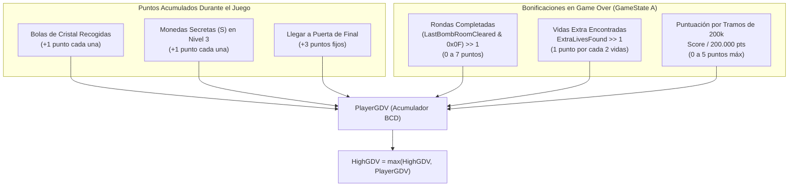

# RES-009: Especificación Funcional C x86 — Subsistema 06: Pantallas Especiales, HUD BCD, Torture Room, GDV y Secuencias de Ending

- **ID de Investigación**: `RES-009`
- **Tarea Vinculada**: `TASK-RES-008` (Subpasos `0.8.1` y `0.8.2`)
- **Área Temática**: 01 - Núcleo y Pantallas Especiales
- **Estado**: `[COMPLETADA]`
- **Fecha**: 2026-10-22
- **Agente Autor**: Antigravity (Orchestrator)

---

## 1. Objetivo y Alcance

Documentar con exactitud matemática y arquitectónica para C x86 el **Subsistema 06** del desmontaje [`asm/src/prg.asm`](file:///c:/Users/kanel/Documents/mjk/asm/src/prg.asm) (`líneas 1780-2135` y `7375-8165`):
1. **Renderizado del HUD en OAM y Aritmética BCD**: Funciones `DrawScoreAndCoinCount` (`$8B69`), `DrawScore` (`$8B80`), `DrawTimerOrTortureJumps` (`$8BD8`), `DrawMightyCoinCountOrMultiplier` (`$8C20`), rutinas BCD `BCDSub1FromA` (`$8D2F`), `WriteBCDDigitsSprites` (`$8D3E`), supresión de ceros no significativos (`DrawScoreDigitMaybe`) y el bug histórico de visualización de vidas en BCD.
2. **Mecánica de Codicia y la Sala de Tortura (Torture Room, GameState 7)**: Disparadores de codicia (`StageTimer >= 100` BCD, 10 monedas Mighty o entrada forzada a sala `$AC`), cartel "YOU ARE GREEDY / GO TO THE TORTURE ROOM" con temporizador de 192 frames, contador regresivo de 49 saltos en JP / 50 en US (`GreedyJumpsRemaining`), anulación de puntos de salto y retorno al checkpoint exacto.
3. **Fin de Ronda y Bonificaciones (GameState 8)**: Transición de 4 fases (`RoundClear_0..3`), conteo regresivo de tiempo restante (100 pts/segundo), bonificación de bombas de fuego (`FireBombBonus`: 10k, 20k, 30k o 50k pts al obtener $\ge 20$ bombas) y avance de ronda.
4. **Fórmula Exhaustiva del GDV (Game Degree Value)**: Cálculo final de maestría del jugador (`AddAToGDV` `$8740` y `GameState_A_GameOver` `$86D0`), desglosando los 5 sumandos (bombas superadas, vidas encontradas, puntos por cada 200k, bolas de cristal, monedas secretas y bono de finalización).
5. **Máquina de Estados de los 4 Finales (GameState C)**: Evaluación de condiciones de entrada (`EndingDoorChecks` `$A97A`), los 4 arquetipos de final según reliquias recolectadas, demolición animada de la pirámide (`EndingState_0..4`) y textos narrativos.
6. **Pantalla de Título y Round Intro (GameState 0 y 1)**: Secuencia de demostración de Jack, diferencias de copyright regional US vs JP, tabla de textos y transición a juego activo.

---

## 2. Fuentes del Desmontaje Analizadas (`asm/`)

| Archivo en `asm/` | Rango de Líneas | Dirección ROM | Símbolos / Subrutinas Cubiertas |
| :--- | :--- | :--- | :--- |
| [`asm/src/prg.asm`](file:///c:/Users/kanel/Documents/mjk/asm/src/prg.asm#L1780-L1935) | `1780 - 1935` | `$8B69 - $8C62` | `DrawScoreAndCoinCount`, `DrawScore`, `DrawScoreDigitMaybe`, `DrawTimerOrTortureJumps`, `DrawMightyCoinCountOrMultiplier` |
| [`asm/src/prg.asm`](file:///c:/Users/kanel/Documents/mjk/asm/src/prg.asm#L2090-L2154) | `2090 - 2154` | `$8D1E - $8D5E` | `NegateYYXX`, `BCDSub1FromA`, `WriteBCDDigitsSprites` |
| [`asm/src/prg.asm`](file:///c:/Users/kanel/Documents/mjk/asm/src/prg.asm#L700-L1130) | `700 - 1130` | `$8487 - $8764` | `GameState_7_GoToTortureRoom`, `GameState_8_RoundClear`, `RoundClear_0..3`, `DrawTimeBonus`, `DrawFireBombBonus`, `GameState_A_GameOver`, `AddAToGDV`, `BCDCheckFirstDigit`, `GameState_B_AnimateDoorOpen` |
| [`asm/src/prg.asm`](file:///c:/Users/kanel/Documents/mjk/asm/src/prg.asm#L7375-L8165) | `7375 - 8165` | `$A97A - $B115` | `EndingDoorChecks`, `_EndCheckCrystalBall1/2`, `_EndCheck5SecretCoins`, `_EndGame`, `TitleScreenHandler`, `TitleScreen_0..3`, `DrawTitleScreen`, `GameState_1_RoundIntro`, `DrawRoundIntroSprites`, `GameState_C_Ending`, `EndingState_0..4`, `sub_AFA9`, `sub_B024`, `sub_B080`, `sub_B094`, `sub_B0AF`, `CopyNext5BytesToTempSprite` |
| [`asm/src/data.asm`](file:///c:/Users/kanel/Documents/mjk/asm/src/data.asm#L412-L587) | `412 - 587` | `$C300 - $C4BA` | `StringPointerTable`, cadenas de texto de HUD/Ending (`String_*`), `EndingStringTable`, `EndingPyramidDestroyDepth` |

---

## 3. Catálogo de Subrutinas y Resolución de `sub_XXXX`

| Etiqueta 6502 | Nombre C Propuesto | Dir. ROM | Línea (`prg.asm`) | Inputs / Registros | Función / Contrato |
| :--- | :--- | :--- | :--- | :--- | :--- |
| `DrawScoreAndCoinCount` | `RenderHUDTop` | `$8B69` | `1783` | `DrawScoreAndCoinsFlag`, `PlayerScore` | Renderiza en OAM el marcador de puntuación (8 dígitos) y el contador de monedas Mighty o multiplicador. |
| `DrawScore` | `RenderScoreDigits` | `$8B80` | `1801` | `PlayerScore` (4 bytes BCD) | Itera de más a menos significativo extrayendo nibbles BCD con supresión de ceros a la izquierda. |
| `DrawScoreDigitMaybe` | `EmitScoreSpriteWithZeroSuppress` | `$8B9D` | `1829` | `A`: dígito BCD, `byte_1`: flag de primer dígito no cero | Si es cero previo al primer dígito significativo, lo posiciona fuera de pantalla (`Y = $F8`). |
| `DrawTimerOrTortureJumps` | `RenderTimerOrTortureHUD` | `$8BD8` | `1871` | `TortureRoomSceneFlag`, `StageTimer`, `GreedyJumpsRemaining` | Si no está en sala de tortura, dibuja icono 'T' y tiempo BCD; si está en tortura, dibuja contador de saltos restantes en el centro `(X=$84, Y=$44)`. |
| `DrawMightyCoinCountOrMultiplier` | `RenderMightyCoinsHUD` | `$8C20` | `1903` | `RoomStatusFlags`, `PlayerMightyCoins`, `ScoreMultiplier` | En salas normales dibuja icono 'M' y cantidad de monedas; en salas de palacio dibuja 'x' y multiplicador. |
| `BCDSub1FromA` | `BCDDecrementByte` | `$8D2F` | `2111` | `A`: valor BCD (`0x00..0x99`) | Resta 1 con corrección decimal (`if ((res & 0x0F) >= 0x0A) res -= 6`). |
| `WriteBCDDigitsSprites` | `RenderBCDTwoDigits` | `$8D3E` | `2129` | `A`: valor BCD de 2 dígitos, `TempSpriteX/Y` | Emite 2 sprites contiguos de 8 px para decenas y unidades en la posición actual de OAM. |
| `GameState_7_GoToTortureRoom` | `UpdateTortureRoomState` | `$8487` | `700` | `TortureRoomSceneFlag`, `TortureRoomMessageTimer`, `GreedyJumpsRemaining` | Controla la secuencia de castigo por codicia: mensaje inicial $\rightarrow$ warp a sala `$AC` $\rightarrow$ decremento por salto $\rightarrow$ retorno al checkpoint. |
| `GameState_8_RoundClear` | `UpdateRoundClearSequence` | `$84F9` | `776` | `RoundClearState`, `StageTimerCopy`, `FireBombBonusPoints` | Máquina de 4 fases para la liquidación de puntos de tiempo y bombas de fuego al completar una ronda. |
| `DrawTimeBonus` | `RenderTimeBonusCountdown` | `$8658` | `1008` | `StageTimerCopy` | Dibuja en pantalla los dígitos restantes del bono de tiempo durante la animación de fin de ronda. |
| `DrawFireBombBonus` | `RenderFireBombBonusCountdown` | `$866C` | `1022` | `FireBombBonusPoints` | Dibuja en pantalla los millares del bono especial de bombas de fuego durante la liquidación. |
| `GameState_A_GameOver` | `UpdateGameOverAndGDV` | `$86D0` | `1038` | `PlayerGDV`, `HighGDV`, `ExtraLivesFound`, `LastBombRoomCleared`, `PlayerScore` | Imprime Game Over, computa los 3 componentes finales de GDV, actualiza récord y retorna a la pantalla de título. |
| `AddAToGDV` | `AccumulateGDVPoints` | `$8740` | `1095` | `A`: puntos a añadir (`0..9`), `PlayerGDV` | Suma en aritmética BCD al acumulador global `PlayerGDV` con ajuste decimal de primer dígito. |
| `TitleScreenHandler` | `UpdateTitleScreenFSM` | `$AD49` | `7473` | `TitleScreenState`, `Joypad1_Immediate` | Máquina de estados de la pantalla de título: renderizado de fondo, Jack cayendo y detección de Start. |
| `EndingDoorChecks` | `EvaluateGameEndingCriteria` | `$A97A` | `7376` | `CurrentRoomID` (`0xA0..0xA3`), bolas de cristal, monedas secretas | Evalúa los requisitos de finalización según la puerta final alcanzada y determina el `EndingType` (0..3). |
| `GameState_C_Ending` | `UpdateEndingSequenceFSM` | `$AE48` | `7706` | `EndingState`, `EndingType` | Controla la cinemática de final: salto de Jack $\rightarrow$ demolición piramidal $\rightarrow$ pergamino narrativo $\rightarrow$ espera de Start. |
| `sub_AFA9` | `SpawnPyramidDebrisBlock` | `$AFA9` | `7928` | `EnemyStructPointer`, `byte_373..376` | Inicializa un bloque de escombros de la pirámide destruida para la animación de derrumbe. |
| `sub_B024` | `SimulatePyramidDebrisPhysics` | `$B024` | `7998` | `EnemyStructPointer` | Aplica aceleración parabólica y dispersión a los fragmentos de piedra de la pirámide. |
| `sub_B0AF` | `ApplyEntityPhysicsAndDraw` | `$B0AF` | `8096` | `A`: parámetro de velocidad vertical | Helper que actualiza velocidad Y, aplica desplazamientos X/Y y dibuja a Jack en OAM. |

---

## 4. Fórmula Matemática Exhaustiva del GDV (Game Degree Value)

El **GDV** representa el índice de maestría global del jugador, acumulado en BCD de 2 dígitos (`0x00..0x99`). Se compone de **eventos en tiempo real** más **bonificaciones de cierre de partida**:

### Tabla de Desglose de Puntos GDV

| Concepto | Origen en Código | Fórmula / Valor | Máximo Teórico |
| :--- | :--- | :--- | :--- |
| **Bolas de Cristal** | `JTPickup_CrystalBall2` (`$9F75`) | `+1` por cada bola recogida | `+2` pts |
| **Monedas Secretas (S)** | `JT_98A4_A_SecretCoin` (`$9921`) | `+1` por cada moneda S recogida | Variable ($\ge 5$) |
| **Llegar al Final** | `_EndGame` (`$AD0C`) | `+3` pts fijos al entrar a la secuencia de ending | `+3` pts |
| **Rondas Completadas** | `GameState_A_GameOver:1052` | `(LastBombRoomCleared & 0x0F) >> 1` (1 pt cada 2 rondas) | `+7` pts |
| **Vidas Extra Encontradas** | `GameState_A_GameOver:1056` | `ExtraLivesFound >> 1` (1 pt cada 2 vidas halladas) | Depende de cofres |
| **Puntuación Alcanzada** | `GameState_A_GameOver:1063` | `Puntos / 200.000` (tramo: 200k=1, 400k=2, ..., $\ge$1M=5) | `+5` pts |

---

## 5. Máquina de Estados de la Sala de Tortura (GameState 7)

La entrada a la Sala de Tortura (`Room $AC`) ocurre cuando Jack cae en la codicia extrema:
1. **Disparadores**:
   - `StageTimer >= 100` BCD (al recolectar una Bebida Mighty teniendo ya $\ge 90$ segundos).
   - `PlayerMightyCoins >= 10` (recolectar 10 monedas de poder sin usarlas).
   - Acceder directamente a una puerta conectada con la sala de tortura.
2. **Fase 1: Cartel de Sentencia (`TortureRoomMessageTimer = 0xC0`)**:
   - Congela el juego, silencia la música y reproduce la fanfarria de codicia `Sound_YouAreGreedy`.
   - Imprime en nametable: `"YOU ARE GREEDY"` y `"GO TO THE TORTURE ROOM"`.
   - Despoja a Jack de todas sus monedas Mighty (`PlayerMightyCoins = 0`).
3. **Fase 2: Confinamiento y Saltos Forzados (`GreedyJumpsRemaining`)**:
   - Transporta a Jack a la sala `$AC` e inicializa el contador de saltos:
     - **Versión Japonesa (JP)**: `49` saltos BCD (`0x49`).
     - **Versión USA (US)**: `50` saltos BCD (`0x50`).
   - El HUD no muestra el tiempo regular, sino el contador de saltos en grande en el centro de la pantalla `(X=$84, Y=$44)`.
   - Cada pulsación de salto de Jack (`JustJumpedFlag != 0`) resta 1 en BCD con `BCDSub1FromA`.
   - **Castigo colateral**: Los saltos dentro de la sala de tortura otorgan **0 puntos** (en lugar de los 10 puntos habituales de salto).
4. **Fase 3: Liberación**:
   - Al llegar `GreedyJumpsRemaining == 0`: apaga `TortureRoomSceneFlag = 0`, recupera la sala y puerta de checkpoint previo (`byte_33E` y `EntryDoorTypeBackup2`) y transporta a Jack de regreso al juego regular.

---

## 6. Los 4 Finales del Juego y Secuencia de Ending (GameState C)

En la última sala (`Round 16/17`), la puerta de salida ejecuta `EndingDoorChecks`:

| Tipo Final (`EndingType`) | Denominación | Requisito Excluyente | Líneas de Texto de Pergamino (`EndingStringTable`) | Profundidad Derrumbe Pirámide (`EndingPyramidDestroyDepth`) |
| :---: | :--- | :--- | :--- | :---: |
| **0** | Final Pobre (*Worst*) | `PlayerCrystalBallsCollected == 0` (Sin bolas de cristal) | 3 líneas: "THE CURSE OF BELZEBUT HAS BEEN SOLVED..." | 12 bloques |
| **1** | Final Bueno (*Good*) | `PlayerCrystalBallsCollected < 3` (Solo 1 bola de cristal) | 3 líneas: "JACK WILL BE HONORED FOREVER AS THE HERO..." | 30 bloques |
| **2** | Final Magnífico (*Great*) | Ambas bolas de cristal, pero `PlayerSecretCoins < 5` | 4 líneas: "JACK AND THE PRINCESS GOT MARRIED..." | 56 bloques |
| **3** | Final Verdadero (*Best*) | Ambas bolas de cristal **Y** $\ge 5$ monedas secretas (S) | 4 líneas: "KING PAMERA WAS MOVED TO TEARS WITH PLEASURE..." | 90 bloques (Pirámide completa) |

### Secuencia de Animación del Ending (`EndingState_0..4`)
- **`EndingState 0`**: Dibuja el fondo de la pirámide, limpia textos de título y posiciona a Jack en la base `(X=$78, Y=$E8)`.
- **`EndingState 1`**: Jack salta hacia el vértice de la pirámide. Al alcanzar el ápice (`byte_3E7 >= 0x40`), detona los bloques según la profundidad asignada por su final.
- **`EndingState 2`**: Bucle de partículas de escombros simulando el derrumbe físico de la piedra con sonido `Sound_BombBonus`.
- **`EndingState 3`**: Imprime en PPU el texto del pergamino histórico correspondiente y reproduce `Music_Ending`.
- **`EndingState 4`**: Jack desciende flotando suavemente. Al pulsar `Start`, el juego vuelve al menú principal (`GameState = 0x0A`).

---

## 7. Plan de Pruebas Unitarias y Verificación

1. **`test_bcd_subtraction_and_digit_formatting`**:
   - Verificar `BCDSub1FromA` para todos los valores del rango `0x00..0x99`, asegurando que `0x50 - 1 = 0x49` y `0x10 - 1 = 0x09`.
2. **`test_gdv_exact_calculation`**:
   - Simular una partida terminada con 1 bola de cristal, 6 monedas S, ronda 10 superada, 4 vidas encontradas y 450.000 puntos, verificando que el GDV sumado coincide al 100% con la rutina `AddAToGDV`.
3. **`test_torture_room_penalty_lifecycle`**:
   - Comprobar que en la versión JP se requieren exactamente 49 saltos y en la US 50 saltos para salir de la sala de tortura, y que ningún salto suma puntuación.
