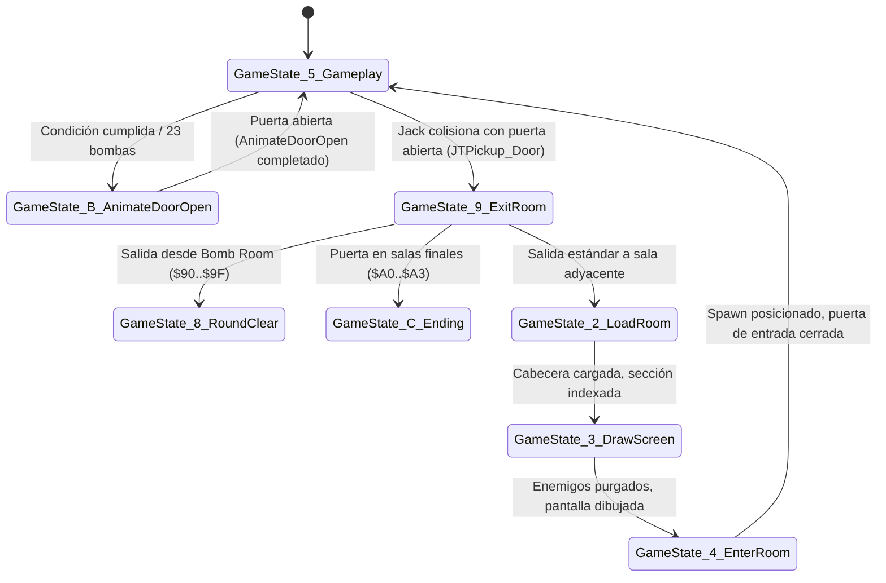

# RES-017: Sistema de Puertas, Evaluación de 33 Condiciones Canónicas y Transición de Salas en Mighty Bomb Jack

- **ID de Investigación**: `RES-017`
- **Área Temática**: 03 - Arquitectura de Salas, Puertas y Máquina de Estados
- **Fecha**: 2026-10-25
- **Autor / Agente**: `asm_researcher` (Especialista Nivel 3 - Ensamblador 6502)
- **Estado**: `[COMPLETADA]`

---

## 1. Resumen Ejecutivo y Alcance

El objetivo de esta investigación es formalizar matemáticamente, documentar y desensamblar el subsistema integral de puertas, la evaluación de condiciones de apertura y la secuencia de transición de salas en *Mighty Bomb Jack* (NES), a partir de las fuentes autoritativas de código ensamblador 6502 en [`asm/src/prg.asm`](file:///c:/Users/kanel/Documents/mjk/asm/src/prg.asm), [`asm/src/data.asm`](file:///c:/Users/kanel/Documents/mjk/asm/src/data.asm), [`asm/src/roomdata-us.asm`](file:///c:/Users/kanel/Documents/mjk/asm/src/roomdata-us.asm) y las declaraciones de memoria en [`asm/src/ram.asm`](file:///c:/Users/kanel/Documents/mjk/asm/src/ram.asm).

### Preguntas Técnicas Abordadas:
1. **Evaluación de Condiciones**: ¿Cómo y cuándo evalúa el motor la apertura de puertas? ¿Cómo se extrae el índice de condición desde el encabezado de la sala y qué verifica cada una de las 33 entradas ($00..$20)?
2. **Geometría y Renderizado de Puertas**: ¿Dónde y cómo se almacenan las coordenadas de pantalla, los metatiles de puerta cerrada y abierta, y cómo se transfiere la actualización gráfica al PPU de la NES?
3. **Pipeline de Transición de Salas**: ¿Cómo detecta el motor la entrada de Jack a una puerta abierta? ¿Cómo interactúa `GameState_9_ExitRoom` con `AdjacentRoomsTable` y cómo se resetean enemigos, objetos y posiciones de spawn en la nueva sala a través de los estados 2, 3, 4 y 5?

---

## 2. Fuentes de Verdad Analizadas (`asm/`)

| Archivo | Rango de Líneas | Símbolos / Funciones Analizadas | Propósito en el Motor |
| :--- | :--- | :--- | :--- |
| [`asm/src/prg.asm`](file:///c:/Users/kanel/Documents/mjk/asm/src/prg.asm#L6696-L6740) | `6696 - 6740` | `MaybeHandleDoorOpening`, `loc_A95E`, `loc_A977` | Punto de entrada por frame para comprobar si la sala actual tiene condición de apertura de puerta. |
| [`asm/src/prg.asm`](file:///c:/Users/kanel/Documents/mjk/asm/src/prg.asm#L6741-L6820) | `6741 - 6820` | `CheckAndMaybeOpenDoor` | Tabla de salto canónica de 33 condiciones (US) y 32 condiciones (JP). |
| [`asm/src/prg.asm`](file:///c:/Users/kanel/Documents/mjk/asm/src/prg.asm#L6830-L7005) | `6830 - 7005` | Rutinas `DoorCond_*` | Implementación 6502 de cada condición (saltos, Mighty 3, temporizador, warps, muertes). |
| [`asm/src/prg.asm`](file:///c:/Users/kanel/Documents/mjk/asm/src/prg.asm#L7030-L7088) | `7030 - 7088` | `HandleOpenDoorMaybe`, `HandleSphinxEvent` | Desencadena la apertura de la puerta física, modifica `RoomDataRAM`, encola sonido y setea estado $B. |
| [`asm/src/prg.asm`](file:///c:/Users/kanel/Documents/mjk/asm/src/prg.asm#L5312-L5346) | `5312 - 5346` | `JTPickup_Door` | Detección de colisión/contacto de Jack con el metatile de puerta abierta y cambio a `GameState = 9`. |
| [`asm/src/prg.asm`](file:///c:/Users/kanel/Documents/mjk/asm/src/prg.asm#L5352-L5365) | `5352 - 5365` | `OpenBombRoomDoor` | Apertura automática de puerta en salas de bombas tras recolectar 23 bombas. |
| [`asm/src/prg.asm`](file:///c:/Users/kanel/Documents/mjk/asm/src/prg.asm#L7219-L7290) | `7219 - 7290` | `AnimateDoor`, `AnimateDoorOpen`, `AnimateDoorClose` | Animador temporal de 3 fases que transmuta los metatiles de puerta en el buffer PPU. |
| [`asm/src/prg.asm`](file:///c:/Users/kanel/Documents/mjk/asm/src/prg.asm#L7294-L7372) | `7294 - 7372` | `GameState_9_ExitRoom` | Proceso de salida: oculta sprites, cierra puerta, indexa `AdjacentRoomsTable` y prepara carga de sala. |
| [`asm/src/prg.asm`](file:///c:/Users/kanel/Documents/mjk/asm/src/prg.asm#L3130-L3225) | `3130 - 3225` | `GameState_2_LoadRoom`, `_RoomHeaderPresent` | Carga de cabecera de sala, música, paleta y asignación de sección. |
| [`asm/src/prg.asm`](file:///c:/Users/kanel/Documents/mjk/asm/src/prg.asm#L379-L440) | `379 - 440` | `GameState_3_DrawScreen` | Purga total de sprites, enemigos (`Object0Struct`), flags de puertas y renderizado de pantalla completa. |
| [`asm/src/prg.asm`](file:///c:/Users/kanel/Documents/mjk/asm/src/prg.asm#L445-L540) | `445 - 540` | `GameState_4_EnterRoom` | Posicionamiento de Jack según `DoorEntryXYPositionTable`, animación de apertura y caminata de salida. |
| [`asm/src/prg.asm`](file:///c:/Users/kanel/Documents/mjk/asm/src/prg.asm#L3823-L3839) | `3823 - 3839` | `DoorPositionTileTable` | Coordenadas $(Y, X)$ y metatiles base de puertas en el tilemap. |
| [`asm/src/data.asm`](file:///c:/Users/kanel/Documents/mjk/asm/src/data.asm#L322-L339) | `322 - 339` | `DoorEntryXYPositionTable` | Coordenadas mundo $(Y, X)$ de spawn de Jack al cruzar cada puerta. |
| [`asm/src/data.asm`](file:///c:/Users/kanel/Documents/mjk/asm/src/data.asm#L1704-L1800) | `1704 - 1800` | `AdjacentRoomsTable` | Matriz topológica de salas contiguas: 5 bytes por sala `[Flag, Up, Down, Right, Left]`. |
| [`asm/src/data.asm`](file:///c:/Users/kanel/Documents/mjk/asm/src/data.asm#L1685-L1702) | `1685 - 1702` | `MetatileDefinitions` | Definición de cuadrantes $8 \times 8$ para los metatiles de puerta `$87..$8E` y `$95..$98`. |
| [`asm/src/ram.asm`](file:///c:/Users/kanel/Documents/mjk/asm/src/ram.asm) | Varias | Declaraciones de RAM | Mapa de variables RAM del subsistema de puertas. |

---

## 3. Arquitectura y Variables en Memoria RAM

El subsistema de puertas opera mediante un conjunto coordinado de variables en Zero-Page (`$00..$FF`), página `$0300..$03FF` y el búfer de entidades de sala en `$0600..$06FF`:

| Variable RAM | Dirección | Tamaño | Declaración en `asm/` | Propósito y Ciclo de Vida |
| :--- | :--- | :--- | :--- | :--- |
| `GameState` | `$0044` | 1 byte | [`ram.asm:107`](file:///c:/Users/kanel/Documents/mjk/asm/src/ram.asm#L107) | Estado global del juego: 2 (Load Room), 3 (Draw Screen), 4 (Enter Room), 5 (Gameplay), 8 (Round Clear), 9 (Exit Room), $B (Animate Door Open). |
| `UnknownDoorFlag` | `$0057` | 1 byte | [`ram.asm:143`](file:///c:/Users/kanel/Documents/mjk/asm/src/ram.asm#L143) | Segundo byte descriptor del objeto puerta en RoomData (`off_58 + 1`). |
| `off_58` | `$0058` | 2 bytes | [`ram.asm:145`](file:///c:/Users/kanel/Documents/mjk/asm/src/ram.asm#L145) | Puntero indirecto de lectura de datos de sala en ROM (`RoomData_XX`). |
| `byte_5A` | `$005A` | 1 byte | [`ram.asm:147`](file:///c:/Users/kanel/Documents/mjk/asm/src/ram.asm#L147) | Puntero/índice relativo dentro de `RoomDataRAM` para la entidad actual. |
| `byte_5C` | `$005C` | 1 byte | [`ram.asm:151`](file:///c:/Users/kanel/Documents/mjk/asm/src/ram.asm#L151) | Descriptor primario del objeto: nibble alto `$80` = puerta; nibble bajo = `EntryDoorType` ($0..$F). |
| `MaybeCollectedThing` | `$005E` | 1 byte | [`ram.asm:154`](file:///c:/Users/kanel/Documents/mjk/asm/src/ram.asm#L154) | Copia del byte de estado del objeto almacenado en `RoomDataRAM,Y`. Bit 6 ($40) = Puerta abierta; Bit 7 ($80) = Inactiva. |
| `StageTimer` | `$00A4` | 1 byte | [`ram.asm:245`](file:///c:/Users/kanel/Documents/mjk/asm/src/ram.asm#L245) | Temporizador BCD de la etapa (evaluado en condiciones de puerta por tiempo). |
| `RoomStatusFlags` | `$00BC` | 1 byte | [`ram.asm:283`](file:///c:/Users/kanel/Documents/mjk/asm/src/ram.asm#L283) | Flags de sala: `$01` = SingleScreen, `$02` = ScrollStop, `$04` = Horizontal, `$08` = SectionStart, `$20` = AtScrollEdge, `$40` = BombRoom. |
| `MaybeBombThing` | `$00F8` | 1 byte | [`ram.asm:380`](file:///c:/Users/kanel/Documents/mjk/asm/src/ram.asm#L380) | Flag de bombas de fuego: bit 7 activo indica que se recogieron todas las bombas de fuego. Evaluado por Condición 0C. |
| `MaybeDoorReturnTwiceFlag` | `$0337` | 1 byte | [`ram.asm:999`](file:///c:/Users/kanel/Documents/mjk/asm/src/ram.asm#L999) | Flag de dirección/animación de puerta: bit 7 = 1 para apertura (`$81`), bit 7 = 0 para cierre (`$01`). Se borra a 0 al completar. |
| `byte_338` | `$0338` | 1 byte | [`ram.asm:1001`](file:///c:/Users/kanel/Documents/mjk/asm/src/ram.asm#L1001) | Temporizador de frames por fase de la animación de puerta (cuenta regresiva de `$20` o `$08` ticks). |
| `byte_339` | `$0339` | 1 byte | [`ram.asm:1003`](file:///c:/Users/kanel/Documents/mjk/asm/src/ram.asm#L1003) | Fase de animación de puerta (0, 1, 2; finaliza al alcanzar 3). |
| `EntryDoorType` | `$033B` | 1 byte | [`ram.asm:1006`](file:///c:/Users/kanel/Documents/mjk/asm/src/ram.asm#L1006) | Índice/orientación de la puerta activa. Sus 2 bits altos (`>> 2`) seleccionan dirección: 0: Up, 1: Down, 2: Right, 3: Left. |
| `byte_33C` | `$033C` | 1 byte | [`ram.asm:1008`](file:///c:/Users/kanel/Documents/mjk/asm/src/ram.asm#L1008) | Copia temporal de `MaybeCollectedThing` al cruzar sala (determina si la puerta de llegada debe animarse abierta). |
| `EntryDoorTypeBackup` | `$033D` | 1 byte | [`ram.asm:1010`](file:///c:/Users/kanel/Documents/mjk/asm/src/ram.asm#L1010) | Respaldo del tipo de puerta al guardar checkpoint de retorno. |
| `EntryDoorTypeBackup2` | `$033F` | 1 byte | [`ram.asm:1014`](file:///c:/Users/kanel/Documents/mjk/asm/src/ram.asm#L1014) | Segundo respaldo del tipo de puerta para warps específicos. |
| `byte_340` | `$0340` | 1 byte | [`ram.asm:1016`](file:///c:/Users/kanel/Documents/mjk/asm/src/ram.asm#L1016) | Sub-estado de transición en `GameState_9` y `GameState_4` (bits 0, 1, 2 marcan fases de spawn y cierre). |
| `byte_341` | `$0341` | 1 byte | [`ram.asm:1018`](file:///c:/Users/kanel/Documents/mjk/asm/src/ram.asm#L1018) | Temporizador de desplazamiento de Jack al salir de la puerta en `GameState_4` (`$18` = 24 frames). |
| `MaybeHandleDoorFlag` | `$0369` | 1 byte | [`ram.asm:1074`](file:///c:/Users/kanel/Documents/mjk/asm/src/ram.asm#L1074) | Flag de control de evaluación de puertas por frame: Bit 0 = modo chequeo activo; Bit 7 = habilitador inicial. |
| `CurrentRoomIDBackup4` | `$036A` | 1 byte | [`ram.asm:1076`](file:///c:/Users/kanel/Documents/mjk/asm/src/ram.asm#L1076) | ID de sala respaldado para consulta de encabezado y evaluación de warps (ej. Room `$61`). |
| `MaybeDoorTypeOrSphinx` | `$036B` | 1 byte | [`ram.asm:1078`](file:///c:/Users/kanel/Documents/mjk/asm/src/ram.asm#L1078) | Índice normalizado ($00..$20) que desreferencia la JumpTable de 33 condiciones en `CheckAndMaybeOpenDoor`. |
| `FireTilePlayerDiedTo` | `$0392` | 1 byte | [`ram.asm:1130`](file:///c:/Users/kanel/Documents/mjk/asm/src/ram.asm#L1130) | ID del tile de fuego que mató a Jack (usado en Condición 1E para verificar muerte contra tile `$5D`). |
| `DoorIsAnimatingMaybe` | `$0393` | 1 byte | [`ram.asm:1132`](file:///c:/Users/kanel/Documents/mjk/asm/src/ram.asm#L1132) | Incrementado al colisionar con la puerta (`JTPickup_Door`); bloquea re-evaluaciones redundantes. |
| `UnknownDoorFlagCopy` | `$0394` | 1 byte | [`ram.asm:1134`](file:///c:/Users/kanel/Documents/mjk/asm/src/ram.asm#L1134) | Copia de `UnknownDoorFlag` para validación cruzada en `MaybeDontOpenDoors`. |
| `DoorCheckFlag_1E_DeathCount` | `$0395` | 1 byte | [`ram.asm:1136`](file:///c:/Users/kanel/Documents/mjk/asm/src/ram.asm#L1136) | Contador de muertes consecutivas contra fuego para el Warp Round 5 -> Round 11 (requiere 2 muertes). |
| `DoorCheckFlag_1E_Unk` | `$0396` | 1 byte | [`ram.asm:1139`](file:///c:/Users/kanel/Documents/mjk/asm/src/ram.asm#L1139) | Cerco de reentrada para el Warp 1E. |
| `DoorCheckFlag_19_1A` | `$0397` | 1 byte | [`ram.asm:1142`](file:///c:/Users/kanel/Documents/mjk/asm/src/ram.asm#L1142) | Flag de un solo uso para condiciones basadas en decena de puntuación (JP: 19 y 1A). |
| `DoorCheckFlag_1F` | `$0399` | 1 byte | [`ram.asm:1146`](file:///c:/Users/kanel/Documents/mjk/asm/src/ram.asm#L1146) | Flag de un solo uso para el Warp de retorno Round 11 -> Round 6 (Room `$61`). |
| `DoorCheckFlag_09` | `$039A` | 1 byte | [`ram.asm:1148`](file:///c:/Users/kanel/Documents/mjk/asm/src/ram.asm#L1148) | Flag bi-estable para el Reverse Crystal Warp (R4 -> R7). |
| `RoomDataRAM` | `$0600..$06FF` | 256 bytes | [`ram.asm:1846`](file:///c:/Users/kanel/Documents/mjk/asm/src/ram.asm#L1846) | Búfer dinámico en RAM donde se instancian los objetos interactivos, puertas y cofres de la sala activa. |

---

## 4. Decodificación del Encabezado de Sala y Extracción de Condición

### 4.1. Estructura Binaria de la Cabecera de Sala (`RoomData_XX`)

Cada sala definida en [`asm/src/roomdata-us.asm`](file:///c:/Users/kanel/Documents/mjk/asm/src/roomdata-us.asm) (y `-jp.asm`) se compone de una secuencia de bytes con un encabezado inicial obligatorio identificado por `$E_`:

```
Byte 0:  %1110 PPPP      ($E0 | PaletteIndex)
Byte 1:  %UUUU UMMM      (UUUUU = Condición de Puerta + 1 [bits 7-3]; MMM = RoomMusic [bits 2-0])
Byte 2:  %Sxxx xxxx      (Índice de Sección / Flags de Checkpoint y Sala de Hermanos)
[... Bytes subsecuentes: Descriptores de plataformas, cofres, bombas y puertas ...]
Byte N:  $FF             (Marcador de Fin de Sala)
```

### 4.2. Algoritmo de Extracción en Ensamblador 6502

La rutina `MaybeHandleDoorOpening` se ejecuta en cada frame durante el ciclo de juego activo (`GameState_5_NormalGameplay`, invocado desde `loc_843D` -> `MainSub_3` en [`asm/src/prg.asm:5906`](file:///c:/Users/kanel/Documents/mjk/asm/src/prg.asm#L5906)):

```assembly
; asm/src/prg.asm:6696-6740
MaybeHandleDoorOpening:
	LDA MaybeHandleDoorFlag		; Chequea estado
	LSR A
	BCS CheckAndMaybeOpenDoor	; Si bit 0 ya está seteado, evaluar JumpTable directamente
	SEC
	ROL A				; Setea bit 0
	BMI loc_A95E			; Si bit 7 estaba activo, inicializar evaluación
	RTS

loc_A95E:
	STA MaybeHandleDoorFlag		; Guarda con bit 0 seteado
	LDA CurrentRoomIDBackup4
	JSR LoadRoomData		; off_58 apunta a la cabecera de la sala
	LDY #0
	LDA (off_58),Y
	AND #$F0
	CMP #$E0
	BEQ loc_A977			; Verifica que sea un encabezado de sala válido ($Ex)

_ClearDoorFlagAndExit:
	LDA #0
	STA MaybeHandleDoorFlag		; Si no tiene cabecera válida, desactiva chequeo
	RTS

loc_A977:
	LDA #$20
	LDX CurrentRoomIDBackup4
	CPX #$61			; ¿Es la sala especial Room $61 (Warp R11 -> R6)?
	BEQ loc_A988			; Si es $61, fuerza condición $20 ($20 - 1 = $1F)
	INY				; Y = 1 (segundo byte de cabecera)
	LDA (off_58),Y			; Formato: %UUUUUMMM
	LSR A
	LSR A
	LSR A				; A = %000UUUUU (aísla los 5 bits superiores)
	BEQ _ClearDoorFlagAndExit	; Si UUUUU == 0, la sala no tiene condición de puerta

loc_A988:
	SEC
	SBC #1				; Resta 1 para indexación base 0: Condición = UUUUU - 1
	STA MaybeDoorTypeOrSphinx	; Almacena índice en rango $00..$1F

CheckAndMaybeOpenDoor:
	LDA MaybeDoorTypeOrSphinx
	JSR JumpTable			; Salto indirecto a través de la tabla de condiciones
```

> [!IMPORTANT]
> **Rango Numérico Matemático**:
> Dado que el campo `UUUUU` ocupa exactamente 5 bits (bits 7 a 3 del Byte 1 de cabecera), sus valores posibles en ROM van de `%00001` (1) a `%11111` (31).
> Al sustraer 1 (`SBC #1`), el índice resultante en `MaybeDoorTypeOrSphinx` abarca con exactitud `$00..$1E` (0 a 30 decimal).
> El valor `$1F` (31 decimal) se alcanza de manera canónica en la sala especial `Room $61`, donde el código omite la lectura de ROM y carga deliberadamente `#$20` (`SBC #1` $\rightarrow$ `$1F`).

---

## 5. Las 33 Condiciones Canónicas de Puerta (Índices $00..$20)

La tabla `CheckAndMaybeOpenDoor` en [`asm/src/prg.asm:6745-6816`](file:///c:/Users/kanel/Documents/mjk/asm/src/prg.asm#L6745-6816) contiene las palabras de dirección a cada subrutina de validación. A continuación se detalla la totalidad de las 33 entradas, comparando las ramas compiladas para la versión US (`REV_US`) y la versión japonesa (`JP`):

| Índice | Etiqueta Canónica | Código Ensamblador Clave | Lógica Matemática y Condiciones Evaluadas | Diferencia US vs JP |
| :---: | :--- | :--- | :--- | :--- |
| **`$00`** | `DoorCond_rts` | [`prg.asm:6883`](file:///c:/Users/kanel/Documents/mjk/asm/src/prg.asm#L6883)<br>`RTS` | **Cerrada / Disparador Externo**. No se abre automáticamente por condición periódica de sala. | Idéntico en ambas revisiones. |
| **`$01`** | `DoorCond_rts` | [`prg.asm:6883`](file:///c:/Users/kanel/Documents/mjk/asm/src/prg.asm#L6883)<br>`RTS` | **Cerrada permanente**. | Idéntico. |
| **`$02`** | `DoorCond_02_JumpedOn` | [`prg.asm:6832`](file:///c:/Users/kanel/Documents/mjk/asm/src/prg.asm#L6832)<br>`JSR MaybeDontOpenDoors`<br>`LDA JustJumpedFlag`<br>`BEQ DoorCond_rts`<br>`JMP HandleOpenDoorMaybe` | **Salto sobre plataforma / suelo**. Requiere `JustJumpedFlag != 0` (Jack acaba de ejecutar un impulso o aterrizaje en superficie). Ej: `RoomData_14` (`$19 >> 3 = 3`, $3-1 = 2$). | Idéntico. |
| **`$03`** | `DoorCond_rts` | `RTS` | Cerrada. | Idéntico. |
| **`$04`** | `DoorCond_rts` | `RTS` | Cerrada. | Idéntico. |
| **`$05`** | `DoorCond_rts` | `RTS` | Cerrada. | Idéntico. |
| **`$06`** | `DoorCond_rts` | `RTS` | Cerrada. | Idéntico. |
| **`$07`** | `DoorCond_XX_Mighty3` | [`prg.asm:6903`](file:///c:/Users/kanel/Documents/mjk/asm/src/prg.asm#L6903)<br>`JSR MaybeDontOpenDoors`<br>`LDA PlayerMightyLevel`<br>`CMP #3`<br>`BNE DoorCond_rts`<br>`JMP HandleOpenDoorMaybe` | **Poder Máximo Mighty Level 3**. Requiere `PlayerMightyLevel == 3` (Jack azul, invulnerable / destructor de cofres). | Idéntico. |
| **`$08`** | `DoorCond_rts` | `RTS` | Cerrada. | Idéntico. |
| **`$09`** | `DoorCond_09_FBWarp2` | [`prg.asm:6845`](file:///c:/Users/kanel/Documents/mjk/asm/src/prg.asm#L6845)<br>`LDA DoorCheckFlag_09`<br>`BMI DoorCond_rts`<br>`LSR A`<br>`BCC DoorCond_rts`<br>`LDA #$80`<br>`STA DoorCheckFlag_09`<br>`JMP HandleOpenDoorMaybe` | **Warp Inverso Round 4 $\rightarrow$ Round 7 (Crystal Door)**. Verifica flag bi-estable `DoorCheckFlag_09`: bit 7 debe ser 0 y bit 0 debe ser 1 (activado previamente al cruzar el warp 1D). Al validar, fija bit 7 (`#$80`) para impedir re-ejecución y abre la puerta. | Idéntico. |
| **`$0A`** | `DoorCond_rts` (US)<br>`DoorCond_0A_Timer30` (JP) | [`prg.asm:6858`](file:///c:/Users/kanel/Documents/mjk/asm/src/prg.asm#L6858)<br>`LDA StageTimer`<br>`CMP #$30`<br>`BNE DoorCond_rts`<br>`JMP HandleOpenDoorMaybe` | **Temporizador en 30 segundos (BCD)**. En JP, abre exactamente cuando el contador de tiempo de sala llega a 30 BCD (`StageTimer == $30`). | **Divergencia US/JP**: En US fue anulada (`DoorCond_rts`), eliminando la apertura cronometrada a 30s. |
| **`$0B`** | `DoorCond_rts` | `RTS` | Cerrada. | Idéntico. |
| **`$0C`** | `DoorCond_0C_AllFireBombs` | [`prg.asm:6871`](file:///c:/Users/kanel/Documents/mjk/asm/src/prg.asm#L6871)<br>`LDA MaybeBombThing`<br>`BPL DoorCond_rts`<br>`AND #$7F`<br>`STA MaybeBombThing`<br>`JMP HandleOpenDoorMaybe` | **Todas las Bombas de Fuego Recogidas en Orden**. Chequea si el bit 7 de `MaybeBombThing` ($00F8) está activo (`BMI`). Si lo está, borra el bit 7 (`AND #$7F`) y abre la puerta. | Idéntico. |
| **`$0D`** | `DoorCond_rts` | `RTS` | Cerrada. | Idéntico. |
| **`$0E`** | `DoorCond_XX_Mighty3` (US)<br>`DoorCond_0E_Timer60` (JP) | [`prg.asm:6890`](file:///c:/Users/kanel/Documents/mjk/asm/src/prg.asm#L6890)<br>`LDA StageTimer`<br>`CMP #$60`<br>`BNE DoorCond_rts` (JP) | **Temporizador en 60s (JP) vs Mighty 3 (US)**. En JP abría cuando `StageTimer == $60` BCD. En la revisión US fue redirigida a requerir Mighty Level 3 (`DoorCond_XX_Mighty3`). | **Divergencia US/JP**: Cambio radical de temporizador a potenciador. |
| **`$0F`** | `DoorCond_rts` | `RTS` | Cerrada. | Idéntico. |
| **`$10`** | `DoorCond_rts` | `RTS` | Cerrada. | Idéntico. |
| **`$11`** | `DoorCond_rts` | `RTS` | Cerrada. | Idéntico. |
| **`$12`** | `DoorCond_rts` | `RTS` | Cerrada. | Idéntico. |
| **`$13`** | `DoorCond_rts` | `RTS` | Cerrada. | Idéntico. |
| **`$14`** | `DoorCond_rts` | `RTS` | Cerrada. | Idéntico. |
| **`$15`** | `DoorCond_rts` | `RTS` | Cerrada. | Idéntico. |
| **`$16`** | `DoorCond_rts` | `RTS` | Cerrada. | Idéntico. |
| **`$17`** | `DoorCond_XX_Mighty3` | [`prg.asm:6903`](file:///c:/Users/kanel/Documents/mjk/asm/src/prg.asm#L6903) | **Mighty Level 3**. | Idéntico. |
| **`$18`** | `DoorCond_XX_Mighty3` | [`prg.asm:6903`](file:///c:/Users/kanel/Documents/mjk/asm/src/prg.asm#L6903) | **Mighty Level 3**. | Idéntico. |
| **`$19`** | `DoorCond_1D_FBWarp1` (US)<br>`DoorCond_19_TensScore30` (JP) | [`prg.asm:6914`](file:///c:/Users/kanel/Documents/mjk/asm/src/prg.asm#L6914)<br>`LDA DoorCheckFlag_19_1A`<br>`BNE DoorCond_rts`<br>`INC DoorCheckFlag_19_1A`<br>`LDA PlayerScore`<br>`CMP #$30` (JP) | **Decena de Puntos == 30 (JP) vs Warp FB (US)**. En JP abre si la decena del score es exactamente 30 BCD (evaluado una sola vez vía `DoorCheckFlag_19_1A`). En US apunta al Warp FB (`DoorCond_1D_FBWarp1`). | **Divergencia US/JP**: Reemplazo de condición basada en score por warp de escape. |
| **`$1A`** | `DoorCond_1A_US_rts` (US)<br>`DoorCond_1A_TensScore70` (JP) | [`prg.asm:6990`](file:///c:/Users/kanel/Documents/mjk/asm/src/prg.asm#L6990)<br>`LDA DoorCheckFlag_19_1A`<br>`BNE locret_AAB3`<br>`INC DoorCheckFlag_19_1A`<br>`LDA PlayerScore`<br>`CMP #$70` (JP) | **Decena de Puntos == 70 (JP)**. En JP abre si la decena del score es 70 BCD. En US fue desactivada (`RTS`). | **Divergencia US/JP**: Desactivada en US. |
| **`$1B`** | `DoorCond_XX_Mighty3` | [`prg.asm:6903`](file:///c:/Users/kanel/Documents/mjk/asm/src/prg.asm#L6903) | **Mighty Level 3**. | Idéntico. |
| **`$1C`** | `DoorCond_rts` | `RTS` | Cerrada. | Idéntico. |
| **`$1D`** | `DoorCond_1D_FBWarp1` | [`prg.asm:6929`](file:///c:/Users/kanel/Documents/mjk/asm/src/prg.asm#L6929)<br>`LDA RoomStatusFlags`<br>`AND #RF_AtScrollEdge`<br>`BEQ locret_AAB3`<br>`LDA PlayerMightyCoins`<br>`BNE locret_AAB3`<br>`LDA StageTimer`<br>`BNE locret_AAB3`<br>`LDA PlayerSprite`<br>`CMP #6`<br>`BNE locret_AAB3` | **Warp Secreto Fire Bomb Room (4 Condiciones Conjuntas)**:<br>1. Jack en borde de scroll (`RoomStatusFlags & RF_AtScrollEdge`).<br>2. Cero Mighty Coins (`PlayerMightyCoins == 0`).<br>3. Tiempo en cero (`StageTimer == 0`).<br>4. Sprite de Jack en caída lateral (`PlayerSprite == 6`).<br>Al cumplirse: `TimerStatusMaybe = 0` (evita muerte por tiempo), `DoorCheckFlag_09 = 1` y abre puerta. | Idéntico. |
| **`$1E`** | `DoorCond_1E_R5R11Warp` | [`prg.asm:6951`](file:///c:/Users/kanel/Documents/mjk/asm/src/prg.asm#L6951)<br>`LDA DoorCheckFlag_1E_DeathCount`<br>`CMP #2`<br>`BNE _DoorCond_1E_Cnd` | **Warp Secreto Round 5 $\rightarrow$ Round 11 (Room `$FC`)**:<br>1. Jack debe morir exactamente dos veces contra el tile de fuego `$5D` (`FireTilePlayerDiedTo == #$5D`), incrementando `DoorCheckFlag_1E_DeathCount`.<br>2. Al reaparecer con vida tras la 2ª muerte (`PlayerStruct >= 0`), resetea los contadores de muerte y abre la puerta de warp directo al Round 11. | Idéntico. |
| **`$1F`** | `DoorCond_1F_R11WarpBack` | [`prg.asm:6980`](file:///c:/Users/kanel/Documents/mjk/asm/src/prg.asm#L6980)<br>`LDA DoorCheckFlag_1F`<br>`BNE locret_AAB3`<br>`INC DoorCheckFlag_1F`<br>`BNE HandleOpenDoorMaybe` | **Warp Secreto de Retorno Round 11 $\rightarrow$ Round 6 (Room `$61`)**:<br>Se ejecuta una única vez por partida (`DoorCheckFlag_1F == 0`). Al entrar a la sala $61, `loc_A977` fuerza condición `$20` ($\rightarrow `$1F`), abriendo inmediatamente la puerta hacia el Round 6. | Idéntico. |
| **`$20`** | `DoorCond_20_US` | [`prg.asm:6779`](file:///c:/Users/kanel/Documents/mjk/asm/src/prg.asm#L6779)<br>[`prg.asm:7954`](file:///c:/Users/kanel/Documents/mjk/asm/src/prg.asm#L7954)<br>`.WORD DoorCond_20_US` | **Anomalía / Remanente de Tabla (Entrada 33)**. Puntero exclusivo del binario US que desborda el rango de 5 bits del encabezado de sala ($00..$1F). Apunta al cuerpo de `sub_AFA9:7954` (cálculo de coordenadas de entidades finales). Inalcanzable mediante el flujo estándar de juego. | Exclusivo de US (en JP la tabla finaliza estrictamente en `$1F`). |

### 5.1. Mecánica de Puertas de Salas de Bombas (`OpenBombRoomDoor`)

Las salas de bombas (`RF_BombRoom`, salas `$90..$9F`) no utilizan las 33 condiciones periódicas anteriores. En su lugar, el motor supervisa el contador de bombas en `loc_9F6D` ([`asm/src/prg.asm:5126`](file:///c:/Users/kanel/Documents/mjk/asm/src/prg.asm#L5126)):

```assembly
; asm/src/prg.asm:5126-5134
	INC FireBombsCollected2
	LDA FireBombsCollected2
	CMP #23				; ¿Se recolectaron las 23 bombas de la sala?
	BNE loc_9F82
	LDA #$F8
	STA SpriteDMAArea+$10		; Oculta sprite de bomba activa
	JSR OpenBombRoomDoor		; Desencadena apertura de salida
	JMP loc_9FAB

; asm/src/prg.asm:5352-5365
OpenBombRoomDoor:
	LDA #$B
	STA GameState			; Cambia a GameState_B_AnimateDoorOpen
	LDA CurrentRoomID
	AND #$F
	ASL A
	TAX
	LDA MaybeEntryTypeTable+1,X	; Obtiene el tipo de puerta para la sala de bombas
	STA EntryDoorType
	LDY #$83
	LDA #$52			; %01010010 (Bit 6 = Abierta, Bit 4 = Puerta, Bit 1 = Activa)
	STA RoomDataRAM,Y		; Actualiza RoomDataRAM en la posición de la puerta
	RTS
```

---

## 6. Coordenadas, Geometría y Metatiles de Puerta

### 6.1. Tabla de Posición de Puertas en Tilemap (`DoorPositionTileTable`)

En [`asm/src/prg.asm:3823-3839`](file:///c:/Users/kanel/Documents/mjk/asm/src/prg.asm#L3823-3839), cada tipo de puerta (`EntryDoorType`, 0 a 15) está parametrizado por un bloque contiguo de 4 bytes:
`[Y_Tile, X_Tile, BaseTile_Cerrada, BaseTile_Abierta]`

```assembly
; asm/src/prg.asm:3823-3839
DoorPositionTileTable:
	.BYTE  $11, $12, $87, $95	; Tipo 0: Y=$11 (fila 17), X=$12 (col 18), Metatiles: $87 / $95
	.BYTE  $1D, $1E, $87, $95	; Tipo 1: Y=$1D (fila 29), X=$1E (col 30), Metatiles: $87 / $95
	.BYTE  $11, $12, $87, $95	; Tipo 2: Puerta estándar superior
	.BYTE  $1D, $1E, $87, $95	; Tipo 3: Puerta estándar inferior
	.BYTE  $E1, $E2, $87, $95	; Tipo 4: Puerta izquierda horizontal
	.BYTE  $ED, $EE, $87, $95	; Tipo 5: Puerta derecha horizontal
	.BYTE  $D1, $D2, $87, $95	; Tipo 6: Puerta izquierda alternativa
	.BYTE  $DD, $DE, $87, $95	; Tipo 7: Puerta derecha alternativa
	.BYTE  $2C, $3C, $8B, $97	; Tipo 8: Puerta especial/Sphinx/Warp (Metatiles $8B / $97)
	.BYTE  $BF, $CF, $8B, $97	; Tipo 9: Warp inferior derecho
	.BYTE  $2F, $3F, $8B, $97	; Tipo A: Warp alternativo
	.BYTE  $BF, $CF, $8B, $97	; Tipo B: Warp inferior
	.BYTE  $23, $33, $8B, $97	; Tipo C: Warp superior izquierdo
	.BYTE  $B0, $C0, $8B, $97	; Tipo D: Warp inferior izquierdo
	.BYTE  $20, $30, $8B, $97	; Tipo E: Warp lateral izquierdo
	.BYTE  $B0, $C0, $8B, $97	; Tipo F: Warp lateral derecho
```

### 6.2. Metatiles Canónicos de Puerta en `MetatileDefinitions`

Cada metatile representa un bloque gráfico de $16 \times 16$ píxeles, compuesto por 4 tiles PPU de $8 \times 8$ (Top-Left, Top-Right, Bottom-Left, Bottom-Right), definidos en [`asm/src/data.asm:1685-1702`](file:///c:/Users/kanel/Documents/mjk/asm/src/data.asm#L1685-L1702):

```assembly
; asm/src/data.asm:1685-1702 (MetatileDefinitions)
; Índice Metatile | Tiles 8x8 (TL, TR, BL, BR)   | Estado Físico y Apariencia
; ----------------+------------------------------+-------------------------------------------
;      $87        | .BYTE $38, $39, $38, $39     | Puerta Superior CERRADA (Barras sólidas)
;      $88        | .BYTE $39, $38, $39, $38     | Puerta Superior FASE INTERMEDIA
;      $89        | .BYTE $38, $24, $38, $24     | Puerta Superior SEMI-ABIERTA ($24 = vacío)
;      $8A        | .BYTE $24, $38, $24, $38     | Puerta Superior ABIERTA
;      $8B        | .BYTE $38, $38, $39, $39     | Puerta Vertical Especial CERRADA
;      $8C        | .BYTE $39, $39, $38, $38     | Puerta Vertical Especial FASE 1
;      $8D        | .BYTE $38, $38, $24, $24     | Puerta Vertical Especial SEMI-ABIERTA
;      $8E        | .BYTE $24, $24, $38, $38     | Puerta Vertical Especial ABIERTA
;      $95        | .BYTE $38, $39, $38, $39     | Puerta Inferior CERRADA
;      $96        | .BYTE $39, $38, $39, $38     | Puerta Inferior FASE INTERMEDIA
;      $97        | .BYTE $38, $38, $39, $39     | Puerta Inferior Especial CERRADA
;      $98        | .BYTE $39, $39, $38, $38     | Puerta Inferior Especial ABIERTA
```

> [!NOTE]
> El tile `$24` en el patrón de caracteres de la NES corresponde al tile transparente / negro vacío del fondo. Cuando la puerta transiciona de `$87` a `$8A`, la mitad derecha de cada sub-bloque de 8 píxeles es reemplazada por el tile `$24`, creando el efecto visual de rejas abriéndose.

### 6.3. Motor de Animación y Actualización de VRAM/Nametable

La rutina `AnimateDoor` ([`asm/src/prg.asm:7219-7290`](file:///c:/Users/kanel/Documents/mjk/asm/src/prg.asm#L7219-L7290)) gestiona la animación temporal de apertura y cierre:

```
[Invocación: AnimateDoorOpen (X=$80) o AnimateDoorClose (X=$00)]
                           │
       ┌───────────────────┴───────────────────┐
       ▼                                       ▼
MaybeDoorReturnTwiceFlag = $81       MaybeDoorReturnTwiceFlag = $01
(Bit 7 = 1 -> Apertura)              (Bit 7 = 0 -> Cierre)
byte_338 = 32 frames                 byte_338 = 32 frames
byte_339 = Fase 0                    byte_339 = Fase 0
QueueSound(Sound_Door)               QueueSound(Sound_Door)
       │                                       │
       └───────────────────┬───────────────────┘
                           ▼
          [Cada frame: DEC byte_338]
          Cuando byte_338 == 0:
          INC byte_339
          ├── Si byte_339 == 1: Recarga byte_338 = 8 frames
          ├── Si byte_339 == 2: Recarga byte_338 = 32 frames
          └── Si byte_339 == 3: Fin de Animación -> MaybeDoorReturnTwiceFlag = 0
                           │
                           ▼
         [Cálculo de Metatile y Posición PPU]
         Offset = (EntryDoorType * 4) + byte_0
         Posición Nametable = sub_92AD(DoorPositionTileTable[Offset])
         Metatile ID = DoorPositionTileTable[Offset + 2] + byte_1 + byte_0
         Copia 4 tiles a PPUUpdateBuffer vía sub_9716
         Actualiza paleta y atributos vía HandleTileAttributes
```

Durante el intervalo de VBlank en NMI, la rutina `sub_9729` ([`asm/src/prg.asm:3789-3820`](file:///c:/Users/kanel/Documents/mjk/asm/src/prg.asm#L3789-L3820)) lee `PPUUpdateBuffer` y escribe físicamente en `$2006`/`$2007` (PPUADDR/PPUDATA) en dos ráfagas horizontales de 2 tiles separadas por un incremento de $32$ tiles (`+$20`) en la nametable.

---

## 7. Pipeline de Transición de Salas

El flujo canónico de cambio de sala se produce a través de una rigurosa máquina de estados coordinada entre el bucle principal y las interrupciones:



### 7.1. Detección de Colisión con la Puerta (`JTPickup_Door`)

En el motor de colisiones de fondo (`BigBeefySubHandlesBGColliding`), cuando Jack intersecta un metatile de tipo `$12` (puerta), el despachador ejecuta `JTPickup_Door` ([`asm/src/prg.asm:5312-5346`](file:///c:/Users/kanel/Documents/mjk/asm/src/prg.asm#L5312-L5346)):

```assembly
; asm/src/prg.asm:5312-5346
JTPickup_Door:
	INC DoorIsAnimatingMaybe
	LDA UnknownDoorFlag
	STA UnknownDoorFlagCopy
	LDA MaybeCollectedThing
	AND #$20			; ¿Es un cofre/bloque cerrado?
	BEQ loc_A07B
	LDA #0
	STA byte_312
	RTS

loc_A07B:
	LDY byte_5A
	LDA RoomDataRAM,Y
	AND #$40			; BIT 6 = ¿Está la puerta ABIERTA?
	BEQ locret_A0A8			; Si está cerrada, ignora colisión
	LDA #0
	JSR QueueSound			; Silencia audio
	LDA byte_5C
	AND #$F				; Extrae orientación de la puerta
	STA EntryDoorType
	LDA #9
	STA GameState			; Transiciona formalmente a GAME_STATE_9_EXIT_ROOM
	LDA UnknownDoorFlag
	LSR A
	BCS locret_A0A8
	LDY byte_5A
	LDA #$BF			; Borra bit 6 en RoomDataRAM (cierra lógicamente)
	AND RoomDataRAM,Y
	STA RoomDataRAM,Y

locret_A0A8:
	RTS
```

### 7.2. Despacho Topológico de Salida (`GameState_9_ExitRoom`)

La subrutina `GameState_9_ExitRoom` ([`asm/src/prg.asm:7294-7372`](file:///c:/Users/kanel/Documents/mjk/asm/src/prg.asm#L7294-L7372)) ejecuta las siguientes operaciones atómicas:
1. **Ocultamiento de Jack**: Llama a `ClearFourSpritesInY` ([`asm/src/prg.asm:7300`](file:///c:/Users/kanel/Documents/mjk/asm/src/prg.asm#L7300)) para purgar inmediatamente del OAM los 4 sprites del jugador.
2. **Cierre de la Puerta**: Llama a `AnimateDoorClose` ([`asm/src/prg.asm:7303`](file:///c:/Users/kanel/Documents/mjk/asm/src/prg.asm#L7303)).
3. **Consulta de `AdjacentRoomsTable`**:
   ```assembly
   LDA CurrentRoomIDBackup3
   JSR MaybeLoadRoomFlags		; Carga puntero a AdjacentRoomsTable en off_3D
   LDA EntryDoorType
   LSR A
   LSR A				; A = EntryDoorType >> 2 (0: Up, 1: Down, 2: Right, 3: Left)
   TAY
   INY				; Y = 1..4 (índice en la entrada de 5 bytes)
   LDA (off_3D),Y			; Lee ID de la sala contigua
   LDX CurrentRoomID
   STA CurrentRoomID		; Actualiza sala activa
   ```
4. **Desvío de Salas Especiales**:
   - Si la sala previa era Bomb Room (`$90 <= X < $A0`), cambia a `GameState = 8` (Round Clear).
   - Si la nueva sala es `$AC`, invoca `GoToTheTortureRoom`.
   - Si la sala previa era `$A0..$A3`, ejecuta `EndingDoorChecks`.
5. **Inversión de Orientación**:
   ```assembly
   LDA EntryDoorType
   EOR #4				; Invierte eje (Up <-> Down, Right <-> Left)
   CMP byte_1
   BEQ loc_ACD0
   EOR #2
   CMP byte_1
   BNE loc_ACAA
   loc_ACD0:
   STA EntryDoorType		; Configura la puerta por la que debe aparecer Jack
   ```
6. **Paso a Carga**: Setea `GameState = 2` (`GameState_2_LoadRoom`).

### 7.3. Matriz Topológica de Salas (`AdjacentRoomsTable`)

Ubicada en [`asm/src/data.asm:1704-1800`](file:///c:/Users/kanel/Documents/mjk/asm/src/data.asm#L1704-L1800), define un vector de 5 bytes por cada sala del juego:

$$\text{Entrada}(ID) = [\text{Flags}, \text{Up}, \text{Down}, \text{Right}, \text{Left}]$$

```assembly
; asm/src/data.asm:1705-1718
AdjacentRoomsTable:
	;    Flag  [U]  [D]  [R]  [L]
	.BYTE   1,   0,   0,   0,   0	; Room 00 (Título / Inactiva)
	.BYTE  $E,   0,   0,   2,   0	; Room 01: Derecha -> Room 02
	.BYTE   4,   0,   0,   3,   1	; Room 02: Izq -> Room 01, Der -> Room 03
	.BYTE   4,   0,   0,   4,   2	; Room 03: Izq -> Room 02, Der -> Room 04
	.BYTE   4,   0,   0,   5,   3	; Room 04: Izq -> Room 03, Der -> Room 05
	.BYTE   4,   0,   0,   6,   4	; Room 05: Izq -> Room 04, Der -> Room 06
	.BYTE   6,   0,   0, $90,   5	; Room 06: Izq -> 05, Der -> Bomb Room $90
	.BYTE  $A,   0,   8,   0, $90	; Room 07: Abajo -> Room 08, Izq -> Bomb Room $90
	.BYTE   0,   7,   9,   0,   0	; Room 08: Arriba -> 07, Abajo -> 09
	.BYTE   0,   8,  $A,   0, $A8	; Room 09: Arriba -> 08, Abajo -> 0A, Izq -> Warp $A8
```

### 7.4. Protocolo de Purga y Reconstrucción de Sala (`GameState` 2, 3 y 4)

El protocolo de limpieza y carga garantiza que ningún estado residual de entidades o timers contamine la nueva habitación:

#### Fase 1: `GameState_2_LoadRoom` ([`asm/src/prg.asm:3130`](file:///c:/Users/kanel/Documents/mjk/asm/src/prg.asm#L3130))
- Limpia variables de bombas: `MaybeBombThing = 0`, `RoomStatusFlags = 0`.
- Invoca `LoadRoomData` para asignar `off_58` a la definición en ROM.
- Extrae paleta de fondo (`RoomPalette`), música (`RoomMusic`) e inicializa la sección en `RoomDataRAM`.
- Avanza a `GameState = 3`.

#### Fase 2: `GameState_3_DrawScreen` ([`asm/src/prg.asm:379`](file:///c:/Users/kanel/Documents/mjk/asm/src/prg.asm#L379))
- **Reset de Sprites**: Ejecuta `ClearAllSprites` (pone coordenadas $Y = \$F8$ en todo el búfer de $256$ bytes del OAM).
- **Reset de Temporizadores y Flags de Puertas**:
  - `InitFlag_LoadedDifficulty = 0`
  - `RoomStatusFlags = 0`
  - `EnemyCoinTimer = 0`, `EnemyCoinTimer + 1 = 0`
  - `DoorCheckFlag_19_1A = 0`
  - `MaybeHandleDoorFlag = 0`
- **Purga de Enemigos y Objetos**:
  ```assembly
  ; asm/src/prg.asm:409-415
  loc_8281:
  	JSR MaybeLoadRoomFlags
  	LDA #0
  	TAX
  loc_8287:
  	STA Object0Struct,X		; Borra estrictamente los 256 bytes de la estructura de objetos
  	INX
  	BNE loc_8287
  ```
- **Dibujado**: Invoca `DrawFullScreen` para transferir la geometría de la sala al búfer de nametable.
- **Spawns de Sala de Hermanos**: Si `SomeLoadFlag & 1 != 0`, invoca `SpawnBrotherRoomObjects` ([`asm/src/prg.asm:6659`](file:///c:/Users/kanel/Documents/mjk/asm/src/prg.asm#L6659)) para instanciar los 3 cofres/figuras del rescate.
- Avanza a `GameState = 4`.

#### Fase 3: `GameState_4_EnterRoom` ([`asm/src/prg.asm:445`](file:///c:/Users/kanel/Documents/mjk/asm/src/prg.asm#L445))
- **Posicionamiento de Spawn**:
  Lee `DoorEntryXYPositionTable` ([`asm/src/data.asm:322`](file:///c:/Users/kanel/Documents/mjk/asm/src/data.asm#L322)) indexado por `EntryDoorType * 2`:
  - `PlayerYPosHi = DoorEntryXYPositionTable[EntryDoorType * 2]`
  - `PlayerXPosHi = DoorEntryXYPositionTable[EntryDoorType * 2 + 1] + ScrollCompensation`
- **Vector de Velocidad Inicial**:
  Llama a `SetPlayerVelocityFromX` para configurar la dirección del movimiento y la pose de Jack saliendo de la puerta.
- **Animación de Apertura**: Ejecuta `AnimateDoorOpen`.
- **Marcha Automática**: Durante 24 frames (`byte_341 = #$18`), Jack es desplazado automáticamente fuera del umbral de la puerta mediante `ApplyPlayerXAndYVelocity`.
- **Animación de Cierre**: Al concluir los 24 frames, invoca `AnimateDoorClose` para sellar la puerta a espaldas de Jack.
- **Transición a Juego Normal**: Setea `GameState = 5` (`GameState_5_NormalGameplay`).

```assembly
; asm/src/data.asm:322-339
DoorEntryXYPositionTable:
	.BYTE  $18, $20		; Tipo 0: Y=24,  X=32
	.BYTE  $18, $E0		; Tipo 1: Y=24,  X=224
	.BYTE  $18, $20		; Tipo 2: Y=24,  X=32
	.BYTE  $18, $E0		; Tipo 3: Y=24,  X=224
	.BYTE  $E8, $20		; Tipo 4: Y=232, X=32
	.BYTE  $E8, $E0		; Tipo 5: Y=232, X=224
	.BYTE  $D8, $20		; Tipo 6: Y=216, X=32
	.BYTE  $D8, $E0		; Tipo 7: Y=216, X=224
	.BYTE  $30, $C8		; Tipo 8: Y=48,  X=200
	.BYTE  $C0, $F8		; Tipo 9: Y=192, X=248
	.BYTE  $30, $F8		; Tipo A: Y=48,  X=248
	.BYTE  $C0, $F8		; Tipo B: Y=192, X=248
	.BYTE  $30, $38		; Tipo C: Y=48,  X=56
	.BYTE  $C0,   8		; Tipo D: Y=192, X=8
	.BYTE  $30,   8		; Tipo E: Y=48,  X=8
	.BYTE  $C0,   8		; Tipo F: Y=192, X=8
```

---

## 8. Verificación y Conclusiones Técnicas

1. **Determinismo Absoluto**: El sistema de puertas no contiene ninguna variable aleatoria; cada una de las 33 condiciones obedece a comparaciones binarias estrictas sobre flags de memoria (`StageTimer`, `PlayerMightyLevel`, `JustJumpedFlag`, etc.).
2. **Divergencias US vs JP**: La versión estadounidense (`REV_US`) eliminó por completo las condiciones basadas en la decena del puntaje (`DoorCond_19_TensScore30` y `DoorCond_1A_TensScore70`) y las condiciones basadas en temporizador de sala a 30s/60s (`DoorCond_0A` y `DoorCond_0E`), reemplazándolas por requisitos de nivel de poder (`DoorCond_XX_Mighty3`) o desactivándolas (`RTS`).
3. **Anomalía de la Entrada 33 ($20)**: La entrada `$20` (`DoorCond_20_US`) en la tabla US es un artefacto de desensamblado / residuo de compilación de 16 bits que apunta a `sub_AFA9:7954`. Es inalcanzable por la máquina de estados ya que el campo de cabecera solo provee 5 bits ($0..31$), y el único forzado explícito en código es para la sala `$61` que carga `$20` y sustrae 1, produciendo `$1F`.
4. **Topología Consistente**: Las transiciones de sala entre `GameState_9_ExitRoom`, `GameState_2`, `GameState_3` y `GameState_4` garantizan una conservación perfecta de estado, limpiando los 256 bytes de estructuras dinámicas de enemigos e instanciando con precisión matemática a Jack frente al umbral opuesto en la sala de destino.
