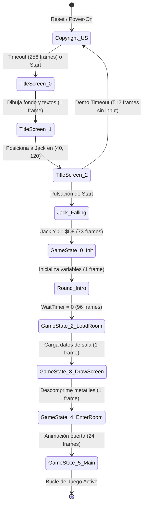

# RES-021: Especificación Técnica — Layout de HUD en Nametable/OAM y Flujo Canónico de Pantallas

- **ID de Investigación**: `RES-021`
- **Tarea Vinculada**: `TASK-F6-015`
- **Subsistemas Vinculados**: Subsistema 01 (Núcleo/FSM de Estados), Subsistema 02 (PPU/Nametable/OAM) y Subsistema 06 (HUD/Pantallas Especiales)
- **Archivos Fuente Analizados**:
  - [`asm/src/prg.asm`](file:///c:/Users/kanel/Documents/mjk/asm/src/prg.asm)
  - [`asm/src/data.asm`](file:///c:/Users/kanel/Documents/mjk/asm/src/data.asm)
  - [`asm/src/ram.asm`](file:///c:/Users/kanel/Documents/mjk/asm/src/ram.asm)
  - [`asm/src/macros.asm`](file:///c:/Users/kanel/Documents/mjk/asm/src/macros.asm)
- **Estado**: `[COMPLETADA]`
- **Fecha**: 2026-10-25
- **Agente**: `asm_researcher` (Nivel 3)

---

## 1. Arquitectura de Renderizado del HUD: OAM vs. Nametable

### 1.1 Ground Truth del Hardware NES Original
En el desmontaje original del juego comercial para NES, **los elementos del HUD activo durante el gameplay NO se dibujan en la Nametable VRAM ($2000+)**, sino que se renderizan enteramente mediante **sprites en la OAM (DMA $0200)** en cada ciclo NMI.

- Subrutina principal de HUD: [`DrawScoreAndCoinCount`](file:///c:/Users/kanel/Documents/mjk/asm/src/prg.asm#L1783-L1795) (`prg.asm:1783-1795`), invocada en cada frame desde [`GameState_5_Main`](file:///c:/Users/kanel/Documents/mjk/asm/src/prg.asm#L647-L668) (`prg.asm:664`).
- Subrutina de temporizador: [`DrawTimerOrTortureJumps`](file:///c:/Users/kanel/Documents/mjk/asm/src/prg.asm#L1871-L1897) (`prg.asm:1871-1897`), invocada desde [`HandleStageTimer`](file:///c:/Users/kanel/Documents/mjk/asm/src/prg.asm#L1220-L1232) (`prg.asm:1230`).
- Buffer DMA de sprites: `SpriteDMAArea` en RAM `$0200` ([`ram.asm:733`](file:///c:/Users/kanel/Documents/mjk/asm/src/ram.asm#L733)).

---

## 2. Coordenadas Exactas de Elementos de HUD

### 2.1 Temporizador ('T' + 2 Dígitos de Tiempo)
- **Rutina de dibujo**: [`DrawTimerOrTortureJumps`](file:///c:/Users/kanel/Documents/mjk/asm/src/prg.asm#L1871-L1897) (`prg.asm:1871-1897`).
- **Definición de Sprite**:
  ```asm
  1872: DrawTimerOrTortureJumps:
  1873: 	JSR CopyNext5BytesToTempSprite
  1874: 	SpriteData $E, $10, $3C, $1C, 9 ; tile=$0E ('T'), attrib=$10, xp=$3C (60), yp=$1C (28), spriteindex=9
  ```
- **Mecanismo de Desplazamiento en OAM**:
  La subrutina [`WriteSprite`](file:///c:/Users/kanel/Documents/mjk/asm/src/prg.asm#L2267-L2290) (`prg.asm:2267-2290`) evalúa el bit 4 del atributo (`$10`). Al estar activo, ejecuta:
  ```asm
  2276: 	LDA TempSpriteY
  2277: 	SEC
  2278: 	SBC #4
  2279: 	STA SpriteDMAArea,Y
  ...
  2285: 	LDA TempSpriteX
  2286: 	SEC
  2287: 	SBC #4
  2288: 	STA SpriteDMAArea+3,Y
  ```
  Por tanto, las coordenadas reales en OAM son `(X - 4, Y - 4)`.

- **Coordenadas OAM Reales**:
  - **Letra 'T'** (Tile `$0E`):
    - `Y = $1C - 4 = $18` (24 decimal pixels).
    - `X = $3C - 4 = $38` (56 decimal pixels, columna de tiles 7).
  - **Dígito de Decenas de Tiempo**:
    - `TempSpriteX` avanza `$10` y luego [`WriteBCDDigitsSprites`](file:///c:/Users/kanel/Documents/mjk/asm/src/prg.asm#L2129-L2153) (`prg.asm:2149`) resta 8: `X = $3C + $10 - 8 = $44`.
    - OAM: `X = $44 - 4 = $40` (64 decimal pixels, columna de tiles 8).
    - `Y = $1C - 4 = $18` (24 decimal pixels).
    - Supresión de ceros: si la decena es 0, se sustituye por tile `$0F` (tile transparente/en blanco) ([`prg.asm:2139-2140`](file:///c:/Users/kanel/Documents/mjk/asm/src/prg.asm#L2139-L2140)).
  - **Dígito de Unidades de Tiempo**:
    - `TempSpriteX = $3C + $10 = $4C`.
    - OAM: `X = $4C - 4 = $48` (72 decimal pixels, columna de tiles 9).
    - `Y = $1C - 4 = $18` (24 decimal pixels).
- **Fila de Tiles (Y)**: **Fila 3** (`24 / 8 = 3`, scanlines 25 a 32).
- **Dirección Nametable PPU Equivalente** (Base `$2000`, 32 tiles/fila):
  - Fila 3 base: `$2000 + (3 * 32) = $2060`.
  - Icono 'T' (Columna 7): `$2067`.
  - Decenas (Columna 8): `$2068`.
  - Unidades (Columna 9): `$2069`.

---

### 2.2 Puntuación (Score BCD Centrado, hasta 8 Dígitos)
- **Rutina de dibujo**: [`DrawScore`](file:///c:/Users/kanel/Documents/mjk/asm/src/prg.asm#L1801-L1823) (`prg.asm:1801-1823`) y [`DrawScoreDigitMaybe`](file:///c:/Users/kanel/Documents/mjk/asm/src/prg.asm#L1829-L1865) (`prg.asm:1829-1865`).
- **Definición de Sprite**:
  ```asm
  1802: 	JSR CopyNext5BytesToTempSprite
  1803: 	SpriteData 0, $10, $58, $10, $38 ; tile=0, attrib=$10, xp=$58 (88), yp=$10 (16), spriteindex=$38
  ```
- **Mecanismo de Emisión en OAM**:
  [`DrawScoreDigitMaybe`](file:///c:/Users/kanel/Documents/mjk/asm/src/prg.asm#L1829-L1865) escribe **directamente** en `SpriteDMAArea` sin llamar a `WriteSprite`:
  ```asm
  1831: 	LDYc TempSpriteY    ; Carga $10 (16)
  ...
  1848: 	STA SpriteDMAArea,Y ; Escribe Y = 16 sin restar 4
  ...
  1857: 	STA SpriteDMAArea,Y ; Escribe X = TempSpriteX sin restar 4
  ...
  1862: 	ADC #8              ; Avanza 8 px para el siguiente dígito
  ```
  - **Supresión de ceros no significativos**: los dígitos con valor 0 a la izquierda se colocan en `Y = $F8` (248 px, fuera de pantalla) ([`prg.asm:1839`](file:///c:/Users/kanel/Documents/mjk/asm/src/prg.asm#L1839)).
- **Coordenadas OAM Reales**:
  - `Y = $10` (16 decimal pixels para todos los dígitos visibles).
  - `X` inicial = `$58` (88 decimal pixels, columna de tiles 11).
  - Los 8 dígitos ocupan las posiciones X:
    - Dígito 7 (Millones high): `X = 88` (`$58`), Columna 11.
    - Dígito 6 (Millones low): `X = 96` (`$60`), Columna 12.
    - Dígito 5 (Cien miles high): `X = 104` (`$68`), Columna 13.
    - Dígito 4 (Cien miles low): `X = 112` (`$70`), Columna 14.
    - Dígito 3 (Miles high): `X = 120` (`$78`), Columna 15.
    - Dígito 2 (Miles low): `X = 128` (`$80`), Columna 16.
    - Dígito 1 (Decenas high): `X = 136` (`$88`), Columna 17.
    - Dígito 0 (Unidades low): `X = 144` (`$90`), Columna 18.
- **Fila de Tiles (Y)**: **Fila 2** (`16 / 8 = 2`, scanlines 17 a 24).
- **Dirección Nametable PPU Equivalente** (Base `$2000`, 32 tiles/fila):
  - Fila 2 base: `$2000 + (2 * 32) = $2040`.
  - Columnas 11 a 18: PPU `$204B` a `$2052`.

---

### 2.3 Icono Mighty ('M' + 1 Dígito de Monedas / Multiplicador)
- **Rutina de dibujo**: [`DrawMightyCoinCountOrMultiplier`](file:///c:/Users/kanel/Documents/mjk/asm/src/prg.asm#L1903-L1933) (`prg.asm:1903-1933`).
- **Definición de Sprite**:
  ```asm
  1904: 	JSR CopyNext5BytesToTempSprite
  1905: 	SpriteData $B, $10, $BC, $1C, $C ; tile=$0B ('M'), attrib=$10, xp=$BC (188), yp=$1C (28), spriteindex=$0C
  ```
  - Si la sala es Bomb Room ([`RoomStatusFlags & RF_BombRoom`](file:///c:/Users/kanel/Documents/mjk/asm/src/prg.asm#L1907)): incrementa el tile a `$0C` ('x') y muestra `ScoreMultiplier` en vez de `PlayerMightyCoins`.
- **Mecanismo de Desplazamiento**:
  Utiliza [`WriteSprite`](file:///c:/Users/kanel/Documents/mjk/asm/src/prg.asm#L2267-L2290), por lo que se aplica `SBC #4`.
- **Coordenadas OAM Reales**:
  - **Icono 'M' o 'x'**:
    - `Y = $1C - 4 = $18` (24 decimal pixels).
    - `X = $BC - 4 = $B8` (184 decimal pixels, columna de tiles 23).
  - **Dígito de Contador / Multiplicador**:
    - `TempSpriteX` avanza 8 px (`$BC + 8 = $C4`) ([`prg.asm:1915`](file:///c:/Users/kanel/Documents/mjk/asm/src/prg.asm#L1915)).
    - OAM: `X = $C4 - 4 = $C0` (192 decimal pixels, columna de tiles 24).
    - `Y = $1C - 4 = $18` (24 decimal pixels).
- **Fila de Tiles (Y)**: **Fila 3** (`24 / 8 = 3`, scanlines 25 a 32).
- **Dirección Nametable PPU Equivalente** (Base `$2000`, 32 tiles/fila):
  - Fila 3 base: `$2000 + (3 * 32) = $2060`.
  - Icono 'M' / 'x' (Columna 23): `$2077`.
  - Dígito contador (Columna 24): `$2078`.

---

### 2.4 Comprobación de Alineación en Fila Y = 16 px (Tile Row 2)

> [!IMPORTANT]
> **Conclusión del cotejo con el código fuente original de NES**:
> En el juego original **NO todos los elementos del HUD están alineados en la fila Y = 16 px**:
> 1. El **Score** se sitúa en **Y = 16 px** (Fila 2 de tiles) porque `DrawScoreDigitMaybe` asigna directamente `TempSpriteY = $10` a la OAM sin restar 4.
> 2. El **Timer** y el **Icono Mighty** se sitúan en **Y = 24 px** (Fila 3 de tiles) porque se inicializan con `TempSpriteY = $1C` (28) y pasan por `WriteSprite`, que resta 4 resultando en `Y = $18` (24 px).

#### Tabla Comparativa de Coordenadas: Juego Original vs. Port Unificado

| Elemento HUD | Fila Y Original (OAM) | Tile Row Orig. | PPU NT Orig. Equiv. | PPU NT si se Unifica en Fila Y=16 (Row 2) |
| :--- | :--- | :--- | :--- | :--- |
| **Timer 'T'** | Y = 24 px (`$18`) | Fila 3 | `$2067` | `$2047` |
| **Timer Decenas** | Y = 24 px (`$18`) | Fila 3 | `$2068` | `$2048` |
| **Timer Unidades** | Y = 24 px (`$18`) | Fila 3 | `$2069` | `$2049` |
| **Score (8 dígitos)** | Y = 16 px (`$10`) | Fila 2 | `$204B - $2052` | `$204B - $2052` |
| **Mighty 'M' / 'x'** | Y = 24 px (`$18`) | Fila 3 | `$2077` | `$2057` |
| **Mighty Dígito** | Y = 24 px (`$18`) | Fila 3 | `$2078` | `$2058` |

---

## 3. Timings Canónicos de Pantallas y Máquina de Estados

El flujo general está regido por `InGameFlag` ([`prg.asm:290-296`](file:///c:/Users/kanel/Documents/mjk/asm/src/prg.asm#L290-L296)), que selecciona entre [`TitleScreenHandler`](file:///c:/Users/kanel/Documents/mjk/asm/src/prg.asm#L7473-L7492) (`InGameFlag = 0`) y [`GameHandler`](file:///c:/Users/kanel/Documents/mjk/asm/src/prg.asm#L300-L317) (`InGameFlag = 1`).



### 3.1 Copyright Screen (REV_US)
- **Implementación**: [`TitleScreen_US_0`](file:///c:/Users/kanel/Documents/mjk/asm/src/prg.asm#L7496-L7520) y [`TitleScreen_US_1`](file:///c:/Users/kanel/Documents/mjk/asm/src/prg.asm#L7522-L7530) (`prg.asm:7496-7530`).
- **Textos impresos en Nametable** mediante [`WriteStringToPPU`](file:///c:/Users/kanel/Documents/mjk/asm/src/prg.asm#L2050-L2087):
  - String `$1C`: `MIGHTY BOMB JACK TM` en PPU `$2106` ([`data.asm:571`](file:///c:/Users/kanel/Documents/mjk/asm/src/data.asm#L571)).
  - String `$1D`: `TM AND (C) TECMO,LTD.` en PPU `$2184` ([`data.asm:575`](file:///c:/Users/kanel/Documents/mjk/asm/src/data.asm#L575)).
  - String `$1E`: `LICENSED BY` en PPU `$21CA` ([`data.asm:579`](file:///c:/Users/kanel/Documents/mjk/asm/src/data.asm#L579)).
  - String `$1F`: `NINTENDO OF AMERICA INC.` en PPU `$2204` ([`data.asm:583`](file:///c:/Users/kanel/Documents/mjk/asm/src/data.asm#L583)).
  - Sprites OAM: dígitos "1987" en `(X=$84, Y=$63)` y `(X=$74, Y=$63)` ([`prg.asm:7507-7516`](file:///c:/Users/kanel/Documents/mjk/asm/src/prg.asm#L7507-L7516)).
- **Temporización Canónica**:
  - `CopyrightScreenTimer` se inicializa a 0 ([`prg.asm:7519`](file:///c:/Users/kanel/Documents/mjk/asm/src/prg.asm#L7519)).
  - En cada frame se decrementa (`DEC CopyrightScreenTimer`). Al decrementar desde 0, desborda a `$FF` (255) y cuenta hasta 0.
  - **Duración total**: **256 frames** (~4.267 segundos a 60 Hz).
  - **Cancelación por input**: Si `Joypad1_Immediate & JP_Start != 0`, transiciona inmediatamente a la pantalla de título (`TitleScreenState = 2`) ([`prg.asm:7523-7529`](file:///c:/Users/kanel/Documents/mjk/asm/src/prg.asm#L7523-L7529)).

---

### 3.2 Title Screen
- **Implementación**: [`TitleScreen_0`](file:///c:/Users/kanel/Documents/mjk/asm/src/prg.asm#L7533-L7569), [`TitleScreen_1`](file:///c:/Users/kanel/Documents/mjk/asm/src/prg.asm#L7595-L7605) y [`TitleScreen_2`](file:///c:/Users/kanel/Documents/mjk/asm/src/prg.asm#L7608-L7640).
- **Contenido gráfico**:
  - Carga la sala 0 como fondo de Nametable ([`prg.asm:7583-7585`](file:///c:/Users/kanel/Documents/mjk/asm/src/prg.asm#L7583-L7585)).
  - `Strings_PushStartButton` (String 0): PPU `$21C8` ([`data.asm:450`](file:///c:/Users/kanel/Documents/mjk/asm/src/data.asm#L450)).
  - `Strings_C_Tecmo` (String `$0B`): PPU `$220A` ([`data.asm:495`](file:///c:/Users/kanel/Documents/mjk/asm/src/data.asm#L495)).
  - `Strings_HighGDV` (String `$0C`): PPU `$2213` ([`data.asm:499`](file:///c:/Users/kanel/Documents/mjk/asm/src/data.asm#L499)).
  - En REV_US String `$1B` (`TM`): PPU `$219E` ([`data.asm:567`](file:///c:/Users/kanel/Documents/mjk/asm/src/data.asm#L567)).
  - Digitos de High GDV en OAM: `(X=$CC, Y=$1C)` ([`prg.asm:7546-7551`](file:///c:/Users/kanel/Documents/mjk/asm/src/prg.asm#L7546-L7551)).
- **Demostración / Timeout de Título**:
  - En REV_US: `TitleScreenTimer` (16 bits mediante `TitleScreenTimer+1`): cuenta `2 * 256 =` **512 frames** (~8.533 segundos). Si no se presiona Start, regresa a la pantalla de Copyright ([`prg.asm:7615-7622`](file:///c:/Users/kanel/Documents/mjk/asm/src/prg.asm#L7615-L7622)).
- **Disparo de Partida**:
  - Al pulsar Start (`Joypad1_Immediate & JP_Start` con debounce en `Joypad1_ImmediateCopy == 0`) ([`prg.asm:7609-7613`](file:///c:/Users/kanel/Documents/mjk/asm/src/prg.asm#L7609-L7613)):
    - Invoca [`sub_BB1C`](file:///c:/Users/kanel/Documents/mjk/asm/src/prg.asm#L9224-L9241): inicializa física (`EnemyStruct_19 = $40`, velocidad Y=0).
    - Asigna velocidad horizontal `PlayerXVelLo = $80` y sprite de caída `PlayerSprite = 3`.
    - Pasa a `TitleScreenState = 3` (Jack Falling).

---

### 3.3 Jack Falling (Caída de Jack)
- **Implementación**: [`TitleScreen_3`](file:///c:/Users/kanel/Documents/mjk/asm/src/prg.asm#L7644-L7660) (`prg.asm:7644-7660`).
- **Física del Salto/Caída**:
  - Invocación a [`sub_B0AF`](file:///c:/Users/kanel/Documents/mjk/asm/src/prg.asm#L8096-L8108) con `A = 8`.
  - Aceleración: [`DoSomethingWithObjYVel`](file:///c:/Users/kanel/Documents/mjk/asm/src/prg.asm#L1658-L1685) suma `word_C163[2] = $00A0` ([`data.asm:255`](file:///c:/Users/kanel/Documents/mjk/asm/src/data.asm#L255)) en cada frame al contador interno de gravedad.
  - Velocidad vertical: se calcula indexando la tabla de velocidades [`word_C0E3`](file:///c:/Users/kanel/Documents/mjk/asm/src/data.asm#L187-L251) ([`data.asm:187-251`](file:///c:/Users/kanel/Documents/mjk/asm/src/data.asm#L187-L251)).
  - Posición inicial: `PlayerYPosHi = $78` (120 decimal) y `PlayerXPosHi = $28` (40 decimal) fijados en `TitleScreen_1` ([`prg.asm:7597-7600`](file:///c:/Users/kanel/Documents/mjk/asm/src/prg.asm#L7597-L7600)).
  - Condición de fin:
    ```asm
    7647: 	LDA PlayerYPosHi
    7648: 	CMP #$D8
    7649: 	BCC locret_ADF5
    ```
- **Duración Canónica Exacta**:
  - La simulación del integrador `(YPos += YVel)` partiendo de `Y = $78.00` con aceleración de gravedad `$00A0` alcanza `YPosHi = $DA >= $D8` en exactamente **73 frames** (1.217 segundos a 60 Hz).
  - Al completar el frame 73:
    - Borra Nametable y Sprites ([`prg.asm:7650-7651`](file:///c:/Users/kanel/Documents/mjk/asm/src/prg.asm#L7650-L7651)).
    - Asigna `TitleScreenState = 0`, `GameState = 0` y `INC InGameFlag` (pasa a `GameHandler`) ([`prg.asm:7652-7655`](file:///c:/Users/kanel/Documents/mjk/asm/src/prg.asm#L7652-L7655)).

---

### 3.4 GameState 0: Inicialización del Juego
- **Implementación**: [`GameState_0_Init`](file:///c:/Users/kanel/Documents/mjk/asm/src/prg.asm#L323-L362) (`prg.asm:323-362`).
- **Duración**: **1 frame**.
- **Acciones**:
  - Limpia banderas y contadores (monedas secretas, orbes, puertas, vidas extra).
  - Limpia Nametable ([`prg.asm:342`](file:///c:/Users/kanel/Documents/mjk/asm/src/prg.asm#L342)).
  - Configura `CurrentRoomID = 1` (Sala 1-1) ([`prg.asm:344`](file:///c:/Users/kanel/Documents/mjk/asm/src/prg.asm#L344)).
  - Reinicia `PlayerScore` a 0 en 4 bytes BCD ([`prg.asm:348-352`](file:///c:/Users/kanel/Documents/mjk/asm/src/prg.asm#L348-L352)).
  - Configura `EntryDoorType = $0F` ([`prg.asm:354`](file:///c:/Users/kanel/Documents/mjk/asm/src/prg.asm#L354)).
  - Configura vidas iniciales: `PlayerLives = 3` ([`prg.asm:356`](file:///c:/Users/kanel/Documents/mjk/asm/src/prg.asm#L356)).
  - Configura GDV inicial: `PlayerGDV = $47` ([`prg.asm:358`](file:///c:/Users/kanel/Documents/mjk/asm/src/prg.asm#L358)).
  - Avanza `GameState` a 1 (`GameState_1_RoundIntro`) ([`prg.asm:359`](file:///c:/Users/kanel/Documents/mjk/asm/src/prg.asm#L359)).

---

### 3.5 GameState 1: Round Intro (Presentación de Ronda)
- **Implementación**: [`GameState_1_RoundIntro`](file:///c:/Users/kanel/Documents/mjk/asm/src/prg.asm#L7663-L7700) (`prg.asm:7663-7700`).
- **Primer Frame (`GameState1Flag == 0`)**:
  - Limpia sprites y Nametable ([`prg.asm:7667-7668`](file:///c:/Users/kanel/Documents/mjk/asm/src/prg.asm#L7667-L7668)).
  - Dibuja sprites con [`DrawRoundIntroSprites`](file:///c:/Users/kanel/Documents/mjk/asm/src/prg.asm#L7682-L7700):
    - Sprite Bomb Jack: `(X=$70, Y=$60)`, tile 0, attrib 1 ([`prg.asm:7687`](file:///c:/Users/kanel/Documents/mjk/asm/src/prg.asm#L7687)).
    - Sprite "x": `(X=$84, Y=$60)`, tile `$0C`, attrib `$10` ([`prg.asm:7684`](file:///c:/Users/kanel/Documents/mjk/asm/src/prg.asm#L7684)).
    - Temporizador: asigna `GameState1WaitTimer = $60` (**96 frames**) ([`prg.asm:7689-7690`](file:///c:/Users/kanel/Documents/mjk/asm/src/prg.asm#L7689-L7690)).
    - Sprite Vidas BCD: `(X=$94, Y=$60)`, valor `PlayerLives` renderizado vía [`WriteBCDDigitsSprites`](file:///c:/Users/kanel/Documents/mjk/asm/src/prg.asm#L2129-L2153) ([`prg.asm:7691-7694`](file:///c:/Users/kanel/Documents/mjk/asm/src/prg.asm#L7691-L7694)).
      *(Nota del desensamblado: el juego renderiza las vidas como BCD aquí, a pesar de que el contador interno es binario estándar)*.
- **Temporización Canónica**:
  - En cada frame se decrementa `GameState1WaitTimer`.
  - **Duración total**: **96 frames** (1.600 segundos a 60 Hz).
  - Al llegar a 0:
    - Limpia sprites.
    - Pone `GameState1Flag = 0`.
    - Avanza `GameState` a 2 (`GameState_2_LoadRoom`) ([`prg.asm:7673-7676`](file:///c:/Users/kanel/Documents/mjk/asm/src/prg.asm#L7673-L7676)).

---

### 3.6 Transición a Game Loop Activo (States 2, 3, 4 $\rightarrow$ 5)
1. **GameState 2 (`GameState_2_LoadRoom`)** ([`prg.asm:3130-3163`](file:///c:/Users/kanel/Documents/mjk/asm/src/prg.asm#L3130-L3163)):
   - **Duración**: **1 frame**.
   - Carga punteros de metatiles de la sala, lee paleta de fondo y tipo de música ambiental.
   - Avanza a `GameState = 3`.
2. **GameState 3 (`GameState_3_DrawScreen`)** ([`prg.asm:379-441`](file:///c:/Users/kanel/Documents/mjk/asm/src/prg.asm#L379-L441)):
   - **Duración**: **1 frame**.
   - Borra todos los sprites.
   - Ejecuta [`DrawFullScreen`](file:///c:/Users/kanel/Documents/mjk/asm/src/prg.asm#L2724-L2857): descomprime el layout de la pantalla en la Nametable `$2000` y tabla de atributos `$23C0`.
   - Activa `DrawScoreAndCoinsFlag = 1` ([`prg.asm:420`](file:///c:/Users/kanel/Documents/mjk/asm/src/prg.asm#L420)).
   - Restaura paletas base en el buffer PPU.
   - Avanza a `GameState = 4`.
3. **GameState 4 (`GameState_4_EnterRoom`)** ([`prg.asm:445-623`](file:///c:/Users/kanel/Documents/mjk/asm/src/prg.asm#L445-L623)):
   - **Duración**: **25+ frames**.
   - Frame 1: Obtiene coordenadas iniciales del jugador según [`DoorEntryXYPositionTable`](file:///c:/Users/kanel/Documents/mjk/asm/src/prg.asm#L453) y tipo de puerta de entrada. Ejecuta `AnimateDoorOpen`. Inicializa el temporizador de entrada `byte_341 = $18` (**24 frames**) ([`prg.asm:495-496`](file:///c:/Users/kanel/Documents/mjk/asm/src/prg.asm#L495-L496)).
   - Frames 2 a 25: Aplica velocidad del jugador atravesando el umbral de la puerta mientras `byte_341` cuenta hacia atrás hasta 0 ([`prg.asm:501-506`](file:///c:/Users/kanel/Documents/mjk/asm/src/prg.asm#L501-L506)).
   - Al finalizar el movimiento: ejecuta `AnimateDoorClose` ([`prg.asm:516`](file:///c:/Users/kanel/Documents/mjk/asm/src/prg.asm#L516)).
   - Concluye en `loc_83E6`:
     - Activa al jugador (`PlayerStruct = 1`).
     - Avanza `GameState` a 5 (`GameState_5_Main`) ([`prg.asm:615`](file:///c:/Users/kanel/Documents/mjk/asm/src/prg.asm#L615)).
     - Pone en cola la música de fondo de la sala (`QueueSound`) ([`prg.asm:621`](file:///c:/Users/kanel/Documents/mjk/asm/src/prg.asm#L621)).
4. **GameState 5 (`GameState_5_Main`)** ([`prg.asm:647-668`](file:///c:/Users/kanel/Documents/mjk/asm/src/prg.asm#L647-L668)):
   - **Bucle principal activo**.
   - En cada tick se actualizan y renderizan en OAM:
     - `HandleStageTimer` $\rightarrow$ `DrawTimerOrTortureJumps` ([`prg.asm:661`](file:///c:/Users/kanel/Documents/mjk/asm/src/prg.asm#L661) y [`1230`](file:///c:/Users/kanel/Documents/mjk/asm/src/prg.asm#L1230)).
     - `DrawScoreAndCoinCount` $\rightarrow$ `DrawScore` + `DrawMightyCoinCountOrMultiplier` ([`prg.asm:664`](file:///c:/Users/kanel/Documents/mjk/asm/src/prg.asm#L664)).

---

## 4. Resumen de Constantes y Referencias Cruzadas para C x86

```c
/* Constantes Canónicas de Layout de HUD */
#define HUD_ROW2_PPU_BASE       0x2040  /* Y = 16 px (Scanlines 17-24) */
#define HUD_ROW3_PPU_BASE       0x2060  /* Y = 24 px (Scanlines 25-32) */

/* Direcciones PPU Equivalentes (Hardware Original NES / Staggered) */
#define PPU_TIMER_ORIG_T        0x2067  /* Row 3, Col 7  (Y = 24 px) */
#define PPU_TIMER_ORIG_TENS     0x2068  /* Row 3, Col 8  (Y = 24 px) */
#define PPU_TIMER_ORIG_ONES     0x2069  /* Row 3, Col 9  (Y = 24 px) */
#define PPU_SCORE_ORIG_START    0x204B  /* Row 2, Col 11 (Y = 16 px, hasta 0x2052) */
#define PPU_MIGHTY_ORIG_ICON    0x2077  /* Row 3, Col 23 (Y = 24 px) */
#define PPU_MIGHTY_ORIG_DIGIT   0x2078  /* Row 3, Col 24 (Y = 24 px) */

/* Direcciones PPU Unificadas en Fila Y = 16 px (Row 2) */
#define PPU_TIMER_UNIF_T        0x2047  /* Row 2, Col 7  (Y = 16 px) */
#define PPU_TIMER_UNIF_TENS     0x2048  /* Row 2, Col 8  (Y = 16 px) */
#define PPU_TIMER_UNIF_ONES     0x2049  /* Row 2, Col 9  (Y = 16 px) */
#define PPU_SCORE_UNIF_START    0x204B  /* Row 2, Col 11 (Y = 16 px) */
#define PPU_MIGHTY_UNIF_ICON    0x2057  /* Row 2, Col 23 (Y = 16 px) */
#define PPU_MIGHTY_UNIF_DIGIT   0x2058  /* Row 2, Col 24 (Y = 16 px) */

/* Timings Canónicos de Pantallas (en frames @ 60 Hz) */
#define FRAMES_COPYRIGHT_TIMEOUT    256     /* TitleScreen_US_1: 256 frames (~4.27 s) */
#define FRAMES_TITLE_DEMO_TIMEOUT   512     /* TitleScreen_2: 512 frames (~8.53 s) */
#define FRAMES_JACK_FALLING         73      /* TitleScreen_3: Y=0x78 -> Y>=0xD8 (~1.22 s) */
#define FRAMES_GAME_INIT            1       /* GameState_0_Init */
#define FRAMES_ROUND_INTRO          96      /* GameState_1_RoundIntro: GameState1WaitTimer=0x60 (1.60 s) */
#define FRAMES_LOAD_ROOM            1       /* GameState_2_LoadRoom */
#define FRAMES_DRAW_SCREEN          1       /* GameState_3_DrawScreen */
#define FRAMES_ENTER_DOOR_WALK      24      /* GameState_4_EnterRoom: byte_341=0x18 */
```
