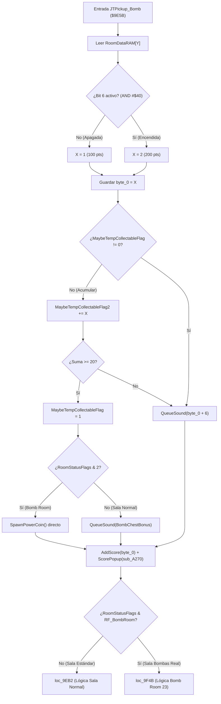

# Informe Técnico: Mecánicas de Recolección de Bombas, Cadena de Mechas y Puertas de Fuego

- **ID de Investigación**: `RES-022`
- **Tarea Asociada**: `TASK-F6-022B`
- **Área Temática**: `03-Escenarios / 04-Mecánicas de Juego y Objetos`
- **Fecha**: 2026-10-25
- **Autor / Agente**: `asm_researcher` (Nivel 3)
- **Estado**: `[COMPLETADA]`

---

## 1. Objetivo y Preguntas de Investigación

El presente informe documenta la ingeniería inversa exhaustiva y análisis a nivel de instrucción 6502 del subsistema de bombas, progresión de mecha ardiente (*fire bomb chain*), bonificaciones BCD y activación de eventos especiales (Power Coin y desbloqueo de puertas) en *Mighty Bomb Jack* (NES).

### Preguntas Técnicas Abordadas
1. **Codificación en `RoomDataRAM`**: ¿Cómo se representan las bombas apagadas, encendidas, iniciales, finales y recolectadas en la matriz de RAM de sala?
2. **Algoritmo de avance de mecha**: ¿Cuál es el autómata de estados finitos exacto que gobierna `JTPickup_Bomb` en salas normales (`loc_9EB2`) frente a salas de bombas reales (`loc_9F4B`)?
3. **Puntuación y popup BCD**: ¿Cómo se codifican los 100 y 200 puntos, y cómo interactúa el multiplicador?
4. **Condición de Bonus Perfecto (10.000 pts)**: ¿Cómo se valida la recogida ininterrumpida de bombas encendidas y cómo se enlaza con `DoorCond_0C_AllFireBombs`?
5. **Generador de Power Coin (Umbral de 20 bombas)**: ¿Cómo opera el acumulador de 20 bombas (`MaybeTempCollectableFlag2`) y cómo se diferencia el spawn directo vs armado de cofre?
6. **Renderizado OAM de la mecha/chispa**: ¿Cómo se calculan las coordenadas en pantalla a partir del byte de ROM empaquetado y cuál es el ciclo de parpadeo del sprite?

---

## 2. Fuentes de Verdad Analizadas (`asm/`)

| Archivo | Rango de Líneas | Símbolos / Etiquetas Analizadas |
| :--- | :---: | :--- |
| [prg.asm](../asm/src/prg.asm#L4970-L5165) | 4970–5164 | `JTPickup_Bomb`, `loc_9E68`, `loc_9E94`, `loc_9E9D`, `loc_9EB2`, `loc_9EC9`, `loc_9EDB`, `loc_9F09`, `loc_9F1E`, `loc_9F20`, `loc_9F31`, `loc_9F40`, `loc_9F48`, `loc_9F4B`, `loc_9F60`, `loc_9F6D`, `loc_9F82`, `loc_9F8C`, `loc_9F98`, `loc_9FAB` |
| [prg.asm](../asm/src/prg.asm#L5367-L5388) | 5367–5388 | `MaybeDrawFireBombSprite` |
| [prg.asm](../asm/src/prg.asm#L5645-L5667) | 5645–5667 | `sub_A270` (Spawning del score popup flotante de 100/200 pts) |
| [prg.asm](../asm/src/prg.asm#L5670-L5697) | 5670–5697 | `sub_A29C` (Lógica de animación/flashing del sprite de chispa en OAM) |
| [prg.asm](../asm/src/prg.asm#L3130-L3398) | 3130–3398 | `GameState_2_LoadRoom`, `ReadRoomData`, `HandleRoomDataObject`, `JT_94AD_0` (Inicialización de bombas en `RoomDataRAM`) |
| [prg.asm](../asm/src/prg.asm#L6867-L6878) | 6867–6878 | `DoorCond_0C_AllFireBombs` |
| [prg.asm](../asm/src/prg.asm#L8976-L8992) | 8976–8992 | `SpawnPowerCoin` |
| [prg.asm](../asm/src/prg.asm#L8546-L8566) | 8546–8566 | `MaybeConsiderOffscreen` (Limpieza de flags de Power Coin) |
| [prg.asm](../asm/src/prg.asm#L5415-L5431) | 5415–5431 | `loc_A11A` (Aparición de Power Coin al abrir cofre) |
| [ram.asm](../asm/src/ram.asm#L378-L382) | 378–382 | `byte_F7` (`$00F7`), `MaybeBombThing` (`$00F8`) |
| [ram.asm](../asm/src/ram.asm#L263-L266) | 263–266 | `FireBombsCollected` (`$00AE`), `FireBombsCollected2` (`$00AF`) |
| [ram.asm](../asm/src/ram.asm#L1043-L1046) | 1043–1046 | `MaybeTempCollectableFlag2` (`$0356`), `MaybeTempCollectableFlag` (`$0357`) |
| [ram.asm](../asm/src/ram.asm#L1846-L1865) | 1846–1865 | `RoomDataRAM` (`$0603`) |
| [data.asm](../asm/src/data.asm#L848-L870) | 848–870 | `ScoreAddTable` |
| [data.asm](../asm/src/data.asm#L831-L836) | 831–836 | `FireBombBonus` |

---

## 3. Hallazgos Técnicos y Extracción de Datos

### 3.1. Formato y Codificación de Bombas en `RoomDataRAM`

La matriz `RoomDataRAM` (ubicada en `$0603` del espacio de direccionamiento de la RAM de la NES) almacena los metatiles y entidades interactivas del escenario actual en bloques alineados en filas de 16 bytes (`$10`).

Durante la carga del nivel (`prg.asm:3210-3398`), las bombas son decodificadas y almacenadas según los siguientes valores de byte:

| Valor Hex | Bits (`7654 3210`) | Estado de la Bomba | Significado Operativo |
| :---: | :---: | :--- | :--- |
| `0x05` | `0000 0101` | **Bomba Apagada Estándar** | Tipo de entidad 5 (`ItemToTileTable[5] = $27`). Mecha apagada (`bit 6 = 0`), no es starter ni final (`bit 7 = 0`). Otorga 100 pts. |
| `0x85` | `1000 0101` | **Bomba Detonadora / Bomba Final** | Marcador especial fijado por `JT_94AD_0` (`prg.asm:3393`). Indica la **primera bomba** de la primera sección de la sala (`byte_B == 1`), o la **última bomba** de la última sección (`byte_B == 2` y `byte_AC == 0`). |
| `0x45` | `0100 0101` | **Bomba Intermedia con Mecha Activa** | Resultado de `ORA #$40` sobre `0x05` (`prg.asm:5101, 5153`). Otorga 200 pts. |
| `0xC5` | `1100 0101` | **Bomba Final con Mecha Activa** | Resultado de `ORA #$40` sobre `0x85`. Al recogerse con `MaybeBombThing == 1`, desencadena el Bonus Perfecto de 10.000 pts. |
| `0x0F` | `0000 1111` | **Bomba Recogida / Espacio Vacío** | Sobrescrita en `MaybePickupItem` (`prg.asm:4870-4871`). El metatile de fondo se transforma en vacío (`$2F`). |

#### Inicialización en `JT_94AD_0` (`prg.asm:3381-3398`)
```asm
JT_94AD_0:
	LDYc byte_E
	LDA #5
	STA RoomDataRAM,Y       ; Graba bomba normal 0x05
	LDXc byte_B             ; Indicador de sección inicial/final
	BEQ locret_94E8         ; Si byte_B == 0, retorna dejando 0x05
	DEX
	BEQ loc_94E3            ; Si byte_B era 1 (primera sección): marca 0x85
	LDAc byte_AC            ; Si byte_B era 2 (última sección): comprueba restantes
	BNE locret_94E8         ; Si byte_AC > 0, no es la última bomba; deja 0x05

loc_94E3:
	LDA #$85
	STA RoomDataRAM,Y       ; Graba 0x85 (bomba starter o bomba final)

locret_94E8:
	RTS
```

---

### 3.2. Arquitectura de Despacho y Máquina de Estados (`JTPickup_Bomb`)

El punto de entrada `JTPickup_Bomb` (`prg.asm:4970`) se invoca a través de la tabla de salto `loc_9DA0` (`prg.asm:4841`) con el índice de la bomba actual en el registro `Y = byte_5A`.



---

### 3.3. Algoritmo Exacto en Sala Normal (`loc_9EB2` a `loc_9F48`)

En salas estándar (pirámide / pasajes), el jugador puede obtener el Bonus de 10.000 puntos si recoge todas las bombas siguiendo estrictamente la cadena de mechas sin romperla.

#### 1. Primera Bomba Recogida en la Sala (`byte_F7 == 0`)
- Líneas `prg.asm:5020-5039`:
  ```asm
  loc_9EB2:
  	LDA a:byte_F7
  	BNE loc_9EDB            ; Si byte_F7 != 0, ya se recogió al menos una bomba
  	INC a:byte_F7            ; Marca primer pickup de la sala
  	LDYc byte_5A
  	LDA RoomDataRAM,Y
  	BPL loc_9EC9            ; Si bit 7 == 0, NO era la bomba starter (0x85)
  	LDA #1
  	STA a:MaybeBombThing     ; Starter correcta recogida: MaybeBombThing = 1
  	BNE loc_9F1E            ; Salta a encender la siguiente bomba

  loc_9EC9:
  	TYA
  	AND #$F0
  	TAX
  	LDA RoomDataRAM,X       ; Comprueba cabecera de fila
  	CMP #$90
  	BCS loc_9F1E
  	LDA #0
  	STA a:MaybeBombThing     ; Starter fallida: anula racha (MaybeBombThing = 0)
  	BEQ loc_9F1E
  ```

#### 2. Bombas Subsecuentes (`loc_9EDB`)
- Líneas `prg.asm:5041-5073`:
  - Se comprueba si la bomba recogida tenía mecha encendida (`AND #$40`):
    - **Caso Bomba Apagada (`BEQ loc_9F09`)**:
      - El jugador recogió una bomba con mecha inactiva fuera de turno.
      - Comprueba la cabecera de fila (`RoomDataRAM,X < $90`).
      - Ejecuta:
        ```asm
        LDA #2
        ORA a:MaybeBombThing
        STA a:MaybeBombThing    ; MaybeBombThing |= 0x02 (marca fallo / racha rota)
        BNE loc_9F48            ; Salta sin encender ninguna otra bomba
        ```
      - **Consecuencia**: La cadena de mechas se extingue. No se propaga a otra bomba y el bonus perfecto queda anulado.
    - **Caso Bomba Encendida (`AND #$40 != 0`)**:
      - Comprueba el bit 7 de la bomba recogida (`LDA RoomDataRAM,Y; BPL loc_9F1E`):
        - Si `bit 7 == 0`: Es una bomba intermedia ordinaria (`0x45`). Salta a `loc_9F1E` para buscar y encender la siguiente.
        - Si `bit 7 == 1`: ¡Es la **bomba final** de la sala (`0xC5`)!
          - Verifica si la racha fue intachable:
            ```asm
            LDA #1
            CMP a:MaybeBombThing    ; ¿Permanece MaybeBombThing exactamente en 1?
            BNE loc_9F1E            ; Si no es 1 (era 0 o tiene bit 1 activo), salta
            LDA a:MaybeBombThing
            ORA #$80
            STA a:MaybeBombThing    ; MaybeBombThing |= 0x80 (Bonus Perfecto armado)
            LDA #Score_10000
            JSR AddScore            ; Suma 10.000 puntos BCD
            LDA #Sound_BombBonus
            JSR QueueSound          ; Reproduce fanfarria de bonus de bombas
            LDYc byte_5A
            JMP loc_9F1E
            ```

#### 3. Búsqueda y Propagación de Mecha (`loc_9F1E` a `loc_9F48`)
- Líneas `prg.asm:5074-5105`:
  ```asm
  loc_9F1E:
  	LDX #$C                 ; Límite de búsqueda: máximo 12 posiciones por fila

  loc_9F20:
  	INY                     ; Avanza al siguiente byte en RoomDataRAM
  	LDA RoomDataRAM,Y
  	CMP #$FF                ; ¿Fin de fila?
  	BEQ loc_9F31            ; Salta a avanzar de fila
  	AND #$7F                ; Enmascara bit 7 (0x05 y 0x85 dan 5)
  	CMP #5                  ; ¿Es una bomba intacta?
  	BEQ loc_9F40            ; ¡Encontrada! Enciende mecha
  	DEX
  	BNE loc_9F20            ; Continúa buscando en la fila actual

  loc_9F31:
  	TYA
  	AND #$F0
  	CLC
  	ADC #$10                ; Avanza a la siguiente fila (+16 bytes)
  	TAY
  	LDA RoomDataRAM,Y       ; Lee cabecera de la nueva fila
  	BEQ loc_9F48            ; Si cabecera == 0, fin de la sala (no hay más bombas)
  	INY                     ; Salta byte de cabecera
  	BNE loc_9F1E            ; Reinicia búsqueda con X = 12

  loc_9F40:
  	LDA RoomDataRAM,Y
  	ORA #$40                ; Activa bit 6 (mecha encendida: 0x45 o 0xC5)
  	STA RoomDataRAM,Y

  loc_9F48:
  	JMP MaybePickupItem     ; Finaliza consumo de la bomba recogida
  ```

---

### 3.4. Algoritmo en Sala de Bombas / Royal Palace (`loc_9F4B` a `loc_9FAB`)

Las salas de bombas (`RF_BombRoom`) contienen exactamente 23 bombas en una cuadrícula cerrada sin scroll horizontal/vertical:

1. **Inicialización (`loc_9F4B`)**:
   - Si `byte_F7 == 0`:
     - `INC byte_F7`.
     - `FireBombsCollected = 0` (`$00AE`).
     - `FireBombsCollected2 = 0` (`$00AF`).
     - Salta directo a encender la primera mecha en `loc_9F8C`.

2. **Conteo y Condición de Salida (`loc_9F60-9F82`)**:
   - Si la bomba recogida tenía mecha (`AND #$40 != 0`): `INC FireBombsCollected`.
   - Siempre incrementa `FireBombsCollected2`.
   - Comparación con 23 (`CMP #23`):
     - Si se han recogido las **23 bombas**:
       ```asm
       LDA #$F8
       STA SpriteDMAArea+$10    ; Oculta el sprite de la mecha (Y = 248)
       JSR OpenBombRoomDoor     ; Abre la salida de la sala de bombas
       JMP loc_9FAB
       ```
   - Si la bomba recogida **NO** estaba encendida (`AND #$40 == 0`):
     - Salta a `loc_9FAB` (`BEQ loc_9FAB`): **no** enciende la siguiente bomba ni mueve el sprite de la chispa. La mecha actual permanece ardiendo en su posición.

3. **Propagación Circular de Mecha (`loc_9F8C-9F60`)**:
   - Líneas `prg.asm:5142-5161`:
     ```asm
     loc_9F8C:
     	INY
     	LDA RoomDataRAM,Y
     	CMP #$FF                ; Si llega a fin de datos de la sala...
     	BNE loc_9F98
     	LDY #$81                ; ...envuelve circularmente al offset 0x81
     	BNE loc_9F8C

     loc_9F98:
     	CMP #5                  ; Busca la siguiente bomba intacta (valor 5)
     	BNE loc_9F8C
     	ORA #$40                ; Enciende mecha (valor 0x45)
     	STA RoomDataRAM,Y
     	TYA
     	SEC
     	SBC #$84                ; Calcula índice relativo a la lista de ROM
     	TAY
     	LDA (byte_90),Y         ; Carga byte de coordenadas (Y|X) desde ROM
     	JSR MaybeDrawFireBombSprite ; Posiciona la chispa en OAM
     ```

4. **Bonificación de Sala de Bombas en Round Clear (`prg.asm:835-862`)**:
   - Al completar la ronda, si `FireBombsCollected >= 20` (out of 23), se otorga el bonus especial:
     - 20 bombas encendidas: 10.000 pts (`FireBombBonus[0] = $10`).
     - 21 bombas encendidas: 20.000 pts (`FireBombBonus[1] = $20`).
     - 22 bombas encendidas: 30.000 pts (`FireBombBonus[2] = $30`).
     - 23 bombas encendidas: 50.000 pts (`FireBombBonus[3] = $50`).

---

### 3.5. Sistema de Puntuación BCD y Popups Gráficos

1. **Puntuación Base (`JTPickup_Bomb:5009-5010`)**:
   - Registro temporal `byte_0`:
     - `byte_0 = 1`: Bomba apagada.
     - `byte_0 = 2`: Bomba encendida.
   - Rutina `AddScore` (`prg.asm:2436`):
     - Para índices `< 8` en salas estándar (`RoomStatusFlags & RF_BombRoom == 0`), el multiplicador se ignora (`BEQ _AddScoreIndex`).
     - Utiliza `ScoreAddTable` (`data.asm:850-852`):
       - Índice 1: `ScoreValue 1, 1` -> Suma `1` al dígito de centenas en BCD (100 puntos).
       - Índice 2: `ScoreValue 1, 2` -> Suma `2` al dígito de centenas en BCD (200 puntos).
     - En salas de bombas (`RF_BombRoom`), si `ScoreMultiplier > 0`, se aplica `MultipliedScoreTable` (`data.asm:840-846`).

2. **Popup Gráfico Flotante (`sub_A270`, `prg.asm:5647-5667`)**:
   - Invoca `sub_9276` con `byte_70` para obtener coordenadas exactas en pantalla (`byte_94` = X, `byte_92` = Y).
   - Estructura del popup en RAM:
     - `byte_786 = $80`: Flag activo del popup.
     - `byte_787 = byte_0`: Tipo de texto (1 para "100", 2 para "200").
     - `byte_789 = byte_94`: Coordenada X del popup.
     - `byte_78B = byte_92`: Coordenada Y del popup.

---

### 3.6. Bonus Perfecto de 10.000 Puntos y Enlace con Puertas

El desbloqueo de la puerta secreta gobernada por `DoorCond_0C_AllFireBombs` (`prg.asm:6871-6877`) opera mediante el protocolo estricto de bits sobre `MaybeBombThing` (`$00F8`):

| Bit de `MaybeBombThing` | Máscara | Función y Transición |
| :---: | :---: | :--- |
| **Bit 0** | `0x01` | **Cadena Iniciada Correctamente**: Se fija a 1 si y solo si la primera bomba recogida en la sala es la starter detonadora (`0x85`). |
| **Bit 1** | `0x02` | **Penalización / Cadena Rota**: Se activa mediante `ORA #02` si en cualquier momento posterior el jugador recoge una bomba con la mecha apagada. |
| **Bit 7** | `0x80` | **Bonus Perfecto Armado**: Activado mediante `ORA #$80` al recoger la bomba final (`0xC5`) cuando `MaybeBombThing == 1`. |

#### Inspección en `DoorCond_0C_AllFireBombs`:
```asm
DoorCond_0C_AllFireBombs:
	LDAc MaybeBombThing     ; Comprueba si el bit 7 está activo
	BPL DoorCond_rts        ; Si bit 7 == 0 (positivo), no abre la puerta (RTS)
	AND #$7F
	STAc MaybeBombThing     ; Consume el bit 7 (evita aperturas duplicadas)
	JMP HandleOpenDoorMaybe ; Abre la puerta secreta/salida
```

---

### 3.7. Contador de 20 Bombas y Spawning de Power Coin

El subsistema gestiona la aparición de la **Power Coin** mediante dos variables de RAM:
- `MaybeTempCollectableFlag2` (`$0356` en `ram.asm:1043`): Contador acumulativo.
- `MaybeTempCollectableFlag` (`$0357` en `ram.asm:1045`): Flag de estado y disparo.

> [!NOTE]
> **Discrepancia de Direcciones RAM**: En documentación preliminar o listados externos, estas variables aparecían etiquetadas como `$0363` y `$0362`. El análisis canónico de `asm/src/ram.asm` confirma que en la build oficial se sitúan en `$0356` (`Flag2`, acumulador) y `$0357` (`Flag`, estado).

#### Lógica Operativa (`prg.asm:4980-4995`):
1. **Acumulación Ponderada**:
   - Bomba apagada (`byte_0 = 1`): Suma **+1** al acumulador `$0356`.
   - Bomba encendida (`byte_0 = 2`): Suma **+2** al acumulador `$0356`.
   - *Consecuencia técnica*: Recoger bombas encendidas acelera al doble la aparición de la Power Coin (requiere solo 10 bombas encendidas vs 20 apagadas).
2. **Evaluación de Umbral (`CMP #20` = 0x14 decimal)**:
   - Al alcanzar o superar 20:
     - `INC MaybeTempCollectableFlag`: El flag pasa de `0` a `1`.
     - Si `RoomStatusFlags & 2` (Sala de Bombas / Royal Palace):
       - Ejecuta `JSR SpawnPowerCoin` (`prg.asm:8978`).
       - En `SpawnPowerCoin`, se realiza `ORA #2` sobre `$0357` (pasando el flag a `3`).
       - Se inicializa el enemigo `EnemyType_8_PowerCoin` y se reproduce `Sound_PowerCoinSpawn`.
     - Si `RoomStatusFlags & 2 == 0` (Sala Estándar):
       - Reproduce `Sound_BombChestBonus`.
       - El flag permanece en `1` (armado en espera).
       - En `loc_A11A` (`prg.asm:5426-5428`), cuando Jack abre cualquier cofre, se evalúa:
         ```asm
         LDA MaybeTempCollectableFlag
         BEQ locret_A125
         JSR SpawnPowerCoin      ; La Power Coin emerge del cofre abierto
         ```
3. **Reseteo del Ciclo**:
   - En `MaybeConsiderOffscreen` (`prg.asm:8555-8557`), cuando la Power Coin sale de la pantalla o es recolectada, ambas variables son limpiadas a 0:
     ```asm
     LDA #0
     STA MaybeTempCollectableFlag   ; $0357 = 0
     STA MaybeTempCollectableFlag2  ; $0356 = 0
     ```

---

### 3.8. Renderizado OAM de la Chispa / Mecha Ardiente

En las salas de bombas, la mecha activa no es un metatile alternativo, sino un **sprite de hardware de la NES** que se superpone dinámicamente sobre la bomba correspondiente.

#### Subrutina `MaybeDrawFireBombSprite` (`prg.asm:5369-5388`)
- Asignación exclusiva: **Sprite Slot 4** en la tabla de OAM DMA (`SpriteDMAArea+$10` a `+$13`, dirección física `$0210`-`$0213`).
- **Entrada**: Acumulador `A` contiene el byte de coordenadas empaquetadas leído de la ROM de la sala `(byte_90),Y`.

```asm
MaybeDrawFireBombSprite:
	PHA                     ; Preserva byte original
	AND #$F0                ; Aísla nibble superior (coordenada vertical Y)
	SEC
	SBC #4                  ; Desplaza 4 píxeles hacia arriba (Y - 4)
	STA SpriteDMAArea+$10   ; OAM Byte 0: Posición Y ($0210)
	PLA                     ; Recupera byte original
	ASL A
	ASL A
	ASL A
	ASL A                   ; Rota nibble inferior a superior ((A & 0x0F) * 16)
	CLC
	ADC #8                  ; Desplaza 8 píxeles a la derecha (X + 8)
	STA SpriteDMAArea+$13   ; OAM Byte 3: Posición X ($0213)
	LDA #$D
	STA SpriteDMAArea+$11   ; OAM Byte 1: Tile ID 0x0D ($0211)
	LDA #$12
	STA SpriteDMAArea+$12   ; OAM Byte 2: Atributos 0x12 ($0212)
	RTS
```

#### Parámetros del Sprite OAM:
- **Y Pos (`$0210`)**: `(Coordenada_Y_Bloque) - 4`. Alinea la chispa directamente sobre la mecha en el extremo superior de la bomba.
- **X Pos (`$0213`)**: `(Coordenada_X_Bloque) + 8`. Centra horizontalmente la chispa de 8x8 píxeles sobre el metatile de 16x16.
- **Tile ID (`$0211`)**: `$0D` (Chispa / llama frame A).
- **Atributos (`$0212`)**: `$12` (`%00010010`):
  - Bits 1-0 = `10`b: Paleta de sprites 2 (tonos amarillos, naranjas y rojos de fuego).
  - Bit 5 = `0`: Prioridad por delante del fondo (in front of background).
  - Bits 6-7 = `0`: Sin volteo horizontal ni vertical.

#### Animación y Flashing (`sub_A29C`, `prg.asm:5671-5689`)
Invocada cada frame desde el bucle principal en `HandleSpawnsAndMore` (`prg.asm:3861`):
```asm
sub_A29C:
	JSR MaybeAward1UP
	LDA #4
	BIT byte_786
	BNE loc_A2B1
	ORA byte_786
	STA byte_786
	LDA #4
	STA byte_78D            ; Inicializa temporizador en 4 frames

loc_A2B1:
	DEC byte_78D            ; Decrementa contador de animación
	BNE loc_A2C3
	LDA #3
	STA byte_78D            ; Recarga con periodo de 3 frames
	LDA SpriteDMAArea+$11   ; Lee tile actual del sprite de la chispa
	EOR #2                  ; Conmuta bit 1: 0x0D ^ 0x02 = 0x0F / 0x0F ^ 0x02 = 0x0D
	STA SpriteDMAArea+$11   ; Actualiza Tile ID en OAM
```
- **Periodo**: La animación conmuta cada **3 frames** (20 Hz en NTSC / ~16.6 Hz en PAL).
- **Frames de animación**: Alterna cíclicamente entre Tile `$0D` y Tile `$0F`.

---

## 4. Discrepancias Frente a la Implementación Actual en C

En el archivo [src/core/mjk_room_decoder.c](../src/core/mjk_room_decoder.c#L363-L379) se identifican discrepancias críticas respecto a la lógica original de NES:

```c
// IMPLEMENTACIÓN ACTUAL EN C (INCORRECTA / SIMPLISTA):
uint16_t MjkRoom_CollectBomb(MjkRoomContext* room, uint8_t bomb_index) {
    if (!room || bomb_index >= MJK_BOMBS_PER_ROOM) return 0;
    room->total_bombs_collected++;
    if (room->chain_active && bomb_index == room->active_fire_bomb_index) {
        room->fire_bombs_collected++;
        room->active_fire_bomb_index = (uint8_t)((bomb_index + 1) % MJK_BOMBS_PER_ROOM);
        return 200;
    } else {
        room->chain_active = true;
        room->active_fire_bomb_index = (uint8_t)((bomb_index + 1) % MJK_BOMBS_PER_ROOM);
        return 100;
    }
}
```

### Divergencias Detectadas:
1. **Unificación Errónea de Salas**: El código C actual trata todas las salas como un array plano de 23 bombas modulares `(bomb_index + 1) % 23`. En el ASM original:
   - Las salas normales operan sobre `RoomDataRAM` multidimensional con saltos de fila (`$FF`, `+$10`) y límite de 12 pasos (`prg.asm:5075`).
   - Solo las salas de bombas (`RF_BombRoom`) tienen 23 bombas y wrapping circular a `$81`.
2. **Propagación en Recogida Apagada**: En C, recoger una bomba apagada activa o mantiene la cadena y enciende la siguiente (`room->active_fire_bomb_index = bomb_index + 1`). En el ASM original:
   - En salas normales: recoger una bomba apagada **apaga definitivamente la cadena**, fija `MaybeBombThing |= 0x02` y **NO** enciende ninguna otra bomba (`loc_9F09` -> `loc_9F48`).
   - En salas de bombas: recoger una bomba apagada no avanza la mecha (`loc_9F82` -> `loc_9FAB`), manteniendo la mecha en la bomba previa.
3. **Ausencia del Bonus de 10.000 pts**: No se valida la coincidencia con la bomba starter (`0x85`) ni la bomba final con bit 7 (`0xC5`), ni se setea el bit 7 en `MaybeBombThing` para la puerta de salida.
4. **Omisión del Acumulador de Power Coin**: No existe la ponderación `+1` (apagada) / `+2` (encendida) hacia el umbral de 20 en `$0356`, ni la activación condicionada por sala normal (cofres) vs sala real (spawn directo).
5. **Omisión del Sprite OAM de Chispa**: No existe la simulación del sprite 4 (`$0210-$0213`) con tiles `$0D`/`$0F`, animación cada 3 frames y offsets de píxeles `(-4, +8)`.

---

## 5. Especificación de Implementación y Criterios de Paridad

Para alcanzar paridad estricta 1:1 con el hardware NES en `src/core/mjk_room_decoder.c` y `src/core/mjk_game.c`:

### 5.1. Definiciones de Constantes y Máscaras
```c
#define MJK_BOMB_STATE_UNLIT           0x05
#define MJK_BOMB_STATE_STARTER_OR_END  0x85
#define MJK_BOMB_FLAG_FUSE_LIT         0x40
#define MJK_BOMB_STATE_EMPTY           0x0F

#define MJK_BOMB_THING_STARTED         0x01
#define MJK_BOMB_THING_BROKEN          0x02
#define MJK_BOMB_THING_PERFECT_BONUS   0x80

#define MJK_POWER_COIN_THRESHOLD       20
```

### 5.2. Estructura de Estado de Mechas Sugerida
```c
typedef struct {
    uint8_t maybe_bomb_thing;           // Reflejo exacto de $00F8 (bits 0, 1, 7)
    uint8_t room_bomb_picked_flag;      // Reflejo exacto de $00F7
    uint8_t power_coin_bomb_counter;    // Reflejo exacto de $0356 (acumulador hasta 20)
    uint8_t power_coin_trigger_flag;    // Reflejo exacto de $0357 (0, 1=armado, 3=spawned)
    uint8_t fire_bombs_collected;       // Reflejo exacto de $00AE (solo bomb rooms)
    uint8_t fire_bombs_collected_total; // Reflejo exacto de $00AF (cuenta hasta 23)
    
    // Simulación OAM Sprite 4 (Chispa de Mecha)
    uint8_t spark_sprite_y;             // OAM $0210
    uint8_t spark_sprite_tile;          // OAM $0211 (0x0D <-> 0x0F)
    uint8_t spark_sprite_attr;          // OAM $0212 (0x12)
    uint8_t spark_sprite_x;             // OAM $0213
    uint8_t spark_anim_timer;           // byte_78D (periodo de 3 frames)
} MjkBombFuseSystem;
```

### 5.3. Casos Límite y Reglas de Paridad
1. **Recogida fuera de orden**: Si el jugador recoge cualquier bomba apagada en una sala estándar mientras la cadena está en curso, la mecha desaparece inmediatamente de la pantalla y no vuelve a aparecer ninguna mecha en esa sala.
2. **Ponderación de Power Coin**: El contador `$0356` debe sumar `2` al recoger bomba con mecha y `1` con bomba normal. Al alcanzar 20, en sala normal no aparece la moneda en el aire, sino que se reproduce `Sound_BombChestBonus` y se arma para el próximo cofre que se abra.
3. **Desbloqueo de Puerta 0x0C**: La condición de puerta `0x0C` solo debe evaluarse afirmativa si el bit 7 de `maybe_bomb_thing` está activo (`0x80`), y al abrir la puerta dicho bit debe consumirse (`& 0x7F`).
