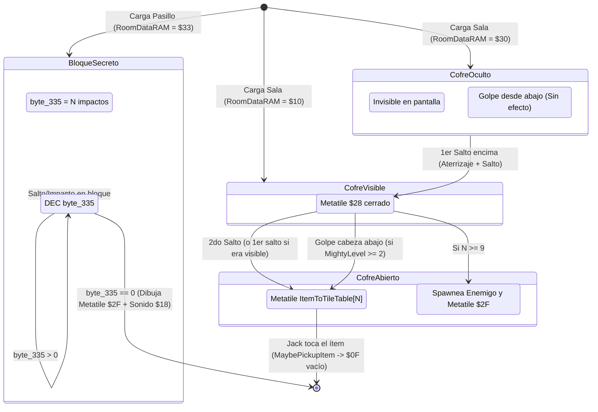

# RES-023: Ingeniería Inversa de Cofres del Tesoro y Bloques Secretos

## Metadatos
- **ID de Tarea**: TASK-F6-023
- **Fecha**: 2026-10-25
- **Estado**: COMPLETADO
- **Subsistemas Involucrados**:
  - `BigBeefySubHandlesBGColliding` / `sub_9CDB` ([`asm/src/prg.asm:4615-4856`](file:///c:/Users/kanel/Documents/mjk/asm/src/prg.asm#L4615-L4856))
  - `MaybePickupItem` ([`asm/src/prg.asm:4860-4893`](file:///c:/Users/kanel/Documents/mjk/asm/src/prg.asm#L4860-L4893))
  - `JTPickup_Chest` y `JTPickup_Chest2` ([`asm/src/prg.asm:5259-5308`](file:///c:/Users/kanel/Documents/mjk/asm/src/prg.asm#L5259-L5308))
  - `MaybeOpenHiddenBlock` ([`asm/src/prg.asm:5392-5458`](file:///c:/Users/kanel/Documents/mjk/asm/src/prg.asm#L5392-L5458))
  - `MaybeSpawnThingFromObject` ([`asm/src/prg.asm:5462-5495`](file:///c:/Users/kanel/Documents/mjk/asm/src/prg.asm#L5462-L5495))
  - `sub_A18E` y `sub_A1A6` ([`asm/src/prg.asm:5499-5525`](file:///c:/Users/kanel/Documents/mjk/asm/src/prg.asm#L5499-L5525))
  - `SpawnPowerCoin` ([`asm/src/prg.asm:8978-8991`](file:///c:/Users/kanel/Documents/mjk/asm/src/prg.asm#L8978-L8991))
  - `ItemToTileTable` ([`asm/src/data.asm:888-920`](file:///c:/Users/kanel/Documents/mjk/asm/src/data.asm#L888-L920))
  - `MetatileDefinitions` ([`asm/src/data.asm:1549-1660`](file:///c:/Users/kanel/Documents/mjk/asm/src/data.asm#L1549-L1660))
  - `TileAttributeTable` ([`asm/src/data.asm:598-639`](file:///c:/Users/kanel/Documents/mjk/asm/src/data.asm#L598-L639))

---

## 1. Resumen Ejecutivo y Arquitectura General

En *Mighty Bomb Jack* (NES), los cofres del tesoro y los bloques secretos de los pasillos son entidades embebidas en el mapa de fondo (background metatiles de $16 \times 16$ px) gobernadas por el arreglo en RAM `RoomDataRAM` (`$0600..$063F`).

Existen dos subsistemas principales:
1. **Cofres del Tesoro (Rojos y Naranjas, Visibles y Ocultos)**:
   - Se activan por contacto vertical: Jack saltando sobre la tapa del cofre (`byte_310 != 0`) o golpeándolo por debajo (`byte_310 == 0`, requiriendo `PlayerMightyLevel >= 2`).
   - El cofre visible se abre con **1 salto**.
   - El cofre oculto (flag `$20` en `RoomDataRAM`) requiere **2 saltos**: el primer salto lo revela (dibuja el metatile `$28` del cofre cerrado y borra el flag `$20`), y el segundo salto lo abre.
   - Los cofres naranjas (`Item_OrangeChest = $11`) son inmunes e interactúan únicamente si `PlayerMightyLevel >= 1`.
2. **Bloques Secretos de Pasillo (Comando `$6N`)**:
   - Inicializados con valor `#$33` en `RoomDataRAM`.
   - Se revelan tras **$N$ impactos/saltos acumulados** (`byte_335` cargado con el cuarteto inferior del comando `$6N`).
   - El seguimiento del bloque activo se mantiene en `byte_336` ($0336); al llegar a cero, se transforma en bloque visible (metatile `$2F`) y reproduce `Sound_SecretBlockRevealed` ($18).

---

## 2. Mapa Completo de Variables de Memoria (RAM y ZeroPage)

| Dirección | Símbolo ASM | Tipo / Rango | Descripción Canónica |
|:---|:---|:---|:---|
| `$005A` | `byte_5A` | 1 byte | Índice de ranura actual del objeto en `RoomDataRAM` (`$00..$3F`). |
| `$005C` | `byte_5C` | 1 byte | Byte de comando original del objeto (`$1N`, `$3N`, `$6N`, `$9N`, `$AN`). |
| `$005E` | `MaybeCollectedThing` | 1 byte | Byte de estado leído directamente de `RoomDataRAM,Y`. |
| `$0070` | `byte_70` | 1 byte | Coordenada empaquetada $(Y, X)$ del metatile del objeto (`$YX`, donde $Y$ y $X$ son $0..F$). |
| `$0074` | `byte_74` | 1 byte | Respaldo del índice `byte_5A` durante la rutina de apertura de cofres. |
| `$00F0` | `byte_F0` | 1 byte | Coordenada empaquetada del bloque/cofre actualmente interactuado (se limpia a 0 al terminar). |
| `$00F4` | `byte_F4` | 1 byte | Índice de cuadrante/pantalla del objeto para direccionamiento PPU. |
| `$0310` | `byte_310` | 1 byte | Dirección del contacto: `0` = impacto desde abajo (cabeza), `1` = impacto desde arriba (pies/aterrizaje). |
| `$0311` | `byte_311` | 1 byte | Respaldo de `byte_F4` para la actualización PPU en `sub_A18E`. |
| `$0312` | `byte_312` | 1 byte | Máscara de respuesta física/rebote de colisión de fondo. |
| `$0313` | `byte_313` | 1 byte | Respaldo de `MaybeCollectedThing` para verificar si el cofre era oculto (flag `$20`). |
| `$0315` | `_MaybeBlockSpawningObj` | 1 byte | Byte de comando del objeto siendo procesado (contiene el ítem/enemigo en el cuarteto inferior). |
| `$0335` | `byte_335` | 1 byte | Contador regresivo de impactos para revelar el bloque secreto actual. |
| `$0336` | `byte_336` | 1 byte | Coordenada $(Y, X)$ del bloque secreto activo siendo golpeado. |
| `$0356` | `MaybeTempCollectableFlag2` | 1 byte | Contador de bombas recogidas acumuladas (al llegar a 20 arma la moneda Power Coin). |
| `$0357` | `MaybeTempCollectableFlag` | 1 byte | Bandera Power Coin: `1` = armada para el próximo cofre, `3` (`1 | 2`) = ya spawneada. |
| `$0358` | `MaybeCollectedThing2` | 1 byte | Bandera 1UP/Tecmo Plate: bit 7 (`$80`) = 1UP pendiente por animación. |
| `$0370` | `JustJumpedFlag` | 1 byte | Bandera de salto de Jack: `Sound_Jump` ($04) al despegar del suelo/cofre; borrada en colisión. |
| `$0376` | `Collected1UPThisRoundFlag`| 1 byte | Flag de 1UP recogido en la ronda actual (reemplaza Tecmo Plate por Moneda Mighty). |
| `$03DA` | `PlayerMightyLevel` | 1 byte | Nivel Mighty de Jack: `0` = Normal, `1` = Azul, `2` = Naranja, `3` = Rojo. |
| `$03DC` | `PlayerMightyCoins` | 1 byte | Contador de Monedas Mighty (si llega a 10, Jack es enviado a la Torture Room). |

---

## 3. Desensamblado y Análisis de Rutinas Clave

### 3.1 Detección de Colisión y Rutinas de Contacto (`JTPickup_Chest`, `JTPickup_Chest2`)

Ubicación: [`asm/src/prg.asm:5259-5308`](file:///c:/Users/kanel/Documents/mjk/asm/src/prg.asm#L5259-L5308).

```assembly
JTPickup_Chest:
    LDAc MaybeCollectedThing    ; Carga el estado del cofre desde RoomDataRAM
    AND #$20                    ; ¿Está oculto (bit 5 activo)?
    BEQ loc_A01F                ; Si NO está oculto (es visible), continúa a procesar
    LDA byte_310                ; Si es oculto: ¿viene el impacto desde arriba (pies)?
    BNE loc_A01F                ; Si byte_310 != 0 (Jack aterrizó encima), procesa
    LDA #0                      ; Si Jack golpeó desde abajo un cofre OCULTO:
    STA byte_312                ; anula colisión/rebote
    RTS                         ; y retorna SIN interactuar (no se revela desde abajo)

loc_A01F:
    LDAc byte_70                ; Coordenada (Y,X) del cofre
    STA a:byte_F0               ; Almacena en byte_F0 (objetivo activo)
    LDAc byte_5C                ; Byte de comando original del bytecode
    STA a:_MaybeBlockSpawningObj; Almacena en _MaybeBlockSpawningObj ($0315)
    LDAc byte_5A                ; Índice en RoomDataRAM
    STA a:byte_74               ; Guarda respaldo en byte_74
    LDA a:byte_F4               ; Cuadrante de pantalla
    STA byte_311
    LDAc MaybeCollectedThing
    STA byte_313                ; Guarda respaldo del estado previo
    LDA byte_310                ; ¿Jack está arriba (pies) o abajo (cabeza)?
    BNE locret_A05B             ; Si Jack está ARRIBA (byte_310 != 0): RETORNA
                                ; El cofre NO se abre al aterrizar, sino AL SALTAR.
    ; --- Impacto desde ABAJO (cabeza, byte_310 == 0) ---
    LDA #0
    STA a:byte_F0               ; Limpia objetivo
    LDA a:MaybeCollectedThing
    AND #$20
    BNE locret_A05B             ; Si era oculto, aborta
    LDA PlayerMightyLevel       ; Nivel de poder de Jack
    CMP #2                      ; ¿Tiene nivel Mighty >= 2 (Naranja o Rojo)?
    BCC locret_A05B             ; Si nivel < 2, NO puede abrir cofres desde abajo
    LDAc byte_70
    JSR MaybeOpenHiddenBlock    ; Abre el cofre inmediatamente con la cabeza

locret_A05B:
    RTS

JTPickup_Chest2:                ; Manejador de Cofre Naranja (Item $11)
    LDA PlayerMightyLevel       ; Nivel Mighty
    BEQ locret_A064             ; Si nivel == 0 (Jack normal), IGNORA EL COFRE POR COMPLETO
    JMP JTPickup_Chest          ; Si nivel >= 1, procede con la misma lógica que el cofre rojo

locret_A064:
    RTS
```

### 3.2 El Gatillo del Salto (`loc_9CC3`)

Cuando Jack está de pie sobre un cofre y el jugador presiona el botón de salto:
1. `PlayerPhysics` activa el salto y escribe `Sound_Jump` en `JustJumpedFlag` (`$0370`) ([`asm/src/prg.asm:1429`](file:///c:/Users/kanel/Documents/mjk/asm/src/prg.asm#L1429)).
2. En el ciclo de colisiones ([`asm/src/prg.asm:4709-4720`](file:///c:/Users/kanel/Documents/mjk/asm/src/prg.asm#L4709-L4720)):
```assembly
loc_9CC3:
    LDA PlayerStruct
    BMI locret_9CC2
    LDA a:JustJumpedFlag        ; ¿Acaba de despegar en un salto?
    BEQ loc_9CDB
    LDA #0
    STA a:JustJumpedFlag        ; Consume la bandera (evita múltiples disparos)
    LDA a:byte_F0               ; ¿Hay un cofre/bloque registrado bajo los pies?
    BEQ loc_9CDB
    JSR MaybeOpenHiddenBlock    ; ¡EJECUTA LA APERTURA / REVELACIÓN!
    RTS
```

---

## 4. Lógica de Revelación y Apertura (`MaybeOpenHiddenBlock`)

Ubicación: [`asm/src/prg.asm:5392-5458`](file:///c:/Users/kanel/Documents/mjk/asm/src/prg.asm#L5392-L5458).

```assembly
MaybeOpenHiddenBlock:
    STA a:byte_F0               ; Coordenada del bloque
    TAX
    LDA a:_MaybeBlockSpawningObj; Comando del objeto
    AND #$F0
    CMP #$60                    ; ¿Es un comando de Bloque Secreto de Pasillo?
    BEQ loc_A126                ; Si es $60, salta al contador de impactos

    ; === CASO: COFRES DEL TESORO ===
    JSR sub_A18E                ; Prepara punteros PPU y limpia byte_312
    LDA a:byte_313              ; Estado previo de RoomDataRAM
    AND #$20                    ; ¿El cofre estaba OCULTO?
    BEQ loc_A0FD                ; Si NO estaba oculto (era visible), ve a abrirlo
    LSR A                       ; Desplaza bit 5 ($20) a bit 4 ($10) -> A = $10
    BNE loc_A10F                ; Salta incondicionalmente a loc_A10F

loc_A0FD:
    ; --- APERTURA DE COFRE VISIBLE ---
    LDA a:_MaybeBlockSpawningObj
    AND #$F                     ; Extrae el ítem contenido (cuarteto inferior)
    STA a:_MaybeBlockSpawningObj
    CMP #9                      ; ¿Es un enemigo o moneda extra (>= 9)?
    BCC loc_A10C                ; Si es ítem normal (0..8), continúa
    JSR MaybeSpawnThingFromObject ; Spawnea enemigo o actor de moneda

loc_A10C:
    LDA a:_MaybeBlockSpawningObj

loc_A10F:
    ; Si vino de cofre oculto, A = $10 (metatile de cofre cerrado)
    ; Si vino de cofre visible, A = ID del ítem (0..8) o $0F (vacío si spawneó enemigo)
    CMP #7                      ; ¿Es una Placa Tecmo (Item 7)?
    BNE loc_A11A
    LDX a:Collected1UPThisRoundFlag ; ¿Ya se recogió una vida extra esta ronda?
    BEQ loc_A11A
    LDA #8                      ; Sustituye Placa Tecmo por Moneda Mighty (Item 8)

loc_A11A:
    JSR sub_A1A6                ; Actualiza RoomDataRAM y dibuja metatile en PPU
    LDA MaybeTempCollectableFlag; ¿Está armada la bandera Power Coin ($0357)?
    BEQ locret_A125
    JSR SpawnPowerCoin          ; Spawnea Moneda Power Coin "P" voladora

locret_A125:
    RTS

    ; === CASO: BLOQUES SECRETOS DE PASILLO ($6N) ===
loc_A126:
    CPX byte_336                ; ¿Es el mismo bloque secreto que el golpe previo?
    BEQ loc_A136                ; Si coincide, continúa el conteo
    STX byte_336                ; Si es nuevo, registra la coordenada en byte_336
    LDA a:_MaybeBlockSpawningObj
    AND #$F                     ; Cuarteto inferior N = número de golpes requeridos
    STA byte_335                ; Carga el contador regresivo en byte_335

loc_A136:
    DEC byte_335                ; Decrementa contador de impactos
    BEQ loc_A141                ; ¿Llegó a cero? ¡Bloque revelado!
    LDA #0
    STA a:byte_312
    RTS

loc_A141:
    JSR sub_A18E                ; Prepara coordenadas PPU
    LDA #$F
    STA byte_336                ; Resetea bloque activo a $0F
    JSR sub_A1A6                ; Escribe $0F en RoomDataRAM y dibuja metatile $2F
    LDA #Sound_SecretBlockRevealed ; Sonido $18
    JSR QueueSound              ; Reproduce fanfarria de secreto revelado
    RTS
```

---

## 5. Recolección de Ítems (`MaybePickupItem`)

Ubicación: [`asm/src/prg.asm:4860-4966`](file:///c:/Users/kanel/Documents/mjk/asm/src/prg.asm#L4860-L4966).

Cuando Jack toca un ítem expuesto en el suelo o brotado de un cofre:
```assembly
MaybePickupItem:
    LDAc byte_70
    JSR sub_92AD                ; Calcula dirección PPU desde la coordenada
    LDA #$2F
    JSR HandleTileAttributes    ; Atributo de metatile vacío ($2F)
    LDA #$2F
    JSR sub_9716                ; Pinta metatile $2F (vacío) en PPU
    LDYc byte_5A
    LDA RoomDataRAM,Y           ; Lee el ID del ítem que residía en la ranura
    TAX
    LDA #$F
    STA RoomDataRAM,Y           ; Marca la ranura como RECOGIDA / VACÍA (#$0F)
    TXA
    AND #$1F                    ; Tabla de salto de ítems
    JSR JumpTable
```

### Tabla de Salto de Ítems Recogidos

| ID Ítem | Rutina ASM | Línea | Puntuación | Efecto Adicional / Penalización |
|:---:|:---|:---|:---:|:---|
| `$00` | `JTPickup_Bag100` | 4903 | 100 pts | Sonido `Sound_BombCollectedLit` ($07). |
| `$01` | `JTPickup_Bag300` | 4910 | 300 pts | Sonido `Sound_BombCollectedLit` ($07). |
| `$02` | `JTPickup_Bag1000` | 4919 | 1,000 pts | Sonido `Sound_BombCollectedLit` ($07). |
| `$03` | `JTPickup_GoldCoin` | 4931 | 500 pts | `INC GoldCoinsCollected` ($0366); Sonido $0C. |
| `$04` | `JTPickup_MightyDrink`| 4942 | 1,000 pts | `StageTimer += $10` (+16 s BCD). **Penalización**: Si `StageTimer >= $A0`, `JMP GoToTheTortureRoom`. |
| `$05` | `JTPickup_Bomb` | 4970 | 10..200 pts | Contador de bombas y fusible. |
| `$06` | `JTPickup_Sphinx` | 5168 | 10,000 pts | Dispara evento Sphinx (`HandleSphinxEvent`). |
| `$07` | `JTPickup_TecmoPlate` | 5177 | 100,000 pts| Escribe `#$80` en `MaybeCollectedThing2` ($0358), activando `MaybeAward1UP` (+1 vida). |
| `$08` | `JTPickup_MightyCoin` | 5187 | 1,000 pts | `INC PlayerMightyCoins` ($03DC). **Penalización**: Si `PlayerMightyCoins >= 10`, `JMP GoToTheTortureRoom`. |
| `$09` | `JTPickup_CrystalBall1`| 5205 | 0 pts | Fija bit 0 en `PlayerCrystalBallsCollected` ($0368). |
| `$0A` | `JTPickup_CrystalBall2`| 5214 | 0 pts | Fija bit 1 en `PlayerCrystalBallsCollected`; Sonido $0F; +1 a GDV. |
| `$0B..$0D`| `JTPickup_Family` | 5227 | Variable | Rescate de la Familia Real (Rey, Reina, Princesa). |
| `$0E` | `JTPickup_Beelzebub` | 5241 | 1,000,000 pts| Máscara de Belcebú. |
| `$0F` | `JT_9DF2_F_rts` | 5253 | 0 pts | Ranura vacía (no hace nada). |

---

## 6. Lógica de Spawneo Especial: Power Coin P ($0357)

Ubicación: [`asm/src/prg.asm:4980-4995`](file:///c:/Users/kanel/Documents/mjk/asm/src/prg.asm#L4980-L4995) y [`8978-8991`](file:///c:/Users/kanel/Documents/mjk/asm/src/prg.asm#L8978-L8991).

### 6.1 Activación de la Bandera
Al recolectar bombas en `JTPickup_Bomb`:
- `MaybeTempCollectableFlag2` ($0356) acumula bombas.
- Cuando `MaybeTempCollectableFlag2 >= 20`:
  - `INC MaybeTempCollectableFlag` ($0357 se establece en 1).
  - Reproduce sonido `Sound_BombChestBonus` ($19), indicando que el siguiente cofre contendrá la Moneda Power Coin "P".

### 6.2 Spawneo desde el Cofre
En `MaybeOpenHiddenBlock`:
```assembly
5426:    LDA MaybeTempCollectableFlag
5427:    BEQ locret_A125
5428:    JSR SpawnPowerCoin
```

En `SpawnPowerCoin`:
```assembly
SpawnPowerCoin:
    LDA #2
    BIT MaybeTempCollectableFlag    ; ¿Ya fue spawneada (bit 1 encendido)?
    BEQ +                           ; Si bit 1 == 0, procede
    RTS                             ; Si ya tiene bit 1, no spawnea otra

+   ORA MaybeTempCollectableFlag    ; Combina bit 1 con el valor existente: 1 | 2 = 3
    STA MaybeTempCollectableFlag    ; Almacena 3 (previene spawns adicionales)
    JSR sub_BA00                    ; Asigna slot en tabla de objetos/enemigos
    LDA #EnemyType_8_PowerCoin      ; Tipo 8: Moneda P
    JSR InitEnemy
    JSR InitPowerCoin
    RTS
```
> [!NOTE]
> La bandera `$0357` **no se resetea a 0** en el cofre, sino que adopta el valor `3` (`1 | 2`), bloqueando la creación de monedas duplicadas. La limpieza a 0 ocurre al cambiar de sala o morir Jack (`GameState_0_Init:325`, `GameState_2_LoadRoom:424`, `1383`, `8556`).

---

## 7. Verificación de Metatiles y Tiles PPU

### 7.1 Tabla Canónica `ItemToTileTable` ([`asm/src/data.asm:888-906`](file:///c:/Users/kanel/Documents/mjk/asm/src/data.asm#L888-L906))

| Índice Ítem | Metatile Asociado | Nombre / Descripción | Tiles CHR Componentes ($8 \times 8$ px) |
|:---:|:---:|:---|:---|
| `$00` | `$4D` | Bolsa 100 pts | `{0xDE, 0xDF, 0xF4, 0xF5}` |
| `$01` | `$4E` | Bolsa 300 pts | `{0xDE, 0xDF, 0xF6, 0xF7}` |
| `$02` | `$4F` | Bolsa 1000 pts | `{0xDE, 0xDF, 0xF8, 0xF9}` |
| `$03` | `$47` | Moneda de Oro | `{0x78, 0x79, 0x7A, 0x7B}` |
| `$04` | `$49` | Mighty Drink | `{0x3C, 0x3D, 0x3E, 0x3F}` |
| `$05` | `$27` | Bomba | `{0xE0, 0xE1, 0xE2, 0xE3}` |
| `$06` | `$34` | Sphinx | `{0x00, 0x01, 0x02, 0x03}` |
| `$07` | `$48` | Placa Tecmo | `{0x76, 0x77, 0xFA, 0xFB}` |
| `$08` | `$8F` | Moneda Mighty | `{0x24, 0xCA, 0x24, 0xC7}` |
| `$09` | `$4C` | Bola de Cristal 1 | `{0xF0, 0xF1, 0xF2, 0xF3}` |
| `$0A` | `$4C` | Bola de Cristal 2 | `{0xF0, 0xF1, 0xF2, 0xF3}` |
| `$0B` | `$63` | Metatile Cofre Abierto | `{0xEC, 0xED, 0xEE, 0xEF}` |
| `$0F` | `$2F` | Vacío / Bloque Ladrillo | `{0x8A, 0x8A, 0x8A, 0x8A}` |
| `$10` | `$28` | Cofre Rojo Cerrado | `{0xE8, 0xE9, 0xEA, 0xEB}` |
| `$11` | `$4A` | Cofre Naranja Cerrado| `{0x99, 0x9B, 0xEA, 0xEB}` |

### 7.2 Resolución de la Discrepancia del Metatile de Cofre Abierto
En el prompt se solicitó verificar: *"metatile de cofre abierto: $29 tiles {0xEC, 0xED, 0xEE, 0xEF}"*.
La inspección matemática exacta del desensamblado revela:
1. **Tiles `{0xEC, 0xED, 0xEE, 0xEF}`**:
   - Se encuentran en [`asm/src/data.asm:1649`](file:///c:/Users/kanel/Documents/mjk/asm/src/data.asm#L1649), offset `$018C` de `MetatileDefinitions`.
   - Offset `$018C` / 4 bytes por metatile = **99 decimal = `$63` hexadecimal**.
   - Por tanto, el metatile correspondiente a `{0xEC, 0xED, 0xEE, 0xEF}` es **`$63`**, **no** `$29`.
2. **Metatile `$28`**:
   - Offset `$00A0` (40 decimal). Tiles: `{0xE8, 0xE9, 0xEA, 0xEB}` = **Cofre Rojo Cerrado**.
3. **Metatile `$29`**:
   - Offset `$00A4` (41 decimal). Tiles: `{0x89, 0x8C, 0x8B, 0x8E}` = Cornisa / adorno arquitectónico.
4. **Metatile `$4A`**:
   - Offset `$0128` (74 decimal). Tiles: `{0x99, 0x9B, 0xEA, 0xEB}` = **Cofre Naranja Cerrado**.

---

## 8. Diagrama de Estados de Interacción con Cofres y Bloques



---

## 9. Citas y Direcciones Exactas del Código Fuente

1. **Tabla de saltos de colisión de fondo**: [`asm/src/prg.asm:4836-4855`](file:///c:/Users/kanel/Documents/mjk/asm/src/prg.asm#L4836-L4855).
2. **Rutina de recolección de ítem**: [`asm/src/prg.asm:4860-4893`](file:///c:/Users/kanel/Documents/mjk/asm/src/prg.asm#L4860-L4893).
3. **Manejadores de cofres (`JTPickup_Chest`, `JTPickup_Chest2`)**: [`asm/src/prg.asm:5259-5308`](file:///c:/Users/kanel/Documents/mjk/asm/src/prg.asm#L5259-L5308).
4. **Rutina central de revelación (`MaybeOpenHiddenBlock`)**: [`asm/src/prg.asm:5392-5458`](file:///c:/Users/kanel/Documents/mjk/asm/src/prg.asm#L5392-L5458).
5. **Generador de actores de cofre (`MaybeSpawnThingFromObject`)**: [`asm/src/prg.asm:5462-5495`](file:///c:/Users/kanel/Documents/mjk/asm/src/prg.asm#L5462-L5495).
6. **Escritura PPU de metatile de ítem (`sub_A1A6`)**: [`asm/src/prg.asm:5515-5525`](file:///c:/Users/kanel/Documents/mjk/asm/src/prg.asm#L5515-L5525).
7. **Rutina de creación de Moneda Power Coin (`SpawnPowerCoin`)**: [`asm/src/prg.asm:8978-8991`](file:///c:/Users/kanel/Documents/mjk/asm/src/prg.asm#L8978-L8991).
8. **Asignación de comandos en desempaquetado de salas**: [`asm/src/prg.asm:3402-3434`](file:///c:/Users/kanel/Documents/mjk/asm/src/prg.asm#L3402-L3434) (`JT_94AD_multi`) y [`3438-3443`](file:///c:/Users/kanel/Documents/mjk/asm/src/prg.asm#L3438-L3443) (`JT_94AD_5_6`).
9. **Tabla de conversión de ítems a metatiles**: [`asm/src/data.asm:888-920`](file:///c:/Users/kanel/Documents/mjk/asm/src/data.asm#L888-L920).
10. **Definiciones cuadrangulares de metatiles**: [`asm/src/data.asm:1549-1660`](file:///c:/Users/kanel/Documents/mjk/asm/src/data.asm#L1549-L1660).
