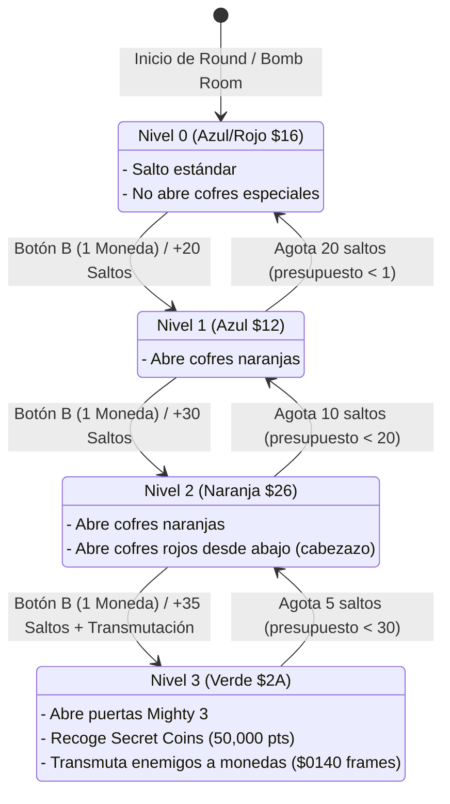

# RES-024: Power-Ups, Niveles Mighty y Transmutación en Mighty Bomb Jack

- **Fecha**: 2026-10-25
- **Autor**: asm_researcher (Nivel 3)
- **Ámbito**: Desensamblado ASM 6502 original (`asm/src/prg.asm`, `asm/src/data.asm`, `asm/src/ram.asm`, `asm/src/defs.asm`)
- **Estado**: COMPLETADO / DOCUMENTACIÓN MAESTRA

---

## 1. Mighty Drink, Mighty Coin y Niveles Mighty (0..3)

### 1.1 Variables de RAM Asociadas

| Variable | Dirección RAM | Tamaño | Descripción Técnica |
|:---|:---:|:---:|:---|
| `PlayerMightyLevel` | `$03E0` | 1 byte | Nivel de poder Mighty actual del jugador (`0`, `1`, `2`, `3`). [`asm/src/ram.asm:1255`](../asm/src/ram.asm#L1255) |
| `PlayerMightyLevelPressesLeft` | `$03E1` | 1 byte | Presupuesto restante de pulsaciones de salto (botón A) antes de descender de nivel. [`asm/src/ram.asm:1257`](../asm/src/ram.asm#L1257) |
| `PlayerMightyCoins` | `$03E2` | 1 byte | Inventario de monedas Mighty acumuladas (máximo tolerado < 10). [`asm/src/ram.asm:1259`](../asm/src/ram.asm#L1259) |
| `StageTimer` | `$00A4` | 1 byte | Temporizador del round en formato BCD (segundos restantes). [`asm/src/ram.asm:245`](../asm/src/ram.asm#L245) |
| `byte_333` | `$0333` | 1 byte | Flag/contador interno reseteado a `#$00` al usar moneda Mighty. [`asm/src/ram.asm:1107`](../asm/src/ram.asm#L1107) |

---

### 1.2 Recolección de Ítems en Cofres (`MaybePickupItem`)

Ubicación: [`asm/src/prg.asm:4860-4966`](../asm/src/prg.asm#L4860-L4966) y [`5187-5201`](../asm/src/prg.asm#L5187-L5201).

```assembly
; asm/src/prg.asm:4942-4953
JTPickup_MightyDrink:
	LDA #Score_1000             ; 1,000 puntos
	JSR AddScore
	LDA #Sound_TimePickup       ; SFX $21 (mighty milk / time pickup)
	JSR QueueSound
	LDAc StageTimer             ; RAM $00A4
	CLC
	ADC #$10                    ; +$10 BCD (+16 segundos)
	STAc StageTimer
	CMP #$A0                    ; ¿Superó 99 segundos (formato BCD)?
	BCC locret_9E5A             ; No -> salir
                                ; Sí -> penalización por avaricia:
GoToTheTortureRoom:
	LDA #0
	STA PlayerMightyCoins       ; Confisca todas las monedas Mighty
	STA TortureRoomSceneFlag
	LDA #7
	STAc GameState              ; Cambia estado de juego a Torture Room
locret_9E5A:
	RTS

; asm/src/prg.asm:5187-5201
JTPickup_MightyCoin:
	LDA #Score_1000             ; 1,000 puntos
	JSR AddScore
	LDA #Sound_CoinCollected    ; SFX $04
	JSR QueueSound
	INC PlayerMightyCoins       ; Incrementa inventario RAM $03E2
	LDA PlayerMightyCoins
	CMP #10                     ; ¿Lleva 10 o más monedas Mighty?
	BCC locret_9FDB             ; No -> salir
	JMP GoToTheTortureRoom      ; Sí -> penalización por avaricia (Torture Room)
locret_9FDB:
	RTS
```

- **Mighty Drink** (`JTPickup_MightyDrink`, índice `$04` en tabla de ítems de cofre): Suma 1,000 puntos, reproduce `Sound_TimePickup` (`$21`), añade `+$10` al `StageTimer` en BCD. Si el temporizador supera `99` (`CMP #$A0`), confisca todas las monedas Mighty (`PlayerMightyCoins = 0`) y envía a Jack a la Sala de Tortura (`GameState = 7`).
- **Mighty Coin** (`JTPickup_MightyCoin`, índice `$08` en tabla de ítems de cofre): Suma 1,000 puntos, reproduce `Sound_CoinCollected` (`$04`) e incrementa `PlayerMightyCoins`. Si acumula 10 monedas, se activa la penalización de avaricia hacia la Sala de Tortura.

---

### 1.3 Activación del Nivel Mighty: Consumo de Moneda (Botón B)

Ubicación: [`asm/src/prg.asm:1448-1458`](../asm/src/prg.asm#L1448-L1458).

```assembly
loc_895A:
	LDA #JP_B
	AND Joypad1_Immediate       ; Botón B presionado en este frame
	BEQ loc_8970
	AND a:Joypad1_ImmediateCopy ; Evita autorepetición si ya estaba pulsado
	BNE loc_8970
	LDA #RF_BombRoom
	BIT a:RoomStatusFlags       ; ¿Está en sala real (Bomb Room)?
	BNE loc_8970                ; Prohibido usar monedas Mighty en Bomb Rooms
	JSR UseMightyCoin           ; Ejecuta subrutina de incremento de nivel
```

---

### 1.4 Lógica de Incremento y Tope en Nivel 3 (`UseMightyCoin`)

Ubicación: [`asm/src/prg.asm:1745-1768`](../asm/src/prg.asm#L1745-L1768).

```assembly
UseMightyCoin:
	LDA PlayerMightyCoins       ; RAM $03E2
	BEQ locret_8B5F             ; Si no hay monedas, no hace nada
	LDA PlayerMightyLevel       ; RAM $03E0
	CMP #3                      ; Comprueba tope superior
	BEQ locret_8B5F             ; Si ya está en Nivel 3, aborta (no consume moneda)
	DEC PlayerMightyCoins       ; Consume 1 moneda Mighty ($03E2)
	INC PlayerMightyLevel       ; Incrementa nivel Mighty (0 -> 1, 1 -> 2, 2 -> 3)
	LDX PlayerMightyLevel
	LDA MightyLevelAPressesTable,X ; Carga presupuesto de pulsaciones (20, 30, 35)
	STA PlayerMightyLevelPressesLeft ; Almacena en RAM $03E1
	JSR UpdateMightyPalette     ; Actualiza color de Jack según nivel en X
	LDA #Sound_UsedMightyCoin   ; SFX $1D
	JSR QueueSound
	LDA #0
	STA byte_333                ; Resetea flag/temporizador auxiliar
	LDA PlayerMightyLevel
	CMP #3                      ; ¿Alcanzó el Nivel 3 en esta pulsación?
	BNE locret_8B5F             ; No -> salir
	JSR TurnEnemiesIntoCoins    ; SÍ -> Transmuta todos los enemigos a monedas
locret_8B5F:
	RTS
```

---

### 1.5 Degradación Progresiva del Nivel por Saltos (`_MightyLevelAPressCheck`)

El nivel Mighty no expira por tiempo continuo, sino por **presupuesto de pulsaciones de salto** (botón A).

Ubicación: [`asm/src/prg.asm:1397-1421`](../asm/src/prg.asm#L1397-L1421).

```assembly
_MightyLevelAPressCheck:
	LDX #JP_A                   ; Detecta botón A (salto)
	LDA #RF_BombRoom
	BIT a:RoomStatusFlags       ; En salas de bombas, también cuenta B
	BEQ loc_8901
	LDX #JP_B|JP_A
loc_8901:
	TXA
	AND Joypad1_Immediate
	BEQ loc_895A
	AND a:Joypad1_ImmediateCopy
	BNE loc_895A
	INC a:APressCounter
	LDX PlayerMightyLevel       ; RAM $03E0
	BEQ _NoMightyLevelDown      ; Si nivel es 0, no hay degradación
	DEC PlayerMightyLevelPressesLeft ; Decrementa presupuesto RAM $03E1
	DEX                         ; X = PlayerMightyLevel - 1 (índice umbral inferior)
	LDA PlayerMightyLevelPressesLeft
	CMP MightyLevelAPressesTable,X ; Compara con el umbral del nivel inferior
	BCS _NoMightyLevelDown      ; Si presupuesto >= umbral, mantiene nivel
	DEC PlayerMightyLevel       ; Si cayó por debajo, DESCIENDE UN NIVEL
	JSR UpdateMightyPalette     ; Actualiza paleta gráfica con el nuevo nivel en X
_NoMightyLevelDown:
```

#### Presupuesto por Nivel (`MightyLevelAPressesTable`)
Definida en [`asm/src/data.asm:309-310`](../asm/src/data.asm#L309-L310):
```assembly
MightyLevelAPressesTable:
	.BYTE 1,  20,  30,  35
```

- **Nivel 1**: Al activarse recibe valor `20`. El umbral inferior es `MightyLevelAPressesTable[0] = 1`. Permite **20 saltos**. Al llegar a `0`, desciende a Nivel 0.
- **Nivel 2**: Al activarse recibe valor `30`. El umbral inferior es `MightyLevelAPressesTable[1] = 20`. Permite **10 saltos** en Nivel 2 antes de degradarse a Nivel 1 (donde le restan 20 saltos).
- **Nivel 3**: Al activarse recibe valor `35`. El umbral inferior es `MightyLevelAPressesTable[2] = 30`. Permite **5 saltos** en Nivel 3 antes de degradarse a Nivel 2 (donde le restan 10 saltos).

---

## 2. Paletas Cromáticas de Jack por Nivel

### 2.1 Tablas de Datos de Paleta

Ubicación en ROM:
- Tabla de colores por nivel Mighty: [`asm/src/data.asm:306-307`](../asm/src/data.asm#L306-L307).
- Paleta maestra inicial: [`asm/src/data.asm:258-268`](../asm/src/data.asm#L258-L268).

```assembly
; asm/src/data.asm:306-307
MightyLevelColors:
	.BYTE  $16, $12, $26, $2A

; asm/src/data.asm:264-267 (Subpaletas de Sprites en MainPalette)
; Subpaleta 0 ($10..$13): .BYTE $21, $16, $16, $30
; Subpaleta 1 ($14..$17): .BYTE $21, $30, $12, $16  <- Subpaleta de Jack
; Subpaleta 2 ($18..$1B): .BYTE $21,   8, $16, $30
; Subpaleta 3 ($1C..$1F): .BYTE $21,  $F, $2B, $30
```

### 2.2 Desglose Cromático y Asignación Hardware PPU

La subpaleta 1 de sprites de Jack reside en las posiciones `$14..$17` del `PaletteBuffer` (`$05E3..$0602` en RAM, base `$05E3`), direccionada en PPU VRAM a `$3F14..$3F17`:

| Offset Buffer | Dirección PPU | Color Base | Componente Visual del Sprite de Jack |
|:---:|:---:|:---:|:---|
| `+$14` | `$3F14` | `$21` | Transparente / Color de fondo universal |
| `+$15` | `$3F15` | `$30` | Blanco brillante (Ojos, piel clara, guantes) |
| `+$16` | `$3F16` | `$12` | Azul marino (Traje base constante) |
| `+$17` | `$3F17` | Dinámico | **Color Mighty dinámico** (Capa, emblema, botas) |

#### Colores Exactos por Nivel Mighty (`MightyLevelColors`)

| Nivel Mighty | Valor Byte | Color NES 2C02 | Apariencia Visual Resultante de Jack |
|:---:|:---:|:---|:---|
| **0** (Normal) | `$16` | Rojo oscuro / Bermellón | Traje Azul clásico con capa y botas Rojas |
| **1** | `$12` | Azul marino medio | Traje Azul monocromático integral |
| **2** | `$26` | Naranja / Ámbar brillante | Traje Azul con capa y detalles Naranja vivo |
| **3** | `$2A` | Verde brillante / Lima | Traje Azul con capa y detalles Verde esmeralda |

### 2.3 Mecanismo de Carga a la PPU

Ubicación: [`asm/src/prg.asm:1774-1779`](../asm/src/prg.asm#L1774-L1779) y [`259-281`](../asm/src/prg.asm#L259-L281).

```assembly
; X = PlayerMightyLevel (0..3)
UpdateMightyPalette:
	LDA MightyLevelColors,X     ; Lee color del nivel correspondiente
	STA PaletteBuffer+$17       ; Escribe en RAM $05FA ($05E3 + $17)
	INC a:UpdatePaletteFlag     ; Fija flag $0046 != 0 para solicitar DMA en VBlank
	RTS

; En NMI / VBlank (CopyPaletteToPPU2):
CopyPaletteToPPU2:
	LDA PPUSTATUS               ; Resetea flip-flop de direccionamiento
	LDA #$3F
	STA PPUADDR                 ; PPUADDR = $3F10 (base de paletas de sprites)
	STX PPUADDR
loc_8190:
	LDA PaletteBuffer,X         ; Vuelca los 16 bytes de paletas de sprites
	STA PPUDATA                 ; Escribe en registros de paleta de la PPU
	INX
	DEY
	BNE loc_8190
```

Al entrar a salas de bombas (`prg.asm:396-400`), el juego fuerza el reseteo del nivel Mighty a `0`, las pulsaciones restantes a `0` y restaura `PaletteBuffer+$17` a `#$16`.

---

## 3. Facultades y Habilidades por Nivel Mighty

### 3.1 Apertura de Cofres Naranjas (Requiere Nivel >= 1)

Ubicación: [`asm/src/prg.asm:5300-5308`](../asm/src/prg.asm#L5300-L5308).

Los cofres de color naranja poseen el metatile `$11`.

```assembly
JTPickup_Chest2:
	LDA PlayerMightyLevel       ; RAM $03E0
	BEQ locret_A064             ; Si nivel == 0 -> ABORTA. El cofre NO se abre
	JMP JTPickup_Chest          ; Si nivel >= 1 -> Procede a abrir el cofre
locret_A064:
	RTS
```

Jack debe encontrarse en **Nivel Mighty 1 o superior** para poder interactuar y abrir cofres naranjas.

---

### 3.2 Apertura con Cabezazo de Cofres Rojos (Requiere Nivel >= 2)

Ubicación: [`asm/src/prg.asm:5259-5296`](../asm/src/prg.asm#L5259-L5296).

Los cofres rojos poseen el metatile `$10`. Cuando Jack colisiona desde abajo (ascendiendo con `PlayerYVelHi < 0`), la bandera `byte_310` permanece en `0` (cabezazo). Si Jack aterriza encima cayendo (`PlayerYVelHi >= 0`), `byte_310` es incrementada en línea 4783.

```assembly
JTPickup_Chest:
	; ... (verificación de colisión y registro de coordenadas en RAM) ...
loc_A01F:
	LDAc byte_70
	STA a:byte_F0
	LDAc byte_5C
	STA a:_MaybeBlockSpawningObj
	LDA byte_310                ; 0 = impacto inferior (cabezazo); != 0 = impacto superior
	BNE locret_A05B             ; Si cayó encima, no abre por cabezazo directo
	LDA #0
	STA a:byte_F0
	LDA a:MaybeCollectedThing
	AND #$20
	BNE locret_A05B
	LDA PlayerMightyLevel       ; RAM $03E0
	CMP #2                      ; ¿Nivel Mighty >= 2?
	BCC locret_A05B             ; Si nivel < 2 (0 o 1) -> ABORTA
	LDAc byte_70
	JSR MaybeOpenHiddenBlock    ; Si nivel >= 2 -> Abre el cofre rojo desde abajo
locret_A05B:
	RTS
```

Abrir cofres rojos golpeándolos desde abajo requiere estrictamente **Nivel Mighty 2 o superior**.

---

### 3.3 Puertas con Condición Mighty 3 (`DoorCond_XX_Mighty3`)

Ubicación: [`asm/src/prg.asm:6903-6909`](../asm/src/prg.asm#L6903-L6909).

```assembly
DoorCond_XX_Mighty3:
	JSR MaybeDontOpenDoors      ; Verificaciones previas de estado
	LDA PlayerMightyLevel       ; RAM $03E0
	CMP #3                      ; Comprueba si el jugador está en Nivel 3
	BNE DoorCond_rts            ; Si != 3 -> Puerta cerrada
	JMP HandleOpenDoorMaybe     ; Si == 3 -> Inicia animación de apertura
```

#### Asignación en Tabla de Puertas (`prg.asm:6747-6816`)
En la versión USA/World, las siguientes ranuras de condiciones de puerta exigen estar en Nivel 3:
- `$07`: [`prg.asm:6754`](../asm/src/prg.asm#L6754)
- `$0E`: [`prg.asm:6761`](../asm/src/prg.asm#L6761) (Exclusivo revisión USA)
- `$17`: [`prg.asm:6770`](../asm/src/prg.asm#L6770)
- `$18`: [`prg.asm:6771`](../asm/src/prg.asm#L6771)
- `$1B`: [`prg.asm:6774`](../asm/src/prg.asm#L6774)

---

### 3.4 Recolección Exclusiva de Monedas Secretas (Secret Coins)

Ubicación: [`asm/src/prg.asm:4081-4091`](../asm/src/prg.asm#L4081-L4091).

```assembly
JT_98A4_A_SecretCoin:
	LDA PlayerMightyLevel       ; RAM $03E0
	CMP #3                      ; ¿Está en Nivel Mighty 3?
	BNE locret_9926             ; Si NO está en Nivel 3, atraviesa sin recoger
	JSR RemoveEnemy             ; Elimina la entidad de pantalla
	LDA #Score_50000            ; 50,000 puntos
	JSR AddScore
	LDA #Sound_CoinCollected    ; SFX $04
	JSR QueueSound
	INC PlayerSecretCoins       ; Incrementa contador RAM $03E5
locret_9926:
	RTS
```

---

## 4. Power Coin (Objeto 8) y Transmutación de Enemigos

### 4.1 Variables de RAM Asociadas

| Variable | Dirección RAM | Tamaño | Descripción Técnica |
|:---|:---:|:---:|:---|
| `EnemyCoinTimer` | `$006A..$006B` | 2 bytes | Temporizador de transmutación (palabra 16 bits en Little-Endian, Zero Page). [`asm/src/ram.asm:171`](../asm/src/ram.asm#L171) |
| `byte_54` | `$0054` | 1 byte | Contador de racha/combo de monedas recogidas en transmutación (0..6). [`asm/src/ram.asm:84`](../asm/src/ram.asm#L84) |
| `MaybeTempCollectableFlag` | `$0357` | 1 byte | Flag de habilitación de Power Coin en el siguiente cofre. [`asm/src/ram.asm:1046`](../asm/src/ram.asm#L1046) |
| `MaybeTempCollectableFlag2` | `$0356` | 1 byte | Acumulador de bombas para activar Power Coin (umbral = 20). [`asm/src/ram.asm:1045`](../asm/src/ram.asm#L1045) |
| `GoldCoinsCollected` | `$0366` | 1 byte | Contador acumulativo de monedas de oro recogidas (umbral = 40). [`asm/src/ram.asm:1136`](../asm/src/ram.asm#L1136) |

---

### 4.2 Spawneo de la Moneda Power Coin "P"

Ubicación: [`asm/src/prg.asm:4980-4999`](../asm/src/prg.asm#L4980-L4999) y [`8978-8991`](../asm/src/prg.asm#L8978-L8991).

1. Al recoger bombas ordinarias (`JTPickup_Bomb`), `MaybeTempCollectableFlag2` suma las bombas.
2. Al alcanzar 20 bombas (`CMP #20` en línea 4986), ejecuta `INC MaybeTempCollectableFlag` (`$0357 = 1`) y suena `Sound_BombChestBonus` (`$19`).
3. Al abrir un cofre con la bandera activa (`prg.asm:5426-5435`), llama a `SpawnPowerCoin` (`prg.asm:8978`), inicializando `EnemyType_8_PowerCoin` (`InitPowerCoin`, `prg.asm:8660`).

---

### 4.3 Inicio de la Transmutación (`TurnEnemiesIntoCoins`)

Ubicación: [`asm/src/prg.asm:9019-9049`](../asm/src/prg.asm#L9019-L9049).

```assembly
JT_98A4_8_PowerCoin:
	JSR RemoveEnemy             ; Elimina la moneda Power Coin
TurnEnemiesIntoCoins:
	LDA #$40
	STA a:EnemyCoinTimer        ; Byte bajo = $40
	LDA #1
	STA a:EnemyCoinTimer+1      ; Byte alto = $01 -> Total: $0140 (320 frames)
	LDA #Sound_PowerCoinMusic   ; BGM $06 (tema musical acelerado de Power Coin)
	JSR QueueSound
	LDX #0
	STX a:byte_54               ; Resetea combo de monedas a 0
-	TXA
	AND #3
	BEQ +
	TAY
	LDA GoldCoinSpritePalette,Y ; Paleta: .BYTE 0, 8, $26, $30
	STA PaletteBuffer+$18,X     ; Carga paleta dorada en subpaleta de sprites 2
+	INX
	CPX #4
	BNE -
	INC a:UpdatePaletteFlag     ; Solicita volcado PPU
	RTS
```

- **Duración Exacta**: `$0140` frames = **320 frames**. En NTSC (60.0988 Hz), equivale exactamente a **5.33 segundos**.
- **Música**: Se activa `Sound_PowerCoinMusic` (`$06`).
- **Paleta**: Carga en `PaletteBuffer+$18..$1B` los colores `$00, $08, $26, $30` (`GoldCoinSpritePalette`, línea 9048).

---

### 4.4 Efecto en las Entidades Enemigas

Ubicación: [`asm/src/prg.asm:8828-8860`](../asm/src/prg.asm#L8828-L8860) y [`8178-8182`](../asm/src/prg.asm#L8178-L8182).

1. **Transformación Visual y de Estado**:
   En `DrawEnemies`:
   ```assembly
   LDA a:EnemyCoinTimer
   ORA a:EnemyCoinTimer+1
   BEQ _DrawEnemy              ; Si el temporizador es 0, dibuja enemigo normal
   LDY #EnemyStruct_0_Status
   LDA (EnemyStructPointer),Y
   AND #$10
   BNE _DrawEnemy
   LDA (EnemyStructPointer),Y
   ORA #$20                    ; Fija BIT 5: Entidad transmutada a moneda
   STA (EnemyStructPointer),Y
   LDA #$21                    ; Sprite #$21 = Metasprite de moneda flotante
   LDY #EnemyStruct_E_Sprite
   STA (EnemyStructPointer),Y
   ```
2. **Inhibición de Spawneo**:
   En `HandleEnemySpawnTimer`:
   ```assembly
   LDA a:EnemyCoinTimer
   ORA a:EnemyCoinTimer+1
   BEQ loc_B57F                ; Si timer != 0, ABORTA spawn de nuevos enemigos
   RTS
   ```
3. **Aviso de Expiración**:
   Cuando `EnemyCoinTimer` cae por debajo de `$0040` (últimos 64 frames / ~1 segundo), cicla los bits de atributo de sprite (líneas 8846-8858) generando un parpadeo cromático acelerado.
4. **Expiración**:
   En `_EnemyCoinTimerCheck` ([`prg.asm:1368-1395`](../asm/src/prg.asm#L1368-L1395)), cuando el temporizador llega a cero:
   - Limpia `MaybeTempCollectableFlag` y `MaybeTempCollectableFlag2`.
   - Restaura las paletas de sprites originales (`RestoreDefaultPalettesLimited`).
   - Reanuda la música del escenario (`RoomMusic`).
   - Configura `UnknownFlag_0FE = #$20` para otorgar un período de gracia de invulnerabilidad.

---

### 4.5 Sistema de Bonificación Escalar por Recogida (`JT_98A4_multi`)

Ubicación: [`asm/src/prg.asm:4032-4060`](../asm/src/prg.asm#L4032-L4060).

```assembly
JT_98A4_multi:
	LDA #Sound_CoinCollected    ; SFX $04
	JSR QueueSound
	LDX a:byte_54               ; Carga combo actual
	CPX #6
	BEQ loc_98D9                ; Tope en 6
	INX
	STX a:byte_54               ; Guarda combo incrementado
loc_98D9:
	LDY #$17
	INX
	TXA                         ; Índice de puntuación a otorgar
	STA (EnemyStructPointer),Y  ; Popup visual flotante de puntos
	JSR AddScore                ; Suma puntuación
	LDA byte_364
	AND #4
	BNE locret_98FB
	INC GoldCoinsCollected      ; Acumula monedas recogidas
	LDA GoldCoinsCollected
	CMP #40                     ; ¿Llegó a 40 monedas?
	BCC locret_98FB
	LDA byte_364
	ORA #4                      ; Habilita bit 2: Spawneo de Extra Coin listo
	STA byte_364
locret_98FB:
	RTS
```

#### Escala de Puntuación (`ScoreAddTable`, `asm/src/data.asm:848-879`)
Cuando `AddScore` ([`prg.asm:2436-2485`](../asm/src/prg.asm#L2436-L2485)) procesa el índice `A`:
- Moneda 1 (`byte_54 = 1`, `A = 2`): **200 puntos** (`Score_200`)
- Moneda 2 (`byte_54 = 2`, `A = 3`): **300 puntos** (`Score_300`)
- Moneda 3 (`byte_54 = 3`, `A = 4`): **500 puntos** (`Score_500`)
- Moneda 4 (`byte_54 = 4`, `A = 5`): **800 puntos** (`Score_800`)
- Moneda 5 (`byte_54 = 5`, `A = 6`): **1,200 puntos** (`Score_1200`)
- Moneda 6+ (`byte_54 = 6`, `A = 7`): **2,000 puntos** (`Score_2000`)

En salas de bombas (Bomb Rooms) con multiplicador activo (`ScoreMultiplier` en `$03E3` con valores x2, x3, x4, x5), se aplica `MultipliedScoreTable` ([`data.asm:837-846`](../asm/src/data.asm#L837-L846)), elevando las recompensas en base BCD.

---

## 5. Extra Coin (Objeto 9) y Sistema de Vidas Extra (1UP)

### 5.1 Variables de RAM Asociadas

| Variable | Dirección RAM | Tamaño | Descripción Técnica |
|:---|:---:|:---:|:---|
| `PlayerLives` | `$03E4` | 1 byte | Contador de vidas de Jack. [`asm/src/ram.asm:1263`](../asm/src/ram.asm#L1263) |
| `ExtraLivesFound` | `$037A` | 1 byte | Total acumulado de vidas extra halladas (para cálculo de GDV final). [`asm/src/ram.asm:1154`](../asm/src/ram.asm#L1154) |
| `MaybeCollectedThing2` | `$0358` | 1 byte | Registro de eventos especiales: Bit 7 (`$80`) = 1UP pendiente; Bit 0 (`$01`) = 1UP procesado. [`asm/src/ram.asm:1047`](../asm/src/ram.asm#L1047) |
| `Collected1UPThisRoundFlag` | `$0359` | 1 byte | Bandera que impide recolectar más de un 1UP en el mismo round. [`asm/src/ram.asm:1048`](../asm/src/ram.asm#L1048) |
| `Show1UPSpriteTimer` | `$035A` | 1 byte | Temporizador (64 frames / `$40`) para el letrero flotante "1UP". [`asm/src/ram.asm:1049`](../asm/src/ram.asm#L1049) |

---

### 5.2 Formato de la Variable `PlayerLives`

- **Inicialización**: Se inicializa en `3` en `GameState_0_Init` ([`asm/src/prg.asm:356`](../asm/src/prg.asm#L356): `LDA #3; STA PlayerLives`).
- **Decremento**: En caso de muerte, `DEC PlayerLives` ([`asm/src/prg.asm:1137`](../asm/src/prg.asm#L1137)).
- **Visualización HUD (Formato BCD)**:
  En `GameState_1_RoundIntro` ([`asm/src/prg.asm:7692-7698`](../asm/src/prg.asm#L7692-L7698)):
  ```assembly
  SpriteData   0, $10, $94, $60, $25 ;; Contador visual de vidas
  LDA PlayerLives
  JSR WriteBCDDigitsSprites
  ```
  La subrutina del HUD dibuja el byte esperando formato BCD (nibble alto para decenas, nibble bajo para unidades). Al manipularse internamente mediante instrucciones binarias directas (`INC` y `DEC`), si el contador alcanzase valores hexadecimales como `$0A..$0F`, el HUD produce anomalías gráficas antes de estabilizarse en múltiplos de 10.

---

### 5.3 Rutina Única de Incremento de Vidas (+1): `MaybeAward1UP`

`MaybeAward1UP` es la **única rutina en todo el código original** que ejecuta `INC PlayerLives`.

Ubicación: [`asm/src/prg.asm:5797-5830`](../asm/src/prg.asm#L5797-L5830).

```assembly
MaybeAward1UP:
	LDA #1
	BIT a:MaybeCollectedThing2   ; ¿Bit 0 activo (ya se procesó el 1UP)?
	BNE _Draw1UPSprite           ; Sí -> Salta a dibujar animación del sprite
	ORA a:MaybeCollectedThing2   ; Comprueba estado
	BMI loc_A372                 ; ¿Bit 7 activo (#$80)? -> Concede vida
	RTS                          ; No hay 1UP pendiente -> salir

loc_A372:
	STA a:MaybeCollectedThing2   ; Marca Bit 0 activo para evitar duplicación
	INC PlayerLives              ; +1 VIDA A JACK (RAM $03E4)
	INC ExtraLivesFound          ; +1 a vidas halladas ($037A)
	LDA #Sound_1UP_Captive       ; SFX $0A (jingle de 1UP / rescate)
	JSR QueueSound
	INC a:Collected1UPThisRoundFlag ; Bloquea futuros 1UPs en la sala actual
	LDA #$40
	STA Show1UPSpriteTimer       ; Inicia temporizador de sprite flotante "1UP" (64 frames)

_Draw1UPSprite:
	LDA PlayerYPosHi
	SEC
	SBC #$10
	STAc TempSpriteY             ; Posiciona sprite 16 píxeles sobre Jack
	LDA PlayerXPosHi
	SBC #8
	STAc TempSpriteX
	LDA #$82
	DEC Show1UPSpriteTimer
	BNE loc_A3A7
	LDX #0
	STX MaybeCollectedThing2     ; Limpia registro al finalizar animación
loc_A3A7:
	; ... volcado a OAM de sprites ...
```

- **Efecto de Sonido**: `Sound_1UP_Captive` (`$0A` / decimal 10, [`asm/src/defs.asm:95`](../asm/src/defs.asm#L95)).

---

### 5.4 Activadores de la Concesión de 1UP

El Bit 7 (`#$80`) de `MaybeCollectedThing2` es activado exclusivamente por dos eventos:
1. **Rescate del Hermano (Brother)**:
   [`asm/src/prg.asm:4070-4072`](../asm/src/prg.asm#L4070-L4072):
   ```assembly
   JT_98A4_10_Brother:
   	LDA #$80
   	STA a:MaybeCollectedThing2  ; Fija #$80 -> Detona MaybeAward1UP
   ```
2. **Recolección de la Placa Tecmo (Tecmo Plate)**:
   [`asm/src/prg.asm:5177-5182`](../asm/src/prg.asm#L5177-L5182):
   ```assembly
   JTPickup_TecmoPlate:
   	LDA #Score_100000           ; 100,000 puntos
   	JSR AddScore
   	LDA #$80
   	STA a:MaybeCollectedThing2  ; Fija #$80 -> Detona MaybeAward1UP
   	RTS
   ```

---

### 5.5 Comportamiento de la Extra Coin (`EnemyType_9_ExtraCoin`)

Ubicación: [`asm/src/prg.asm:2528-2542`](../asm/src/prg.asm#L2528-L2542), [`5462-5478`](../asm/src/prg.asm#L5462-L5478), [`4064-4066`](../asm/src/prg.asm#L4064-L4066) y [`9532-9548`](../asm/src/prg.asm#L9532-L9548).

1. **Condición de Aparición**:
   Cuando Jack recolecta 40 monedas (`GoldCoinsCollected >= 40`), `byte_364` adquiere el bit 2 (`#$04`). Al alcanzar la siguiente meta de puntuación en `AddScore`:
   ```assembly
   LDX #EnemyType_E_BonusCoin
   LDA byte_364
   AND #4
   BEQ loc_8FA9
   LDX #EnemyType_9_ExtraCoin   ; Sustituye la moneda de bonificación por EXTRA COIN
   LDA byte_364
   AND #3
   STA byte_364
   LDA #0
   STA GoldCoinsCollected       ; Resetea acumulador de monedas de oro
   ```
2. **Sustitución si ya se obtuvo 1UP**:
   En `MaybeSpawnThingFromObject`:
   ```assembly
   MaybeSpawnThingFromObject:
   	CMP #EnemyType_9_ExtraCoin
   	BNE _NotExtraCoin
   	LDX a:Collected1UPThisRoundFlag
   	BEQ _No1UPYet
   	LDA #8                      ; Si ya obtuvo 1UP en este round, la convierte en
   	STA a:_MaybeBlockSpawningObj ; MONEDA MIGHTY (#8)
   	RTS
   _No1UPYet:
   	PHA
   	LDA #Sound_BonusCoinSpawn   ; SFX $03 (al spawnear moneda extra)
   	JSR QueueSound
   	PLA
   ```
3. **Colisión de Recogida**:
   En `JT_98A4_9_ExtraCoin`:
   ```assembly
   JT_98A4_9_ExtraCoin:
   	JSR loc_9945
   ; loc_9945:
   	LDA byte_364
   	AND #$FD
   	STA byte_364
   	LDA #Sound_CoinCollected    ; SFX $04
   	JSR QueueSound
   	RTS
   ```

---

## 6. Diagrama de Transición de Estados Mighty



---

## 7. Referencias Cruzadas del Repositorio

- [`asm/src/prg.asm`](../asm/src/prg.asm): Lógica de ejecución de input, colisiones, cofres y transmutaciones.
- [`asm/src/data.asm`](../asm/src/data.asm): Tablas de colores (`MightyLevelColors`), pulsaciones (`MightyLevelAPressesTable`) y puntuaciones (`ScoreAddTable`).
- [`asm/src/ram.asm`](../asm/src/ram.asm): Mapeo canónico de memoria RAM NES.
- [`asm/src/defs.asm`](../asm/src/defs.asm): Constantes enum de sonido (`Sound_...`), tipos de entidad y puntuación.
- [`research/RES-023-chests-and-secret-blocks.md`](../research/RES-023-chests-and-secret-blocks.md): Análisis complementario de metatiles y bloques ocultos.
