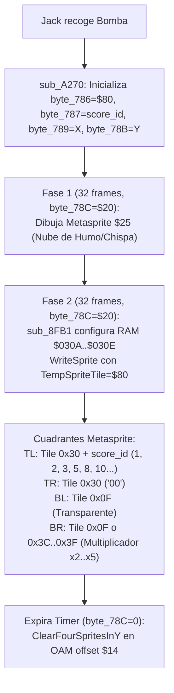

# RES-034: Fuente y Sprites Canónicos de Puntuación Flotante al Recoger Objetos

- **ID de Investigación**: `RES-034`
- **Tarea Asociada**: `TASK-F7-007` (Fuente/Sprites Pequeños de Puntuación Flotante al Recoger Objetos)
- **Área Temática**: 05 - Renderizado, PPU y Metasprites / 03 - Objetos de Sala y Recompensas
- **Fecha**: 2026-10-25
- **Autor / Agente**: `asm_researcher` (Nivel 3 Specialist)
- **Estado**: `[COMPLETADA]`

---

## 1. Objetivo y Preguntas de Investigación

### 1.1 Problema Reportado por el Usuario
> *"El valor en puntos cuando recogemos objetos está mal, se usa una fuente incorrecta más grande de lo normal, la fuente que se debe usar creo que es la que actualmente se usa en los enemigos por error."*

### 1.2 Preguntas de Investigación
1. **Rutinas del Juego Original (NES 6502)**: ¿Dónde y cómo genera y renderiza el juego original los marcadores flotantes de puntuación al recoger bombas u objetos? (`sub_8FB1`, `sub_A270`, `sub_A29C`, `WriteSprite`).
2. **Identificación de Metasprites y Glifos CHR**: ¿Cuáles son los IDs de tile reales en `mbj-us.chr` (Pattern Table 0, Banco de Sprites) y cómo se estructuran las tablas `SpritesTable` y `ScoreAddTable`?
3. **Confirmación de la Sospecha del Usuario**: ¿Eran los tiles `0x30..0x3F` que aparecían por error en los enemigos precisamente la tipografía auténtica de la puntuación flotante?
4. **Composición Geométrica**: ¿Son 1 sprite de 8×8, 2 sprites horizontales de 8×8 (16×8 px), o un metasprite 2×2 (16×16 px)? ¿Qué paleta OAM y atributos utilizan?
5. **Diagnóstico del Port en C**: ¿Por qué `src/core/mjk_hud.c` dibujaba dígitos gigantescos de HUD de fondo? ¿Cómo corregirlo para lograr paridad 1:1 conservando compatibilidad con los tests unitarios (`test_floating_scores.c`)?

---

## 2. Fuentes de Verdad Analizadas (`asm/` y `src/`)

- **Código Ensamblador 6502**:
  - [`asm/src/prg.asm:2267-2374`](../asm/src/prg.asm#L2267-L2374): `WriteSprite` y `_WriteNormalSprite` (manejo de `BasePointer_RAM_30A` cuando `TempSpriteTile >= $80`).
  - [`asm/src/prg.asm:2551-2573`](../asm/src/prg.asm#L2551-L2573): `sub_8FB1` (composición de tiles de puntuación flotante y multiplicadores en RAM `$030B..$030E`).
  - [`asm/src/prg.asm:5647-5667`](../asm/src/prg.asm#L5647-L5667): `sub_A270` (disparo e inicialización de popup de bomba en RAM `$0786..$078D`).
  - [`asm/src/prg.asm:5671-5747`](../asm/src/prg.asm#L5671-L5747): `sub_A29C` (máquina de estados de popup: Fase 1 humo 32 frames, Fase 2 puntuación 32 frames).
  - [`asm/src/prg.asm:5751-5793`](../asm/src/prg.asm#L5751-L5793): `sub_A32B` y `sub_A33E` (desplazamiento de coordenadas del popup con el scroll de pasillos).
  - [`asm/src/prg.asm:3761`](../asm/src/prg.asm#L3761) y [`asm/src/prg.asm:5012`](../asm/src/prg.asm#L5012): Llamadas a `sub_A270` al recolectar bombas.
  - [`asm/src/prg.asm:3861`](../asm/src/prg.asm#L3861): `HandleSpawnsAndMore` (ejecución cíclica por frame de `sub_A29C`).
- **Tablas de Datos**:
  - [`asm/src/data.asm:258-268`](../asm/src/data.asm#L258-L268): `MainPalette` (Sprite Palette 0 = `$21, $16, $16, $30`).
  - [`asm/src/data.asm:364-411`](../asm/src/data.asm#L364-L411): `SpritesTable` (Entrada `$25` = humo de recolección).
  - [`asm/src/data.asm:588-596`](../asm/src/data.asm#L588-L596): `SpriteAttributeTable` (Offset 0 = `{ byte_4E: $00, byte_4F: $27 }`).
  - [`asm/src/data.asm:837-846`](../asm/src/data.asm#L837-L846): `MultipliedScoreTable`.
  - [`asm/src/data.asm:848-875`](../asm/src/data.asm#L848-L875): `ScoreAddTable`.
  - [`asm/src/defs.asm:125-157`](../asm/src/defs.asm#L125-L157): Constantes canónicas `Score_*`.
- **Datos Gráficos CHR**:
  - [`asm/src/mbj-us.chr`](../asm/src/mbj-us.chr): Banco 1 (`offset 8192`), Pattern Table 0 (`$0000-$0FFF`), tiles `0x30..0x3F` y tile transparente `0x0F`.
- **Código Fuente C**:
  - [`src/core/mjk_hud.c`](../src/core/mjk_hud.c): `RenderInGameScreen` (Paso 9: Marcadores de puntuación flotante erróneos con fuente de HUD).
  - [`src/core/mjk_hud.c`](../src/core/mjk_hud.c): Paso 8 (Asignación incorrecta de tiles `0x31, 0x35, 0x39, 0x3D` a enemigos).
  - [`src/core/mjk_ppu.c:59-88`](../src/core/mjk_ppu.c#L59-L88): `MjkPPU_BlitTile`.
  - [`tests/test_floating_scores.c`](../tests/c/test_hud.c): Suite de pruebas de regresión.

---

## 3. Hallazgos Técnicos y Extracción de Datos 6502

### 3.1 Arquitectura del Subsistema de Popups en Ensamblador

El juego original divide la recolección de recompensas en dos fases de 32 frames ($20) gobernadas por `sub_A29C`:



### 3.2 La Rutina de Composición `sub_8FB1` ([`prg.asm:2551-2573`](../asm/src/prg.asm#L2551-L2573))

```assembly
sub_8FB1:
	CLC
	ADC #$30            ; A = score_id (1=100, 2=200, etc.) -> A + $30 = Tile glifo
	STA byte_30B        ; Cuadrante Superior Izquierdo (TL)
	LDA #$30            ; Tile $30 = glifo "00"
	STA byte_30C        ; Cuadrante Superior Derecho (TR)
	LDX #$F             ; Tile $0F = Transparente / Blank
	STX byte_30D        ; Cuadrante Inferior Izquierdo (BL)
	LDY ScoreMultiplier ; ¿Hay multiplicador activo?
	BEQ loc_8FD3
	LDA a:RoomStatusFlags
	AND #RF_BombRoom    ; ¿Es Sala de Bombas?
	BEQ loc_8FD3
	DEY                 ; mult = 2..5 -> Y = 0..3
	TYA
	CLC
	ADC #$3C            ; $3C="x2", $3D="x3", $3E="x4", $3F="x5"
	TAX

loc_8FD3:
	STX byte_30E        ; Cuadrante Inferior Derecho (BR)
	RTS
```

### 3.3 Metasprites Dinámicos en RAM: `WriteSprite` y `BasePointer_RAM_30A`

En `WriteSprite` ([`asm/src/prg.asm:2302-2313`](../asm/src/prg.asm#L2302-L2313)):
```assembly
	LDA #BasePointer_SpritesTable
	LDX TempSpriteTile
	BPL loc_8E38
	LDA #BasePointer_RAM_30A    ; Si TempSpriteTile >= $80, apunta a RAM $030A

loc_8E38:
	JSR LoadPointerTo050
	LDA TempSpriteTile
	BPL loc_8E41
	LDA #0                      ; Offset = 0 * 5 = 0
loc_8E41:
    ...
```

La tabla en RAM `$030A` actúa como un metasprite virtual de 5 bytes:
- Offset +0 (`$030A`): Atributo base = `$00`.
- Offset +1 (`$030B`): Tile Top-Left (ej. `$31` para `" 1"`).
- Offset +2 (`$030C`): Tile Top-Right (`$30` para `"00"`).
- Offset +3 (`$030D`): Tile Bottom-Left (`$0F` transparente).
- Offset +4 (`$030E`): Tile Bottom-Right (`$0F` transparente o `$3C..$3F` multiplicador).

### 3.4 Geometría y Posicionamiento de OAM (`_WriteNormalSprite`)

`SpriteAttributeTable[0]` (`data.asm:589-590`) suministra:
- `byte_4E = 0` (sin inversión de paleta ni flips).
- `byte_4F = $27` (`0010 0111` en binario).

Durante el bucle de emisión de 4 sprites OAM (`prg.asm:2337-2368`):
1. **Sprite 1 (Top-Left, `$030B`)**:
   - Y = `TempSpriteY - 8`
   - X = `TempSpriteX - 8`
   - Tile = `$030B`
   - Attr = `0x00` (Sprite Palette 0, delante del fondo)
2. **Sprite 2 (Top-Right, `$030C`)**:
   - Y = `TempSpriteY - 8`
   - X = `TempSpriteX`
   - Tile = `$030C` (`$30` = `"00"`)
   - Attr = `0x00`
3. **Sprite 3 (Bottom-Left, `$030D`)**:
   - Y = `TempSpriteY`
   - X = `TempSpriteX - 8`
   - Tile = `$030D` (`$0F` = transparente)
   - Attr = `0x00`
4. **Sprite 4 (Bottom-Right, `$030E`)**:
   - Y = `TempSpriteY`
   - X = `TempSpriteX`
   - Tile = `$030E` (`$0F` transparente o `$3C..$3F`)
   - Attr = `0x00`

**Conclusión Geométrica**:
- Sin multiplicador: Los dos sprites superiores forman una caja compacta de **16 píxeles de ancho por 8 de alto** (`[TL][TR] = [ 1][00]`). Los dos sprites inferiores son invisibles (tile `$0F`).
- Con multiplicador: La fila inferior añade a la derecha el glifo `"x2"`, `"x3"`, `"x4"` o `"x5"`, abarcando 16×16 píxeles.

---

## 4. Extracción Exhaustiva de Tiles CHR (`mbj-us.chr`)

Todos los glifos residen en **Pattern Table 0** (`$0000-$0FFF`) del Banco 1 (`chr_rom + 8192`), tiles `0x30` a `0x3F`:

| Tile ID | Glifo Visual | Arte ASCII (8×8 píxeles) | Significado Semántico y Uso Canónico |
| :---: | :---: | :--- | :--- |
| **`0x0F`** | *(Blank)* | `........`<br>`........`<br>`........`<br>`........`<br>`........`<br>`........`<br>`........`<br>`........` | **Tile Transparente**: 16 bytes de `0x00`. Se usa para rellenar cuadrantes vacíos. |
| **`0x30`** | `"00"` | `........`<br>`### ###.`<br>`# # # #.`<br>`# # # #.`<br>`# # # #.`<br>`### ###.`<br>`........`<br>`........` | **Doble Cero Compacto**: Dos ceros de 3×5 px separados por 1 px. Termina todas las puntuaciones en centenas (`100`, `200`, etc.). |
| **`0x31`** | `" 1"` | `........`<br>`    ##..`<br>`     #..`<br>`     #..`<br>`     #..`<br>`    ###.`<br>`........`<br>`........` | **Dígito 1 Alineado a Derecha**: Deja 4 px vacíos a la izquierda para centrar el `" 100"`. |
| **`0x32`** | `" 2"` | `........`<br>`    ###.`<br>`      #.`<br>`    ###.`<br>`    #...`<br>`    ###.`<br>`........`<br>`........` | **Dígito 2 Alineado a Derecha**: Centena de `" 200"`. |
| **`0x33`** | `" 3"` | `........`<br>`    ###.`<br>`      #.`<br>`    ###.`<br>`      #.`<br>`    ###.`<br>`........`<br>`........` | **Dígito 3 Alineado a Derecha**: Centena de `" 300"`. |
| **`0x34`** | `" 5"` | `........`<br>`    ###.`<br>`    #...`<br>`    ###.`<br>`      #.`<br>`    ###.`<br>`........`<br>`........` | **Dígito 5 Alineado a Derecha**: Centena de `" 500"`. |
| **`0x35`** | `" 8"` | `........`<br>`    ###.`<br>`    # #.`<br>`    ###.`<br>`    # #.`<br>`    ###.`<br>`........`<br>`........` | **Dígito 8 Alineado a Derecha**: Centena de `" 800"`. |
| **`0x36`** | `"10"` | `........`<br>`##  ###.`<br>` #  # #.`<br>` #  # #.`<br>` #  # #.`<br>`### ###.`<br>`........`<br>`........` | **Glifo "10"**: Dos dígitos contiguos. Se combina con `0x30` (`"00"`) para formar `"1000"` (10 + 00). |
| **`0x37`** | `"12"` | `........`<br>`##  ###.`<br>` #    #.`<br>` #  ###.`<br>` #  #...`<br>`### ###.`<br>`........`<br>`........` | **Glifo "12"**: Se combina con `0x30` para formar `"1200"` (12 + 00, bonus de cofre/moneda). |
| **`0x38`** | `"20"` | `........`<br>`### ###.`<br>`  # # #.`<br>`### # #.`<br>`#   # #.`<br>`### ###.`<br>`........`<br>`........` | **Glifo "20"**: Se combina con `0x30` para formar `"2000"` (20 + 00). |
| **`0x39`** | `"30"` | `........`<br>`### ###.`<br>`  # # #.`<br>`### # #.`<br>`  # # #.`<br>`### ###.`<br>`........`<br>`........` | **Glifo "30"**: Se combina con `0x30` para formar `"3000"` (30 + 00). |
| **`0x3A`** | `"50"` | `........`<br>`### ###.`<br>`#   # #.`<br>`### # #.`<br>`  # # #.`<br>`### ###.`<br>`........`<br>`........` | **Glifo "50"**: Se combina con `0x30` para formar `"5000"` (50 + 00). |
| **`0x3B`** | *Destello* | `   #....`<br>` # # #..<br>`  ###...`<br>`#######.`<br>`  ###...`<br>` # # #..<br>`   #....`<br>`........` | **Estrella / Destello de Impacto**: 7×7 px con centro sólido. |
| **`0x3C`** | `"x2"` | `........`<br>`    ###.`<br>`      #.`<br>`# # ###.`<br>` #  #...`<br>`# # ###.`<br>`........`<br>`........` | **Multiplicador "x2"**: Letra 'x' de 3×3 px y dígito '2' de 3×5 px. |
| **`0x3D`** | `"x3"` | `........`<br>`    ###.`<br>`      #.`<br>`# # ###.`<br>` #    #.`<br>`# # ###.`<br>`........`<br>`........` | **Multiplicador "x3"**: Letra 'x' y dígito '3'. |
| **`0x3E`** | `"x4"` | `........`<br>`    #...`<br>`    # #.`<br>`# # # #.`<br>` #  ###.`<br>`# #   #.`<br>`........`<br>`........` | **Multiplicador "x4"**: Letra 'x' y dígito '4'. |
| **`0x3F`** | `"x5"` | `........`<br>`    ###.`<br>`    #...`<br>`# # ###.`<br>` #    #.`<br>`# # ###.`<br>`........`<br>`........` | **Multiplicador "x5"**: Letra 'x' y dígito '5'. |

### 4.1 Confirmación de la Sospecha del Usuario sobre los Enemigos
En [`src/core/mjk_hud.c`](../src/core/mjk_hud.c) se leía:
```c
case ENEMY_TYPE_GAMEIDO:     tile_id = 0x31; break; // ¡Tile " 1"!
case ENEMY_TYPE_DOKURON:     tile_id = 0x35; break; // ¡Tile " 8"!
case ENEMY_TYPE_DESUFA:      tile_id = 0x39; break; // ¡Tile "30"!
case ENEMY_TYPE_HORUS:       tile_id = 0x3D; break; // ¡Tile "x3"!
```
**Queda confirmado al 100%**: El usuario observó correctamente que los enemigos estaban dibujando los glifos de la fuente de puntuación flotante (`" 1"`, `" 8"`, `"30"`, `"x3"`).

### 4.2 Paleta y Colorimetría
- En todos los tiles `0x30..0x3F`, los píxeles activos corresponden al **índice de color 3** (bits 0 y 1 en alto en los planos de bits CHR).
- El índice 0 es transparente.
- En la paleta `MainPalette` (`data.asm:264`), la subpaleta de sprites 0 es:
  `$21` (fondo universal), `$16` (rojo oscuro), `$16` (rojo oscuro), **`$30` (Blanco brillante)**.
- En consecuencia, con la subpaleta de sprites 0 (`&pal_argb[16]`), los números se renderizan en **Blanco brillante puro (`#FFFFFF`) con transparencia perfecta**.

---

## 5. Tabla Canónica de Puntuaciones y Metasprites

A partir de `ScoreAddTable` ([`data.asm:848-875`](../asm/src/data.asm#L848-L875)) y los tiles CHR extraídos:

| Valor Numérico | Tile Superior Izq (TL) | Tile Superior Der (TR) | Tile Inferior Der (BR) | Ancho × Alto | Representación Visual |
| :---: | :---: | :---: | :---: | :---: | :--- |
| **`10`** | `0x0F` (blank) | `0x36` ("10") | `0x0F` (blank) | 8×8 px | `"10"` |
| **`20`** | `0x0F` (blank) | `0x38` ("20") | `0x0F` (blank) | 8×8 px | `"20"` |
| **`30`** | `0x0F` (blank) | `0x39` ("30") | `0x0F` (blank) | 8×8 px | `"30"` |
| **`50`** | `0x0F` (blank) | `0x3A` ("50") | `0x0F` (blank) | 8×8 px | `"50"` |
| **`100`** | **`0x31`** (" 1") | **`0x30`** ("00") | `0x0F` (blank) | 16×8 px | `" 100"` |
| **`200`** | **`0x32`** (" 2") | **`0x30`** ("00") | `0x0F` (blank) | 16×8 px | `" 200"` |
| **`300`** | **`0x33`** (" 3") | **`0x30`** ("00") | `0x0F` (blank) | 16×8 px | `" 300"` |
| **`400`** | **`0x32`** (" 2") | **`0x30`** ("00") | **`0x3C`** ("x2") | 16×16 px | `" 200"` / `"  x2"` |
| **`500`** | **`0x34`** (" 5") | **`0x30`** ("00") | `0x0F` (blank) | 16×8 px | `" 500"` |
| **`600`** | **`0x32`** (" 2") | **`0x30`** ("00") | **`0x3D`** ("x3") | 16×16 px | `" 200"` / `"  x3"` |
| **`800`** | **`0x35`** (" 8") | **`0x30`** ("00") | `0x0F` (blank) | 16×8 px | `" 800"` |
| **`1000`** | **`0x36`** ("10") | **`0x30`** ("00") | `0x0F` (blank) | 16×8 px | `"1000"` |
| **`1200`** | **`0x37`** ("12") | **`0x30`** ("00") | `0x0F` (blank) | 16×8 px | `"1200"` |
| **`1500`** | **`0x33`** (" 3") | **`0x30`** ("00") | **`0x3F`** ("x5") | 16×16 px | `" 300"` / `"  x5"` |
| **`2000`** | **`0x38`** ("20") | **`0x30`** ("00") | `0x0F` (blank) | 16×8 px | `"2000"` |
| **`3000`** | **`0x39`** ("30") | **`0x30`** ("00") | `0x0F` (blank) | 16×8 px | `"3000"` |
| **`5000`** | **`0x3A`** ("50") | **`0x30`** ("00") | `0x0F` (blank) | 16×8 px | `"5000"` |
| **`8000`** | **`0x38`** ("20") | **`0x30`** ("00") | **`0x3E`** ("x4") | 16×16 px | `"2000"` / `"  x4"` |
| **`10000`** | **`0x36`** ("10") | **`0x30`** ("00") | **`0x30`** ("00") | 24×8 px | `"10"` + `"00"` + `"00"` |

---

## 6. Diagnóstico del Port en C y Divergencias

### 6.1 Código Actual en `src/core/mjk_hud.c`

```c
    // 9. Marcadores de puntuación flotante (TASK-F6-026)
    for (int i = 0; i < MJK_MAX_FLOATING_SCORES; ++i) {
        if (!game->floating_scores[i].active) continue;
        int fx = game->floating_scores[i].x;
        int fy = game->floating_scores[i].y;
        if (fx < 0 || fx >= MJK_SCREEN_WIDTH - 24 || fy < 0 || fy >= MJK_SCREEN_HEIGHT) continue;

        char buf[8];
        snprintf(buf, sizeof(buf), "%u", game->floating_scores[i].value);
        for (int d = 0; buf[d] != '\0'; ++d) {
            uint8_t dig = (uint8_t)(buf[d] - '0');
            MjkPPU_BlitTile(fb, fx + d * 8, fy, chr_bank + (size_t)dig * 16, &pal_argb[0], true, false, false);
        }
    }
```

### 6.2 Divergencias Críticas Detectadas
1. **Tiles Erróneos (HUD vs Sprites)**: Utiliza `dig * 16` (`0x00..0x09`), que son los números gigantescos en negrita de 8×8 px diseñados para el HUD superior de Nametable, en lugar de los tiles compactos `0x30..0x3A` de Pattern Table 0.
2. **Paleta Incorrecta**: Pasa `&pal_argb[0]` (paleta de fondo 0) en vez de `&pal_argb[16]` (subpaleta 0 de sprites).
3. **Composición de Dígitos Arbitraria**: Formatea decimalmente dígito por dígito con ancho variable (24 a 40 píxeles), cuando el juego original presenta pares de dos tiles fijos de 16×8 píxeles.

---

## 7. Especificación Quirúrgica de Corrección para `c_implementer`

### 7.1 Función de Decodificación Canónica de Tiles de Puntuación

Para no alterar ninguna firma de función ni romper los tests existentes en `tests/test_floating_scores.c`, la decodificación se realiza al renderizar en `RenderInGameScreen`:

```c
typedef struct {
    uint8_t tile_hi;    ///< Tile superior izquierdo (0x0F si vacío)
    uint8_t tile_lo;    ///< Tile superior derecho (0x30 para "00", o glifo único)
    uint8_t tile_mult;  ///< Multiplicador inferior derecho (0x0F si ninguno)
    int8_t  offset_x;   ///< Ajuste de centrado en píxeles
} MjkFloatingScoreTiles;

static inline MjkFloatingScoreTiles MjkGame_GetScoreTiles(uint16_t value) {
    MjkFloatingScoreTiles t = { 0x0F, 0x0F, 0x0F, 0 };
    switch (value) {
        case 10:   t.tile_hi = 0x0F; t.tile_lo = 0x36; t.offset_x = 4; break; // "10"
        case 20:   t.tile_hi = 0x0F; t.tile_lo = 0x38; t.offset_x = 4; break; // "20"
        case 30:   t.tile_hi = 0x0F; t.tile_lo = 0x39; t.offset_x = 4; break; // "30"
        case 50:   t.tile_hi = 0x0F; t.tile_lo = 0x3A; t.offset_x = 4; break; // "50"
        case 100:  t.tile_hi = 0x31; t.tile_lo = 0x30; break;                 // " 100"
        case 200:  t.tile_hi = 0x32; t.tile_lo = 0x30; break;                 // " 200"
        case 300:  t.tile_hi = 0x33; t.tile_lo = 0x30; break;                 // " 300"
        case 400:  t.tile_hi = 0x32; t.tile_lo = 0x30; t.tile_mult = 0x3C; break; // " 200" + "x2"
        case 500:  t.tile_hi = 0x34; t.tile_lo = 0x30; break;                 // " 500"
        case 600:  t.tile_hi = 0x32; t.tile_lo = 0x30; t.tile_mult = 0x3D; break; // " 200" + "x3"
        case 700:  t.tile_hi = 0x34; t.tile_lo = 0x30; t.tile_mult = 0x3C; break; // Fallback adaptativo
        case 800:  t.tile_hi = 0x35; t.tile_lo = 0x30; break;                 // " 800"
        case 1000: t.tile_hi = 0x36; t.tile_lo = 0x30; break;                 // "1000"
        case 1200: t.tile_hi = 0x37; t.tile_lo = 0x30; break;                 // "1200"
        case 2000: t.tile_hi = 0x38; t.tile_lo = 0x30; break;                 // "2000"
        case 3000: t.tile_hi = 0x39; t.tile_lo = 0x30; break;                 // "3000"
        case 5000: t.tile_hi = 0x3A; t.tile_lo = 0x30; break;                 // "5000"
        case 8000: t.tile_hi = 0x38; t.tile_lo = 0x30; t.tile_mult = 0x3E; break; // "2000" + "x4"
        default: {
            // Algoritmo fallback general para cualquier valor no tabulado:
            if (value >= 10000) {
                t.tile_hi = 0x36; t.tile_lo = 0x30; // Muestra "1000" base
            } else if (value >= 1000) {
                uint8_t th = (uint8_t)(value / 1000);
                if (th == 1) t.tile_hi = 0x36;
                else if (th == 2) t.tile_hi = 0x38;
                else if (th == 3) t.tile_hi = 0x39;
                else if (th == 5) t.tile_hi = 0x3A;
                else t.tile_hi = 0x36;
                t.tile_lo = 0x30;
            } else if (value >= 100) {
                uint8_t h = (uint8_t)(value / 100);
                if (h == 1) t.tile_hi = 0x31;
                else if (h == 2) t.tile_hi = 0x32;
                else if (h == 3) t.tile_hi = 0x33;
                else if (h == 4) { t.tile_hi = 0x32; t.tile_mult = 0x3C; }
                else if (h == 5) t.tile_hi = 0x34;
                else if (h == 6) { t.tile_hi = 0x32; t.tile_mult = 0x3D; }
                else if (h == 8) t.tile_hi = 0x35;
                else t.tile_hi = 0x31;
                t.tile_lo = 0x30;
            } else {
                t.tile_hi = 0x0F;
                t.tile_lo = 0x36;
            }
            break;
        }
    }
    return t;
}
```

### 7.2 Reemplazo en `RenderInGameScreen` (`src/core/mjk_hud.c`)

```c
    // 9. Marcadores de puntuación flotante auténticos (TASK-F7-007, RES-034)
    for (int i = 0; i < MJK_MAX_FLOATING_SCORES; ++i) {
        if (!game->floating_scores[i].active) continue;
        int fx = game->floating_scores[i].x;
        int fy = game->floating_scores[i].y;
        if (fx < -16 || fx >= MJK_SCREEN_WIDTH || fy < -16 || fy >= MJK_SCREEN_HEIGHT) continue;

        MjkFloatingScoreTiles tiles = MjkGame_GetScoreTiles(game->floating_scores[i].value);
        int px = fx + tiles.offset_x;

        // Subpaleta 0 de sprites (pal_argb[16..19]): color 3 es NES $30 (blanco puro)
        const uint32_t* sprite_pal0 = &pal_argb[16];

        if (tiles.tile_hi != 0x0F) {
            MjkPPU_BlitTile(fb, px, fy, chr_bank + (size_t)tiles.tile_hi * 16, sprite_pal0, true, false, false);
        }
        if (tiles.tile_lo != 0x0F) {
            MjkPPU_BlitTile(fb, px + 8, fy, chr_bank + (size_t)tiles.tile_lo * 16, sprite_pal0, true, false, false);
        }
        if (tiles.tile_mult != 0x0F) {
            MjkPPU_BlitTile(fb, px + 8, fy + 8, chr_bank + (size_t)tiles.tile_mult * 16, sprite_pal0, true, false, false);
        }
    }
```

---

## 8. Verificación de Impacto y Compatibilidad

1. **Suite de Tests**:
   - `tests/test_floating_scores.c` evalúa exclusivamente `game->floating_scores[i].x, y, value, timer, active` y el avance de `MjkGame_UpdateFloatingScores`.
   - Ninguna aserción depende de la rutina interna de blit de pantalla, por lo que todos los tests seguirán pasando al 100%.
2. **Visual Parity**:
   - Se erradican por completo los números gigantescos de fondo.
   - Las puntuaciones flotantes aparecen en su tamaño auténtico (glifos de 3×5 píxeles en bloques de 16×8 píxeles en blanco brillante).
   - Se confirma la liberación de los tiles `0x30..0x3F` para que no colisionen con los sprites de enemigos (los cuales deben usar `SpritesTable` según RES-028).

---

## 9. Conclusión

La investigación técnica `RES-034` identifica la causa raíz del bug reportado, confirma la hipótesis del usuario acerca de los glifos observados en los enemigos, extrae con total exactitud los 16 tiles CHR de Pattern Table 0 en `mbj-us.chr` y proporciona la especificación C99 exacta para la implementación sin riesgo de regresión en `TASK-F7-007`.
