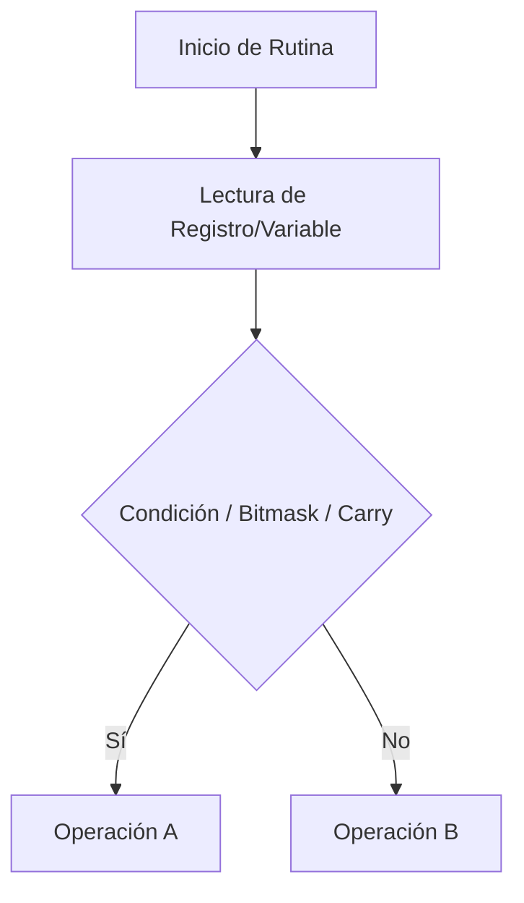

# Informe Técnico: [TÍTULO DE LA INVESTIGACIÓN]

- **ID de Investigación**: `RES-###`
- **Tarea Asociada**: `TASK-XXX-###`
- **Área Temática**: [01-Núcleo / 02-Física / 03-Escenarios / 04-Enemigos / 05-Render / 06-Audio]
- **Fecha**: AAAA-MM-DD
- **Autor / Agente**: [Nombre del Agente / Rol]
- **Estado**: `[BORRADOR]` | `[COMPLETADA]` | `[SUPERADA]`

---

## 1. Objetivo y Preguntas de Investigación

Describir qué se investiga, qué comportamiento original se busca desentrañar y qué dudas o discrepancias pretende resolver este informe.

- **Pregunta Principal**: ¿Cómo implementa el código original de NES...?
- **Impacto en el Port**: ¿Qué módulos de `port_native/` dependen de estos hallazgos?

---

## 2. Fuentes de Verdad Analizadas (`asm/`)

Listar con precisión quirúrgica los archivos, etiquetas, offsets y rangos de líneas analizados:

- **Archivos**:
  - `asm/src/<archivo.asm>`: Líneas `X` a `Y` (Etiqueta: `NombreDeEtiqueta`)
- **ROM / Binario** (si aplica):
  - Offset hex: `$XXXX`
- **Referencias Multimedia**:
  - Video original: `Mighty-Bomb-Jack-original.mp4` (Minuto/Segundo `MM:SS`)
  - Video del port: `Mighty-Bomb-Jack-Port.mp4` (Minuto/Segundo `MM:SS`)

---

## 3. Hallazgos Técnicos y Extracción de Datos

### 3.1. Inventario de Subrutinas y Contrato ABI 6502
Para cada subrutina analizada en este lote, registrar su firma exacta para que pueda recrearse en C x86 sin ambigüedad:

| Etiqueta `asm/` | Nombre Semántico Propuesto | Dir. ROM (`$XXXX`) | Archivo y Líneas | Entradas (`A, X, Y, C, ZP`) | Salidas (`A, X, Y, Flags C/Z/N`) | Mutación de Stack (`RTS` vs `PLA;PLA`) | Callers (`JSR`/`JMP`/`JumpTable`) | Callees |
| :--- | :--- | :---: | :---: | :--- | :--- | :---: | :--- | :--- |
| `sub_XXXX` | `NombreDescriptivo` | `$XXXX` | `prg.asm:L1-L2` | `A=idx, X=slot` | `C=1 (colisión)` | `Normal RTS` | `MainSub_1` | `sub_YYYY` |

### 3.2. Algoritmo Original (6502) y Tablas de Salto (`JSR JumpTable`)
Explicar el flujo lógico, tablas de despacho indirecto (`JSR JumpTable` e índice de estado que las gobierna), operaciones aritméticas de 8/16 bits (`uint8_t`/`int8_t`, propagación de `Carry`/`Borrow` en subpíxeles `8.8` y wrap-around `$FF+1=$00`).



### 3.3. Uso de Zero-Page Scratchpad (`$0000-$0014`) y Variables RAM (`$0000-$07FF`)
Documentar qué variables globales y qué registros temporales de Zero-Page (`byte_0`..`byte_14`, `off_2`, `off_4`) lee o modifica cada rutina, especificando si el valor temporal se pasa entre función padre e hija:

| Dirección RAM | Etiqueta Actual | Nombre Semántico | Tipo C Exacto | Lectura (`R`) / Escritura (`W`) | Rol Exacto y Semántica de Bits |
| :--- | :--- | :--- | :---: | :---: | :--- |
| `$0000` | `byte_0` | `zp_temp_0` | `uint8_t` | `R/W` | Contador/índice temporal compartido entre X e Y |

### 3.4. Tablas de Constantes y Datos en ROM
Registrar los valores exactos encontrados en `asm/`, la variable que los indexa, su stride y máscara:

| Etiqueta ROM (`$XXXX`) | Tamaño (Bytes) | Indexado por | Valor Hex / Estructura | Significado / Efecto en Juego |
| :--- | :---: | :--- | :--- | :--- |
| `word_XXXX` | `N` | `X (0..K)` | `$00, $05, ...` | Descripción exacta |

---

## 4. Discrepancias y Estado Actual en `port_native/`

Comparar lo hallado en `asm/` frente a la implementación actual en C:

- **Archivo C**: `port_native/src/...` (Líneas `A` a `B`)
- **Comportamiento Actual en C**: Descripción de lo que hace el código nativo ahora mismo.
- **Divergencias Detectadas**:
  1. *Divergencia 1*: [Ejemplo: El temporizador decrementa cada tick en vez de usar el frame counter de la NES].
  2. *Divergencia 2*: [Ejemplo: La tabla de salto omite el paso 32].

---

## 5. Especificación de Implementación y Criterios de Paridad

Guía concreta para el desarrollador que implementará la corrección o nueva característica:

1. **Estructura C recomendada**:
   ```c
   // Definición o prototipo sugerido
   ```
2. **Constantes a incorporar**:
   ```c
   #define CONSTANTE_EJEMPLO 0x12
   ```
3. **Casos Límite (Edge Cases)**:
   - ¿Qué pasa en overflow?
   - ¿Cómo reacciona ante entrada nula de gamepad?

---

## 6. Plan de Pruebas Unitarias / Aceptación

Definir los tests que certificarán la paridad matemática y funcional en `port_native/tests/`:

- [ ] **Test 1**: `test_...` - Verificar que con entrada X la salida es exactamente Y.
- [ ] **Test 2**: `test_...` - Comprobar paridad de ciclos/ticks con la tabla de datos original.

---

## 7. Referencias Cruzadas

- **Decisión de Arquitectura**: [ADR-XXX](../DECISIONS.md)
- **Otras Investigaciones**: [`RES-YYY`](RES-YYY-tema.md)
