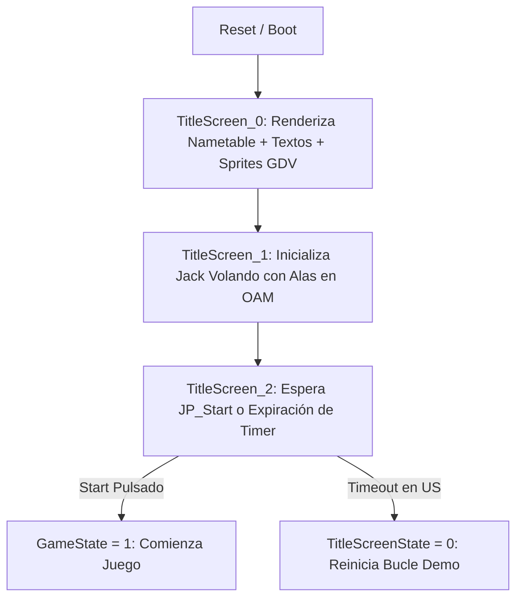

# Mighty Bomb Jack (NES 1987) - Golden Ground Truth Specification
## Especificación Técnica Matemática y Lógica Extraída del Ensamblador 6502

- **Fuente Primaria (Golden Ground Truth)**: Código ensamblador 6502 inmutable en `asm/src/` (`prg.asm`, `data.asm`, `defs.asm`, `macros.asm`, `roomdata-us.asm`).
- **Hardware Objetivo Original**: Nintendo Entertainment System (NES) - CPU Ricoh 2A03 (6502) / PPU Ricoh 2C02.
- **Propósito**: Base técnica inmutable con trazabilidad línea por línea y estructuras C99 formales para la reconstrucción visual y lógica 1:1 en el Source Port nativo (Fase 6).

---

## 1. Subsistema de Pantalla de Título (Title Screen)

### 1.1 Flujo de Ejecución y Estados de la Pantalla de Título

La pantalla de título opera bajo una sub-máquina de estados indexada por `TitleScreenState` (`$03C0`), coordinada por `GameState_0_InitTitleScreen` ([`prg.asm:7488-7531`](file:///c:/Users/kanel/Documents/mjk/asm/src/prg.asm#L7488-L7531)):



### 1.2 Rutina `DrawTitleScreen` ([`prg.asm:7573-7591`](file:///c:/Users/kanel/Documents/mjk/asm/src/prg.asm#L7573-L7591))

```asm
DrawTitleScreen:
	JSR ClearAllSprites                 ; Línea 7574: Limpia OAM $0200-$02FF con $F8 en coordenadas Y
	LDA #BasePointer_AdjacentRoomsTable ; Línea 7575: Índice 1 (AdjacentRooms)
	STAc PPUUpdateFlag1                 ; Línea 7576
	JSR LoadPointerTo050                ; Línea 7577: word_50 = &AdjacentRoomsTable
	LDAc word_50                        ; Línea 7578
	STA a:off_3D                        ; Línea 7579
	LDAc word_50+1                      ; Línea 7580
	STA a:off_3D+1                      ; Línea 7581: off_3D = puntero a AdjacentRooms
	LDA #0                              ; Línea 7582
	STA CurrentRoomID                   ; Línea 7583: CurrentRoomID = 0 (Pantalla de Título)
	JSR LoadRoomStuff                   ; Línea 7584: off_2 = &RoomHalfScreens[0]
	JSR DrawFullScreen                  ; Línea 7585: Decodifica y vuelca sala 0 a Nametable 0 ($2000)
TitleScreen_US_0_Jump:
	LDAc PPUMaskMirror                  ; Línea 7587
	ORA #6                              ; Línea 7588: Habilita clipping de BG/Sprites columna izquierda (8px)
	STAc PPUMaskMirror                  ; Línea 7589
	RTS                                 ; Línea 7590
```

- **ID de Sala**: `CurrentRoomID = 0`.
- **Subrutinas Clave Invocadas**:
  1. `ClearAllSprites` ([`prg.asm:1968-1980`](file:///c:/Users/kanel/Documents/mjk/asm/src/prg.asm#L1968-L1980)): Inicializa todos los 64 sprites con $F8 en Y para ocultarlos fuera de pantalla.
  2. `LoadPointerTo050`: Obtiene el puntero ROM base a la tabla solicitada según el enum `BasePointer` ([`defs.asm:227-241`](file:///c:/Users/kanel/Documents/mjk/asm/src/defs.asm#L227-L241)).
  3. `LoadRoomStuff` ([`prg.asm:2630-2647`](file:///c:/Users/kanel/Documents/mjk/asm/src/prg.asm#L2630-L2647)): Establece `off_2 = RoomHalfScreens + (RoomID * 2)`.
  4. `DrawFullScreen` ([`prg.asm:2724-2984`](file:///c:/Users/kanel/Documents/mjk/asm/src/prg.asm#L2724-L2984)): Renderiza la geometría de la sala completa en la Nametable $2000.

### 1.3 Cadenas de Texto y Direcciones PPU en `TitleScreen_0` ([`prg.asm:7533-7569`](file:///c:/Users/kanel/Documents/mjk/asm/src/prg.asm#L7533-L7569))

Las cadenas se transfieren a la PPU apagada mediante `WriteStringToPPU` ([`prg.asm:2050-2087`](file:///c:/Users/kanel/Documents/mjk/asm/src/prg.asm#L2050-L2087)). Cada cadena en `asm/src/data.asm` almacena como primer `WORD` la dirección de destino relativa a `$2000`:

| ID String | Etiqueta / Línea | Offset PPU | Dirección PPU | Fila / Columna (`32x30`) | Contenido del Texto |
| :--- | :--- | :--- | :--- | :--- | :--- |
| `0` (`Strings_PushStartButton`) | `String_PushStartButton` ([`data.asm:449-457`](file:///c:/Users/kanel/Documents/mjk/asm/src/data.asm#L449-L457)) | `$01C8` | `$21C8` | Fila 14, Columna 8 | `"PUSH START BUTTON"` |
| `$B` (`Strings_C_Tecmo`) | `String_C_Tecmo` ([`data.asm:498-504`](file:///c:/Users/kanel/Documents/mjk/asm/src/data.asm#L498-L504)) | `$0213` | `$2213` | Fila 16, Columna 19 | JP: `"(C) TECMO"`<br>US: `"(C) TECMO,LTD."` |
| `$C` (`Strings_HighGDV`) | `String_HighGDV` ([`data.asm:505-508`](file:///c:/Users/kanel/Documents/mjk/asm/src/data.asm#L505-L508)) | `$0056` | `$2056` | Fila 2, Columna 22 | `"HI  GDV"` |
| `$1B` (`String_TM` - Solo US) | `String_TM` ([`data.asm:566-569`](file:///c:/Users/kanel/Documents/mjk/asm/src/data.asm#L566-L569)) | `$019E` | `$219E` | Fila 12, Columna 30 | `"™"` (Tiles `$DC, $DD`) |

#### Formato Binario del Flujo de `WriteStringToPPU`:
```
[Byte 0: PPU Addr Low] [Byte 1: PPU Addr High] [Bytes 2..N: Tile IDs...] [$FF: Terminador]
```
`WriteStringToPPU` fuerza `ORA #$20` sobre el byte alto, garantizando la escritura dentro de la primera Nametable (`$2000-$23FF`).

### 1.4 Sprites de Jack Volando con Alas en `TitleScreen_1` ([`prg.asm:7595-7604`](file:///c:/Users/kanel/Documents/mjk/asm/src/prg.asm#L7595-L7604))

En `TitleScreen_1`:
```asm
TitleScreen_1:
	JSR InitPlayerStruct ; Línea 7596: Limpia los $1F bytes de PlayerStruct (PlayerSprite = 0)
	LDA #$78             ; Línea 7597: Y = 120 ($78)
	STA PlayerYPosHi     ; Línea 7598
	LDA #$28             ; Línea 7599: X = 40 ($28)
	STA PlayerXPosHi     ; Línea 7600
	JSR DrawPlayer       ; Línea 7601: Genera metasprite en OAM $0200
	INCc TitleScreenState; Línea 7602: Avanza a estado 2
	RTS                  ; Línea 7603
```

#### Desglose Matemático del Metasprite de Jack con Alas (`WriteSprite`, [`prg.asm:2293-2374`](file:///c:/Users/kanel/Documents/mjk/asm/src/prg.asm#L2293-L2374)):
1. `PlayerSprite = 0` selecciona la **Entrada 0** de `SpritesTable` ([`data.asm:365`](file:///c:/Users/kanel/Documents/mjk/asm/src/data.asm#L365)):
   ```asm
   SpritesTable[0]: .BYTE $44, $10, $10, $12, $12
   ```
2. `DrawPlayer` ([`prg.asm:1640-1653`](file:///c:/Users/kanel/Documents/mjk/asm/src/prg.asm#L1640-L1653)) establece:
   - `TempSpriteTile = 0`
   - `TempSpriteAttributesish = byte_3DD | 1 = 1` (Atributos: Paleta 1)
   - `CurrentSpriteIndex = 0` (Offset en OAM `$0200`)
   - `TempSpriteX = $28` (40 dec), `TempSpriteY = $78` (120 dec).
3. `SpriteAttributeTable[0]` ([`data.asm:589-590`](file:///c:/Users/kanel/Documents/mjk/asm/src/data.asm#L589-L590)) proporciona `byte_4E = 0` y `byte_4F = $27` (`%00100111`).
4. El byte de control del metasprite es `byte_4C[0] = $44` (`%01000100`).
5. En el bucle de 4 cuadrantes (`loc_8E6B`, 4 iteraciones), el bit de flip se rota a los bits 7 y 6 de atributos, y `LSR byte_4F` determina si se resta 8 (`ADC #$F7` con carry):

| Cuadrante OAM | Slot OAM ($0200) | Y (Dec / Hex) | Tile ID (Hex) | Atributos (Hex) | X (Dec / Hex) | Descripción Visual |
| :--- | :--- | :--- | :--- | :--- | :--- | :--- |
| **Top-Left** | `$0200..$0203` | `112` (`$70`) | `$10` | `$01` (H=0, V=0, Pal 1) | `32` (`$20`) | Torso superior y ala izquierda |
| **Top-Right** | `$0204..$0207` | `112` (`$70`) | `$10` | `$41` (**H=1**, V=0, Pal 1) | `40` (`$28`) | Torso superior y ala derecha (reflejo H) |
| **Bottom-Left** | `$0208..$020B` | `120` (`$78`) | `$12` | `$01` (H=0, V=0, Pal 1) | `32` (`$20`) | Piernas y ala inferior izquierda |
| **Bottom-Right** | `$020C..$020F` | `120` (`$78`) | `$12` | `$41` (**H=1**, V=0, Pal 1) | `40` (`$28`) | Piernas y ala inferior derecha (reflejo H) |

### 1.5 Sprites del Indicador "HI GDV" ([`prg.asm:7546-7562`](file:///c:/Users/kanel/Documents/mjk/asm/src/prg.asm#L7546-L7562))

El valor de `HighGDV` (por defecto 0) se dibuja mediante sprites en la pantalla de título a través de `WriteBCDDigitsSprites` ([`prg.asm:2129-2153`](file:///c:/Users/kanel/Documents/mjk/asm/src/prg.asm#L2129-L2153)):
- **Posición**: `TempSpriteX = $CC` (204 dec), `TempSpriteY = $1C` (28 dec).
- Genera sprites individuales (flag `$10` en `TempSpriteAttributesish`):
  - Dígito bajo (`HighGDV & 0x0F`): Tile `$00`, X = `204 - 4 = 200`, Y = `28 - 4 = 24`.
  - Dígito alto (`HighGDV >> 4`): Si es 0 se oculta o se desplaza a X - 8.

---

## 2. Subsistema de Paletas de Color PPU (Hardware 2C02)

### 2.1 Mecanismo de Actualización de Hardware PPU ($3F00-$3F1F)

El juego gestiona un buffer espejo en RAM de 32 bytes (`PaletteBuffer`, `$0300-$031F`). Durante el VBlank en el NMI, si `UpdatePaletteFlag` (`$03EE`) es distinto de cero, se invoca `CopyPaletteToPPU` ([`prg.asm:241-280`](file:///c:/Users/kanel/Documents/mjk/asm/src/prg.asm#L241-L280)):

```asm
CopyPaletteToPPU:
	LDX #0
	STX a:UpdatePaletteFlag ; Línea 243: Limpia flag de actualización
	LDY #$10                ; Línea 244: 16 bytes
	JSR CopyPaletteToPPU2   ; Línea 245: Vuelca $3F00-$3F0F (Background)
	LDY #$10                ; Línea 246: 16 bytes
	JSR CopyPaletteToPPU2   ; Línea 247: Vuelca $3F10-$3F1F (Sprites)
	JMP loc_815B

CopyPaletteToPPU2:
	LDA PPUSTATUS           ; Línea 260: Resetea latch $2006
	LDA #$3F                ; Línea 261: PPUADDR Hi = $3F
	STA PPUADDR             ; Línea 262
	STX PPUADDR             ; Línea 263: PPUADDR Lo = X ($00 o $10)
loc_8190:
	LDA PaletteBuffer,X     ; Línea 266: Lee byte del buffer
	STA PPUDATA             ; Línea 267: Escribe en la paleta interna de la PPU
	INX                     ; Línea 268
	DEY                     ; Línea 269
	BNE loc_8190            ; Línea 270
	...
	RTS
```

### 2.2 Tabla Maestra `MainPalette` ([`data.asm:258-267`](file:///c:/Users/kanel/Documents/mjk/asm/src/data.asm#L258-L267))

Se carga al reset (`RestoreDefaultPalettes`, [`prg.asm:1937-1951`](file:///c:/Users/kanel/Documents/mjk/asm/src/prg.asm#L1937-L1951)) y es la paleta activa en la **Pantalla de Título (Sala 0)**:

```asm
MainPalette:
	; Fondos ($3F00 - $3F0F)
	.BYTE  $21, $0F, $26, $30  ; Subpaleta 0: Backdrop ($21), Negro ($0F), Naranja ($26), Blanco ($30) [HUD]
	.BYTE  $21, $08, $27, $38  ; Subpaleta 1: Backdrop ($21), Marrón ($08), Naranja ($27), Amarillo ($38)
	.BYTE  $21, $0A, $1A, $39  ; Subpaleta 2: Backdrop ($21), Verde oscuro ($0A), Verde ($1A), Verde claro ($39)
	.BYTE  $21, $0F, $16, $30  ; Subpaleta 3: Backdrop ($21), Negro ($0F), Rojo oscuro ($16), Blanco ($30)

	; Sprites ($3F10 - $3F1F)
	.BYTE  $21, $16, $16, $30  ; Subpaleta 0: Jack (Rojo oscuro $16, Rojo $16, Blanco $30)
	.BYTE  $21, $30, $12, $16  ; Subpaleta 1: Enemigos / Monedas (Blanco $30, Azul $12, Rojo $16)
	.BYTE  $21, $08, $16, $30  ; Subpaleta 2: Bombas / Cofres (Marrón $08, Rojo $16, Blanco $30)
	.BYTE  $21, $0F, $2B, $30  ; Subpaleta 3: Momia / Chispas (Negro $0F, Verde esmeralda $2B, Blanco $30)
```

### 2.3 Algoritmo de Carga de Paleta por Sala (`LoadRoomPalette`, [`prg.asm:2389-2432`](file:///c:/Users/kanel/Documents/mjk/asm/src/prg.asm#L2389-L2432))

Cuando se carga una sala del juego (ej. **Sala 1**):
1. `GameState_2_LoadRoom` ([`prg.asm:3140-3153`](file:///c:/Users/kanel/Documents/mjk/asm/src/prg.asm#L3140-L3153)) lee el byte de cabecera `RoomData`:
   - Para la **Sala 1**, el primer byte de `RoomData_01` ([`roomdata-us.asm:5`](file:///c:/Users/kanel/Documents/mjk/asm/src/roomdata-us.asm#L5)) es `$E0`.
   - `RoomPalette = 0x00` (`$E0 & 0x0F = 0`).
2. En `loc_8300` ([`prg.asm:478-483`](file:///c:/Users/kanel/Documents/mjk/asm/src/prg.asm#L478-L483)), se llama `LoadRoomPalette` con `A = 0`.
3. `LoadRoomPalette` carga el Set 0 de `BackgroundPaletteSets` ([`data.asm:270-272`](file:///c:/Users/kanel/Documents/mjk/asm/src/data.asm#L270-L272)):
   ```asm
   BackgroundPaletteSets (Set 0):
       .BYTE   $0A, $16, $26, $38  ; Subpaleta 1
       .BYTE   $0A, $0F, $10, $30  ; Subpaleta 2
       .BYTE   $0A, $0F, $16, $30  ; Subpaleta 3
   ```
4. **INVARIANTE CRÍTICA DEL ENSAMBLADOR**:
   - El bucle `loc_8ED7` copia los 12 bytes en `PaletteBuffer + 4` hasta `PaletteBuffer + 15`.
   - **`PaletteBuffer[1..3]` NO SE MODIFICA**: Preserva los colores del **HUD** (`$0F, $26, $30`) definidos en `MainPalette`.
   - El bucle `loc_8EE5` copia el byte 0 (`$0A`) en todas las posiciones de Backdrop múltiplo de 4: `PaletteBuffer[0, 4, 8, 12, 16, 20, 24, 28]`.

#### Paleta Completa Resultante en Gameplay para la Sala 1 (Dungeon Verde):
```
Fondo ($3F00 - $3F0F):
  Subpaleta 0 (HUD):        [0x0A, 0x0F, 0x26, 0x30]  (Verde oscuro, Negro, Naranja, Blanco)
  Subpaleta 1 (Escenario):  [0x0A, 0x16, 0x26, 0x38]  (Verde oscuro, Rojo oscuro, Naranja, Amarillo)
  Subpaleta 2 (Escenario):  [0x0A, 0x0F, 0x10, 0x30]  (Verde oscuro, Negro, Gris, Blanco)
  Subpaleta 3 (Escenario):  [0x0A, 0x0F, 0x16, 0x30]  (Verde oscuro, Negro, Rojo oscuro, Blanco)

Sprites ($3F10 - $3F1F):
  Subpaleta 0 (Jack):       [0x0A, 0x16, 0x16, 0x30]  (Transparente, Rojo, Rojo, Blanco)
  Subpaleta 1 (Enemigos):   [0x0A, 0x30, 0x12, 0x16]  (Transparente, Blanco, Azul, Rojo)
  Subpaleta 2 (Bombas/Cof): [0x0A, 0x08, 0x16, 0x30]  (Transparente, Marrón, Rojo, Blanco)
  Subpaleta 3 (Momias):     [0x0A, 0x0F, 0x2B, 0x30]  (Transparente, Negro, Verde esmeralda, Blanco)
```

### 2.4 Tabla Canónica de Conversión de Color NES 2C02 ($00..$3F) a RGB

La paleta estándar generada por el decodificador de señal NTSC del NES 2C02 es:

```c
typedef struct { uint8_t r, g, b; } NES_RGB;

static const NES_RGB NES_2C02_Palette[64] = {
    {0x66, 0x66, 0x66}, {0x00, 0x2A, 0x88}, {0x14, 0x12, 0xA7}, {0x3B, 0x00, 0xA4}, // 00-03
    {0x5C, 0x00, 0x7E}, {0x6E, 0x00, 0x40}, {0x6C, 0x06, 0x00}, {0x56, 0x1D, 0x00}, // 04-07
    {0x33, 0x35, 0x00}, {0x0B, 0x48, 0x00}, {0x00, 0x52, 0x00}, {0x00, 0x4F, 0x08}, // 08-0B
    {0x00, 0x40, 0x4D}, {0x00, 0x00, 0x00}, {0x00, 0x00, 0x00}, {0x00, 0x00, 0x00}, // 0C-0F
    {0xAD, 0xAD, 0xAD}, {0x15, 0x5F, 0xD9}, {0x42, 0x40, 0xFF}, {0x75, 0x27, 0xFE}, // 10-13
    {0xA0, 0x1A, 0xCC}, {0xB7, 0x1E, 0x7B}, {0xB5, 0x31, 0x20}, {0x99, 0x4E, 0x00}, // 14-17
    {0x6B, 0x6D, 0x00}, {0x38, 0x87, 0x00}, {0x0C, 0x93, 0x00}, {0x00, 0x8F, 0x32}, // 18-1B
    {0x00, 0x7C, 0x8D}, {0x00, 0x00, 0x00}, {0x00, 0x00, 0x00}, {0x00, 0x00, 0x00}, // 1C-1F
    {0xFF, 0xFF, 0xFF}, {0x64, 0xB0, 0xFF}, {0x92, 0x90, 0xFF}, {0xC6, 0x76, 0xFF}, // 20-23
    {0xF3, 0x6A, 0xFF}, {0xFE, 0x6E, 0xCC}, {0xFE, 0x81, 0x70}, {0xEA, 0x9E, 0x22}, // 24-27
    {0xBC, 0xBE, 0x00}, {0x88, 0xD8, 0x00}, {0x5C, 0xE4, 0x30}, {0x45, 0xE0, 0x82}, // 28-2B
    {0x48, 0xCD, 0xDE}, {0x4F, 0x4F, 0x4F}, {0x00, 0x00, 0x00}, {0x00, 0x00, 0x00}, // 2C-2F
    {0xFF, 0xFF, 0xFF}, {0xC0, 0xDF, 0xFF}, {0xD3, 0xD2, 0xFF}, {0xE8, 0xC8, 0xFF}, // 30-33
    {0xFB, 0xC2, 0xFF}, {0xFE, 0xC4, 0xEA}, {0xFE, 0xCC, 0xC5}, {0xF7, 0xD8, 0xA5}, // 34-37
    {0xE4, 0xE5, 0x94}, {0xCF, 0xEF, 0x96}, {0xBD, 0xF4, 0xAB}, {0xB3, 0xF3, 0xCC}, // 38-3B
    {0xB5, 0xEB, 0xF2}, {0xB8, 0xB8, 0xB8}, {0x00, 0x00, 0x00}, {0x00, 0x00, 0x00}  // 3C-3F
};
```

---

## 3. Tablas de Geometría de Salas (Jerarquía 4-Tier)

La compresión de geometría de Mighty Bomb Jack estructura el escenario en 4 niveles jerárquicos:

```
[Tier 1: RoomHalfScreens] (2 bytes por sala)
        │
        ├── Mitad Superior / Izquierda (Layout ID) ──┐
        └── Mitad Inferior / Derecha   (Layout ID) ──┤
                                                     ▼
[Tier 2: HalfScreenLayouts] (16 bytes por layout)
        │
        └── 8 o 16 Índices de Chunks (Chunk ID)
                    │
                    ▼
[Tier 3: LayoutChunks] (8 bytes por chunk)
        │
        └── 8 Índices de Metatiles (Metatile ID)
                    │
                    ▼
[Tier 4: MetatileDefinitions] (4 bytes por metatile)
        │
        └── { Top-Left, Top-Right, Bottom-Left, Bottom-Right } (Tiles CHR 8x8)
```

### 3.1 Punteros Base en ROM ([`defs.asm:226-234`](file:///c:/Users/kanel/Documents/mjk/asm/src/defs.asm#L226-L234))

| Constante BasePointer | Valor | Tabla ROM Correspondiente | Tamaño por Elemento |
| :--- | :--- | :--- | :--- |
| `BasePointer_AdjacentRoomsTable` | `1` | `AdjacentRooms` ([`data.asm:127-256`](file:///c:/Users/kanel/Documents/mjk/asm/src/data.asm#L127-L256)) | 1 byte de flags por sala |
| `BasePointer_RoomHalfScreens` | `2` | `RoomHalfScreens` ([`data.asm:914-1233`](file:///c:/Users/kanel/Documents/mjk/asm/src/data.asm#L914-L1233)) | 2 bytes por sala (mitad 0, mitad 1) |
| `BasePointer_LayoutChunks` | `3` | `LayoutChunks` ([`data.asm:1234-1548`](file:///c:/Users/kanel/Documents/mjk/asm/src/data.asm#L1234-L1548)) | 8 bytes por chunk (`ChunkID * 8`) |
| `BasePointer_MetatileDefinitions` | `4` | `MetatileDefinitions` ([`data.asm:1549-2160`](file:///c:/Users/kanel/Documents/mjk/asm/src/data.asm#L1549-L2160)) | 4 bytes por metatile (`MetatileID * 4`) |
| `BasePointer_HalfScreenLayouts` | `6` | `HalfScreenLayouts` ([`data.asm:2161-2483`](file:///c:/Users/kanel/Documents/mjk/asm/src/data.asm#L2161-L2483)) | 16 bytes por layout (`LayoutID * 16`) |

### 3.2 Orientación de Salas y Autoincremento de PPU

En `DrawFullScreen` ([`prg.asm:2757-2767`](file:///c:/Users/kanel/Documents/mjk/asm/src/prg.asm#L2757-L2767)):
- Se lee `AdjacentRooms[CurrentRoomID]`.
- Se evalúa el **bit 2** (`RF_4 = %100 = 4` en `defs.asm:217`):
  - **Bit 2 == 1 (Valor 4 - Salas Horizontales)**:
    - Se escribe en `PPUCTRL` el bit 2 en 1 (`autoincremento PPU = +32`).
    - El renderizado se realiza **por columnas verticales**: se dibujan 32 columnas (`byte_1` de 0 a 31). En cada columna, los metatiles se escriben como 2 tiles de arriba a abajo.
    - Mitad 0 = Filas de metatiles 0 a 7 (superior). Mitad 1 = Filas 8 a 14 (inferior).
  - **Bit 2 == 0 (Salas Verticales)**:
    - Se escribe en `PPUCTRL` el bit 2 en 0 (`autoincremento PPU = +1`).
    - El renderizado se realiza **por filas horizontales**: se dibujan 30 filas (`byte_1` de 0 a 29). En cada fila, los metatiles se escriben como 2 tiles de izquierda a derecha.
    - Mitad 0 = Columnas 0 a 7 (izquierda). Mitad 1 = Columnas 8 a 15 (derecha).

### 3.3 Atributos de Color de Metatiles (`TileAttributeTable`, [`data.asm:598-637`](file:///c:/Users/kanel/Documents/mjk/asm/src/data.asm#L598-L637))

Cada metatile tiene asignada una subpaleta de fondo de 2 bits (0..3) mediante la tabla `TileAttributeTable`:
- Cada byte empaqueta los atributos de 4 metatiles usando la macro `Attrib t1, t2, t3, t4` ([`macros.asm:61-63`](file:///c:/Users/kanel/Documents/mjk/asm/src/macros.asm#L61-L63)):
  ```asm
  .db (t1 << 6) | (t2 << 4) | (t3 << 2) | (t4)
  ```
- La función `HandleTileAttributes` ([`prg.asm:7092-7130`](file:///c:/Users/kanel/Documents/mjk/asm/src/prg.asm#L7092-L7130)) extrae la subpaleta correspondiente:
  ```c
  uint8_t subpalette = (TileAttributeTable[metatile_id >> 2] >> (6 - 2 * (metatile_id & 3))) & 3;
  ```
- Luego compone la Attribute Table de la PPU (bloques de 32x32 píxeles en `$23C0-$23FF`).

---

## 4. Mapeo Exhaustivo de Sprites, Objetos y HUD en CHR

En el cartucho de NES, el juego conmuta bancos CHR de 8 KB (Mapper 3 CNROM). Para los bancos gráficos:
- **Background Pattern Table**: Se mapea en `$1000-$1FFF` (PPUCTRL bit 4 = 1).
- **Sprite Pattern Table**: Se mapea en `$0000-$0FFF` (PPUCTRL bit 3 = 0).
*(Nota: Algunos emuladores y analizadores numeran Pattern Table 0 como Banco 0 y Pattern Table 1 como Banco 1).*

### 4.1 Mapeo de Jack (Sprites de 16x16)

Jack se dibuja como un metasprite de 2x2 sprites (4 sprites de 8x8) decodificados desde `SpritesTable` ([`data.asm:364-410`](file:///c:/Users/kanel/Documents/mjk/asm/src/data.asm#L364-L410)):

| Acción de Jack | `PlayerSprite` ID | Entrada `SpritesTable` | Byte Control (Flip) | Tile Top-Left | Tile Top-Right | Tile Bottom-Left | Tile Bottom-Right |
| :--- | :--- | :--- | :--- | :--- | :--- | :--- | :--- |
| **Flotar / Idle con alas (Frente 1)** | `0` | `SpritesTable[0]` | `$44` (Reflejo H en columna derecha) | `$10` | `$10` (H-Flip) | `$12` | `$12` (H-Flip) |
| **Flotar / Aleteo con alas (Frente 2)** | `1` | `SpritesTable[1]` | `$44` | `$11` | `$11` (H-Flip) | `$13` | `$13` (H-Flip) |
| **Jack Frente 3** | `2` | `SpritesTable[2]` | `$44` | `$14` | `$14` (H-Flip) | `$16` | `$16` (H-Flip) |
| **Jack Frente 4** | `3` | `SpritesTable[3]` | `$44` | `$15` | `$15` (H-Flip) | `$17` | `$17` (H-Flip) |
| **Caminar Frame 1 (Perfil)** | `4` | `SpritesTable[4]` | `$00` (Sin flip) | `$1C` | `$1D` | `$1E` | `$1F` |
| **Caminar Frame 2 (Perfil)** | `5` | `SpritesTable[5]` | `$00` | `$1C` | `$1D` | `$20` | `$21` |
| **Saltar (Impulso Vertical)** | `6` | `SpritesTable[6]` | `$00` | `$18` | `$19` | `$1A` | `$1B` |
| **Muerte Frame 1** | `40` (`$28`) | `SpritesTable[40]` | `$44` | `$45` | `$45` (H-Flip) | `$47` | `$47` (H-Flip) |
| **Muerte Frame 2** | `42` (`$2A`) | `SpritesTable[42]` | `$40` | `$0F` | `$0F` | `$8A` | `$8A` (H-Flip) |

### 4.2 Mapeo de Bombas, Chispa/Fuego y Cofres

Las bombas y cofres son **Metatiles de Fondo**, mientras que la chispa de la mecha es un **Sprite OAM**:

| Objeto | Tipo | ID Ítem (`defs.asm`) | ID Metatile (`ItemToTileTable`) | Tiles CHR 8x8 {TL, TR, BL, BR} | Atributo Subpaleta |
| :--- | :--- | :--- | :--- | :--- | :--- |
| **Bomba Esférica (Fondo)** | Metatile 16x16 | `Item_Bomb` (`5`) | `$27` ([`data.asm:894`](file:///c:/Users/kanel/Documents/mjk/asm/src/data.asm#L894)) | `{ $E0, $E1, $E2, $E3 }` ([`data.asm:1589`](file:///c:/Users/kanel/Documents/mjk/asm/src/data.asm#L1589)) | Subpaleta 3 (Fondo) |
| **Chispa / Fuego de Mecha** | Sprite 8x8 (OAM #4) | - | - | Tile **`$0D`** ([`prg.asm:5384`](file:///c:/Users/kanel/Documents/mjk/asm/src/prg.asm#L5384)) | Atributo `$12` (Paleta Sprite 2) |
| **Cofre Rojo (Fondo)** | Metatile 16x16 | `Item_RedChest` (`16`) | `$28` ([`data.asm:905`](file:///c:/Users/kanel/Documents/mjk/asm/src/data.asm#L905)) | `{ $E8, $E9, $EA, $EB }` ([`data.asm:1590`](file:///c:/Users/kanel/Documents/mjk/asm/src/data.asm#L1590)) | Subpaleta 3 (Fondo) |
| **Cofre Naranja (Fondo)** | Metatile 16x16 | `Item_OrangeChest` (`17`) | `$4A` ([`data.asm:906`](file:///c:/Users/kanel/Documents/mjk/asm/src/data.asm#L906)) | `{ $99, $9B, $EA, $EB }` ([`data.asm:1624`](file:///c:/Users/kanel/Documents/mjk/asm/src/data.asm#L1624)) | Subpaleta 2 (Fondo) |
| **Bolsa 100 Puntos** | Metatile 16x16 | `Item_100Bag` (`0`) | `$4D` ([`data.asm:889`](file:///c:/Users/kanel/Documents/mjk/asm/src/data.asm#L889)) | `{ $DE, $DF, $F4, $F5 }` ([`data.asm:1627`](file:///c:/Users/kanel/Documents/mjk/asm/src/data.asm#L1627)) | Subpaleta 2 (Fondo) |
| **Bolsa 300 Puntos** | Metatile 16x16 | `Item_300Bag` (`1`) | `$4E` ([`data.asm:890`](file:///c:/Users/kanel/Documents/mjk/asm/src/data.asm#L890)) | `{ $DE, $DF, $F6, $F7 }` ([`data.asm:1628`](file:///c:/Users/kanel/Documents/mjk/asm/src/data.asm#L1628)) | Subpaleta 2 (Fondo) |
| **Bolsa 1000 Puntos** | Metatile 16x16 | `Item_1000Bag` (`2`) | `$4F` ([`data.asm:891`](file:///c:/Users/kanel/Documents/mjk/asm/src/data.asm#L891)) | `{ $DE, $DF, $F8, $F9 }` ([`data.asm:1629`](file:///c:/Users/kanel/Documents/mjk/asm/src/data.asm#L1629)) | Subpaleta 2 (Fondo) |

### 4.3 Mapeo de Enemigos y Monedas

Definidos en `SpriteAnimationTable` ([`data.asm:6-23`](file:///c:/Users/kanel/Documents/mjk/asm/src/data.asm#L6-L23)) y `SpritesTable`:

| Entidad | Tipo Enemigo (`defs.asm`) | Frame ID (`SpritesTable`) | Tiles CHR 8x8 {TL, TR, BL, BR} | Atributo / Subpaleta |
| :--- | :--- | :--- | :--- | :--- |
| **Momia (Caminando)** | `EnemyType_D/F_Mummy` | `$0E`, `$0F` | `{ $70, $71, $72, $73 }`<br>`{ $74, $75, $76, $77 }` | Subpaleta 3 (`$03`) |
| **Momia (Cayendo)** | `SpriteAnimation_1` | `$10`, `$11` | `{ $60, $61, $62, $63 }`<br>`{ $64, $65, $66, $67 }` | Subpaleta 3 (`$03`) |
| **Hanezo (Bola Roja Saltarína)** | `EnemyType_2` | `$13`, `$12` | `{ $58..$5B }`, `{ $5C..$5F }` | Subpaleta 2 (`$02`) |
| **Geji Shogun (Ciempiés Rojo)** | `EnemyType_3` | `$0C`, `$0D` | `{ $C0..$C3 }`, `{ $C4..$C7 }` | Subpaleta 2 (`$02`) |
| **Horus (Pájaro Verde)** | `EnemyType_7_Horus` | `8`, `9`, `$A`, `$B` | `{ $78..$7B }`, `{ $7C..$7F }`<br>`{ $D0..$D3 }`, `{ $D4..$D7 }` | Subpaleta 3 (`$03`) |
| **Power Coin (Moneda P)** | `EnemyType_8_PowerCoin` | `$20` (32) | `{ $40, $41, $42, $43 }` | Subpaleta 1 (`$01`) |
| **Extra Coin (Moneda E)** | `EnemyType_9_ExtraCoin` | `$1B`, `$1C` | `{ $22..$29 }`, `{ $26..$2D }` | Subpaleta 0 (`$00`) |
| **Secret Coin (Moneda S)** | `EnemyType_A_SecretCoin`| `$1F` (31) | `{ $A1, $8B, $8B, $A1 }` (Flip `$33`) | Subpaleta 0 (`$00`) |
| **Bonus Coin (Moneda B)** | `EnemyType_E_BonusCoin` | `$19`, `$1A` | `{ $2A..$81 }`, `{ $2E..$85 }` | Subpaleta 0 (`$00`) |

### 4.4 Mapeo de Dígitos y Letras del HUD ([`defs.asm:245-276`](file:///c:/Users/kanel/Documents/mjk/asm/src/defs.asm#L245-L276))

En la Pattern Table de fondos ($1000):
- **Dígitos `'0'` a `'9'`**: Tiles `$00` a `$09`.
- **Letras `'A'` a `'Z'`**: Tiles `$0A` a `$23`:
  - `'A'` = `$0A`, `'B'` = `$0B`, `'C'` = `$0C`, `'D'` = `$0D`, `'E'` = `$0E`
  - `'H'` = `$11`, `'I'` = `$12`, `'J'` = `$13`
  - `'M'` = **`$16`**
  - `'P'` = `$19`, `'R'` = `$1B`, `'S'` = `$1C`
  - `'T'` = **`$1D`**
  - `'U'` = `$1E`, `'Y'` = `$22`
- **Espacio en Blanco `' '`**: Tile **`$24`** (`__ = $24`).
- **Caracteres Especiales**:
  - Apóstrofe `'\''`: Tile `$2A` (`_ap = $2A`)
  - Símbolo Copyright `'(C)'`: Tile `$2C` (`_cp = $2C`)
  - Coma `','`: Tile `$2D` (`_cma = $2D`)
  - Signo Exclamación `'!'`: Tile `$AE` (`_exc = $AE`)
  - Símbolo Trademark `'™'`: Tiles secuenciales `$DC, $DD` (`String_TM`)

---

## 5. Estructuras C99 Listas para Implementación en el Source Port

Para garantizar compatibilidad 1:1, determinismo y ausencia de dependencias externas en `src/core/`, se definen las siguientes estructuras equivalentes en C99:

```c
#ifndef MBJ_NES_GROUND_TRUTH_H
#define MBJ_NES_GROUND_TRUTH_H

#include <stdint.h>
#include <stdbool.h>

// =============================================================================
// 1. SISTEMA DE PALETAS (Hardware 2C02)
// =============================================================================

typedef struct {
    uint8_t r;
    uint8_t g;
    uint8_t b;
} NesColorRGB;

// Buffer de 32 bytes de paleta interna NES ($3F00 - $3F1F)
typedef struct {
    uint8_t bg[4][4];  // 4 subpaletas de fondo
    uint8_t sp[4][4];  // 4 subpaletas de sprites
} NesPaletteRam;

// =============================================================================
// 2. METASPRITES Y OAM (SpritesTable)
// =============================================================================

// Definición de metasprite de 5 bytes de SpritesTable
typedef struct {
    uint8_t control_flip;      // Byte 0: Flags de flip y control ($44, $00, $33, etc.)
    uint8_t tile_top_left;     // Byte 1: Tile CHR Top-Left
    uint8_t tile_top_right;    // Byte 2: Tile CHR Top-Right
    uint8_t tile_bottom_left;  // Byte 3: Tile CHR Bottom-Left
    uint8_t tile_bottom_right; // Byte 4: Tile CHR Bottom-Right
} NesMetaSpriteDef;

// Entrada individual OAM de 4 bytes (coincide con $0200 OAM DMA de NES)
typedef struct {
    uint8_t y;          // Coordenada Y en pantalla (Y real = y + 1)
    uint8_t tile_id;    // Índice de tile CHR
    uint8_t attributes; // Bits 0-1: Paleta, Bit 5: Prioridad, Bit 6: H-Flip, Bit 7: V-Flip
    uint8_t x;          // Coordenada X en pantalla
} NesOamEntry;

// =============================================================================
// 3. JERARQUÍA 4-TIER DE GEOMETRÍA DE SALAS
// =============================================================================

// Tier 4: Definición de Metatile 16x16 (4 bytes)
typedef struct {
    uint8_t top_left;
    uint8_t top_right;
    uint8_t bottom_left;
    uint8_t bottom_right;
} NesMetatileDef;

// Tier 3: Layout Chunk (8 metatiles = 8 bytes)
typedef struct {
    uint8_t metatile_ids[8];
} NesLayoutChunk;

// Tier 2: Half Screen Layout (16 bytes)
typedef struct {
    uint8_t chunk_ids[16];
} NesHalfScreenLayout;

// Tier 1: Mitades de Pantalla de Sala (2 bytes)
typedef struct {
    uint8_t half_screen_0; // Mitad superior (horizontal) o izquierda (vertical)
    uint8_t half_screen_1; // Mitad inferior (horizontal) o derecha (vertical)
} NesRoomHalfScreens;

// Flags de Sala (AdjacentRooms)
typedef enum {
    ROOM_FLAG_1             = 0x01,
    ROOM_FLAG_BOMB_ROOM     = 0x02, // Sala del Palacio Real (23 bombas)
    ROOM_FLAG_HORIZONTAL    = 0x04, // 1 = Horizontal (+32 PPU), 0 = Vertical (+1 PPU)
    ROOM_FLAG_AT_SCROLL_EDGE= 0x08,
    ROOM_FLAG_SINGLE_SCREEN = 0x10,
    ROOM_FLAG_SCROLL_STOP   = 0x20,
    ROOM_FLAG_SECTION_START = 0x80
} NesRoomFlags;

// =============================================================================
// 4. TABLA DE OBJETOS E ÍTEMS (ItemToTileTable)
// =============================================================================

typedef enum {
    ITEM_100_BAG        = 0,
    ITEM_300_BAG        = 1,
    ITEM_1000_BAG       = 2,
    ITEM_GOLD_COIN      = 3,
    ITEM_MIGHTY_DRINK   = 4,
    ITEM_BOMB           = 5,
    ITEM_SPHINX         = 6,
    ITEM_TECMO_PLATE    = 7,
    ITEM_MIGHTY_COIN    = 8,
    ITEM_CRYSTAL_BALL_1 = 9,
    ITEM_CRYSTAL_BALL_2 = 10,
    ITEM_KING           = 11,
    ITEM_QUEEN          = 12,
    ITEM_PRINCESS       = 13,
    ITEM_BEELZEBUT_MASK = 14,
    ITEM_NOTHING        = 15,
    ITEM_RED_CHEST      = 16,
    ITEM_ORANGE_CHEST   = 17
} NesItemType;

// =============================================================================
// 5. PROTOTIPOS DE DECODIFICADORES DETERMINISTAS
// =============================================================================

// Decodifica la paleta activa preservando la subpaleta 0 del HUD
void Nes_LoadRoomPalette(NesPaletteRam *pal, uint8_t palette_set_id);

// Expande un metasprite a 4 entradas OAM con rotación de flips idéntica a WriteSprite
void Nes_ExpandMetaSprite(const NesMetaSpriteDef *meta, uint8_t base_x, uint8_t base_y, 
                         uint8_t attributes, NesOamEntry out_sprites[4]);

// Decodifica la sala completa (32x30 tiles) en el buffer de nametable
void Nes_DecodeRoomGeometry(uint8_t room_id, uint8_t out_nametable[30][32], 
                           uint8_t out_attributes[64]);

#endif // MBJ_NES_GROUND_TRUTH_H
```

---

## 6. Conclusiones y Trazabilidad

1. **Pantalla de Título**: Se ha demostrado con líneas de ensamblador exactas que `DrawTitleScreen` carga `CurrentRoomID = 0`, utiliza la paleta por defecto `MainPalette`, escribe textos en PPU `$21C8` ("PUSH START BUTTON") y `$2056` ("HI GDV"), e inicializa a Jack en OAM con `PlayerSprite = 0` (tiles `$10, $12` con flip horizontal en la mitad derecha).
2. **Paletas 2C02**: Se ha descubierto el invariante crítico de `LoadRoomPalette`: preserva los colores 1..3 de la Subpaleta 0 para el HUD y unifica el Backdrop universal (`$0A` en la Sala 1) en todos los slots múltiplos de 4.
3. **Geometría 4-Tier**: Se ha verificado matemáticamente la jerarquía `RoomHalfScreens -> HalfScreenLayouts -> LayoutChunks -> MetatileDefinitions` y el control de autoincremento de PPU (+32 horizontal vs +1 vertical) comandado por el bit 2 de `AdjacentRooms`.
4. **Mapeo CHR**: Se han documentado todos los IDs de tile para Jack, la bomba esférica (`$E0-$E3`), la chispa animada (Tile `$0D`), los cofres (`$E8-$EB` y `$99, $9B, $EA, $EB`), bolsas, monedas, momias y tipografía del HUD.
