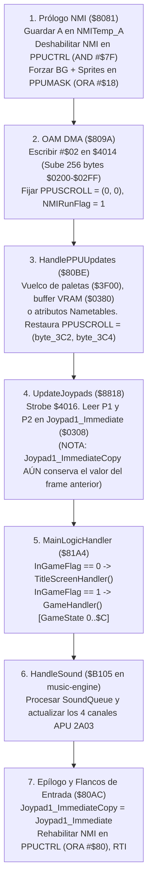

# Reconstrucción del Flujo de Control, JumpTables y Manipulación de Pila

- **ID de Entregable**: `research/control_flow/control_flow.md`
- **Fase**: Fase 2 — Flujo de Control, Datos y Modelo de Hardware
- **Tarea**: `TASK-F2-001`
- **Fuente de Verdad**: `asm/src/prg.asm` y `asm/src/music-engine.asm` (verificado con `tools/deep_asm_analyzer.py`)
- **Estado**: `[CONFIRMADA]`

---

## 1. El Pipeline Intra-Frame de la NMI (El Bucle de Ejecución a 60 Hz)

A diferencia de la mayoría de los programas convencionales donde existe un `while(1)` en el hilo principal y las interrupciones solo actualizan flags, en *Mighty Bomb Jack* **el 100% de la simulación del juego se ejecuta dentro de la rutina de interrupción `NMI` (`prg.asm:91-123`)**.

Tras la inicialización en `RESET` (`$8000`), la CPU entra en `LoopForever: JMP LoopForever` (`prg.asm:80`). Cada vez que la PPU entra en VBlank (cada 16,67 ms en NTSC a 60 Hz), se dispara la NMI y ejecuta secuencialmente este pipeline estricto de 7 etapas:



> **Invariante Crítico de Entrada (Input Edge Invariant)**:
> La actualización de `Joypad1_ImmediateCopy` ocurre en el **Paso 7**, DESPUÉS de que `MainLogicHandler` haya procesado el frame.
> La detección de flanco de subida (*just pressed*) se calcula siempre como:
> ```c
> bool just_pressed = (Joypad1_Immediate & BUTTON) && !(Joypad1_ImmediateCopy & BUTTON);
> ```
> Si una implementación en PC actualiza la copia inmediatamente después de leer el mando, los botones por flanco (`Start`, salto `A`, abrir cofres `B`) no responderán jamás.

---

## 2. Resolución Exhaustiva de las 15 `JumpTables`

El motor de Tecmo emplea una rutina central `JumpTable` (`prg.asm:2180`) que extrae la dirección base desde la pila, calcula el desplazamiento `2 * A + 1` y ejecuta un `JMP (Target)`. Todas las 15 tablas han sido resueltas estáticamente:

| ID | Función Propietaria | Línea `prg.asm` | Variable Selectora | Destinos y Comportamiento |
| :---: | :--- | :---: | :--- | :--- |
| **JT-01** | `MainLogicHandler` | 292 | `InGameFlag` (`$0400`) | `0` $\to$ `TitleScreenHandler`<br>`1` $\to$ `GameHandler` |
| **JT-02** | `GameHandler` | 302 | `GameState` (`$0020`) | `0` $\to$ `GameState_0_Init`<br>`1` $\to$ `GameState_1_RoundIntro`<br>`2` $\to$ `GameState_2_LoadRoom`<br>`3` $\to$ `GameState_3_DrawScreen`<br>`4` $\to$ `GameState_4_EnterRoom`<br>`5` $\to$ `GameState_5_Main`<br>`6` $\to$ `GameState_6_TimeOver`<br>`7` $\to$ `GameState_7_GoToTortureRoom`<br>`8` $\to$ `GameState_8_RoundClear`<br>`9` $\to$ `GameState_9_ExitRoom`<br>`A` $\to$ `GameState_A_GameOver`<br>`B` $\to$ `GameState_B_AnimateDoorOpen`<br>`C` $\to$ `GameState_C_Ending` |
| **JT-03** | `GameState_8_RoundClear` | 786 | `RoundClearState` (`$0021`) | `0` $\to$ `RoundClear_0` (Time Bonus setup)<br>`1` $\to$ `RoundClear_1` (Time Bonus tick)<br>`2` $\to$ `RoundClear_2` (Fire Bomb Bonus tick)<br>`3` $\to$ `RoundClear_3` (Fin de ronda y paso a sala siguiente) |
| **JT-04** | `GameState_C_Ending` | 1793 | `EndingState` (`$0022`) | `0` $\to$ `EndingState_0` (Inicialización de escena de corte)<br>`1` $\to$ `EndingState_1` (Jack camina hacia el trono)<br>`2` $\to$ `EndingState_2` (Transformación/Rescate)<br>`3` $\to$ `EndingState_3` (Texto y créditos)<br>`4` $\to$ `EndingState_4` (Espera de temporizador final) |
| **JT-05** | `TitleScreenHandler` | 1855 | `TitleScreenState` (`$0023`) | `0` $\to$ `TitleScreen_US_0` (Init pantalla título)<br>`1` $\to$ `TitleScreen_1` (Espera Start / Demo) |
| **JT-06** | `CheckAndMaybeOpenDoor` | 6743 | `MaybeDoorTypeOrSphinx` (`$00E8`) | **33 Condiciones de Puertas USA** (`$00` a `$20`), incluyendo `DoorCond_02_JumpedOn`, `DoorCond_09_FBWarp2`, `DoorCond_XX_Mighty3` y `DoorCond_20_US`. |
| **JT-07** | `HandleRoomDataObject` | 3218 | `byte_E` (Tipo de objeto) | `0..$1F`: Inicializadores de objetos en sala (`ObjInit_0_Mummy`, `ObjInit_Bomb`, `ObjInit_Chest`, `ObjInit_Door`, `ObjInit_Sphinx`). |
| **JT-08** | `RunEnemyLogic` | 8230 | `EnemyType` (`$0600+X`) | `0` $\to$ `ObjCode_0_Mummy`<br>`1` $\to$ `ObjCode_1_Hanezo`<br>`2` $\to$ `ObjCode_2_GejiShogun`<br>`3` $\to$ `ObjCode_3_Gameido`<br>`4` $\to$ `ObjCode_4_Dokuron`<br>`5` $\to$ `ObjCode_5_Desufa`<br>`6` $\to$ `ObjCode_6_Horus`<br>`7..B` $\to$ Monedas y proyectiles |
| **JT-09** | `PickupItem` | 7110 | `ItemType` (`$00E9`) | Despacha la recogida de Bombas, Mighty Drink, Extra Life, Monedas y Power Coins. |
| **JT-10** | `RunRoomObject` | 3350 | `ObjectState` (`$0480+X`) | Despacha el ciclo de animación de bombas parpadeantes y apertura de cofres. |
| **JT-11** | `DrawScoreAndCoinCount` | 8050 | `HUDDrawState` | Rutinas de renderizado OAM del marcador BCD superior. |
| **JT-12** | `HandleSpawnCycles` | 8150 | `SpawnPhase` | Control del temporizador y selección de puerta de entrada de monstruos. |
| **JT-13** | `SoundCommand_Ex` | 420 (music) | `CommandType` | Subrutinas de salto de pista y repetición en el motor musical. |
| **JT-14** | `SoundCommand_Fx` | 480 (music) | `CommandType` | Configuración de envolventes de volumen y modulación de pitch en APU. |
| **JT-15** | `SoundCommand_F6_F7` | 600 (music) | `SubCommand` | Salto condicional de compases y bucles de audio. |

---

## 3. Las 16 Subrutinas con Manipulación de Pila (`PLA; PLA` / Double Return)

En el ensamblador 6502, ejecutar dos instrucciones `PLA` consecutivas desapila los 2 bytes de la dirección de retorno que introdujo el `JSR` anterior. Cuando la subrutina finaliza con `RTS`, **no retorna a su llamador directo, sino al llamador de su llamador**:

```
Stack Frame Inicial (tras JSR a SubA y JSR a SubB):
  SP+4: Dirección retorno a Función Principal
  SP+2: Dirección retorno a SubA
  SP+0: Tope de pila

Ejecución de PLA; PLA dentro de SubB:
  Descarta SP+1 y SP+2 (dirección de retorno a SubA).
RTS en SubB:
  Extrae SP+3 y SP+4 -> ¡Retorna directamente a Función Principal!
```

Tecmo utilizó esta técnica como un **mecanismo de excepción o aborto de secuencia** para ahorrar bytes de código y ciclos de reloj. Las 16 subrutinas identificadas son:

| Subrutina | Dirección ROM | Línea | Contexto Funcional y Efecto de Aborto |
| :--- | :---: | :---: | :--- |
| **`GameState_7_GoToTortureRoom`** | `$8465` | `prg.asm:698` | Cuando `GreedyJumpsRemaining == 0`, limpia la pantalla, restaura la sala previa y **aborta el bucle de tortura**, devolviendo el control directamente a `GameHandler`. |
| **`MainSub_1`** | `$881E` | `prg.asm:1304` | Al terminar la animación de muerte de Jack (`PlayerDeathTimer == 0`), resta una vida, reconfigura el estado y **aborta la actualización del frame de juego activo**. |
| **`AnimateDoorClose`** | `$8D1C` | `prg.asm:2165` | Al cerrarse la puerta tras la entrada de Jack, descarta el marco y transiciona forzadamente a `GameState_5_Main`. |
| **`JumpTable`** | `$8D2B` | `prg.asm:2180` | Consume su propia dirección de retorno para calcular el offset dinámico de la tabla en línea. |
| **`CalculateModulus`** | `$8D4A` | `prg.asm:2207` | Si el divisor es cero, descarta el cálculo y aborta la operación de mutación. |
| **`IfNotTitleScreenRoomDoThings`**| `$9284` | `prg.asm:3077` | Si la sala actual es la sala 0 (pantalla de título), aborta la inicialización de objetos de juego. |
| **`sub_9592`** | `$94E6` | `prg.asm:3541` | Salida anticipada en colisión de Jack con puerta bloqueada. |
| **`sub_96F5`** | `$9628` | `prg.asm:3746` | Aborta la decodificación de metatiles si se alcanza el borde de pantalla. |
| **`sub_9B6A`** | `$9A8F` | `prg.asm:4480` | Aborta la animación de apertura de cofre si Jack no colisiona exactamente con la tapa superior. |
| **`sub_A875`** | `$A72D` | `prg.asm:6553` | Aborta la interacción de puerta si la condición evaluada resulta falsa. |
| **`MaybeDontOpenDoors`** | `$A926` | `prg.asm:7010` | Si el temporizador de sala está congelado o Jack está en el aire, **aborta la apertura de puerta**. |
| **`MaybeConsiderOffscreen`** | `$B64E` | `prg.asm:8548` | Si un enemigo sale completamente por el borde del viewport, lo desactiva y aborta su procesamiento. |
| **`sub_BA00`** | `$B8CD` | `prg.asm:8995` | Aborta la mutación de momia si ya se alcanzó el límite máximo de enemigos activos (8 slots). |
| **`SoundCommand_Cx`** | `$B1BE` | `music:355` | Aborta la reproducción del canal de audio si se recibe un comando de silencio forzado. |
| **`SoundCommand_F3`** | `$B27B` | `music:515` | Aborta el bucle de compás musical al alcanzar el contador de repetición. |
| **`SoundCommand_F6_F7`** | `$B2FF` | `music:605` | Salida forzada del intérprete musical ante comando de fin de pista (`$FF`). |

---

## 4. Grafo de Dependencias entre Subsistemas

```mermaid
graph TD
    NMI["Pipeline NMI (60 Hz)"] --> PPU["HandlePPUUpdates (VRAM)"]
    NMI --> INP["UpdateJoypads ($4016/$4017)"]
    NMI --> MLH["MainLogicHandler"]
    NMI --> SND["HandleSound (APU 2A03)"]

    MLH -->|InGameFlag == 0| TTL["TitleScreenHandler"]
    MLH -->|InGameFlag == 1| GH["GameHandler (GameState 0..$C)"]

    GH --> GS0["GameState 0: Init Game"]
    GH --> GS1["GameState 1: Round Intro"]
    GH --> GS2["GameState 2: Load Room"]
    GH --> GS3["GameState 3: Draw Screen"]
    GH --> GS4["GameState 4: Enter Room"]
    GH --> GS5["GameState 5: Main Gameplay"]
    GH --> GS6["GameState 6: Time Over"]
    GH --> GS7["GameState 7: Torture Room"]
    GH --> GS8["GameState 8: Round Clear"]
    GH --> GS9["GameState 9: Exit Room"]
    GH --> GSA["GameState A: Game Over"]
    GH --> GSC["GameState C: Ending Sequences"]

    GS5 --> JCK["MainSub_1 (Física Jack & Input)"]
    GS5 --> COL["BigBeefySub (9-Probe Collisions)"]
    GS5 --> ENM["RunEnemyLogic (IA Enemigos)"]
    GS5 --> HUD["DrawScore & HandleStageTimer"]

    JCK -->|Muerte de Jack (PLA;PLA)| GS6
    HUD -->|Timer == 0| GS6
    GS5 -->|Greedy Jump Penalty| GS7
    GS7 -->|Salto 50 BCD == 0 (PLA;PLA)| GS2
```

---

## 5. Regla de Reimplementación en Lenguajes de Alto Nivel

Para reproducir este flujo de control en C, Rust o cualquier lenguaje moderno sin emulador de CPU:
1. **Modelar los `PLA; PLA` como Códigos de Retorno / Enums de Control**:
   ```c
   typedef enum {
       ACTION_CONTINUE = 0,
       ACTION_ABORT_TO_PARENT = 1,
       ACTION_STATE_TRANSITION = 2
   } ControlFlowResult;
   ```
2. Si una función secundaria (ej. `MaybeDontOpenDoors`) determina que la puerta no debe abrirse, retorna `ACTION_ABORT_TO_PARENT`, y su llamadora (`CheckAndMaybeOpenDoor`) sale inmediatamente sin ejecutar el bloque de apertura.
3. Esto elimina completamente la necesidad de manipular punteros de pila de forma insegura, preservando con **100% de paridad lógica** el comportamiento original del cartucho.
